> 一句话：学生改掉旧毛病后，教练也要换一张能发现新问题的检查表。

来源：联网原始 PDF，arXiv v1，21 页，正文、附录 A.1–A.8 及提示词定义已核读。PDF 保留在项目 `runtime/2026-10-29/refs/coresi/paper.pdf`。下文分数为论文报告，未在本机复现。

## 0. 读之前你需要知道

**Harness** 是围绕模型的运行机制，包括工具、指令、动作规则、观察处理、记忆和停止条件。修改 harness 可以改变模型完成任务的方式，而不更新模型权重。像同一个员工，换流程清单、工具箱和交接制度后，工作表现也会变。

**Rubric** 是一组能从轨迹核对的行为准则，例如最终答案前应检查证据。**Rubric frontier** 不是全部准则，而是本轮最值得处理的 Top-K 问题。**held-in** 是驱动改进时见过的任务，**validation** 用来挑候选，**held-out** 用来最终考察新任务表现。

ACE 演化上下文知识，EvoSkill 演化技能；Self-Harness、Meta-Harness、AHE 修改运行机制。RuHarness 沿这些方向增加一条反馈环：用于指导修改的检查准则本身，也要随 agent 行为改变。

## 1. 动机

员工起初不会正确调用工具，修好以后开始漏做结果核验。如果检查表还把工具调用当作最重要问题，主管可能继续调整已修好的部分，忽略新暴露的缺陷。

**以前怎么做**：收集轨迹和失败反馈，再让模型提出 harness 修改；一些方法依赖相对静态的指导或粗粒度任务结果。**为什么不足**：harness 改变会重新分配行为弱点，早期有价值的准则后期可能变成干扰。

**为什么可以改**：轨迹包含 thought、action、observation，能够形成可核对的行为证据；任务 evaluator 还提供外部结果，验证候选是否真有改善。RuHarness 把诊断准则更新与 harness 更新交替进行，任务目标和 benchmark evaluator 保持固定。Figure 1 中的失败比例是概念示意，不能当成主实验统计。

## 2. 贡献

像教练每轮更新检查表，而不是把所有历史错误都永远贴在墙上，本文贡献集中在诊断状态的管理。

- **Rubric–Harness Co-Evolution**：从新轨迹发现 recurring behavioral criteria，并重新评估旧准则对当前失败的价值。
- **保守的 frontier 选择**：用六格 outcome–assessment 计数建立 posterior，按 utility 的低分位选出 Top-10，而非直接选观测均值最高的准则。
- **可控的 harness 修改**：映射到六个功能坐标，每轮最多三个候选、每候选最多改三个组件，经验证集门控才采纳。
- **held-out 结果与消融**：两个 backbone 的五域宏平均优于表中基线；固定 rubric 甚至低于去掉 rubric 的消融，支持持续更新诊断的必要性。

这些结果表明组合系统在论文任务上有效，不等于证明每条高 utility criterion 都是可干预的因果失败来源。

## 3. 创新点

**把诊断也当作动态外部状态**：系统同时保存 $H_t$ 与 $R_t$，分别代表 harness 和 rubric pool。类似医院治疗后会重新检查症状，而不是永远按第一次诊断开药。

**区分行为判断与结果统计**：outcome-blind judge 在标签判断时不看最终成败，输出 Satisfied、Violated 或 N/A；之后再把行为标签与任务结果结合计算诊断价值。不能把 outcome-blind 误写成整个系统都不使用任务结果。

**管理准则生命周期**：probation、active、dormant、retired 让旧准则可以暂停或退出，而不是单调累积。**干预范围联合规划**：一条失败可同时涉及 Observe 与 Terminate 等坐标，候选作为整体修改验证，保留组件之间的相互作用。

## 4. 方法

### 4.1 整体流程

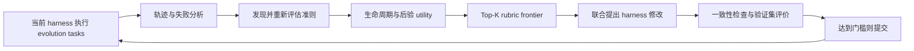

像每轮复盘先更新问题清单，再动流程，最后用另一组实际任务验收；不能用检查表分数直接代替任务成绩。

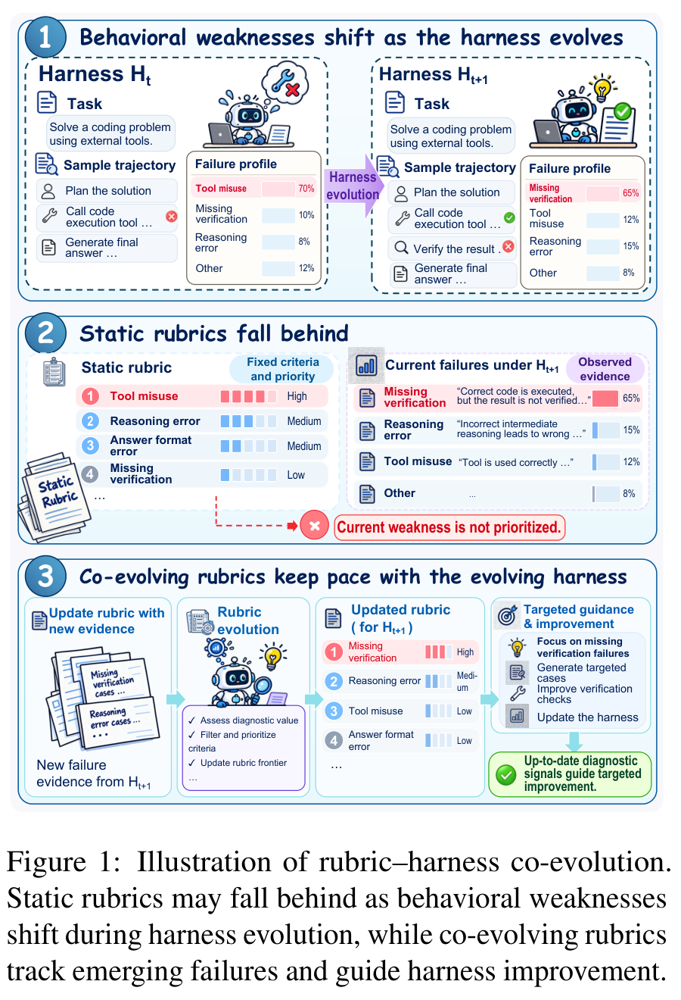

Figure 1：展示静态 rubric 可能落后于行为变化的动机，图内示意百分比不用于下文实验比较。

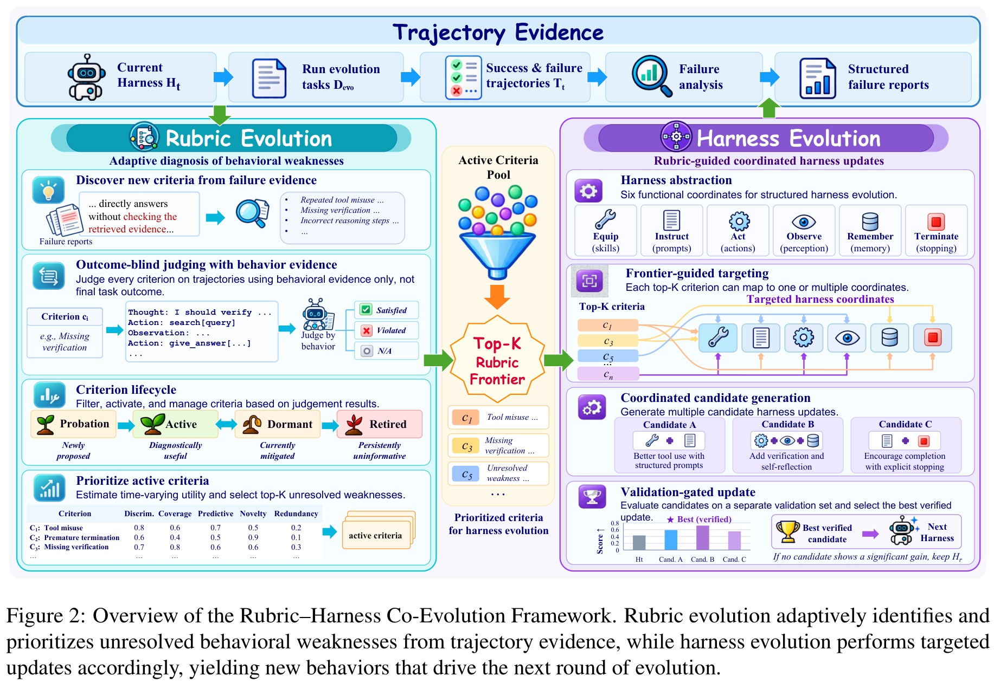

Figure 2：Rubric Evolution 与 Harness Evolution 是两个耦合过程，验证门控仍依据独立任务表现。

### 4.2 从轨迹得到可比较的诊断

每条 criterion 在每条 trajectory 上得到三个标签之一；N/A 表示所描述行为没有出现，Satisfied 表示出现且处理正确，两者不能合并。新准则经过 birth check：N/A 超过 80%、失败轨迹中从不触发 violation、或整体与成功轨迹 violation rate 都超过 90% 时被拒绝。

接着计算五项 utility。下式合成区分成功与失败、覆盖当前失败、预测失败、新发现与冗余惩罚：

$$
U_{t+1}(c)=\alpha D_{t+1}(c)+\beta C_{t+1}(c)+\gamma P_{t+1}(c)
+\delta N_{t+1}(c)-\lambda\mathrm{Red}_{t+1}(c).
$$

$c$ 是准则；$D$ 为成功与失败轨迹 violation rate 之差；$C$ 为失败轨迹中被该准则抓到的比例；$P$ 为 violation 对失败的预测增量；$N$ 是仅该准则识别出的失败占全部失败的比例；$\mathrm{Red}$ 为与其他准则 violation 集合的最大 Jaccard overlap。所有分量和 $U$ 都是标量。原文设 $\alpha=\gamma=1.0$，$\beta=\delta=\lambda=0.5$。

为明确 $P$ 在算什么，它比较看到 violation 后的失败概率和 criterion 可适用样本的基础失败概率：

$$
P(c)=\Pr(\mathrm{fail}\mid\mathrm{violated})-
\Pr(\mathrm{fail}\mid\mathrm{applicable}).
$$

fail 是任务失败事件，violated 是行为违反准则事件，applicable 是非 N/A 的样本集合。差值大表示 violation 更能提示失败，仍然是统计关联，不是证明修复此行为一定提升结果。

### 4.3 后验与准则生命周期

每条准则建立 pass/fail 与 Violated/Satisfied/N/A 的 $2\times3$ 计数表。六格各加 Jeffreys prior 0.5，形成 Dirichlet posterior；抽 2000 次，每次联合重算 $D,C,P$，$N$ 与 Red 保持原观测集合的值。

下面的排序使用 utility posterior 的低分位，抑制仅由少量样本支撑的高分：

$$
\tilde U_{t+1}(c)=Q_q[p(U_{t+1}(c)\mid T_t)],\qquad
\hat R_{t+1}=\operatorname{TopK}_{c\in R_{t+1}^{\mathrm{active}}}\tilde U_{t+1}(c).
$$

$T_t$ 是当前轨迹证据；$Q_q$ 为第 $q$ 分位数，$q=0.2$；$R^{\mathrm{active}}$ 为 active 准则集合，$K=10$；$\hat R$ 是 rubric frontier。这个后验覆盖计数不确定性，不覆盖 judge 系统性误判或所有新准则的选择偏差。

probation 在 $P>0$ 后进入 active；active 连续三轮 trigger rate 低于 5% 等条件会转 dormant；dormant 的触发率达到 15% 可回 active；持续无诊断价值则 retired。退役是终态。像整理维修清单，修过的问题可以保留监控，但不必每天占据首要位置。

### 4.4 从 frontier 到 harness

六坐标保持原名：Equip、Instruct、Act、Observe、Remember、Terminate。criterion 可以映射多个坐标；每个候选最多修改三个组件。轻量 verifier 检查修改与诊断证据是否一致，只接受或拒绝，不改写候选，也不预测任务得分。

最后用独立 validation score 选择候选，只有超过当前 harness 的门槛才提交：

$$
H_t^*\in\arg\max_{H\in\mathcal H_t^{\mathrm{cand}}}S(H,D_{\mathrm{val}}),\qquad
H_{t+1}=\begin{cases}
H_t^*,&S(H_t^*,D_{\mathrm{val}})-S(H_t,D_{\mathrm{val}})>\epsilon,\\
H_t,&\text{otherwise}.
\end{cases}
$$

$\mathcal H^{\mathrm{cand}}$ 是最多三个候选，$S$ 是 validation 平均任务分数，$D_{\mathrm{val}}$ 不参与 evolution，$\epsilon=0.05$。原文未清楚统一该阈值的归一化尺度，因此不擅自换算成百分点。没有过门槛时保留旧 harness，每轮最多采纳一次。

## 5. 实验结果

**实验设置六件事**

- 数据集与切分：EvoAgentBench 五域，基于 BrowseComp-Plus、GDP-Val、SWE-Bench、LiveCodeBench、OmniMath。evolution/validation/test 分别为 Information Retrieval 100/54/65、Knowledge Work 60/36/50、Software Engineering 45/26/36、Code Implementation 128/54/86、Math Reasoning 380/98/100。原训练集再拆 evolution/validation，原 test 保留；删除少量无法可靠运行任务，但具体剔除清单原文未给。
- 骨干模型：Qwen3.5-35B-A3B、GLM-4.7-Flash，底层为 DeepAgent。执行、诊断与进化都用相应 backbone 本身，模型权重保持固定。
- 训练预算：这里是外部状态进化，没有梯度微调；每轮最多三个候选、每候选最多三个组件、最多接受一个，frontier Top-10。图示跨 0–10 rounds；逐设置总 token、API 调用、运行时长与算力费用原文未给，不能当成训练免费。
- 基线：Vanilla Agent、ACE、EvoSkill、Self-Harness、AHE、Meta-Harness；初始 harness、任务划分、环境与评价保持一致。作者称匹配 evolution rounds、candidate budgets、validation selection，完整成本比较未单列。
- 指标：Pass@1，按各域 benchmark evaluator 判分；Average 是五域 macro-average。另有 frontier Jaccard similarity、violation rate、coverage、core diagnostic value；三种子稳健性仅覆盖两个代表性 backbone–task 设置。
- 推理设置：原文未给 temperature、token 上限、工具轮数与独立 judge 的具体解码参数；模型执行与自评均由 backbone 完成。任务 evaluator 的详细版本和知识工作评分过程未在本文完整展开，不补造裁判模型。

像比较两套管理流程，要把参与复盘的任务与最后考试分开，也要把人工式自评次数计入预算。

| 模型 / 任务 | 指标 | RuHarness | 最强基线 | 提升 |
| --- | --- | --- | --- | --- |
| Qwen3.5 五域 Held-in | macro-average Pass@1 | 62.4 | Meta-Harness 60.7 | +1.7 |
| Qwen3.5 五域 Held-out | macro-average Pass@1 | 53.7 | AHE 49.2 | +4.5 |
| GLM 五域 Held-in | macro-average Pass@1 | 43.3 | Self-Harness 40.6 | +2.7 |
| GLM 五域 Held-out | macro-average Pass@1 | 38.0 | Self-Harness 32.7 | +5.3 |

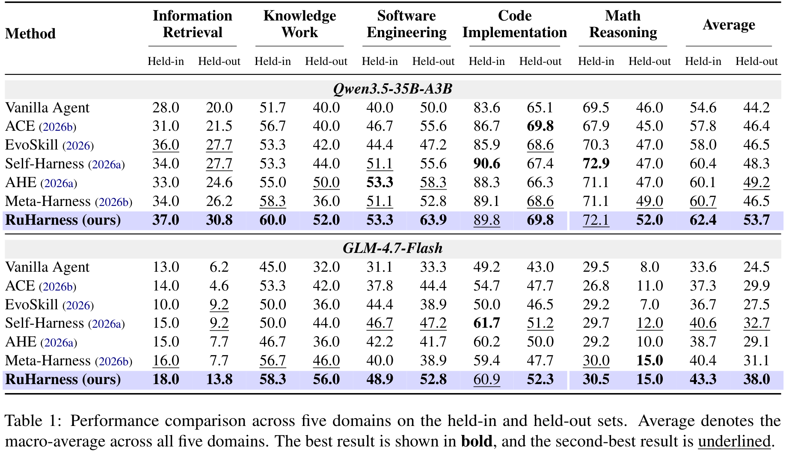

Table 1：宏平均领先不代表每个单域都赢，Qwen 的 Code Implementation held-in 低于 Self-Harness，部分 held-out 项也有并列。

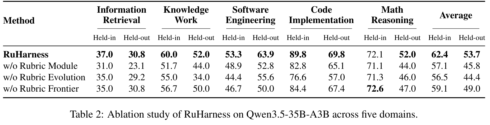

Table 2：固定 rubric 的 held-out 为 44.4，低于移除 rubric 的 45.8，也低于完整方法 53.7；说明过时指导可能有害，但仍是组合消融结果。

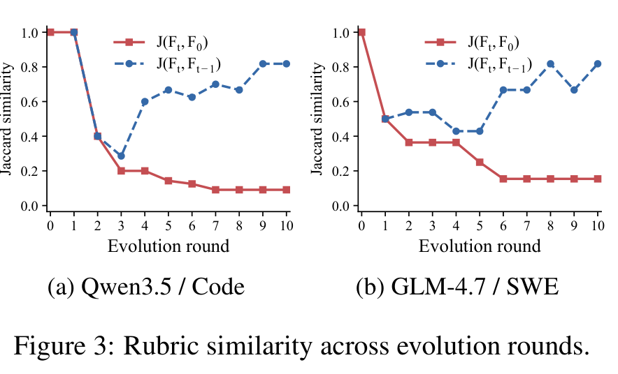

Figure 3：frontier 与初始集合的相似度下降，与前一轮的相似度后期稳定，支持诊断重点发生迁移；准则 ID 变化不完全等于语义变化。

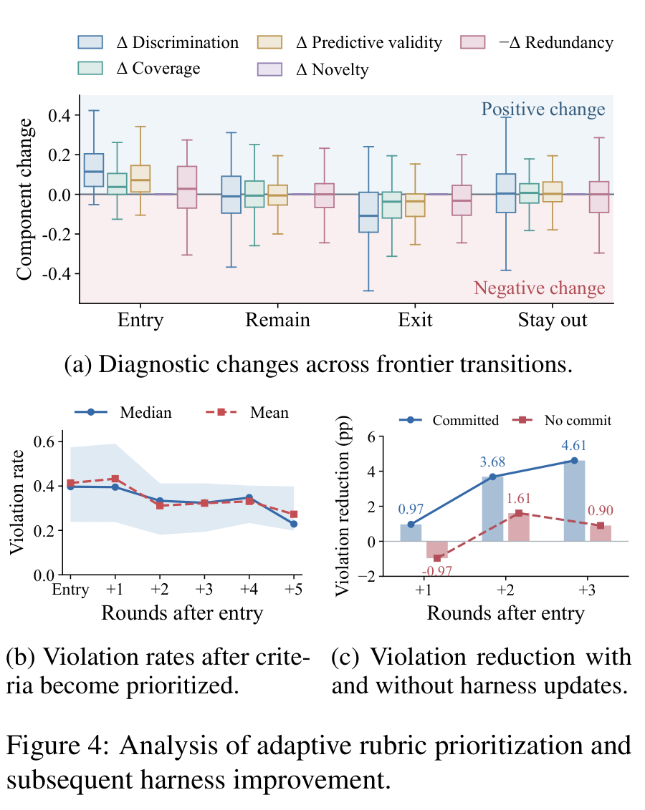

Figure 4：进入 frontier 后 violation rate 延迟下降，Committed 比 No commit 更持续改善；两组非随机分配，不能直接当成 frontier 的因果效应估计。

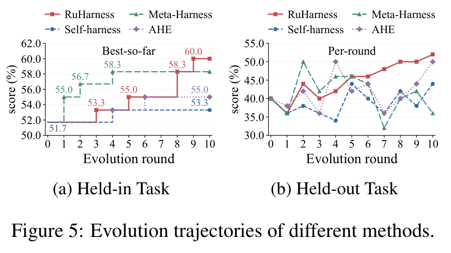

Figure 5：held-in 是 best-so-far，held-out 是 per-round，两条曲线的波动定义不同；前者单调不能用来证明每次更新都改善。

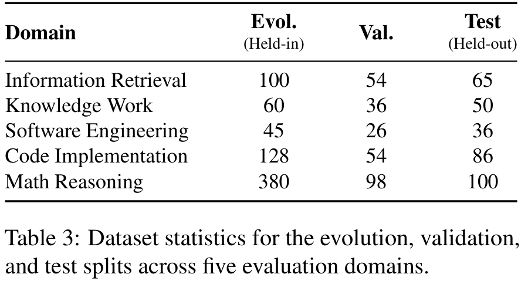

Table 3：各域 test 规模差别很大，最终 Average 按域平均，不按任务数加权。

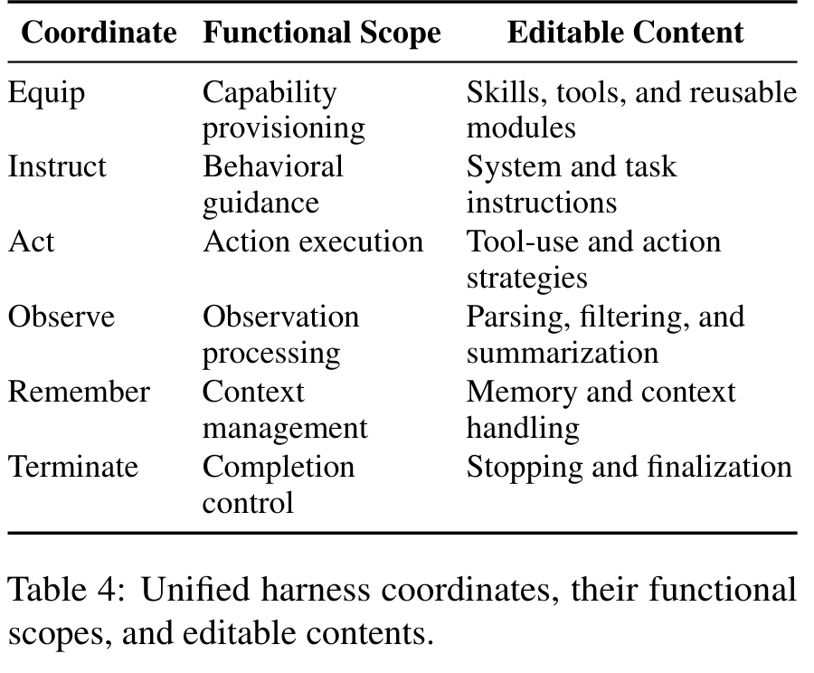

Table 4：六坐标约束了可编辑接口；harness 更新没有权限改变 benchmark 的任务目标和 evaluator。

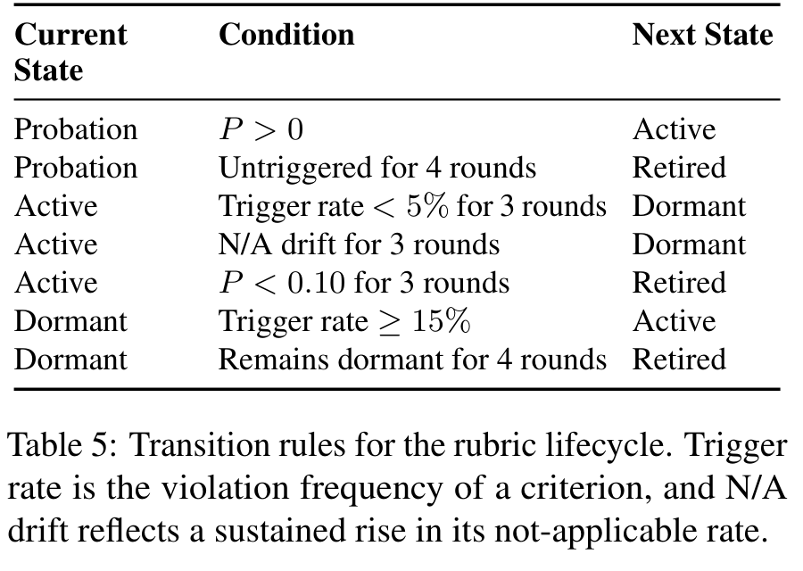

Table 5：激活、休眠和退役有明确阈值，criterion pool 不是无限累积；这些硬阈值仍是方法超参数。

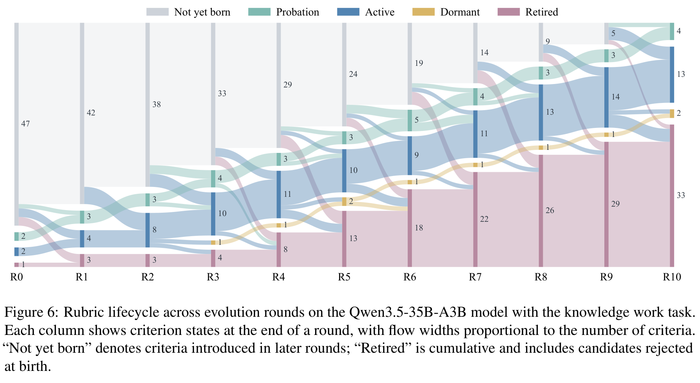

Figure 6：active、dormant、retired 持续流转；图中的 retired 还计入 birth rejection，不能把总量都理解为正式激活后退役。

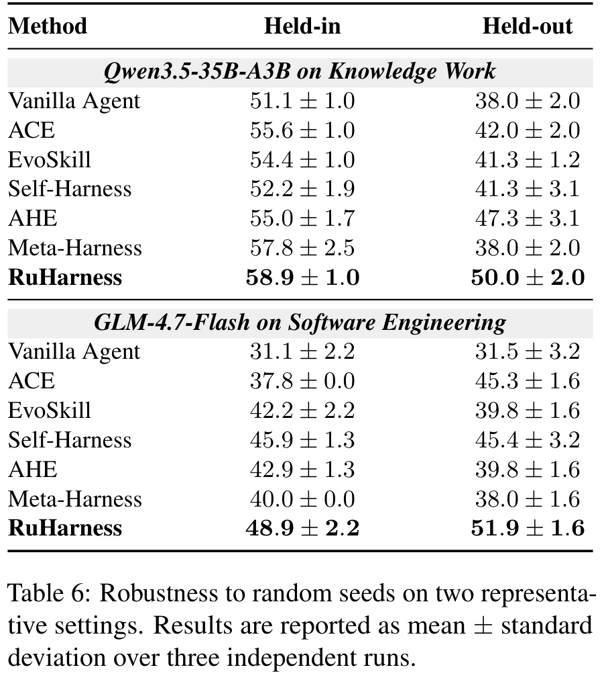

Table 6：两个代表性设置的三次独立运行仍保持均值优势，但不应写成五域全部结果都有三 seed 方差。

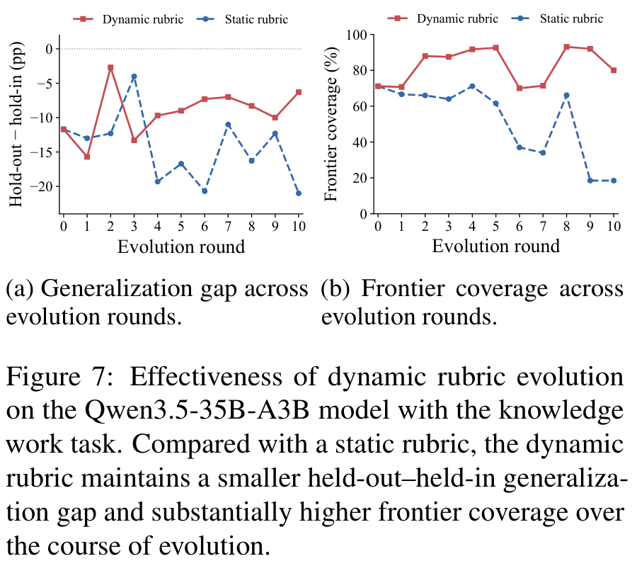

Figure 7：dynamic rubric 后期保持较高 failure coverage，static rubric 逐渐失去覆盖；generalization gap 定义为 held-out 减 held-in，负值更大表示差距更大。

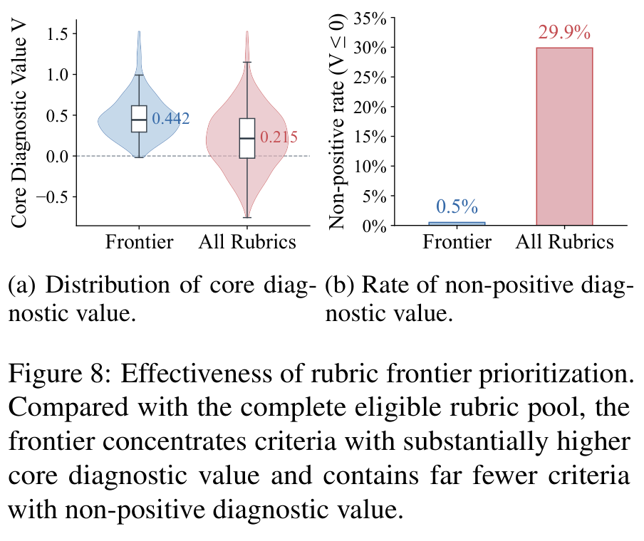

Figure 8：frontier 富集更高的 core diagnostic value；但筛选本来就依赖相关分数，这一图主要是机制核对，不是独立泛化证明。

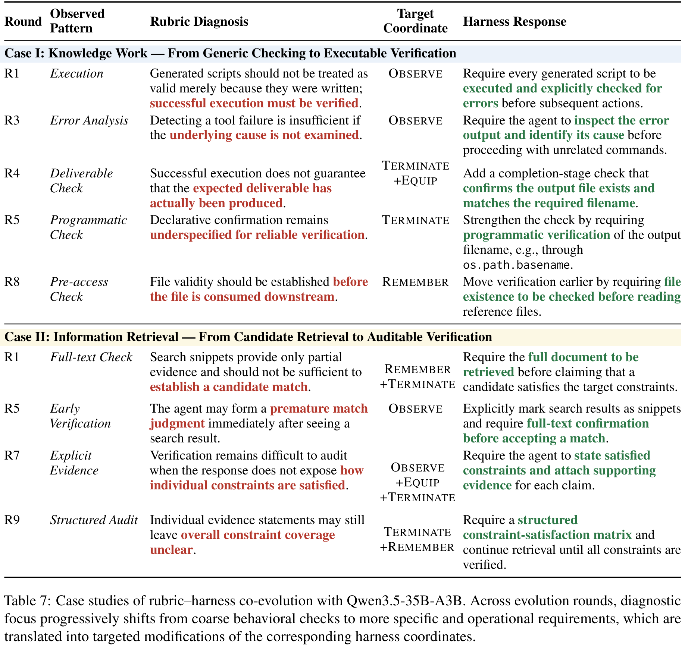

Table 7：案例从检查代码是否执行，细化为错误分析、产物核验和提前检查；它展示可操作诊断如何变细，不代表所有轮次都产生新能力。

## 6. 局限性

**作者承认的**：仅在单一底层 agent framework 内验证六坐标抽象；固定 evolution horizon 限制了对更长期、开放式适应的理解。像一种维修清单在一家工厂有效，换一套设备接口还需要重新试。

**我的判断**：同一模型负责执行、发现问题和行为判定，其盲点可能共同存在；outcome-blind 不能消除从内容猜出成败或系统性误判。$D,C,P$ 反映相关性，某行为可能只是任务困难的标志，修它未必改变结局。固定 validation 反复选候选仍可能过拟合，单次门槛不构成全程泛化保证。birth check 会过滤少适用准则，罕见但严重的失败可能得不到优先处理。

**实验边界**：未完整给出生成与评审成本、解码参数和任务剔除清单；主表缺少全域多种子结果。Figure 4 的 Committed/No commit 存在选择差异，Figure 8 的分数富集与筛选规则并不独立。准则同义合并、重命名与稳定 ID 规则不够明确，也可能影响 Jaccard turnover 的解释。

## 7. 一句话总结

RuHarness 像让教练的检查表跟着学生进步，再由另一组任务决定流程修改是否值得保留；底层模型没有因此被重新训练。最值得带走的是诊断与干预的双反馈环，而不是让自评分数不断升高。对于长期自改进，验证集门控和准则更新都只是缓解偏差的工具，仍需独立 held-out 结果来检验。

## 8. 可复用点

先给当前 agent 的 failure reports 建稳定 criterion ID，记录行为证据、适用性与任务结果，避免每轮换措辞就当成新问题。像给维修故障编号，只有标识一致才能追踪旧问题是否复发。

将发现准则的任务、选修改的 validation 和最终 test 分开；先比较 Static rubric、无 rubric 与动态 Top-K，再尝试 posterior ranking。候选修改保留变更假设、目标坐标和回滚点，同时统计 token 与工具成本。通用机制已抽成 [[../../../30 方法卡片/行为准则的后验前沿筛选]]。

## 9. 我的疑问

- 若某个罕见 failure 对最终交付极严重，是否应绕过适用率筛选，保留单独的硬约束清单？像低频火警不能因为少见就退出检查表。
- 用独立且异构 judge 重新标注一部分轨迹后，frontier 排名会改变多少？
- 更换 validation 子集或限制同一验证任务被查询次数，收益还能维持吗？这些问题属于我的分析，论文没有给出对应完整实验。

基准同步：BrowseComp-Plus、SWE-bench、LiveCodeBench 与 pass@k 母条目不动；新增 EvoAgentBench、GDP-Val 和 Jaccard similarity。OmniMath 仅在现有表正文提及，按本轮只补“缺”条目的约束不改已有正文，具体使用规模在本笔记保留。
