> 一句话：把有限的采样次数按题目难度重新分配，让每道题都贡献学习信号。

来源：联网取到的 arXiv 原始 PDF，v1，22 页（正文 1–12 页、参考文献 13–14 页、附录 A–F 15–22 页全部读过）；PDF 存于工作区 `papers/bamdp-rollout/paper.pdf`，由 pymupdf 裁出 8 张图 3 张表的原图。本文没有复现训练，下面所有数字都是论文报告值。

## 0. 读之前你需要知道

**GRPO（Group Relative Policy Optimization）**：一种大模型后训练用的强化学习算法，对同一道题采一组答案，只用这组奖励的相对高低来算每个 token 的更新权重，省掉 PPO 那个价值网络。像老师让同一个学生把同一道题做八遍，只看这八份卷子里哪份比平均分高，不去预估这一份绝对值多少分。

**rollout**：模型对一道题的一次完整作答采样，一次模拟考。**rollout budget（采样预算）**：允许采多少次。**vanilla GRPO**：本文对每题固定采 G 条的普通 GRPO 的称呼。

**advantage（优势）**：GRPO 的更新权重，等于该条奖励减组内均值、再除以组内标准差。全组同分时标准差为零、优势也为零，这条样本对参数更新没有任何作用。

**二元奖励（binary reward）**：本文只判最终答案对错，取 `1` 或 `0`，不看推理过程和部分正确。

**BAMDP（Bayes-Adaptive MDP，贝叶斯自适应马尔可夫决策过程）**：转移概率未知时，把对未知参数的信念（belief）写进状态，让决策者边采边修正判断。像医生不知道一种药的真实有效率，但每开一次就按疗效更新判断，同时决定下一个病人用不用。

**Beta 信念（Beta belief）**：对成功率 p 的信念分布，`Beta(α, β)` 里 α 记成功次数、β 记失败次数，均值 `α/(α+β)`；起点 `Beta(1, 1)` 表示完全不知道，先当成均匀分布。

**训练效用（training utility）`U`**：本文自定义的一个数，衡量这批题采完之后对训练有多大用。它有六种写法，记作 `U1` 到 `U6`。

**它站在谁肩上**

- PPO（2017）：用价值网络估优势，稳但要额外养一个模型，显存与算力都贵。
- GRPO（2024 / 2025）：去掉价值网络、改用组内相对奖励，是本文的底座。
- DAPO（2025）、Dr. GRPO（2025）：分别改裁剪方式与归一化，走的是改目标函数、改优势算子的路线，与本文改采样分配正交。
- BAMDP（Duff 2002, 2003）：未知转移概率写成信念分布的经典框架，本文把它接到 rollout 分配上。

## 1. 动机

一个家教带三十个学生，每人每晚固定做八道题。有人两道就会了，剩下六道纯属重复；有人的八道全错，一道没做对，第二天还是不会。家教的时间固定，八这个数字却对所有人一样。

**以前怎么做**：vanilla GRPO 给 batch 里每道题都采同样多的 G 条。

**为什么不行**：一道题对梯度的贡献全靠它组内的优势。全对或全错时组内奖励一样，优势恒为零，这道题等于没进 batch。作者的原话是 "identical rewards yield zero advantages, resulting in no learning signal"，说的是同一组奖励完全相同就得到零优势、也就没有学习信号。反过来，中等难度的题两三条就够看出对错。固定预算同时造成两头浪费：难题采不够，简单题采过头。

这不是个别现象。图 1 用 Llama3.2-3B-Instruct 在训练集上统计第一次答对发生在第几条 rollout，MATH 里 `41.48%` 的题一次就对，但 `9.50 + 6.40 + 3.72 + 2.65 + 1.68 + 4.55 = 28.50%` 的题要八条以上才第一次答对，还有 `4.55%` 到 128 条都没对；GSM8K 更极端，`74.51%` 一次就对。

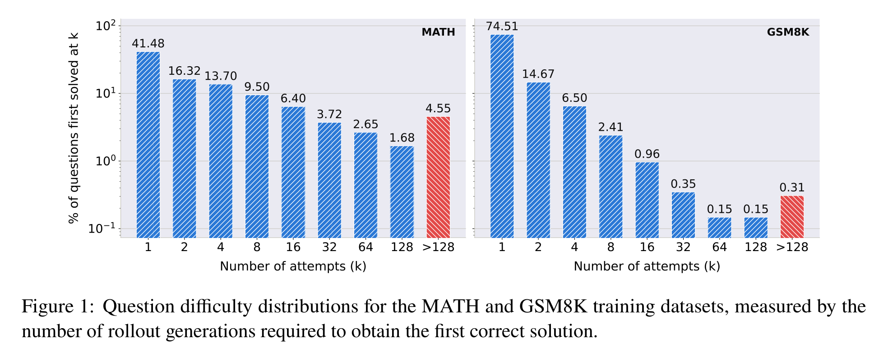

图 1：同一份训练集内部的难度跨度足够大，一个统一的 G 不可能同时适合 1 次就对的题和 128 次都没对的题。

**为什么现在能做**：推理型 RL 的 rollout 已是训练主成本之一，采样预算本身成了可优化的资源；一道题当前成功率可以只用二值结果在线更新，不需要额外模型；再把 batch 压到极小（`B = 4`），使枚举所有可能信念状态并建表在算力上可行。

## 2. 贡献

像后厨只有一口灶，把出菜顺序按哪桌快好了来排，而不是均匀地每隔一会儿给每桌上一道。

- **把分配写成带预算约束的整数优化问题**。目标是最大化期望训练效用，约束是总 rollout 数等于 vanilla GRPO 的 `N = B · G`。证据：式 (5)。
- **把一次性分配拆成顺序决策**。horizon 为 N 的有限期 MDP，每步动作是选一道题给它加一条 rollout。证据：式 (10)–(12)。
- **用 BAMDP 处理未知成功率**。成功率 p_j 未知且随训练漂移，用 Beta 信念替代，写出闭式 Bellman 更新。证据：式 (13)–(16)。
- **离线求解、在线零开销**。值迭代（value iteration）只在训练前跑一次，得到查表策略 φ*，训练时只查表。证据：Algorithm 1 与复杂度 `O(BN^{2B})`。
- **同预算下的实测提升**。三种 loss type（vanilla GRPO、Dr. GRPO、DAPO）× 四种模型 × 四个数据集共 42 组原始 vs +Ada. 的配对对照，全部为正。证据：表 2。

第 5 条我逐格核过表 2：42 个 `+ Ada.` 单元格都大于同列 `Def.`，没有反例。

## 3. 创新点

**把给多少换成下一条给谁**。对比对象是难度过滤这类启发式：先算一条规则把太难的题跳过、把全对全错的组丢掉，再对剩下的题平均分。本文把分配写成一个有终局效用的决策序列，每一步都按已经看到的奖励重算。有用是因为：难题不是该丢而是该多给，启发式丢掉它，本文给它加预算。像考试前撕掉太难的题，和给难题多留时间但绝不撕题，是两种策略。

**效用函数显式化**。什么算有用的训练信号，在本文里是一个能写下来的函数（`U1` 到 `U6`），而不是隐含在过滤器里。有用是因为换一种效用就换一种策略，离线各算一次就能横向比六种。

**用共轭先验把 BAMDP 做成可精确求解**。常见做法是用采样或近似推断处理未知转移；这里 Beta 与 Bernoulli 共轭，使转移概率正好等于后验均值，Bellman 更新有闭式，值迭代能精确做，不用蒙特卡洛。有用是因为离线一次、结果确定、可复现。

**信念状态替代原始状态**。作者指出 α、β 就是成功与失败计数，因此完全决定了式 (10) 的 `(n_j, n^s_j)`，BAMDP 状态不必再存原始状态。有用是因为状态维度砍一半，表小一半。

## 4. 方法

### 4.1 整体流程

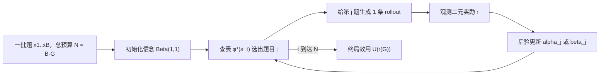

一句话：这条链路是看一条、改一次信念、再决定下一条给谁，花的 rollout 条数与 vanilla GRPO 一样多。像打牌时每摸一张就重算一次该往哪里押注。

图 2 是作者给的整体示意：vanilla 给四道题各 4 条；AdaRoll 给 Q1 五条、Q2 两条、Q3 两条、Q4 七条，总量仍是 16。

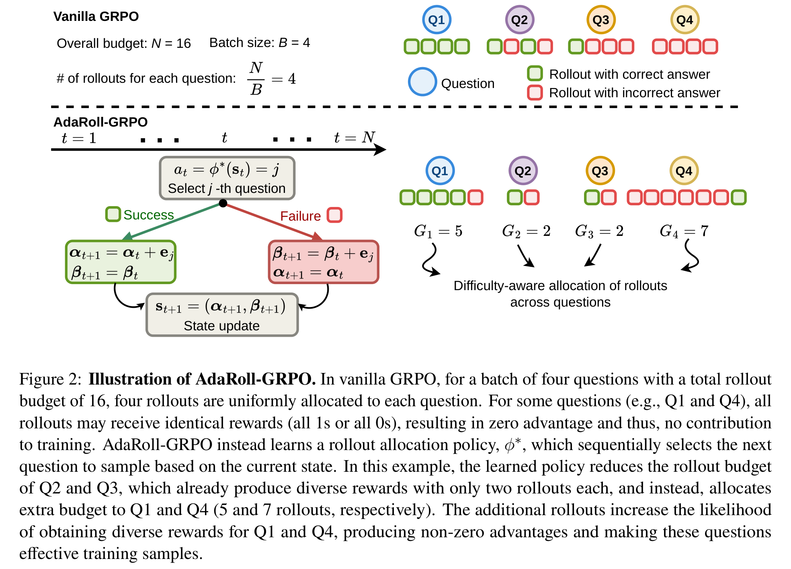

图 2：同样 16 条预算，策略把预算从两条就够看出好坏的 Q2、Q3 挪给八条全是同一个结果的 Q1、Q4，让后者有机会出现非零优势。

图 3 是论文用来开场的最小例子：左边那道 GSM8K 题第二次就答对，右边那道第十次才答对；`G = 8` 时右边整组全错、优势为零，左边的 8 条则纯属浪费。

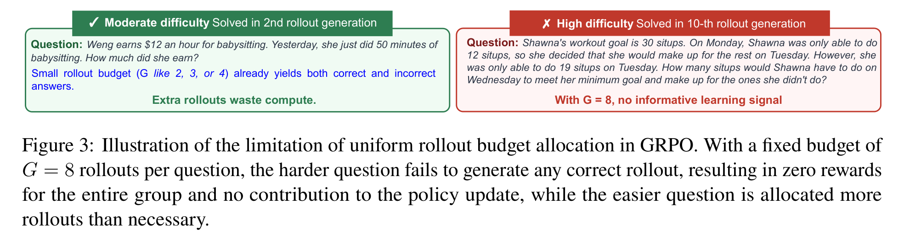

图 3：固定 G 的失败方式不是单纯采少了或采多了，而是同一批里两种错误同时发生。

### 4.2 模块拆解

**模块一：训练效用 U**

为什么需要：不写清楚什么叫有用，分配就没有目标。作者给了六种写法，前三种在主文，后三种在附录 A。

怎么做：先把每题的 rollout 奖励收成一个统计量，再在 batch 上做 min 或 sum。

先看被反复用到的单题奖励方差：

$$
\mathrm{Var}_j=\frac{1}{G_j}\sum_{i=1}^{G_j}\left(r_j^i-\mathrm{mean}\{r_j^1,\dots,r_j^{G_j}\}\right)^2
$$

这个式子在算第 j 题这一组的奖励有多不一致。

- $G_j$：分给第 j 题的 rollout 条数，非负整数，满足 $\sum_j G_j=N$。
- $r_j^i\in\{0,1\}$：第 j 题第 i 条 rollout 的二元奖励。
- $\mathrm{mean}\{\cdot\}$：这组奖励的均值，也就是这题的经验成功率。

六种效用：

$$
\begin{aligned}
U_1&=\min_{1\le j\le B}\mathrm{Var}_j, &\quad U_2&=\min_{1\le j\le B}\sum_{i=1}^{G_j}\left|A_j^i\right|^2,\\
U_3&=\sum_{j=1}^{B}\max_{1\le i\le G_j}r_j^i, &\quad U_4&=\min_{1\le j\le B}\max_{1\le i\le G_j}r_j^i,\\
U_5&=\sum_{j=1}^{B}\mathrm{Var}_j, &\quad U_6&=\sum_{j=1}^{B}\sum_{i=1}^{G_j}\left|A_j^i\right|^2.
\end{aligned}
$$

这一组式子在算整批数据合起来值多少：min 版要求最差的那道题也达标，sum 版只要总量大就行。

- $B$：一个 batch 里的题目数，本文实现里是 4。
- $A_j^i$：第 j 题第 i 条 rollout 的优势，沿用 GRPO 的组内标准化。
- $U_1,U_2,U_4$：min 型，逼策略照顾最弱的题。
- $U_3,U_5,U_6$：sum 型，允许把预算压在少数题上。

主实验最终采用 `U1`（minimum reward variance）。

这里有一个作者没写、但我认为要紧的性质：二值奖励下经验方差恰好等于 $\bar p(1-\bar p)$（其中 $\bar p$ 是这题的经验成功率），全对或全错时它等于 0；`U1` 取组内最小，所以只要 batch 里有一道题全对或全错，`U1` 就等于 0，此时大量动作的最优值并列、策略退化成由并列打破规则决定。**这是我的推断**，它解释了后文图 7 里 `AdaRoll-GRPO-Min-V` 的一些反直觉行为。

**模块二：把分配写成 MDP**

为什么需要：式 (5) 的目标值依赖尚未生成的 rollout 奖励，是典型的在线决策，不能先定分配再打分。

怎么做：把分配多少条换成下一条给谁，走 N 步。

$$
\max_{\mathbf G\in\mathbb N^{B}}\ \mathbb E_{r(\mathbf G)}\left[U\big(r(\mathbf G)\big)\right]\quad \text{s.t.}\quad \sum_{j=1}^{B}G_j=N
$$

这个式子是原始的整数规划：在总预算固定的前提下选一个分配向量，使期望效用最大。

- $\mathbf G=(G_1,\dots,G_B)$：分配向量，每项是非负整数。
- $r(\mathbf G)$：按这个分配采出来的奖励集合，是随机变量。
- $N=B\cdot G$：总预算，与 vanilla GRPO 完全一致，这是全文公平性的支点。

状态、动作、转移、奖励四件套：

$$
\mathbf s_t=\left((n_{1,t},n^s_{1,t}),\dots,(n_{B,t},n^s_{B,t})\right)
$$

这个式子是第 t 步的账本：每道题采了几条、其中几条对。

- $n_{j,t}$：到第 t 步为止分给第 j 题的 rollout 总数。
- $n^s_{j,t}$：其中答对的条数。
- 动作 $a_t\in\{1,\dots,B\}$：选一道题再加一条 rollout。

$$
(n_{j,t+1},n^s_{j,t+1})=
\begin{cases}
(n_{j,t}+1,\ n^s_{j,t}+1), & \text{以概率 } p_j,\\
(n_{j,t}+1,\ n^s_{j,t}), & \text{以概率 } 1-p_j .
\end{cases}
$$

这个式子是转移：被选中的题计数加一，答对则成功计数也加一。

- $p_j$：模型对第 j 题答对的真实概率，未知，正是本文要消掉的东西。

$$
r_t^{\mathrm{MDP}}=
\begin{cases}
0, & t=1,\dots,N-1,\\
U\big(r(\mathbf G)\big), & t=N .
\end{cases}
$$

这个式子是奖励设定：中间步骤一律不给分，只在最后给一次训练效用。

这一点很关键：**奖励不是信息增益**。信息增益没有被显式奖励，它是通过看一条 rollout 会改信念、从而改后续动作，隐式进入 Bellman 递推的；终局奖励就是训练效用本身。

**模块三：BAMDP 与 Beta 信念**

为什么需要：p_j 每轮训练都在变，式 (11) 的转移概率在训练时根本不知道。

怎么做：给每题一个 Beta 信念，看一条更新一次。

$$
\hat p_j^{\,t}=\frac{\alpha_j^t}{\alpha_j^t+\beta_j^t},\qquad
\alpha_j^{t+1}=\alpha_j^t+r_t,\qquad \beta_j^{t+1}=\beta_j^t+1-r_t
$$

这个式子是信念的两步：先用后验均值当当前成功率的点估计，再用观测到的 0/1 更新计数。

- $\hat p_j^{\,t}$：第 j 题成功率的后验均值，也正好是转移概率。
- $\alpha_j^t,\beta_j^t$：到第 t 步为止的成功与失败计数，初值都是 1（均匀先验）。
- $r_t\in\{0,1\}$：这一步新观测到的奖励。

因为 Beta 与 Bernoulli 共轭，后验仍是 Beta，所以增广信念状态（augmented belief state）就是两个整数向量 $(\boldsymbol\alpha^t,\boldsymbol\beta^t)$，而且它完全决定模块二的状态 $\mathbf s_t$。像记账：每笔只记进对应科目，账面余额本身就是全部历史。

**模块四：值迭代求解**

为什么需要：策略要能在训练时直接查。

怎么做：从终点往回推，每步取最大。

$$
V(\boldsymbol\alpha^t,\boldsymbol\beta^t)=\max_{j\in\{1,\dots,B\}}\left[\hat p_j^{\,t}\,V(\boldsymbol\alpha^t+\mathbf e_j,\boldsymbol\beta^t)+\left(1-\hat p_j^{\,t}\right)V(\boldsymbol\alpha^t,\boldsymbol\beta^t+\mathbf e_j)\right]
$$

这个式子是 Bellman 最优方程在本问题上的具体形态：选一道题，两种结果各自的价值按后验均值加权。

- $\mathbf e_j$：第 j 个标准基向量，作用是给第 j 题的成功计数加一。
- 两个加项分别对应这条答对与这条答错。
- 边界条件 $V(\mathbf s_{N+1})=U(r(\mathbf G))$，终局效用直接从最终计数读出。

算法 1 就是从 t=N 倒推到 1 的双层循环，外层 t、内层枚举所有可达信念状态，每步存 argmax 动作，最后得到查表策略 φ*。

### 4.3 关键细节

**复杂度**：离线值迭代 `O(BN^{2B})`，可达信念状态数约 `N^{2B}`，每个状态评估 B 个动作。对固定 B 是 N 的多项式，且只做一次。这也是全文最硬的约束：B 一大表就爆。

**实际规模**：Llama-3.1-8B-Instruct 的实验用 D=2 张卡、per-device batch `B_dev=2`、梯度累积 `A=8`、平均 `G=8`，代入作者给的全局 batch 公式 `n_p = B_dev·A·D/G` 得 `B = n_p = 4` 道题，每卡预算 `N = n_p·G/D = 16`。也就是说这张值函数表是 B=4、N=16 这一档，算一次后复制到所有卡。

**查表与训练解耦**：训练时把每个信念状态映射到下一题选谁，不引入在线优化；作者的说法是 "reduced to a simple table lookup, incurring no additional online computational cost"，指训练时退化为一次查表、不产生额外在线计算开销。像提前印好一张所有情况的对照表，现场只翻表不算式。

**num_generations 语义变了**：vanilla GRPO 里它就是 G；AdaRoll 里它变成平均每题条数，实际每题拿多少由策略定。表 4 写作 `4 / 8 / 16`，正文 E.2 说设为 8，两处口径不完全一致，我按 8 理解。

**训练超参**（表 4）：AdamW、cosine、全参数微调、`β = 0`（无 KL 正则）、per-device batch 2、梯度累积 8、最大生成长度 1024、1 个 epoch、`num_iterations = 2`；学习率按模型分别是 `1e-6`（两个 Llama）、`5e-6`（Gemma 3-4B-IT）、`2e-5`（Qwen 2-Math-1.5B）。

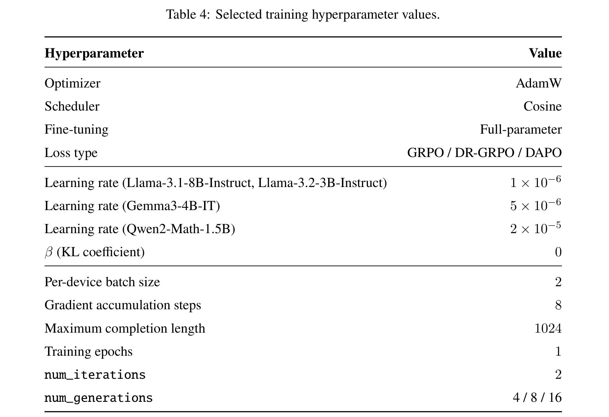

表 4：超参基本走 TRL 默认值加 DAPO 推荐值，唯一按模型单独调的只有学习率。

## 5. 实验结果

**实验设置**

- **数据集与切分**：GSM8K 用完整训练集训练、官方 test split 评测；MATH 用前 4,000 条训练、MATH500（500 题）评测；LogiQA 用前 5,000 条训练、官方 test split 评测；CoLoTa 无官方切分，作者随机取 90% 训练、10% 测试。每个 batch 的题都来自同一数据集。
- **骨干模型**：Llama 3.1-8B-Instruct、Llama 3.2-3B-Instruct、Gemma 3-4B-IT、Qwen 2-Math-1.5B，全部全参数微调。（表 4 写作 `Gemma3-4B-IT`、`Qwen2-Math-1.5B`，无空格；正文带空格。原文自己不一致。）
- **训练预算**：1 个 epoch、每卡 batch 2、梯度累积 8、全局 batch `B = 4` 道题、每卡 rollout 预算 `N = 16`、最大生成长度 1024 tokens；8B 模型用 2 张 NVIDIA H100 SXM5 80GB，其余 1 张。训练样本数等于各数据集训练规模（GSM8K 全量、MATH 4000、LogiQA 5000、CoLoTa 的 90%）。梯度步数原文只以曲线横轴给出（最多约 3,500 步），未单列。
- **基线**：三种 loss type（vanilla GRPO、Dr. GRPO、DAPO），每种都与自己的 + Ada. 版配对。注意这里的 DAPO 只是 loss 层面变体（asymmetric clipping、去掉 KL），不含它的 dynamic sampling。
- **指标**：`exact-match accuracy`，生成的最终答案与标准答案完全一致才算对，越高越好；分析图另用 `normalized relative improvement`（图 4 纵轴 `% Improvement`）与数据集难度分布的 `entropy`。
- **推理设置**：图 1 的难度统计用 `max_new_tokens = 1024`、`temperature = 0.8`、`top_p = 0.95`；**最终评测的解码配置原文未给**，是否贪心、几票、答案抽取规则都没写。

**主结果**

表 2 是全篇主表。为了看清改分配到底值多少，我从三种 loss 里取 `Def.` 最高的一列作最强基线，再用同列的 `+ Ada.` 作本文结果：

| 模型 / 数据集 | 最强基线（`Def.`） | 本文（`+ Ada.`） | 提升 |
| --- | --- | --- | --- |
| Llama 3.1-8B / MATH | 46.60（DAPO） | 49.40 | +2.80 |
| Llama 3.1-8B / GSM8K | 83.32（DAPO） | 86.35 | +3.03 |
| Llama 3.1-8B / CoLoTa | 50.00（vanilla） | 58.24 | +8.24 |
| Llama 3.1-8B / LogiQA | 43.47（DAPO） | 46.24 | +2.77 |
| Llama 3.2-3B / MATH | 37.20（DAPO） | 39.80 | +2.60 |
| Llama 3.2-3B / GSM8K | 73.54（vanilla） | 75.21 | +1.67 |
| Llama 3.2-3B / CoLoTa | 55.29（DAPO） | 59.41 | +4.12 |
| Llama 3.2-3B / LogiQA | 31.18（vanilla） | 37.02 | +5.84 |
| Gemma 3-4B-IT / MATH | 65.80（Dr. GRPO） | 68.40 | +2.60 |
| Gemma 3-4B-IT / GSM8K | 87.04（Dr. GRPO） | 89.31 | +2.27 |
| Gemma 3-4B-IT / CoLoTa | 69.41（Dr. GRPO） | 75.88 | +6.47 |
| Gemma 3-4B-IT / LogiQA | 43.16（Dr. GRPO） | 45.76 | +2.60 |
| Qwen 2-Math-1.5B / MATH | 56.40（DAPO） | 58.80 | +2.40 |
| Qwen 2-Math-1.5B / GSM8K | 77.94（Dr. GRPO） | 79.08 | +1.14 |

单位都是百分点（pp）。按这个口径平均 +3.5 pp，最大的两处都在 CoLoTa（+8.24、+6.47），最小的两处是 Qwen 2-Math-1.5B 的 GSM8K（+1.14）与 Llama 3.2-3B 的 GSM8K（+1.67）。

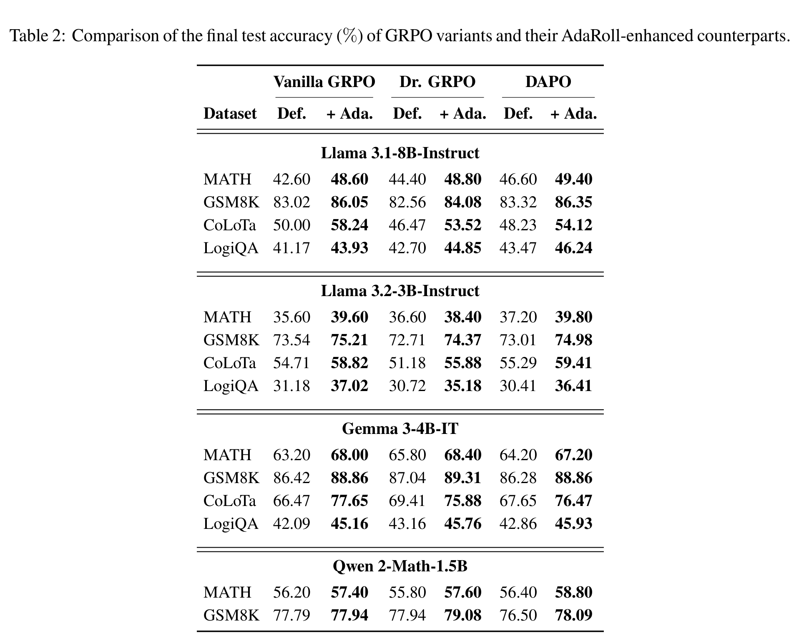

表 2：42 个 `+ Ada.` 格全部高于同列 `Def.`，方向一致、没有反例；但加分配并没有抹平 loss 层面的差距（例如 Llama 3.2-3B / MATH 的 39.60 与 38.40 仍差 1.20 pp），说明两者是叠加关系而非替代关系。

**RQ 1：效用函数怎么选**

作者把六种效用各训一遍，比较最终准确率。结论是没有一种在所有设置里都赢，`U1`（minimum reward variance）在 14 个模型 × 数据集组合里拿下 6 个第一，因此被定为后续默认。

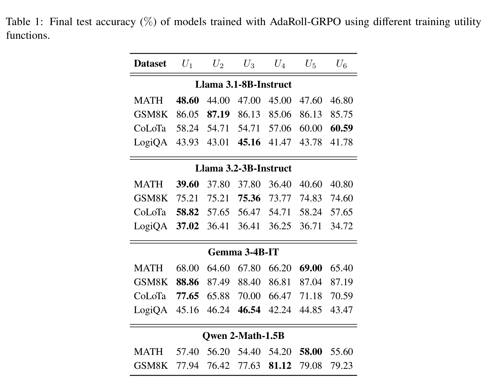

表 1：`U1` 的加粗格散布在三个模型上、没有任何一个落在 Qwen 2-Math-1.5B 行，说明这个综合最优并不均匀；换个模型族，最优效用可能就换人了。

这里我核出一个对不上的地方：按表 1 的实际数值，`U1` 只在 5 行取到最大，而作者说 6 行。差额出在 Llama 3.2-3B / MATH 这一行——表里把 `39.60` 加粗了，但同行 `U6` 是 `40.80`，比它高 1.20 pp。所以更准确的说法是 `U1` 在 5/14 个组合里第一，作者按加粗计数得到 6/14。另外同一行里 Qwen 2-Math-1.5B / GSM8K 的 `U4` 是 `81.12`，比主实验采用的 `U1` 的 `77.94` 高 3.18 pp，也比表 2 里任何 `+ Ada.` 结果都高，作者没有解释这两个例外。**以上是我按原文数字复算的结果**。

**RQ 2：三种 GRPO 变体**

见上表 2。作者的说法是 "augmenting each baseline with the proposed rollout allocation strategy consistently improves performance over its original counterpart"，即加分配后每个基线都稳定优于它自己的原始版本。

**RQ 3：数据异质性决定收益大小**

作者给每个训练集算了一个难度分布熵（按训练前第一次答对需要第几条 rollout 的分布），横轴熵、纵轴相对提升。

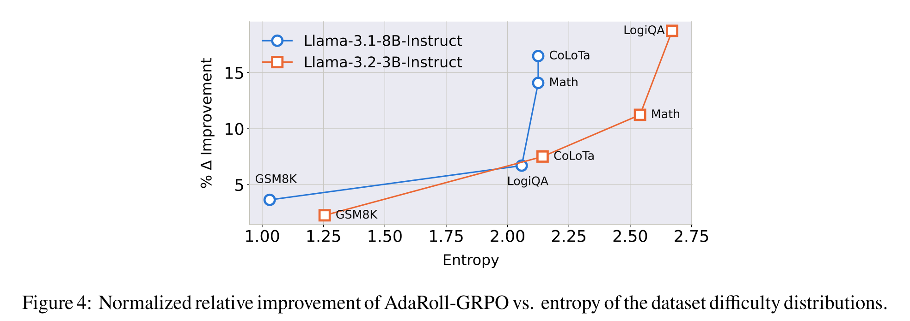

图 4：两条线都随熵上升，GSM8K（熵约 1.0–1.3）收益最小，LogiQA（熵约 2.7）最大；但并不严格单调——Llama-3.1-8B 那条线上熵约 2.10 的 CoLoTa（+16.0%）反而高于熵约 2.16 的 Math（+14.1%），说明熵越高收益越大只是一阶趋势，不是定律。

归一化公式原文没给。我按图 4 坐标反推，提升率约等于 `(Ada − Def) / Def × 100`：Llama-3.1-8B 的 GSM8K 是 `(86.05 − 83.02) / 83.02 ≈ 3.65%`，与图上约 3.5% 吻合。**这是我的推算，不是作者的表述。**

**训练过程**

图 5、图 6 把测试集奖励按训练步画出来，看的是早不早、稳不稳，而不是终值。像体检报告：主表是终值，这两张是过程曲线。

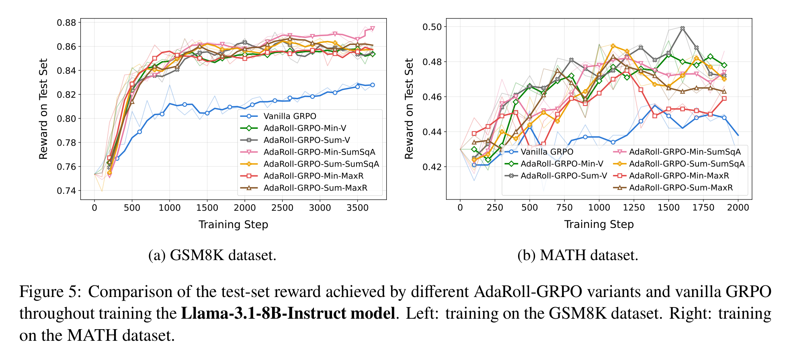

图 5：Llama-3.1-8B-Instruct 上，vanilla GRPO（蓝）在两条曲线上从头到尾压在最下方，其余六种 AdaRoll 变体在中段之后挤成一条带子；GSM8K 的差距在 500 步内就拉开，MATH 要到 750 步后才明显分家，说明收益不是最后几步的偶然反弹。

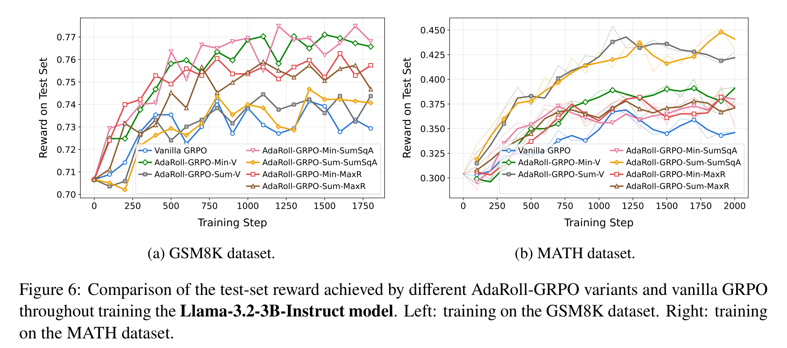

图 6：Llama-3.2-3B-Instruct 上，MATH（右）的分层比 GSM8K（左）干净——右图蓝线始终是地板且与上方各线有稳定间隙，左图则有多条线在 500–1000 步之间反复交叉，与作者对 MATH 难度异质性更大的解释一致。

**学到的策略长什么样**

图 7、图 8 把某个随机训练步上每题分到几条和这题的 rollout 平均奖励画在一起，是全文最有信息量的两张图。

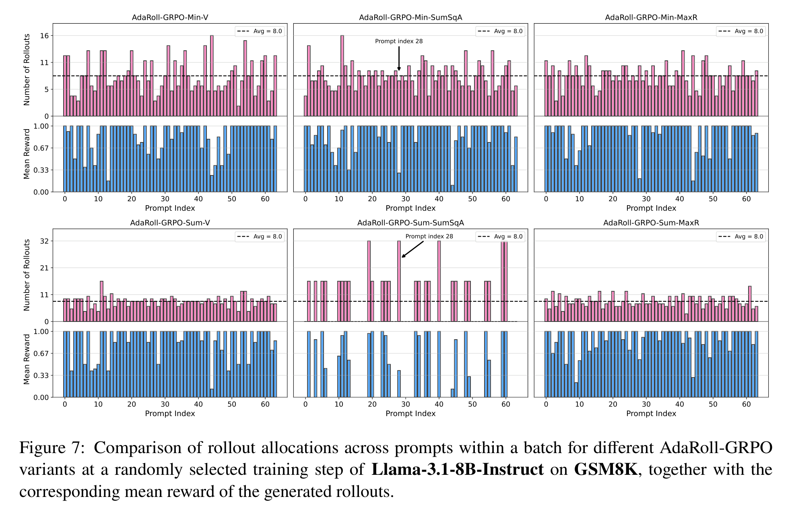

图 7：`Sum-SumSqA`（下中）把约一半的题直接降到 0 条、少数题顶到 32 条，说明 sum 型效用在实现里退化成押注少数题；`Min-V`（上左）反过来把大量预算给平均奖励为 1.00 的题，正是 4.2 节那个推断的表现——min 型效用被 0 方差锁死、动作大面积并列。作者在附录 D.2 里逐条描述了六种策略的形态（包括 `Min-V` 把预算给平均奖励为 1.00 的题），但只做现象描述，没有把它归到效用函数的退化上。

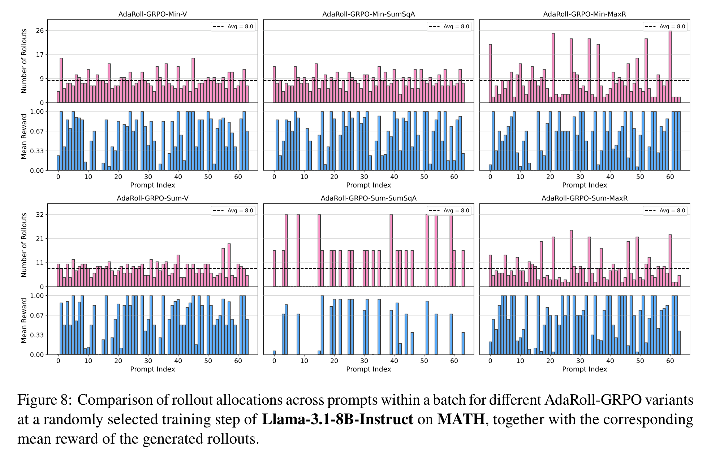

图 8：MATH 上同一现象更极端，`Sum-SumSqA` 只有约三分之一 prompt 拿到 rollout、其余为 0，等于把这些题彻底移出训练；作者另记了一个可核对的细节——同一训练步里 `AdaRoll-GRPO-Min-MaxR` 留下 7 道题没解开，`AdaRoll-GRPO-Sum-MaxR` 只留下 4 道。

**消融告诉我们什么**

本文唯一的消融是 RQ 1 的效用函数对比（六选一），加上附录 D.2 对六种策略形态的定性分析。没有做去掉 BAMDP 会怎样的对照——例如用点估计成功率代替 Beta 信念、或用贪心 plug-in 策略代替值迭代、或干脆每轮按经验成功率排序分配。因此无法判断收益里有多少来自贝叶斯建模与前瞻规划，多少只来自不均匀分配这件事本身。这是我认为最该补的一组实验。

**这些实验够不够支撑结论**

方向性结论（同预算下改分配能涨点）够了，量级结论不够：

- 全部单次运行，没有 seed、没有置信区间、没有方差；`+1.14 pp` 这种量级在单 seed 下无法与噪声区分。
- 全局 batch 只有 4 道题，`min` 型效用是在 4 个数上取最小，本来就抖；论文没有讨论 B 变大后策略是否还成立。
- 没有和免学习的启发式比：DAPO 的 dynamic sampling（丢掉全对/全错组再重采样）、按历史成功率做难度过滤、固定比例如简单题 2 条难题 16 条。这类方法零训练成本，是与本文最直接的竞争者，而论文完全没提。
- 评测只有 exact-match accuracy 一个指标，未报 pass@k、生成长度、训练 wall-clock。

## 6. 局限性

**作者自己承认的**：论文没有设 limitations 一节。作者只正面交代了两件事——值迭代是离线的、复杂度对固定 B 是 N 的多项式；以及 p_j 每轮训练都会变这个事实。

**我看出来的**

- 隐形假设：一道题的价值只由答对概率和这组奖励有多不一致决定，答案长度、推理质量、部分正确程度都不进模型。二值奖励是这个框架的地基，像只按答案对错打分的裁判，看不见推理过程好不好。
- 隐形假设：每轮 GRPO 迭代开始时信念从 `Beta(1,1)` 重来，题目难度不跨迭代继承。等于每轮都要用 4 道题、16 条 rollout 把难度重新摸一遍，信息被反复丢弃。
- 机制边界：表是按 `(B, N)` 离线算的，换 batch 大小或换平均 G 就得重算；`O(BN^{2B})` 意味着 B 稍大就不可行，本文只验到 `B = 4, N = 16`。
- 机制边界：顺序决策在语义上是看一条再决定下一条，照字面实现时 N 条 rollout 无法并成一个大 batch 生成；论文只论证无额外在线优化开销，没给 wall-clock 与吞吐，原文未给这部分数据。
- 缺的对比：没有 DAPO dynamic sampling、难度过滤、固定比例分配这三类免学习基线；没有去掉 BAMDP 的组件消融；没有多 seed。
- 口径问题：`U2`、`U6` 依赖优势 $A$，而全对或全错组的组内标准差为 0、优势无定义，论文没交代这种情况怎么算——而这恰好正是全文动机所指的那类样本。

## 7. 一句话总结

GRPO 里每道题的采样条数不该一样多：把下一条给谁写成一个转移概率未知的决策问题，用 Beta 信念边采边学，离线算一张表，训练时照着查。

类比：不是给全班每人发同样多的练习册，而是有个助教站在旁边，看谁卡住了就多塞一张、看谁已经会了就抽走几张，总张数不变。

核心公式（这篇的看家式子，闭式 Bellman 更新）：

$$
\boxed{V(\boldsymbol\alpha^t,\boldsymbol\beta^t)=\max_{j}\left[\frac{\alpha_j^t}{\alpha_j^t+\beta_j^t}V(\boldsymbol\alpha^t+\mathbf e_j,\boldsymbol\beta^t)+\frac{\beta_j^t}{\alpha_j^t+\beta_j^t}V(\boldsymbol\alpha^t,\boldsymbol\beta^t+\mathbf e_j)\right]}
$$

## 8. 可复用点

- 如果我要在自己的项目里用：把每题固定 G 条改成固定总量、按后验成功率动态分。最小改法是保留 GRPO 的 loss，只在采样器外面加一层分配器；先不要上 BAMDP，先用剩余预算按 $\hat p(1-\hat p)$ 从高到低填的贪心版试水，能涨再考虑建表。
- 如果我要复现：先确认代码里 `num_generations` 是平均值还是每题固定值，这是最容易搞错的一处；再确认 `B`、`N`、`D` 的关系，`N = n_p·G/D` 是按卡切分的。
- 训练不收敛时先查：组内全对/全错的样本占比。占比高就先把预算往这批样本上挪，比调学习率更直接。
- 想换效用函数时：min 型（`U1`、`U2`、`U4`）强制照顾最差题，但二值奖励下容易被 0 方差锁死；sum 型（`U3`、`U5`、`U6`）会退化成押注少数题。折中做法是先按 sum 排序、再给尾部设下限。像装家具时先按图纸摆一遍、再单独加固最晃的那条腿。

## 9. 我的疑问

像照说明书装完柜子还剩在手里的几颗螺丝，下面这些是这篇论文没交代、我也想不通的地方。

- 表 4 写 `num_generations` 为 `4 / 8 / 16`，E.2 说设为 8。到底哪个是主实验配置？如果真做过 4 与 16 的扫描，结果为什么不报？
- 若 `U1` 在 batch 里出现全对题时恒为 0，那 minimum reward variance 最优这个结论是不是相当程度来自并列打破的偶然性？能否给出 `U1` 在训练中的取值分布？
- 顺序决策在工程上怎么批量化？若必须逐条生成，同预算下的 wall-clock 会不会反而更慢？作者只谈了无在线优化开销，回避了这一点。
- 信念每轮重置，能否用上一轮的 $\hat p$ 做下一轮的先验？作者说 p_j 会随训练变化，但变化幅度有没有测过？
- CoLoTa 的 +8.24 pp 是全篇最大提升，但它同时是唯一自建随机切分、且被作者称为 OOD 的数据集。这个提升里有多少来自分配、多少来自该切分本身的方差？
