> 一句话：学老师在哪些地方犹豫，比只学答案更有用。

## 0. 读之前你需要知道

**术语卡**：语言模型逐个预测 token，token 是文本编码后的基本片段。On-policy distillation（OPD）让学生先写回答，再由教师为学生走过的每个前缀提供概率指导。生活类比是学徒自己炒菜，师傅在现场点评，而不是只背师傅的菜谱。

Entropy shape 是沿一条回答排列的 next-token entropy 序列。Entropy 衡量下一步概率分散程度，高值表示有多个候选，低值表示偏向一个候选。它不直接表示答案正确或知识充分。Entropy Shape Correlation（ESC）比较师生两条熵曲线是否同起同落；Overlap@16 比较各位置排名前 16 的候选 token 集合。

**它站在谁肩上**：MiniLLM 与 GKD 把蒸馏带到学生自己的生成分布；Li et al.（2026）的分析发现经过额外 RL 的教师比同配方大教师更有效，并用候选重合度描述学习过程。本文进一步问：老师教的究竟是哪类行为，训练前能否判断值不值得学？

## 1. 动机

一个驾驶教练自己开得快，不代表最适合新手。他也许从不解释何时该停下来确认路况。另一位教练的价值可能是把需要谨慎观察的路口指出来，哪怕最后到达目的地的路线并不完美。

**以前怎么做**：常按教师能力、参数规模或 token 候选相似度选师；更强教师未必产生更好的 OPD。把这种失败归为缺少新知识，仍没有说清新知识具体是什么。

**为什么不够**：同样列出几个候选动作，不等于在同一个时刻保留选择。Overlap@16 把每个位置当作局部集合，无法充分描述整段推理中何处应确定、何处应犹豫。平均 entropy 又会把这些位置结构抹平。

**为什么现在能做**：师生都能在相同学生前缀上输出分布，因此可以逐位置记录 entropy，并通过温度缩放改变概率分散程度。本文由此获得观测曲线和干预教师，而不只是事后比较最终分数。

## 2. 贡献

第一，提出 where to branch 与 how to branch 的分解。前者关心不确定性出现的位置，后者关心候选 token。类比是分别学习在哪个路口看地图、地图上考虑哪些道路。

第二，构造 both-correct 与 both-wrong 训练子集，发现 post-trained teacher 在两种子集均有收益。证据来自 Table 1：教师单次答错并没有使蒸馏失效，但这不等于真实监督质量无关紧要。

第三，提出 ESC，并在训练过程中同时追踪 ESC、Overlap@16、entropy gap 和下游性能。Figure 2 显示成功运行的 ESC 会上升，平均 entropy gap 则不能稳定区分成功与失败。

第四，实施 entropy shape 移植，并将训练前选师定义成独立任务。Table 2 中 ESC 在两个学生各自的五教师池内均选到最优教师；作者明确把这看成初步证据，而非成熟的通用预测器。

## 3. 创新点

**从候选集合转向位置结构**：相比只看 Overlap@k，ESC 比较整条轨迹上的 entropy 起伏。像乐谱既要看有哪些音，也要看在哪些地方停顿；这补上了局部 token 集合不能表达的信息。

**保持排序的反事实干预**：把一个教师的 entropy 序列移植到另一个教师，同时保持后者 logits 的排序。相比直接换教师，它减少了候选排名变化这一因素。不过概率比例仍然变化，不能把排序不变扩大成全部偏好不变。

**把诊断量变成训练前选择规则**：训练中 ESC 上升表示对齐，但训练前 ESC 较低表示尚有可对齐空间。这两个方向并不矛盾。像练琴时与老师节拍越来越一致是进步，而开始前完全相同可能意味着能学的新东西较少；前提仍是老师的节拍值得学。

## 4. 方法

### 4.1 整体流程

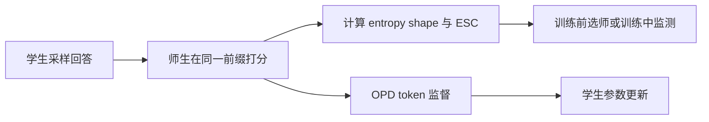

学生先走自己的路，再对照教师的路口判断，避免只在教师生成的路径上练习。这里没有新增一个奖励模型；ESC 主要是分析和预测量，原始 OPD 训练仍使用 token 级分布监督。

### 4.2 OPD 学习信号

先计算师生在学生实际采样 token 上的 log-probability 差，作为局部更新信号：

$$
\Delta_t=\log q_t(y_t)-\log p_t(y_t).
$$

$t$ 是 token 位置，$y_t$ 是实际采样的离散 token；$p_t=\pi_\theta(\cdot\mid x,y_{<t})$ 与 $q_t=\pi_T(\cdot\mid x,y_{<t})$ 是长度为词表大小的概率向量，$\Delta_t$ 是标量。$x$ 是问题，$y_{<t}$ 是已有回答。正值表示教师比学生更认可该 token。实际更新使用停止梯度的 advantage 和 clipped policy objective，不能把这个标量的期望恒等式直接当成任意优化器的完整梯度推导。

再把整个词表的不确定性压成每位置一个数：

$$
H(p_t)=-\sum_{v\in\mathcal V}p_t(v)\log p_t(v),\qquad
\rho=\operatorname{Pearson}\big((H(p_t))_{t=1}^{T},(H(q_t))_{t=1}^{T}\big).
$$

$\mathcal V$ 是共享词表，$v$ 是一个词表元素；$T$ 为回答长度，两个 entropy 序列均为 $T$ 维；$\rho$ 即标量 ESC。Pearson correlation 消除平移和正比例缩放，因此关注曲线形状而非绝对高度。生活类比是比较两个人在哪些拍子放慢，而不是比较平均走路速度。原文没有给出常数 entropy 序列导致零方差时的处理规则。

### 4.3 Entropy shape 移植

为保持教师 A 的候选排序，同时借用 B 的位置不确定性，在每个位置解温度：

$$
H\!\left(\operatorname{softmax}(z_{A,t}/T_t)\right)=H_{B,t},\qquad
\widetilde q_t^{A\leftarrow B}=\operatorname{softmax}(z_{A,t}/T_t).
$$

$z_{A,t}$ 为词表维 logits 向量，$T_t>0$ 为标量温度，$H_{B,t}$ 为 B 在同一前缀上的标量 entropy，$\widetilde q_t^{A\leftarrow B}$ 为替代教师分布。作者在 $\log T$ 空间用带 bracketing 的 Newton's method 求解。正温度保留 argmax 和 top-k 集合，但会改变概率比例与 $\Delta_t$ 幅度。

### 4.4 训练前选师

对每对师生，用 1,000 条 probe rollouts 计算 pre-OPD ESC，较低 ESC 预测较大增益。先按预测分数选教师，再计算选错的代价：

$$
\widehat T=\arg\max_{T_i\in\mathcal T}m(S,T_i),\qquad
\mathrm{Regret}=\max_{T_i\in\mathcal T}\Delta(S,T_i)-\Delta(S,\widehat T).
$$

$S$ 是固定学生，$\mathcal T$ 是候选教师集合，$m$ 是把较低 ESC 转成较高优先级的标量分数；$\Delta$ 是完整 OPD 后的实测增益，Regret 也是标量且越低越好。它类似选教练后，与事后最优选择比较少学了多少。

## 5. 实验结果

**实验设置**：数据集与切分为 DeepMath-103K 的两个各 7,000 prompts 子集，按两位教师各单次生成的最终答案划成 both-correct、both-wrong；其他训练用 DAPO-Math-17K。测试是 AIME 2024、AIME 2025、AMC2023、HMMT February 2025、HMMT February 2026、BeyondAIME。各测试集实际题数、清洗及去重细则原文未给。

骨干学生为 DeepSeek-R1-Distill-Qwen-1.5B 和 Qwen3-1.7B（non-thinking）；教师池详见 Table 4。训练预算为 200 steps、global/mini batch 64、rollout number 1、AdamW、learning rate 1e-6、clip ratio 0.2、KL coefficient 0.0。硬件、卡数和墙钟时间原文未给。

基线包括 same-recipe teacher、post-trained teacher、反事实移植教师，以及选师时的 Overlap@16、$\Delta H$、teacher performance、teacher size。指标是各题四样本平均正确率 avg@4、六个基准非加权平均、Spearman correlation 和 Regret。推理用 vLLM、temperature 0.7、top-p 0.8、top-k 20；R1 最大 16,384 tokens，Qwen 最大 8,192 tokens。训练 temperature/top-p 均 1.0、prompt 上限 1,024、response 上限 16,384、Teacher LogProb top-K 64。

像给同一学生安排不同教练，主表必须先固定学生与训练子集，不能把所有分数混排：

| 学生 / 子集 | 指标 | post-trained teacher | same-recipe teacher | 差值 |
| --- | --- | --- | --- | --- |
| R1-Distill-1.5B / both-wrong | 六基准 mean avg@4 | 31.6 | 25.5 | 6.1 points |
| R1-Distill-1.5B / both-correct | 同上 | 29.9 | 24.9 | 5.0 points |
| Qwen3-1.7B / both-wrong | 同上 | 26.7 | 14.2 | 12.5 points |
| Qwen3-1.7B / both-correct | 同上 | 26.4 | 13.2 | 13.2 points |

差值为 Table 1 数值相减，不是另一组独立实验；该表只有这两类教师对照，不把它包装成整个领域最强基线。

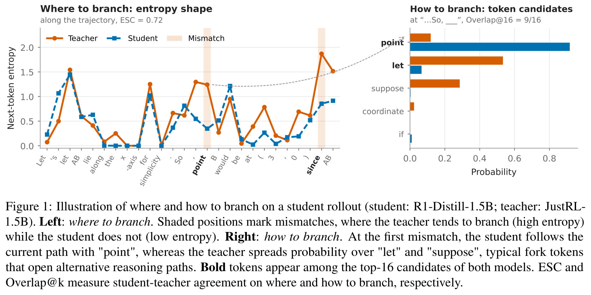

Figure 1：相同前缀处，教师可能保留 let、suppose 等后续，而学生过早集中在 point；它说明两个分析轴的区别，不是统计性性能证据。

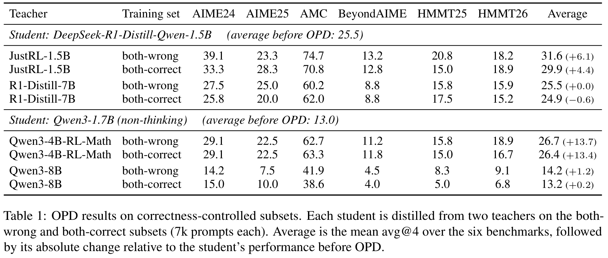

Table 1：post-trained teacher 在两类子集均有效，削弱了仅靠教师做对当前训练题解释收益的说法；单次 both-wrong 标签不等于教师永远不会解这些题。

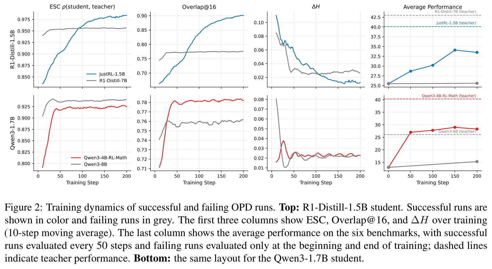

Figure 2：成功运行的 ESC 与性能共同上升，但失败运行的 ESC 起点很高；平均 entropy gap 的收敛不能单独判断学习是否有效。

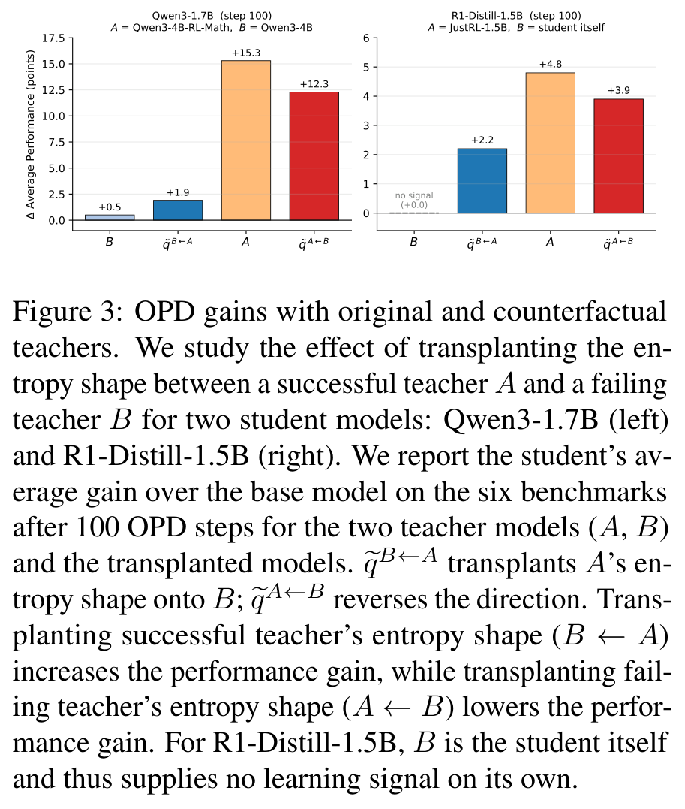

Figure 3：有效 entropy shape 能救活弱教师的一部分信号，移除该 shape 后仍留下可观收益，因此 where to branch 与 how to branch 都有作用。R1 的 self-preference 移植得到 +2.2 points，原教师为 +4.8 points；这组是 step 100，不能与 Table 4 的 step 200 混用。

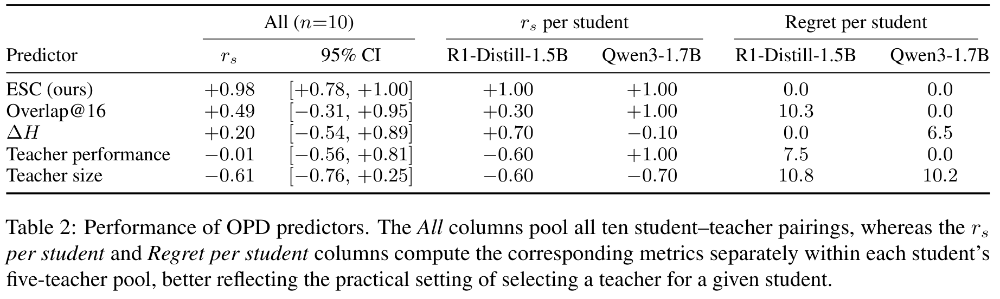

Table 2：ESC 的排序方向已按预测增益统一，所以表中 pooled $r_s$ 为 +0.98；它在两个学生池内均为 +1.00、Regret 均为 0.0。Overlap@16 是其余预测器中 pooled 排序相关最高者，但 R1 池 Regret 为 10.3，Qwen 池为 0.0。这里没有一个跨全部维度都最强的单一基线。

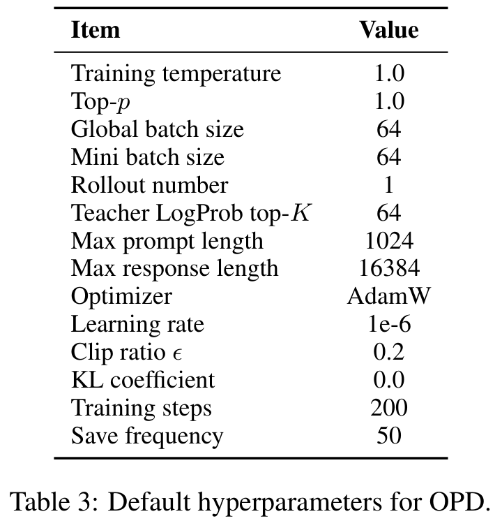

Table 3：给出默认 OPD 超参，尤其说明并非用 ESC 直接代替训练目标；Teacher LogProb top-K 64 也不能误写成全文词表精确 entropy 的实现证明。

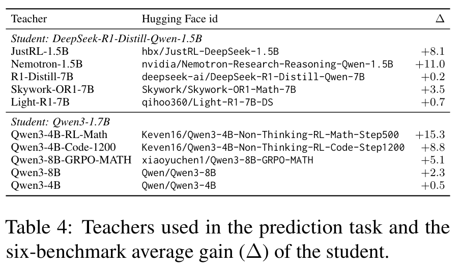

Table 4：两个学生各五位教师，教师规模并不直接决定最终增益；这张表的增益在 step 200 计。

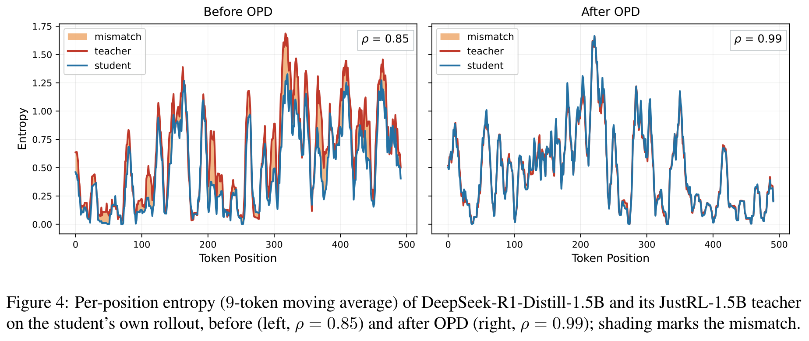

Figure 4：单条回答上的师生 entropy 峰谷在训练后更贴合；它是可视化案例，不足以证明每类推理位置都学对。

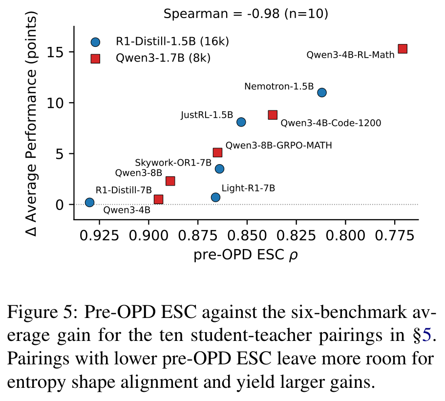

Figure 5：原始 pre-OPD ESC 与增益的相关为负，横轴还反向排列；不要把 Table 2 中按预测方向处理的正号读成 ESC 越高越好。

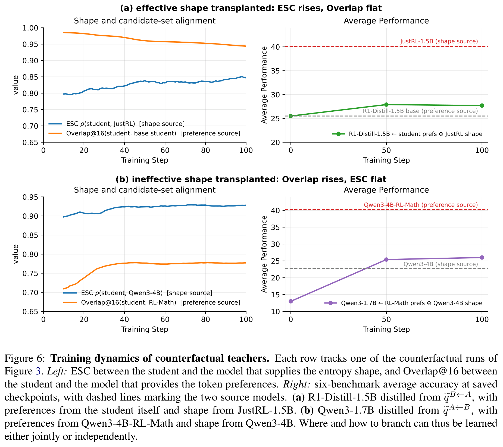

Figure 6：移植实验可让 ESC 与 Overlap@16 分别变化，支持它们不是同一量的重复测量；它没有排除温度对优化幅度的其他影响。

## 6. 局限性

**作者承认**：只研究 sampled-token OPD，数学任务、1.5B/1.7B 学生和不超过 8B 的教师；选师只有十个配对，bootstrap confidence interval 较宽。这些实验覆盖限制留在本节，不填入 frontmatter。作者提出的 early stopping、蒸馏来源检测仍是未来用途，并未在本文验证。

**我的判断**：第一，entropy 是分布形状，不是语义分叉的直接标签。一个模型可能因为标点、格式或词法替代而高熵，像路口犹豫也可能只是看不清路牌。

第二，低 ESC 只能说明不同，不保证可学。随机或刻意错位的教师也可能有低相关；需要教师质量、支持覆盖与学生容量等额外前提，不能把低相关当成独立充分条件。

第三，温度干预固定的是排名，不是概率比值。$\Delta_t$ 的幅度、梯度方差和概率尾部都会变。因此实验支持 entropy 相关干预影响 OPD，但未完全识别纯粹位置语义的唯一因果作用。

第四，shared vocabulary 和同一前缀是当前定义的基础；换 tokenizer 时逐 token 相关不直接成立。论文还没有交代零方差序列、padding、截断和短回答如何稳定聚合 ESC，复现时要先核对代码而不能补设定。

## 7. 一句话总结

OPD 可能同时教学生考虑什么、什么时候保留选择；像学下棋既学候选棋步，也学哪些局面值得停下来算。ESC 是描述后者的有用探针，当前证据支持在受控教师池内试用，尚不能当作通用教师质量分。

这里最有价值的变化是把笼统的新知识拆成能测量、能干预的分布性质。读者应带走这个可检验的问题，而不是把所有高熵 token 都叫作关键推理步骤；真正的语义判断仍需要任务证据。

## 8. 可复用点

在已有 OPD 管线加一个固定 probe 集，同时记录 ESC、Overlap@16、entropy gap 和任务分数，别只盯最终 loss。选师前先固定学生 rollout、推理预算和候选池，再比较 pre-OPD ESC 与实际小规模收益。

训练停滞时，像教练回看录像一样检查高熵位置是否与格式标记重合、哪些教师只改变 token 集合、哪些只改变 entropy。若做温度移植，应增加保持梯度尺度的对照，区分优化幅度与位置结构；这是我的后续实验建议，非本文已完成结果。

## 9. 我的疑问

为什么所有十个配对中低 ESC 都恰好代表有益差异？加入错题教师、随机温度教师或不相关领域教师后还能选对吗？就像挑教练不能只挑与自己最不同的人。

如果把同样 entropy shape 随机打乱位置，收益会不会消失？若没有这个更直接的对照，位置结构与温度正则效应仍难彻底分开。probe 使用的是 full-vocabulary entropy 还是近似分布、对长短回答怎样加权，原文没有给足实现细节，不能自行填补。

**原文与产物**：完整读取 arXiv v1 的 13 页（含附录）；原始 PDF 由联网下载，位于本项目 `runtime/2026-10-30/refs/esc/paper.pdf`；本页嵌入 6 张 Figure、4 张 Table。未运行作者训练代码，文中实验数字均为论文报告，不是本地复现。
