> 一句话：老师接写一段，未必让独自答题的学生学得更多。

## 0. 读之前你需要知道

On-policy distillation（OPD）让学生在自己访问的文本前缀上接受教师概率指导。Teacher bridge 是由教师插入、之后再交回学生的一段文字。生活类比是学生解题时老师接过笔写一段，随后学生继续：老师写的内容可以作为提示，也可以成为学生必须学会模仿的答案。

Forward KL 与 reverse KL 是比较两个概率分布的不同方向，本文在完整词表上计算；EOS 是停止生成的特殊 token。Gradient 是参数改变时 loss 变化的方向向量，cosine 衡量两个向量是否同向。TOST 是等价性检验：要证明差异足够小，须先指定可以接受的误差界，而非只看显著性没通过。

TCOD-B2F、ReOPD 等已有 context-only 先例；Guided-OPD 等会监督 teacher tokens。本文不发明一种新桥段算法，而是把轨迹固定，检查这些训练选择到底改变多少信号。

## 1. 动机

老师帮学生写出关键一步，现场答对率提高了；但学生下次独立做题，是否更强，是另一件事。还要分清他学到了老师那一步，还是只因看到提示才容易接着写。

既有方法把桥段位置、长度、loss 和采样规则一起改，难分离 teacher text 的两种作用：改变后续状态，以及作为直接监督目标。本文固定实际生成文字，只切换哪些 token 参加哪种 loss，就像让几组学生看同一份批改稿，只改变练习要求。

问题还包含一个工程陷阱：模型参数虽更新，低精度推理可能把小变化舍掉。如果测试看到的模型与完整精度权重行为不同，精度就成了结果解释的一部分，而不是无关配置。

## 2. 贡献

第一，按 token 作者分解监督，分别测 student prefix A、teacher bridge B、student continuation C 的 token share、KL-mass share、gradient norm 与 cosine。像统计一篇合写作文中，每个作者的文字实际改变了多少修改方向。

第二，在相同固定轨迹上比较 allRKL、AC、mixedKL，并用预先指定的 ±5 pp margin 做等价性检验。主实验中三者准确率在此界内等价，但不是完全相同。

第三，探索 derail point 的介入，再独立复验；pilot 中 teacher-token loss 的正信号没有确认，四倍加权改变梯度却未带来显著精度收益。

第四，公开报告 stopping collapse 与 BF16/FP32 的巨大行为差异，限制自身负结果的外推。文中独立 checker 和归档核对属于作者报告，我没有取得归档或本地重复核算。

## 3. 创新点

**固定文本再换 loss**：把教师接写的内容当作受控条件，避免把好桥段与某种 KL 方向一起归功。像两组学生练同一段例题，才能比较是否要求抄写老师那一步。

**把机制预测与统计测试连起来**：短 bridge 的梯度小且近正交，作者预测去掉它不会大幅改变总方向，再测试准确率是否在预定界内等价。它提供了能被失败结果推翻的预测，而非事后找解释。

**保留负复验与协议偏离**：作者没有把 pilot 中 +4.8 pp 的结果单独作为最终结论，进一步检查新训练题、更多评测题和 teacher weight dose。所谓 pre-specified 是内部文件冻结，不是公开预注册，哈希本身也不能证明文件何时写成。

## 4. 方法

### 4.1 整体流程

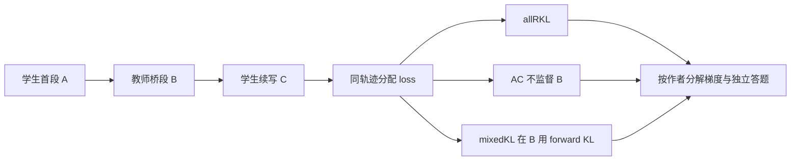

主要实验 S3 固定轨迹；S4 才是每次更新先用最新学生生成 fresh rollouts 的在线检查。Mask 从不删除后续上下文中的 token，也不重新归一化有效 token 数。像保留老师写的解题过程供阅读，只决定哪几行需要交作业。

### 4.2 统一归一化的 loss

先逐 token 比较师生分布，再按原回答长度和 batch 大小平均：

$$
\mathcal L(\theta)=\frac1N\sum_{i=1}^N\frac1{L_i}\sum_{t=1}^{L_i}w_{it}D_{it}(\theta).
$$

$N$ 是 batch 中回答数，$L_i$ 是原回答 token 数，$w_{it}$ 是 mask 或权重标量；$D_{it}$ 是完整词表的 reverse KL 或 forward KL 标量。学生分布为 $p_\theta$，冻结教师为 $q$。AC 在 B 上设零，mixedKL 在 B 用 forward KL，其他学生位置用 reverse KL；randomK 匹配保留 token 数与 terminal-EOS state，pureS 则没有教师桥段。

### 4.3 按作者拆解梯度

把相同参数处的总梯度拆成学生与教师两部分：

$$
g_{all}=g_{AC}+g_B,\qquad
r=\frac{\|g_B\|}{\|g_{AC}\|},\qquad
c=\frac{g_B^\top g_{AC}}{\|g_B\|\|g_{AC}\|}.
$$

$g_{AC}=g_A+g_C$，所有 $g$ 都是参数维向量；$r$ 是相对范数标量，$c\in[-1,1]$ 是 cosine。两者分别区分教师信号有多大、朝什么方向。像两个人推同一辆车，第二个人出力很小又朝侧面，就难以显著改变前进方向。

**我的代数解释**：由上述分解，合力与学生梯度的 cosine 为 $(1+rc)/\sqrt{1+2rc+r^2}$。但作者明确提醒，clipping 后梯度同方向同范数，仍不保证 AdamW 的参数步长一样，因为优化器还有逐坐标历史状态。

### 4.4 检验与数值控制

主实验按 question 做 paired bootstrap，先对每题的训练 seeds 求平均，再重采样问题。TOST 要求 90% interval 落进 ±5 pp；95% interval 包含零仅表示未检出差异，不能替代此规则。固定序列 superiority family 在第一项未显著后停止，后续比较只描述。

derail point 是失败回答中 mean reverse KL 最高的合格 paragraph，不代表已找到真实因果错步。复验固定相同 teacher text，改变 teacher loss weight 为 0、1、4。精度检查则对同一组训练后权重分别做 BF16 autocast 和 exact FP32 推理，检查模型函数真正改变了多少。

## 5. 实验结果

**实验设置六项**：S3 每 seed 用 128 DeepMath training questions，E1 为冻结 512 道 held-out DeepMath 中前 256 道，E2 为 256 道 GSM8K test；后续确认试验扩到全部 512 道 E1，复验用另一组训练失败题。作者记为 DeepMath，本页不擅自把子集当成完整官方测试。

骨干学生 Qwen3-1.7B non-thinking、教师 Qwen3-4B-Instruct-2507；单张 RTX PRO 6000。每 arm 3 seeds、4 次 AdamW updates、batch 32、lr 3e-6、clip 1、无 weight decay；beta=(0.9,0.95)。主轨迹 prefix cap 256、教师 cap 1,024、总 4,096。完整任务总墙钟原文未给，附录逐单元时间包含共享 GPU 情形，不直接拼成公平成本比较。

基线是初始学生、pureS、randomK、noiseAC 和三种 teacher loss treatment。指标 strict accuracy 要同时满足明确最终答案匹配与 EOS；还记录 cap hits、length、KL 和梯度。学生独立推理不接教师，temperature 0.7、top-k 20、top-p 0.8、cap 4,096、主评测 batch 64、各问题共享随机流。FP32 master weights 通常在 BF16 autocast 下运行；exact FP32 检查有明确单独标签。

主表最强对照是同设置 pureS，但它的优势不是通过完整确认 family 得到的结论：

| S3 评测 | allRKL | AC | mixedKL | pureS 对照 |
| --- | --- | --- | --- | --- |
| E1 strict accuracy | 49.9 | 49.5 | 50.0 | 53.0 |
| E2 strict accuracy | 86.3 | 86.7 | 85.9 | 85.9 |

像考试必须同时写出正确答案并按时交卷，本文 strict accuracy 把终止行为也纳入成绩。下面分别保留证据层级，不能只摘最高柱子。

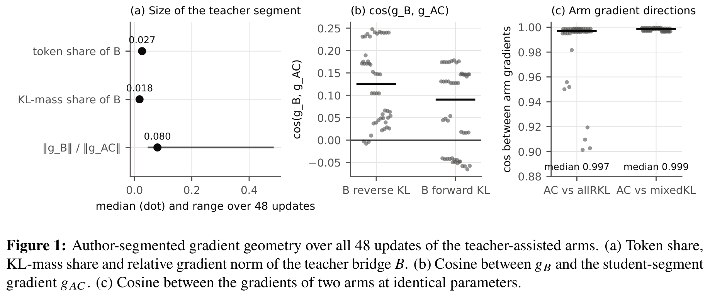

Figure 1：B 的 token share 中位数 2.7%、KL-mass share 1.8%、gradient-norm ratio 0.080；小且近正交的附加项解释为何总方向接近。

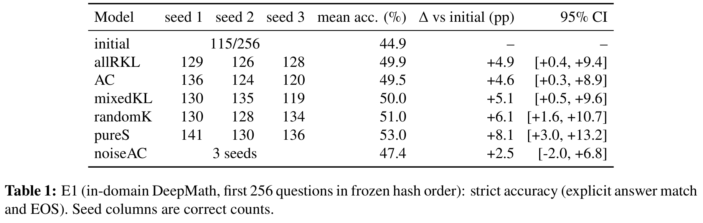

Table 1：训练组 E1 均值高于初始学生，但 pureS 点估计最高不等于已证明教师上下文有害。

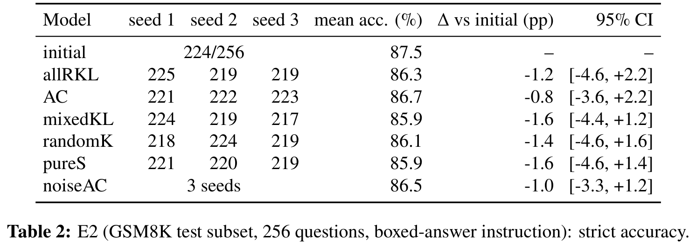

Table 2：GSM8K 迁移未显示同样改善，不能把域内小涨分说成普遍推理能力增强。

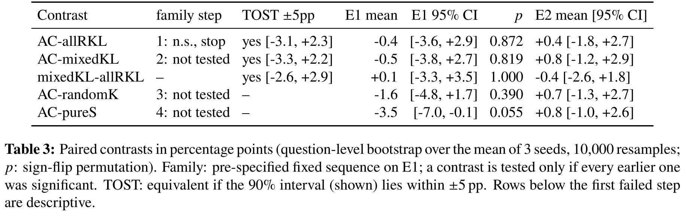

Table 3：三种 bridge loss treatment 在预定 ±5 pp 内等价；superiority family 首项未通过，后续负向差异仅能描述。

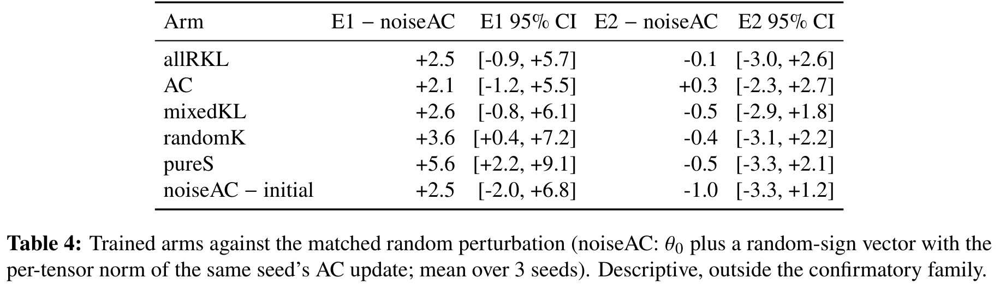

Table 4：matched random perturbation 自身也有正点估计，提醒初始模型的一次采样不是无噪声锚点；几个 teacher bridge treatments 对 noiseAC 的区间均含零。

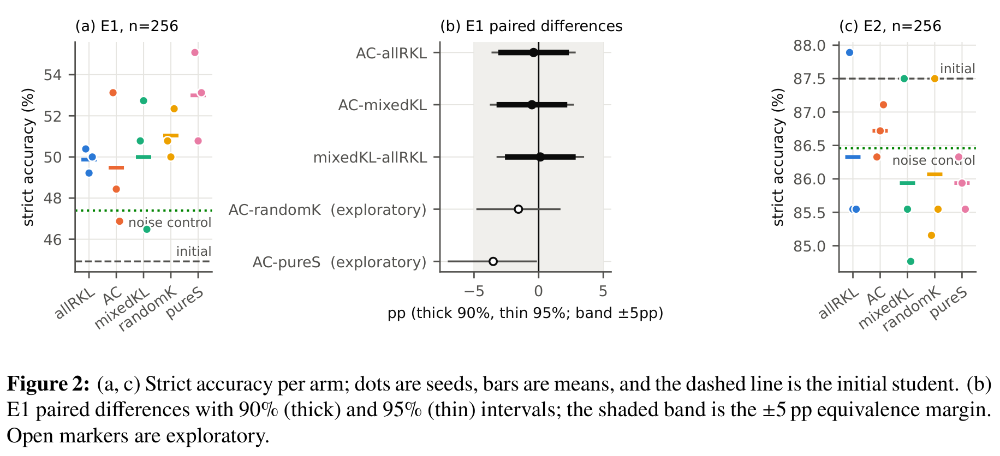

Figure 2：厚线 90%、细线 95% 分别服务于不同推断，空标记为 exploratory；看区间与 margin 比只看均值可靠。

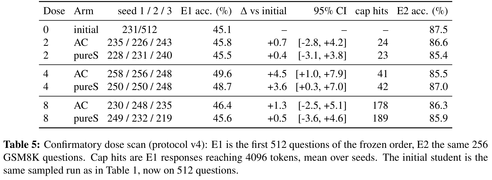

Table 5：剂量增加到 8 updates，cap hits 大量增加，准确率收益回落；这里的 dose 是 optimizer updates，不等于训练样本变成新问题。

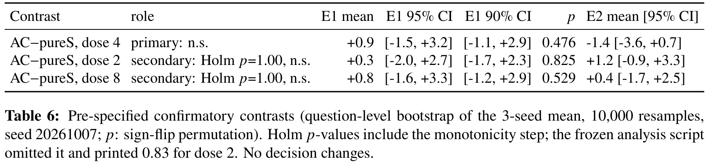

Table 6：单独确认 AC−pureS 在 dose 4 为 +0.9 pp，95% CI [-1.5,+3.2]，未确认先前看似 pureS 更好的信号。

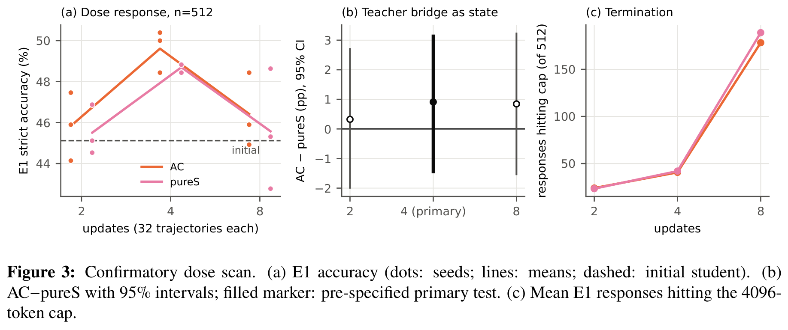

Figure 3：两臂都出现倒 U 形收益和终止恶化，说明限制较长训练的是共同的训练病理，而非教师段存在与否。

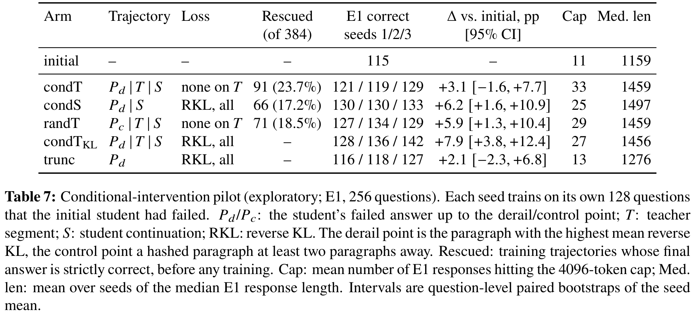

Table 7：derail point 教师先帮助更多训练轨迹答对，却没有让 context-only 学生在后续独立考试最强；救活当前轨迹与学会独立回答不可混同。

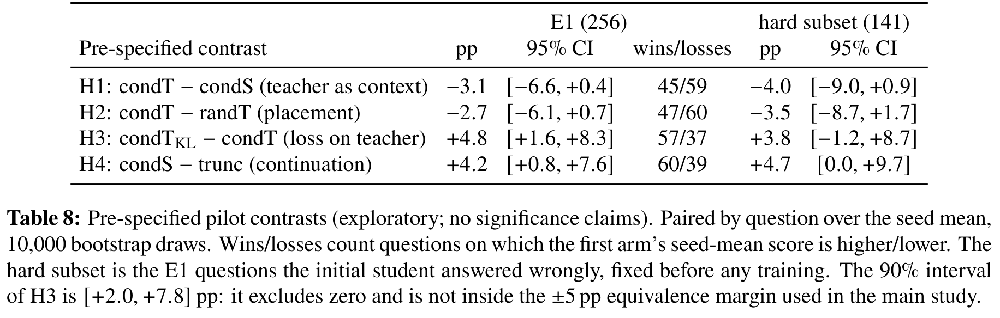

Table 8：pilot 的 H3 为 +4.8 pp，是后续复验的动机；它仍属 exploratory，不能越过多重比较与选择噪声直接宣布有效。

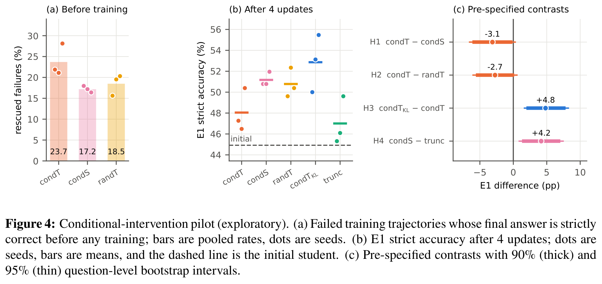

Figure 4：训练前 rescue rate 与训练后各 arm 排序不同，提示上下文改善和参数学习之间没有简单对应。

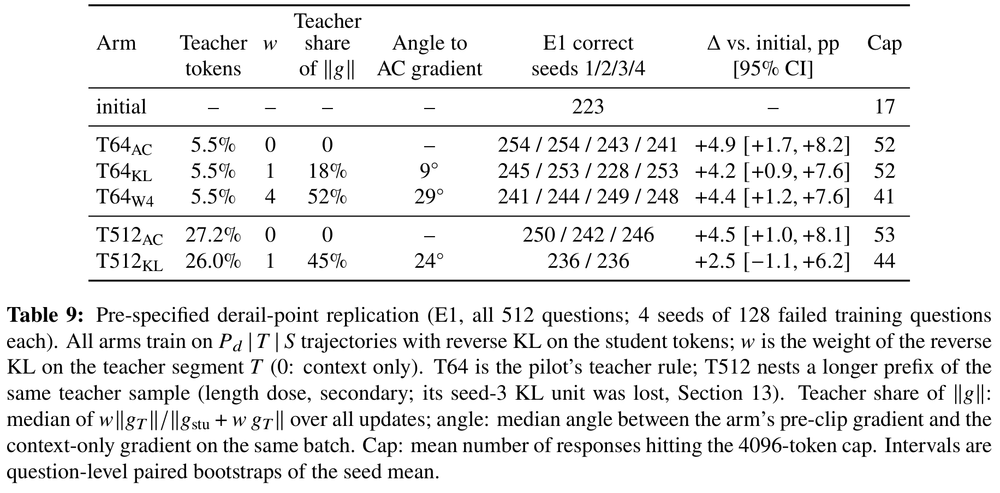

Table 9：weight 4 让教师梯度份额达到 52%、方向转约 29 度，但精度没有跟着增加；gradient share 不是能力贡献百分比。

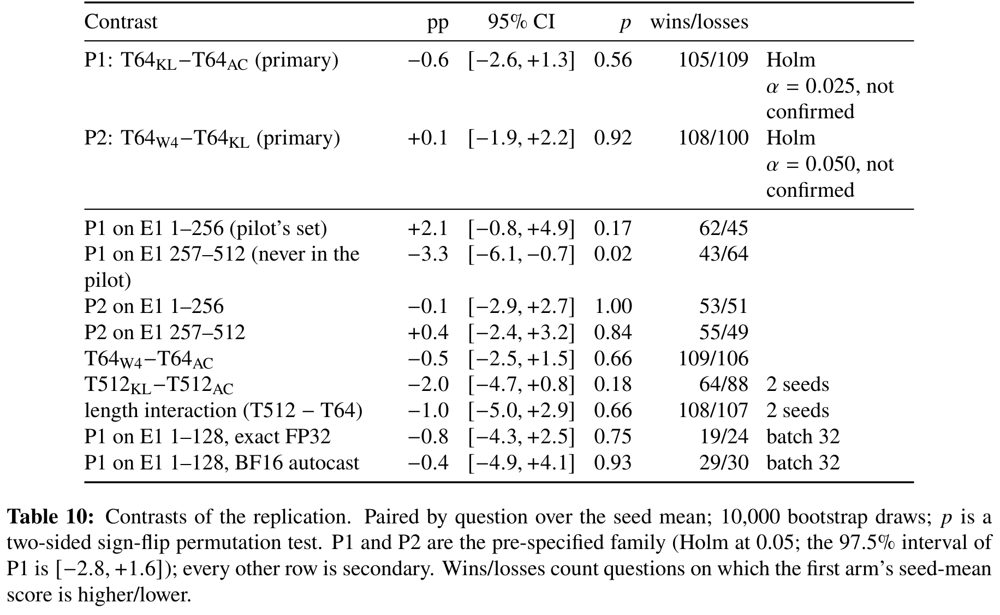

Table 10：复验 P1 为 -0.6 pp、P2 为 +0.1 pp，两项均未确认。这次没有证明等价，不能套用 S3 的 TOST 结论。

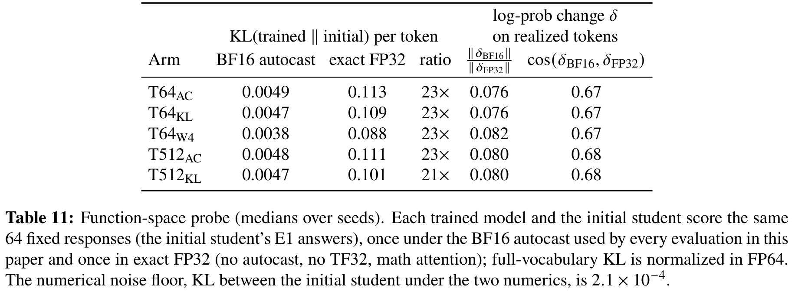

Table 11：同权重的函数变化在 exact FP32 下比 BF16 大 21–23 倍；数值路径改变实际部署模型，不能仅检查权重文件已更新。

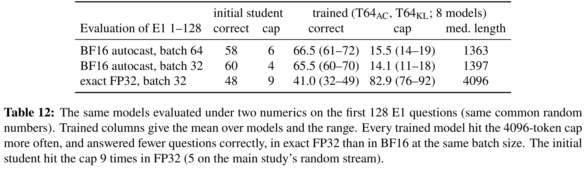

Table 12：8 个训练模型在 exact FP32 下 cap hits 均更多；这削弱了把 BF16 结果外推为完整权重学习规律的理由。

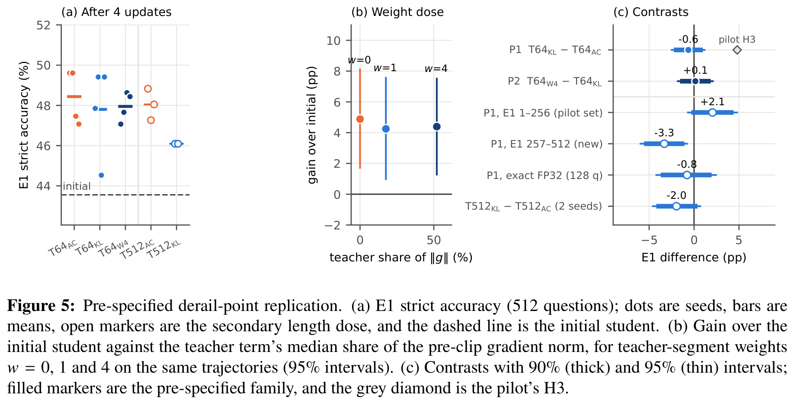

Figure 5：更强 teacher loss 确实改变梯度，所以负结果不能简单归因为处理强度完全没变；但它仍受终止与精度边界限制。

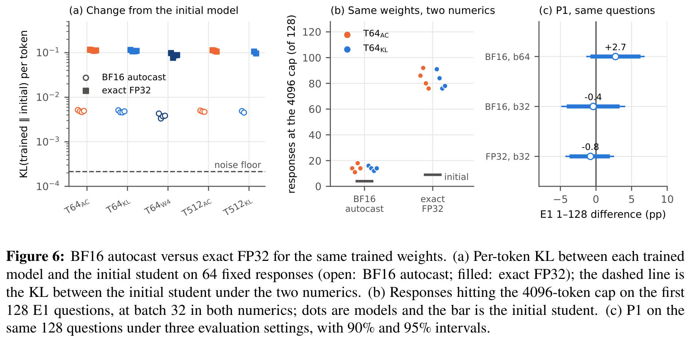

Figure 6：同模型两数值设置的 length 与 KL 差异明显，需将 accuracy comparison 和 function-space effect 同时看。

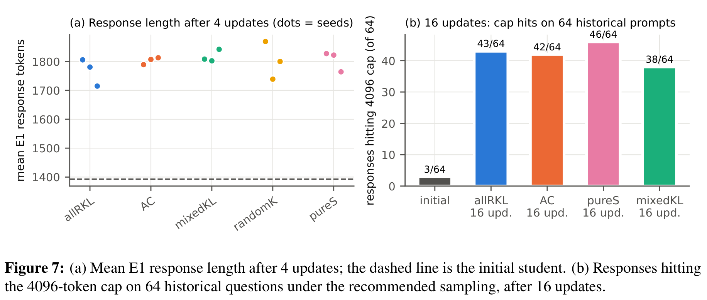

Figure 7：pureS 也会高剂量 collapse，因此 teacher-written bridge 不是该设置中崩溃的必要条件；这没有定位全部根因。

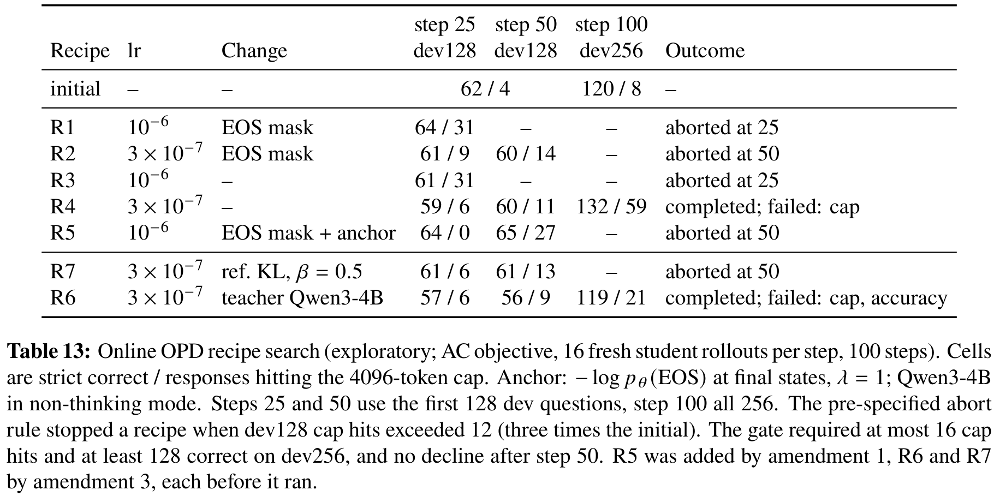

Table 13：七个 online recipes 没有一项同时过准确率和终止 gate。R4 虽提高正确题数，却严重超长；R6 减少超长却失去准确率增益。

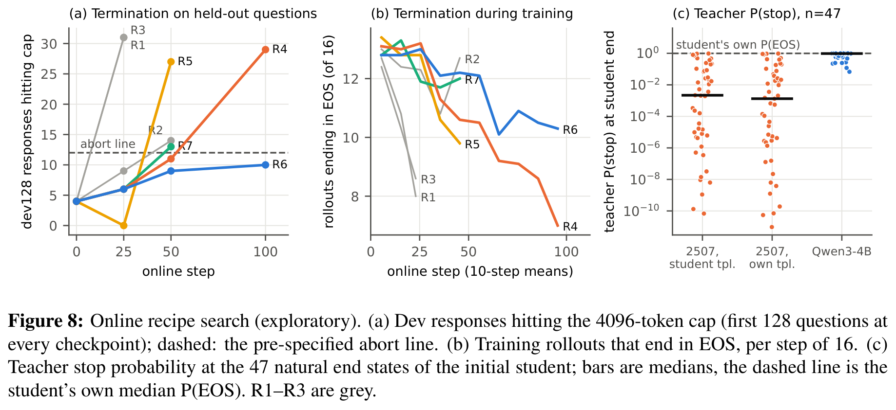

Figure 8：教师在学生自然结束状态倾向继续，换 length-matched teacher 后截断缓解；但换教师也改了能力，不能单独归因于长度偏好。

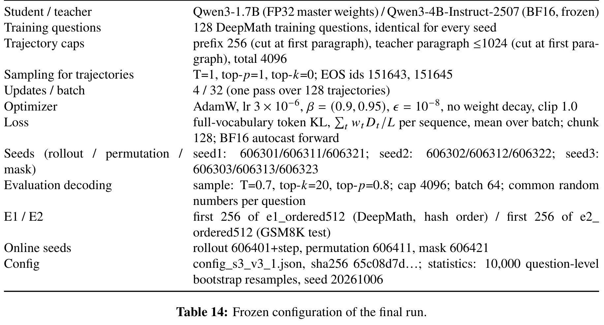

Table 14：主实验冻结配置给足归一化、采样、optimizer 与 EOS IDs；因此此文较适合借鉴对照设计，但公开版本未提供可直接下载的完整归档。

## 6. 局限性

**作者承认**：一对模型、短训练、固定轨迹为主；S4 仅单 seed。question-level bootstrap 条件于有限训练 runs，并不估计跨 seed 的完整分布。独立新 condS、T192、主研究 FP32 rerun 等未在预算内完成，length dose 只有两套完整配对。内部协议有 outcome-informed amendments，均需结合披露时间理解。

**我的判断**：最尖锐的问题是有效更新与训练稳定性共同压缩了可检验范围。BF16 舍入像把训练动作变成一把粗齿尺，FP32 又让这些权重过早失去停止能力；此时三臂相似，可能包含共同病理的影响。它不是一个已稳定收敛体系中对桥段价值的最终判决。

原始梯度 cosine 不能替代 AdamW 的真实参数步长和 function-space update。derail point 只是 KL proxy，而非真实错误位置；教师接手后访问状态的分布差异没有直接测量，因而 state mismatch 只是解释假设。

±5 pp margin 是研究者选定的实用容忍界，不是收益严格为零。对 baseline 很强、计算昂贵的任务，较小收益也可能有用。论文自己披露结论范围较谨慎，引用时应保留这种谨慎。

## 7. 一句话总结

像老师偶尔接写一小段板书，在这套短练习里，要求学生抄不抄那段，最后成绩相近；不能因此推出老师帮助没价值。更值得带走的是分离 context、target、有效更新和 stopping 四件事的检查方法。

这篇负结果的可信之处是没有掩盖失败复验与数值问题；它的限制也来自这些问题。因此合理用途是帮助设计自己的消融，而不是把主表单独当作删除 teacher-token supervision 的通用依据。

## 8. 可复用点

在现有 bridge 方法记录 token 作者与 segment mask，保持文字和原分母完全相同再换 loss；随机 mask 要匹配有效 token 数与 EOS state。像比较两种教学要求时，先让学生拿到同一张讲义。

同时测 pre-clip gradient、实际 AdamW delta、部署精度下函数 KL、cap hits 与 strict accuracy。把有效更新低于数值分辨率的情况尽早发现。探索性最优 arm 单独复验，先写主要假设、margin、停止规则和缺失单元处理，再看结果。

## 9. 我的疑问

能否先用稳定配方避免 stopping collapse，再比较 teacher loss 的长期价值？当 bridge 占比大、学生真实能到达该状态时，主实验的小梯度解释是否仍成立？像要判断辅导有效，至少先保证学生能正常交卷。

若同时保持教师数学能力和停止偏好，只改变后一项，能否拆开 R4/R6 的混杂？在更细粒度数值表示下，用安全 dose 重做等价检验是否还成立？原文未验证这些条件，我也没有本地训练复现。

**来源**：联网 arXiv v1；正文、限制、协议偏离和附录配置已读。本页 8 张 Figure、14 张 Table 来自 PDF 原件；附录逐单元表未在本页引用。无公开完整 artifact 下载，作者内部 archive 验证不能当成本地已确认事实。
