> 一句话：让学生自己写的答案，由一位偷看过相似顾客后续行为的老师逐字打分。

## 0. 读之前你需要知道

**术语卡**

- **序列推荐（sequential recommendation）**：根据一个用户按时间排好的历史交互，猜他下一个会点什么。生活类比：看一个人最近在超市小票上买了什么，猜他下次买什么。
- **后训练（post-training）**：模型预训练完之后，再用某个具体任务的目标继续调。生活类比：大学念完了，入职前再上一期岗前培训班。
- **GRPO**：一种强化学习算法，同一个问题采样一组回答，用组内奖励的均值和标准差把奖励标准化成优势（advantage），再用它去加权更新。生活类比：一个班考同一张卷，按班内排名而不是绝对分数来奖惩。
- **策略（policy）与 on-policy**：策略就是模型当前遇到输入会怎么答的分布；on-policy 指训练数据由当前策略自己现场采样出来，而不是别人提前写好的。生活类比：自己下棋自己复盘，而不是背大师棋谱。
- **蒸馏（distillation）与 on-policy 蒸馏（OPD）**：让一个小模型去模仿一个大模型（或更有信息的模型）的输出分布。on-policy 蒸馏是让学生先自己走一步，老师再对这一步的每个 token 给分。生活类比：学生先自己写草稿，老师逐句批注，而不是让学生抄范文。
- **自蒸馏（self-distillation, OPSD）**：老师和学生是同一份权重，只喂不同的上下文。生活类比：同一个人，一次闭卷做，一次开卷做，拿两次的差别当反馈。
- **特权信息（privileged information）**：只有老师在训练时能看到、学生和推理时都看不到的信息。生活类比：教练手里有对手的战术板，队员上场时没有。
- **最优传输（optimal transport, OT）**：把一堆质量从一个分布搬到另一个分布，使总搬运代价最小。生活类比：两个仓库之间调货，怎么配对装车最省运费。
- **协同信号（collaborative signal）**：从很多用户一起看里统计出来的规律，而不是单个用户自己的历史。生活类比：书店店员说买过这三本的人，通常会接着买那本。

**它站在谁肩上**

- GRPO（Shao et al., 2024）：把组内标准化优势做成 LLM 强化学习的标准件。不够的地方：一个序列一个数，摊给所有 token。
- Rank-GRPO（Zhu et al., 2026）、RecZero（Kong et al., 2025a）：把奖励单位从序列挪到每个排名位或每个推理步骤。不够的地方：位或步骤内部，token 之间还是共享同一个数。
- on-policy distillation（Agarwal et al., 2024）与 OPSD（Zhao et al., 2026）：前者给出稠密 token 级教师信号，后者把外部教师换成同一模型 + 特权上下文。不够的地方：特权只有标签，老师知道哪个对，不知道**为什么**对。
- ReLLa（Lin et al., 2024）、RALLRec（Xu et al., 2025）：检索相似用户的行为来补历史。不够的地方：检索结果在**推理时**塞进 prompt，质量和延迟都直接压在线上。
- LLMRec（Wei et al., 2024）：本文 Netflix 数据集与若干基线口径的来源。

## 1. 动机

你在影院排队，前面那位只买过三部片。想猜他下一部看什么，只看他自己的小票，你最多猜大概是科幻。但如果你知道口味接近的一批人，在看完这三部之后多半去看了哪部，猜得就具体多了。

这篇论文要修的，就是推荐模型只会看自己那张小票这件事。

**以前怎么做**：一条线是把推荐当下一件物品分类，用 ID embedding 学共现（GRU4Rec、SASRec、LightGCN、CL4SRec、LATTICE、MoRec、BM3、AB-Rec）。另一条线把推荐写成文本生成，让 LLM 读物品标题、直接吐出 `[ITEM xxxx] 片名`，再用 GRPO 做后训练（TallRec、LLaRA、SPRec、RecZero、MSRBench、MLLM-MSR、MLLMRec-R1）。

**为什么不行**：作者点了两个洞。

第一个洞叫 **credit-blind optimization**（信用盲分配）。一条回答几十个 token，真正决定对错的只有 `[ITEM 1207]` 那几个字，其余是 `The`、`Dark`、格式符号。GRPO 把同一个 sequence-level advantage 乘到每个 token 上，等于告诉模型整句话每个字功劳一样。作者的原话是 "a single number is still shared by all the tokens inside that rank or step"——Rank-GRPO 和 RecZero 只是换了奖励落在哪一段，段内部照样是一个数摊给所有 token。

第二个洞叫 **collaborative-blind supervision**（协同盲监督）。奖励永远来自被评分用户自己的下一件物品。可一条短历史里，偶然和偏好混在一起，分不开；作者的说法是 "one user's interactions are a thin basis for learning why"。上百个相似用户重复出现的模式才可靠，而单个用户历史太短时，这是唯一能用的证据。

**为什么现在能做**：三件事凑齐了。OPSD 证明同一份权重可以靠不同上下文扮演师生，省掉了第二个模型；不平衡熵 OT（unbalanced entropic OT）的 Sinkhorn 求解足够快，能塞进训练循环；推荐语料本身就是一个巨大的用户-物品行为库，天然可检索。

## 2. 贡献

- **把 OPSD 引进序列推荐，先修 credit-blind**。证据：Table 3 里 `RPSD w/o OT` 三个数据集全部高于 GRPO，Netflix 的 HR@3 从 0.6690 升到 0.7090，而奖励函数一个字没改，只换了优势在 token 上的分配。
- **用 temporally aware OT 造跨用户证据，再修 collaborative-blind**。证据：Table 3 里 `RPSD (Full)` 在所有指标上不低于 `RPSD w/o OT`，Netflix 的 HR@3 从 0.7090 升到 0.8020。
- **在三个真实数据集上打到 SOTA**。证据：Table 1 的 12 个格子里赢 11 格，Netflix 的 HR@3 是 0.8020，最强基线 MLLMRec-R1 是 0.7150。

## 3. 创新点

- **特权知识的来源从标签换成跨用户行为**。对比对象：vanilla OPSD 只把 ground-truth 标签给老师。新在把相似用户后续真的点了什么也塞进教师上下文。有用是因为标签只回答哪个对，证据回答为什么对——论文对标签的原话是 "tells the model which candidate is correct but provides limited information about why that candidate matches the user's preference"。
- **教师不当蒸馏目标，只当音量旋钮**。对比对象：vanilla OPSD 直接最小化师生 token 分布的散度（附录 Eq. 11），教师分布**就是**优化目标。RPSD 保留 GRPO 的可验证奖励，教师只缩放优势的大小。有用是因为模仿一个只看过标签的老师，会把格式 token 也一起拉过去，反而打不过 GRPO（Table 6）。
- **用不平衡熵 OT 比两条轨迹，而不是均值余弦**。对比对象：ReLLa 一类做法用表示学习或向量相似度检索。新在先粗召回、再用 OT 重排，代价里同时含语义不相似与时间错位。有用是因为 Table 4 里 `w/o Re-ranking` 全面掉，MovieLens 的 HR@3 是 0.7498，比干脆不要证据的 `w/o OT`（0.7639）还低。
- **多样性选择**。对比对象：按相关性取 top-|S|。有用是因为 Table 4 里 `w/o Diversity Selection` 在 MovieLens-1M 与 MicroLens 上是掉得最多的那个变体。

## 4. 方法

### 4.1 整体流程

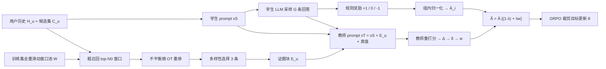

一句话解释这张图：左边一路是学生按原题作答、拿一个粗奖励，右边一路是从行为库里捞出相似顾客的后续、拼成开卷材料给老师看，两路在最后汇合成每 token 一个优势。

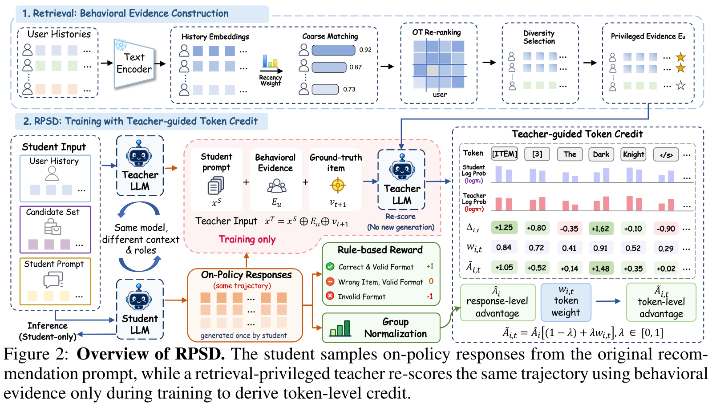

图 2：整篇论文的数据流都在这张图里——上半部是离线建的检索链路（编码 → 粗匹配 → OT 重排 → 多样性选择 → 证据块 $E_u$），下半部是在线训练链路，右下角那三行 $\Delta_{i,t}$、$w_{i,t}$、$\tilde A_{i,t}$ 就是本文真正的新东西：同一个优势被逐 token 重新分配。

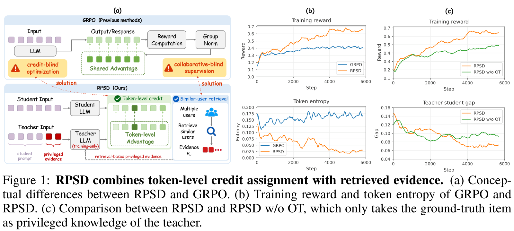

图 1：(a) 把 GRPO 与 RPSD 的差别画成两条并列的流水线，左边红色感叹号分别对应 credit-blind 与 collaborative-blind；(b)(c) 是训练曲线，RPSD 的奖励一路爬到 GRPO 之上，同时 token entropy 被压到接近零，而 w/o OT 的奖励夹在两者之间——真正拉开距离的是右下那张 teacher-student gap：w/o OT 的间隙始终比 RPSD 大且迟迟不收敛，说明少了跨用户证据，老师和学生一直谈不拢。

### 4.2 模块拆解

#### 4.2.1 模块一：把相似顾客的后续做成证据块 $E_u$

**为什么需要**：老师要能说清为什么是这个物品，光有答案不够。跨用户的行为模式是唯一在单条历史太短时还能用的信息源。

**怎么做**：先把训练集里每个用户序列切成定长 $K$ 的滑动窗口，记下窗口和它后面紧跟的那件物品，堆成一个池子 $\mathcal W$。来了一个查询历史，先用便宜的向量相似度捞出 $N_0$ 个候选窗口，再用 OT 在这 $N_0$ 个里重排，最后用多样性准则挑 3 条，每条渲染成一行自然语言。

**公式 1：把一条历史压成一个向量**

先说这个式子在算什么：给窗口里每个物品的标题向量加权平均，越靠近当前的权重越大，再归一化成长度 1 的向量。

$$
\bar e(H)=\frac{\sum_{p} a_p\, e_{v_p}}{\left\|\sum_{p} a_p\, e_{v_p}\right\|_2},
\qquad
a_p=\frac{\exp\!\left[-\beta\,(K-1-p)\right]}{\sum_{r}\exp\!\left[-\beta\,(K-1-r)\right]}
$$

- $e_{v_p}$：第 $p$ 个物品标题文本编码出的单位向量。本文用 SFT 模型对标题做 mean-pooling，再 PCA 降到 128 维（附录 C）。
- $a_p$：位置 $p$ 的权重，非负且加起来等于 1，所以 $\bar e(H)$ 是一个凸组合后再归一化。
- $\beta$：recency rate，越大越偏向最近的交互；$\beta=0$ 就退化成均匀平均（Table 4 的 `w/o Recency Weighting`）。
- $K$：窗口长度；$p=0$ 是最早的位置，$p=K-1$ 是最近的位置。$K$ 的取值原文未给。

**公式 2：给两个物品该不该配成一对定价**

先说这个式子在算什么：比较查询窗口第 $p$ 个物品和候选窗口第 $q$ 个物品时，收两笔钱——语义不像要收钱，时间位置错开也要收钱。

$$
C_{pq}=1-\langle e_{v_p},e_{v'_q}\rangle+\gamma\left|\frac{p}{K-1}-\frac{q}{K-1}\right|
$$

- $e_{v_p}$：查询窗口（当前用户最近 $K$ 件）第 $p$ 个物品的向量；$e_{v'_q}$：候选窗口第 $q$ 个物品的向量。
- 第一项 $1-\langle\cdot,\cdot\rangle$：余弦不相似度，单位向量时取值落在 $[0,2]$。
- 第二项：把两个位置都归一到 $[0,1]$ 后取绝对差，取值 $[0,1]$，惩罚第 2 个物品对上第 5 个这种时间错位。
- $\gamma\ge 0$：两笔钱的汇率。$\gamma=0$ 就是 `w/o Temporal Cost`。

生活类比：比较两张购物清单时，不但看买的东西像不像，还看是不是在同一个阶段买的——先买锅再买铲，和先买铲再买锅，是两种人。

**公式 3：不平衡熵最优传输**

先说这个式子在算什么：在所有把查询的 $K$ 个位置分配到候选的 $K$ 个位置的方案里，找总代价最小、又允许一部分质量不匹配的那一个。

$$
\mathrm{OT}_{\varepsilon,\rho}(a,b;C)=\min_{P\ge 0}\;\langle P,C\rangle+\varepsilon\,\mathrm{KL}\!\left(P\,\|\,\mathbf 1\mathbf 1^\top\right)+\rho\Big[\mathrm{KL}(P\mathbf 1\,\|\,a)+\mathrm{KL}(P^\top\mathbf 1\,\|\,b)\Big]
$$

- $P\in\mathbb R^{K\times K}$：传输方案，$P_{pq}$ 表示把查询第 $p$ 个位置的质量搬到候选第 $q$ 个位置的量。
- $a,b\in\mathbb R^{K}$：两端的质量分布，都用公式 1 的 recency 权重。
- $\langle P,C\rangle$：按公式 2 的单价结算的总运费。
- $\varepsilon$：熵正则强度，让解变平滑，从而能用 Sinkhorn 迭代而不是硬解线性规划。
- $\rho$：边缘松弛。$\rho\to\infty$ 时两个边缘约束变硬，退回标准 balanced OT；$\rho$ 有限时允许一部分质量运不出去。论文的说法是 "lets some mass stay unmatched, so a query and a window that share only part of their interests need not be fully aligned"——两个人只有一半兴趣重合时，不该被逼着把剩下的也硬配上。

解出 $P^\ast$ 后，先用运走的有效质量归一化，再映射成相似度：

$$
c=\frac{\langle P^\ast,C\rangle}{\|P^\ast\|_1},
\qquad
s\big(H^K_u,h_j\big)=\exp\!\left(-c/\tau\right)
$$

- $\|P^\ast\|_1$：实际被运走的总质量，用它归一化是为了让不同窗口的代价可比。
- $\tau$：温度，控制相似度的陡峭程度。

**公式 4：挑 3 条不一样的**

先说这个式子在算什么：每次从剩下的窗口里挑一条，既想要它跟查询像，又想要它跟已选的那些不像。

$$
j^\star=\arg\max_{j\notin S}\left[s_j-\lambda_{\mathrm{div}}\cdot\max_{k\in S}\langle \bar e(h_j),\bar e(h_k)\rangle\right],
\qquad |S|=3
$$

- $S$：已选集合，从空集开始贪心加，直到 $|S|=3$。
- $s_j$：公式 3 之后的相似度。
- $\lambda_{\mathrm{div}}$：相关性与多样性之间的汇率；$\lambda_{\mathrm{div}}=0$ 就是 `w/o Diversity Selection`。
- 内层 $\max_{k\in S}$：跟已选里最像的那条比，所以只要跟其中一条撞了就会被压分。

生活类比：找三个顾问，不要三个都是同一所学校的，第三个哪怕水平稍差，只要视角不同就值。

**证据块的形态**：每条选中的窗口渲染成一行，列出它的 $K$ 个物品、后面跟的那件物品、以及相似度 $s_j$。堆起来就是 $E_u$。附录 K 给了一个真实例子：用户最近看了 Mad Max、The Matrix、Men in Black，检索到的三条轨迹分别以 `[ITEM 2985]`、`[ITEM 24]`、`[ITEM 1527]` 收尾，相似度写着 0.12、0.11、0.09。

#### 4.2.2 模块二：老师重打分，把序列优势拆成 token 优势

**为什么需要**：GRPO 的优势方向是对的（奖励说了算），但粒度太粗。要一个既能细化粒度、又不改变优化目标的方法。

**怎么做**：学生按 $x^S$ 采样 $G$ 条回答；同一条回答原封不动喂给老师，老师的 prompt 是 $x^T=x^S\oplus E_u\oplus v^u_{t+1}$。老师不重新生成，只在 stop-gradient 下给同一批 token 打 log-prob。两个 log-prob 相减得到这个词在开卷条件下变可信了多少，再把它变成乘在优势上的系数。

**公式 5：GRPO 的那一个数**

$$
\hat A_i=\frac{r_i-\mathrm{mean}(\{r_j\}_{j=1}^{G})}{\mathrm{std}(\{r_j\}_{j=1}^{G})}
$$

- $r_i$：第 $i$ 条回答的规则奖励，$+1$ 表示格式合法且物品正确，$0$ 表示格式合法但物品错，$-1$ 表示格式不合法。
- $\mathrm{mean},\mathrm{std}$：都在同一组的 $G$ 条回答上算。$G=8$（附录 C）。
- $\hat A_i$：一个标量，整条回答共用。这就是要被拆掉的那个数。

**公式 6：师生置信差**

$$
\Delta_{i,t}=\log \pi_{\mathrm{sg}(\theta)}\!\left(o_{i,t}\mid x^T,o_{i,<t}\right)-\log \pi_{\mathrm{sg}(\theta)}\!\left(o_{i,t}\mid x^S,o_{i,<t}\right)
$$

- $o_{i,t}$：第 $i$ 条回答的第 $t$ 个 token；$o_{i,<t}$：它前面的 token。
- $\mathrm{sg}(\theta)$：stop-gradient，教师这一路不回传梯度，只当靶子。
- $\Delta_{i,t}>0$ 表示看了证据之后，这个 token 更可信了。

接着做中心化与裁剪：

$$
\delta_{i,t}=\mathrm{clip}\!\left(\Delta_{i,t}-\frac{1}{T_i}\sum_{t'}\Delta_{i,t'},\;-c_\delta,\;c_\delta\right)
$$

- $\frac{1}{T_i}\sum_{t'}\Delta_{i,t'}$：整条回答的平均差，减掉它是为了只保留这个词比这条回答的平均水平更受支持的相对量。
- $c_\delta$：stability threshold，防止个别 token 的差爆掉；`w/o Centering & Clipping` 就是不做这两步。

**公式 7：把差值变成权重**

$$
w_{i,t}=\mathrm{clip}\!\left(\exp\!\left[\mathrm{sign}(\hat A_i)\cdot\delta_{i,t}\right],\;1-\epsilon_w,\;1+\epsilon_w\right)
$$

- $\mathrm{sign}(\hat A_i)$：这条回答是对（$+1$）还是错（$-1$）。
- $\epsilon_w$：weight bound，权重的上下界，$\epsilon_w=0$ 时 $w\equiv 1$，退回 GRPO。
- 回答对时 $\delta>0$ 的 token 拿到 $w>1$（加强）；回答错时 $\delta<0$ 的 token 拿到 $w>1$，乘在负优势上就是**更强**的惩罚。论文的说法是 "tokens the teacher also disfavors receive stronger negative credit when $\hat A_i<0$"。

**公式 8：最终优势与目标函数**

$$
\tilde A_{i,t}=\hat A_i\left[(1-\lambda)+\lambda\,w_{i,t}\right],
\qquad \lambda\in[0,1]
$$

$$
\mathcal L_{\mathrm{RPSD}}=-\mathbb E\left[\frac{1}{G}\sum_{i=1}^{G}\frac{1}{T_i}\sum_{t=1}^{T_i}\min\!\left(\rho_{i,t}\tilde A_{i,t},\;\mathrm{clip}(\rho_{i,t},1-\epsilon,1+\epsilon)\,\tilde A_{i,t}\right)\right]+\beta_{\mathrm{KL}}\,\mathcal L_{\mathrm{KL}}
$$

- $\lambda$：guidance strength，0 时整个式子退回标准 GRPO（原文明确写 "$\lambda=0$ or $\epsilon_w=0$ recovers standard GRPO"）。
- $\rho_{i,t}=\pi_\theta(o_{i,t}\mid x^S,o_{i,<t})/\pi_{\theta_{\mathrm{old}}}(o_{i,t}\mid x^S,o_{i,<t})$：token 级重要性比值，分母是采样时那版策略。
- $\epsilon$：GRPO 的裁剪范围；$\mathcal L_{\mathrm{KL}}$：对参考模型的 KL 正则，系数 $\beta_{\mathrm{KL}}$。
- 由于 $w_{i,t}>0$ 且 $\lambda\in[0,1]$，括号里恒正，所以 $\mathrm{sign}(\tilde A_{i,t})=\mathrm{sign}(\hat A_i)$——奖励决定方向，教师只决定幅度。这是全篇最关键的一句结构性质。

生活类比：奖励是频道选择器，教师是音量旋钮。旋钮只能把某个字的声音调大调小，不能换台。

### 4.3 关键细节

- 骨干 Qwen3-4B，从 SFT 检查点起，LoRA rank 32、scaling factor 64、dropout 0.05，挂在所有线性层。
- 每组采样 8 条回答；证据固定 3 条窗口；物品向量 PCA 到 128 维。
- 学习率 $8\times 10^{-6}$，3 个 epoch，per-device batch size 4，8 步梯度累积，KL 系数 0.1，每 500 步存一次 checkpoint。
- 检索阶段排除查询用户自己的窗口，避免把答案漏进去（算法 2 第 8 行）。
- **原文未给**：$\lambda$、$\epsilon_w$、$c_\delta$、$K$、$N_0$、$\beta$、$\gamma$、$\lambda_{\mathrm{div}}$、$\tau$、$\varepsilon$、$\rho$ 的具体取值，GPU 型号与数量，总优化步数，解码温度与长度上限。这些数字缺一个，复现就得自己重新搜一轮。

生活类比：菜谱写齐了主料和火候，但盐和香料写适量。照着做能吃，想一模一样做不到。

## 5. 实验结果

**实验设置**

- **数据集与切分**：MovieLens-1M、MicroLens、Netflix 三个公开集。按 7:1:2 切成训练/验证/测试。每条实例取最近最多 9 个交互，最后一件当预测目标，前面最多 8 件当历史。候选集是目标 + $n_c-1$ 个从该用户未交互物品里随机采的负样本，默认 $n_c=10$，另在 MovieLens-1M 与 Netflix 上测 $n_c=100$。三个集的规模与密度差别很大：MicroLens 25,411 用户 / 41,081 物品 / 223,263 交互 / 密度 $2.1\times10^{-4}$，Netflix 13,187 / 17,366 / 68,933 / $3.0\times10^{-4}$，MovieLens 6,040 / 3,952 / 1,000,209 / $4.2\times10^{-2}$。作者特意选了平均 5.23 条历史和平均 165.56 条历史两端，来测稀疏与稠密两种工况。
- **骨干模型**：Qwen3-4B，一个尺寸。
- **训练预算**：3 个 epoch，per-device batch size 4 × 8 步梯度累积，学习率 $8\times10^{-6}$。总步数、GPU 型号与数量原文未给；图 4 与图 5 的横轴画到 6000 步。
- **基线**：8 个 Non-LLM（GRU4Rec、SASRec、LightGCN、CL4SRec、LATTICE、MoRec、BM3、AB-Rec）+ 7 个 LLM-based（TallRec、LLaRA、SPRec、RecZero、MSRBench、MLLM-MSR、MLLMRec-R1），外加作者自己的对照 Qwen3-4B + SFT / + GRPO / + RPSD——后三者同骨干、同 prompt、同采样、同奖励，只差方法本身，这是本文最干净的对照。附录另加 Qwen3-4B + OPSD（Table 6）与 Response-level RPSD（Table 7）。
- **指标**：HR@k（hit ratio）与 NDCG@k（表里简写 NG@k）。$n_c=10$ 报 $k\in\{3,5\}$，$n_c=100$ 报 $k\in\{5,10\}$。Top-3 与 Top-5 是**各自独立生成**的两张表，不是同一张排序截断。越高越好，5 次独立运行取平均，配对 t 检验 $p<0.05$。
- **推理设置**：模型只看 $x^S$，拿不到 $E_u$ 也拿不到真值，所以推理成本与 GRPO 完全一致。训练时预测单个下一物品（为了让规则奖励可判定），评测时让它输出 $k$ 个候选构成排序表。解码温度、top-p、长度上限原文未给。

主表只列 RPSD 对最强基线（MLLMRec-R1，12 个格子里每一格的最强基线都是它）：

| 数据集 / 任务 | 指标 | 本文 | 最强基线 | 提升 |
| --- | --- | --- | --- | --- |
| MovieLens-1M（$n_c=10$） | HR@3 | 0.7871 | 0.7630 | +0.0241 |
| MovieLens-1M | HR@5 | 0.8716 | 0.8368 | +0.0348 |
| MovieLens-1M | NG@3 | 0.6678 | 0.6524 | +0.0154 |
| MovieLens-1M | NG@5 | 0.7007 | 0.6784 | +0.0223 |
| MicroLens | HR@3 | 0.6836 | 0.6627 | +0.0209 |
| MicroLens | HR@5 | 0.7809 | 0.7906 | −0.0097 |
| MicroLens | NG@3 | 0.6036 | 0.5845 | +0.0191 |
| MicroLens | NG@5 | 0.6417 | 0.6365 | +0.0052 |
| Netflix | HR@3 | 0.8020 | 0.7150 | +0.0870 |
| Netflix | HR@5 | 0.9245 | 0.8670 | +0.0575 |
| Netflix | NG@3 | 0.6952 | 0.5902 | +0.1050 |
| Netflix | NG@5 | 0.7448 | 0.6293 | +0.1155 |

表中的提升是我用原文两个数相减得到的绝对差，原文没给这一列。

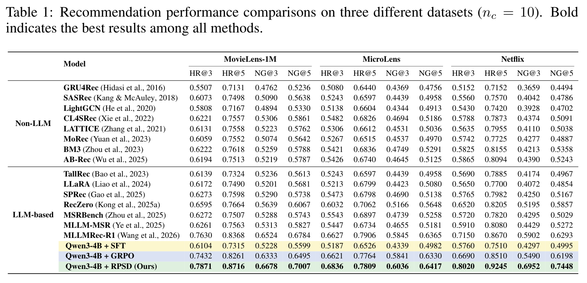

表 1：稠密集（MovieLens-1M）与稀疏集（Netflix）的差距完全不是一个量级——Netflix 上从 GRPO 的 0.6690 跳到 0.8020，而 MovieLens 上只从 0.7432 挪到 0.7871，恰好对上历史越短、跨用户证据越值钱这个动机。

还有一件从原表才看得清的事：MicroLens 的 HR@5 那一格，MLLMRec-R1 的 0.7906 是加粗的，RPSD 的 0.7809 不是。摘要把结论写成 "state-of-the-art performance"，严格讲是 12 格里赢 11 格。

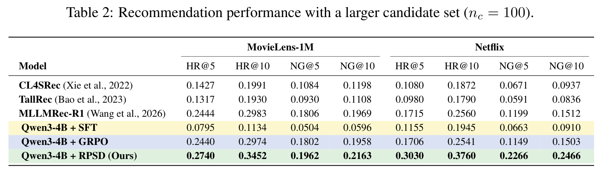

表 2：把候选集从 10 扩到 100 之后，所有方法的分数都掉到原来的两到三成，但 Netflix 上 RPSD 相对最强基线的领先反而拉开（HR@5 0.3030 对 0.1715），说明 token 级信用在要在一百个里挑一个时更吃紧。

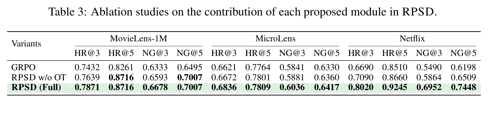

表 3：`RPSD w/o OT` 只用真值当特权就已经全面超过 GRPO，说明 credit-blind 是 GRPO 在推荐上的真实瓶颈；再加检索证据，Netflix 上一路推到 0.8020，而 MovieLens 的 HR@5 与 NG@5 两格和 w/o OT 完全相同（0.8716 / 0.7007），证据在稠密集上几乎不再加分。

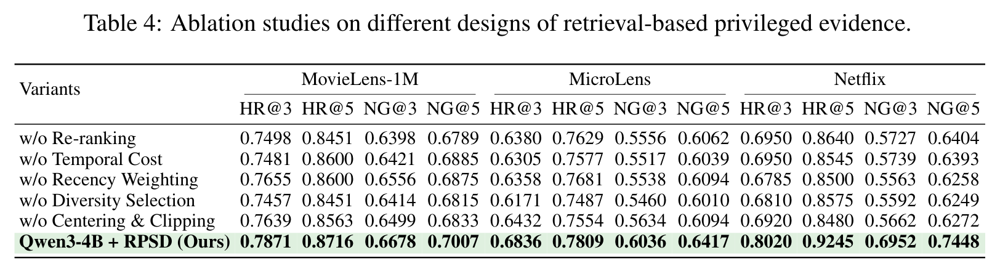

表 4：`w/o Diversity Selection` 在 MovieLens-1M 与 MicroLens 上掉得最多，`w/o Recency Weighting` 在 Netflix 上掉得最多（HR@3 从 0.8020 掉到 0.6785），说明哪个部件重要是随数据集密度变的；而 `w/o Re-ranking` 全线低于 `w/o OT`，对应作者那句 "poorly matched evidence misleads the teacher"——证据找错了比没有证据更糟。

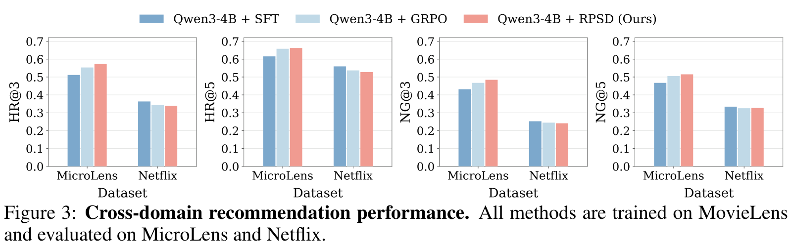

图 3：跨域实验（在 MovieLens 上训、在另两个集上测）里，MicroLens 上 RPSD 四根柱子全高，Netflix 上则是 RPSD 的柱子略微低于 SFT——后训练带来的源域专精会伤到不兼容的目标域，这个负迁移不是特权教师造成的，因为 GRPO 同样掉。

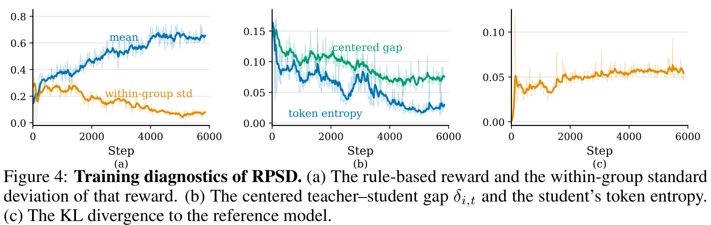

图 4：奖励的均值单调爬升、组内标准差单调下降，是策略越来越确定的典型形状；中间的 centered gap 在前 1000 步掉得最快，之后长期停在 0.07 附近而 token entropy 已经贴近 0——学生很自信了，老师的意见仍然没被完全吸收，所以 token 级信号在训练后期还在起作用。

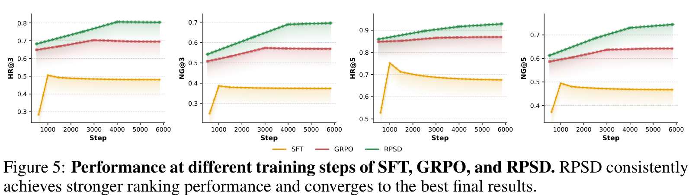

图 5：三条曲线从第一个 checkpoint 就分开了，RPSD 一开始就在 GRPO 上方并保持到收敛；SFT 那条几乎是平的，说明这条增益不是多训了几步，而是后训练目标本身在起作用。

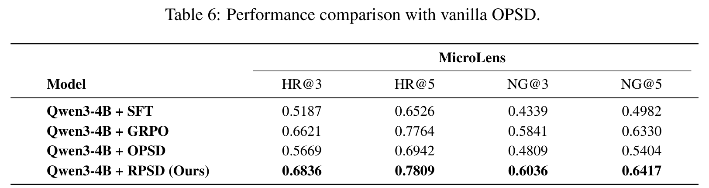

表 6：这是全文最反直觉的一格——vanilla OPSD（0.5669 / 0.6942 / 0.4809 / 0.5404）不但没超过 GRPO（0.6621 / 0.7764 / 0.5841 / 0.6330），还明显落后。把教师分布当优化目标，等于把每个 token（包括格式 token）都往老师那里拉，方向就不再由可验证奖励决定了。

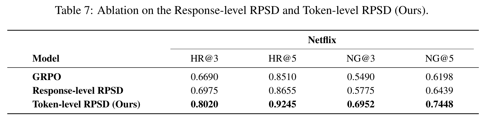

表 7：把同样的教师权重压成每条回答一个标量（Response-level RPSD）只能拿到 0.6975，远低于逐 token 的 0.8020，说明收益来自**同一条回答内部**的 token 分辨，而不是给某些回答整体加权。

**消融告诉我们什么**：三个层次都拆过了。模块级（Table 3）证明 token 级信用与检索证据各自有贡献，且证据的贡献在稀疏集上最大；检索级（Table 4）证明多样性、时间代价、重排三步都不能省，其中最不能省的是多样性；粒度级（Table 7）证明 token 粒度本身就是收益来源。加上 Table 6 把 vanilla OPSD 放在同一张表里，本文与普通 OPD的分界线被划得很清楚：**不是把学生拉向教师，而是用教师重新分配奖励的幅度**。

**这些实验够不够支撑结论**：支撑 SOTA 这一层够了，支撑为什么这一层还差几块。三个数据集全是电影或短视频，没有电商、音乐、新闻这类序列；只有一个 4B 骨干，没有尺寸扫描；检索与 OT 的时间、显存开销一次没报，而这恰好是它只在训练时用的最大卖点该配的数字；跨域实验只做了 MovieLens → 另外两个方向，没有反向。

## 6. 局限性

**作者自己承认的**

- OPSD 家族有个已知缺陷：只用 instance-level 标签做特权，老师会把答案合理化而不落到输入上，信号坍缩成捷径。作者在相关工作里引了这句话（"collapsing its signal into a shortcut"），并把它当作自己要绕开的坑。
- 跨域迁移不稳：Netflix 上 SFT 仍略强于两个后训练方法，作者归因于 RL 后训练引入的 source-domain specialization，并说 "the transferability of RPSD depends on how compatible the source and target domains are"。
- 证据质量有下限：`w/o Re-ranking` 比 `w/o OT` 还差，作者自己点明匹配得差的证据会误导教师。

**我看出来的**

- 隐形假设：相似用户的后续行为对当前用户必须是**正**迁移。热门物品会让相似退化成流行，这时证据是噪声而不是信息；论文没有按物品热度分层看证据的收益。
- 边界条件：证据来自训练语料里的窗口池，新物品没有历史窗口、标题缺失或极短时，$e_v$ 本身就不可靠，整条链路退化。原文没有冷启动实验。
- 缺的对比：没有和推理时检索增强（把同样的证据直接塞进学生 prompt，如 ReLLa 那条线）比。少了这一格，只在训练时用到底是省成本还是更有效，分不清。
- 缺的口径：$n_c=10$ 与 $n_c=100$ 的负样本是随机采的，不同随机种子会改变难度，论文只报了 5 次运行的平均，没有报每格的方差或置信区间。

## 7. 一句话总结

学生先自己答一遍，老师拿着标准答案 + 三个相似顾客的后续行为再把这份答案逐字读一遍，读出每个字有多可信，然后只用这个读数去调每个字的奖惩音量——方向仍然由答对答错决定。

生活类比：请了个陪练，他不替你打球，只在你每次出手后告诉你这一下是运气，那一下是动作对了。

核心公式（这篇论文真正看家的那一个，Eq. 7 与 Eq. 8 的合并写法）：

$$
\boxed{\;\tilde A_{i,t}=\hat A_i\Big[(1-\lambda)+\lambda\,\mathrm{clip}\big(\exp[\mathrm{sign}(\hat A_i)\,\delta_{i,t}],\,1-\epsilon_w,\,1+\epsilon_w\big)\Big]\;}
$$

## 8. 可复用点

- 如果我要在自己的项目里用：任何一个序列一个奖励的 RLVR 任务（代码、数学、工具调用），都可以照这个式子加一层 token 权重，代价是要多跑一遍前向拿教师 log-prob，不改优化目标、不改推理。
- 想让教师信号强又不失真：先 center 再 clip，最后夹在 $[1-\epsilon_w,1+\epsilon_w]$ 里。$\epsilon_w$ 小一点更安全，因为方向永远不会被翻。
- 做检索增强又怕线上变慢：把证据只挂在教师侧。审计上要留一手——训练和推理的输入分布不一致，是这类方法的天然风险。
- 选证据不要只看相似度：加 MMR 式多样性，本文里它是最不能省的部件。
- 两条不等长序列要对齐：用 unbalanced entropic OT，$\rho$ 允许部分不匹配，比硬对齐宽容，比纯余弦多用了位置信息。
- 训练不收敛时先查：$\delta$ 有没有 center + clip。去掉后在 Netflix 掉得最多（Table 4 的 `w/o Centering & Clipping`，HR@3 0.6920 对 0.8020）。

## 9. 我的疑问

- $\lambda$、$\epsilon_w$、$c_\delta$、$K$、$N_0$、$\beta$、$\gamma$、$\lambda_{\mathrm{div}}$、$\tau$、$\varepsilon$、$\rho$ 全都没给数值。那么$\lambda=0$ 退回 GRPO这条恒等式，作者是只在推导里成立，还是也做过实验对照？
- Table 3 里 `RPSD (Full)` 与 `RPSD w/o OT` 在 MovieLens 的 HR@5（0.8716）与 NG@5（0.7007）上完全相同。这是不同随机种子的巧合，还是四舍五入到四位之后被压平了？
- 证据相似度只有 0.09–0.12（附录 K 的例子），这个量级的相似还能算相似用户吗？教师会不会把噪声读成信号？论文没有做证据质量 vs 收益的曲线。
- 摘要说 "consistently outperforms state-of-the-art methods"，但 MicroLens 的 HR@5 输给 MLLMRec-R1（0.7906 对 0.7809 那一格）。这个措辞是不是过强了？
- 教师和学生是同一份权重，而 $x^T$ 里直接写了正确答案。教师重打分时的自信，有多少来自真读了 $E_u$，有多少来自看到了标签？作者用 `w/o OT` 回答了一半，但没有做只给证据不给标签的交叉，而这个交叉才能把两件事分开。
