> 一句话：让做事的模型找出自己哪步错了，只在那一步改。

## 0. 读之前你需要知道

Agent 是会采取动作、接收环境反馈并继续决策的语言模型。Trajectory 是整段交互记录。强化学习（RL）根据做事结果调整模型；GRPO 比较同一任务多条 trajectory 的 reward，得到相对 advantage，决定加强或减弱哪些生成行为。类比是几位学徒各做一道同样的菜，按最终成品比较成绩。

On-policy self-distillation（OPSD）让同一个模型扮演学生与带额外提示的教师：学生用日常输入行动，教师看到 hindsight skill 后给学生已经生成的 token 打分。Skill 是可执行的纠错建议，不是额外神经网络层。SFT 是用示范答案进行的监督微调，本篇用它先教会模型分析错误。

SEED 已让模型同时做事与回顾，但它主要生成 trajectory-level skill。SCOPE 的问题是：一道菜做成，不代表每一步都对；一条总体建议，也未必该作用到整段操作。

## 1. 动机

学徒把锅烧焦后补救，菜最后合格。老师只给整道菜高分，就会连烧焦那步一起鼓励。另一位学徒前面切洗都正确、最后调味失手，只给整道菜低分，又会惩罚正确操作。

作者在 WebShop 上观察到 outcome–step mismatch：成功 trajectory 仍含错步，失败 trajectory 也含正确步。进一步给教师加入整体 skill 后，不相关步骤也会出现明显的 token 概率变化。变化大不等于这条建议与当前动作有关。

以前的 outcome reward 便宜、容易获取，却粗；整段 OPSD 信号更密，却可能纠正错地方。现在模型已有一定轨迹理解能力，借助少量外部标注做 SFT 初始化后，可以在线定位错步，再只在这些位置接受特定 skill 的指导。

## 2. 贡献

第一，把成功与否和单步正确性分开诊断，而不是默认二者一致。Figure 1 中 WebShop 成功组有 29.8% 错步，失败组有 42.4% 正确步，解释了整段打分的分辨率问题。

第二，自举生成 step-specific skills，并用 step-selection mask 控制蒸馏位置。像老师在菜谱的具体一行写批注，而不是把同一句纠正贴满整本菜谱。

第三，采用 bounded signed distillation coefficient，限制极端 log-probability gap，同时保留正向加强和负向抑制；并使用 success-relative pairwise length reward，比较同任务成功 trajectory 的交互长度。

第四，三个小骨干和 Qwen3-32B 上报告成功率及交互效率改善。主要证据来自 ALFWorld、WebShop；这不是任意真实软件工具环境的通用有效性证明。

## 3. 创新点

**定位后再蒸馏**：对比 SEED 的 trajectory-level guidance，把 skill 粒度与作用范围收窄到所选错步；对比 OPID，在线 analyzer 来自当前策略，不每轮请求外部强模型。像学徒先学会检查刀工，然后在下一次切菜时自查。

**系数保留符号又限制幅度**：对比 raw-gap 更新，避免极大差值直接放大辅助梯度；对比非负 sigmoid gate，负 gap 仍能抑制教师不认可的 token。这是优化信号的设计，不是保证训练永远不崩的定理。

**只在成功样本之间比较相对长度**：不用固定目标步数，短成功获得较高额外奖励，失败不因短而获奖。但长度 reward 与原始任务 reward 的兼容性仍依赖成功判定和 reward 定义。

## 4. 方法

### 4.1 整体流程

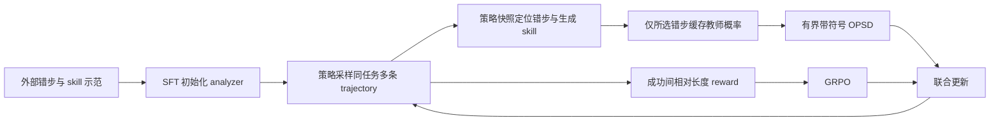

每轮 actor、analyzer 和 privileged teacher 使用同一初始策略快照，student 在 minibatch 内更新。教师分数先计算并缓存，学生分数随参数变化重新计算。像老师批改的是同一份作业，学徒的理解却在连续练习中变化。

### 4.2 选错步

GLM-5.2 在离线阶段标注错步与 skill；在线阶段由当前模型自己生成。成功 trajectory 只看自身记录，失败 trajectory 还可看同任务当前 group 的成功动作序列；group 全失败时没有成功参考，仍可直接分析记录，证据不足则输出空集。

把每条 skill 指定的目标步骤取并集，再决定哪些位置参加 OPSD：

$$
C_i=\bigcup_{k=1}^{J_i}D_{i,k},\qquad m_{i,t}=\mathbb I[t\in C_i].
$$

$i$ 是 trajectory 编号，$J_i$ 是 skill 条目数，$D_{i,k}$ 是第 $k$ 条 skill 的非空步骤集合；$C_i$ 是选中步骤集合，$m_{i,t}\in\{0,1\}$ 为标量 mask。$K_{max}=5$ 限的是 skill 条目，不是总错步数；同一条 skill 可覆盖多个步骤。解析会去掉不存在索引和重复归属。

### 4.3 Bounded signed self-distillation

先计算相同采样 token 在有 skill 教师和普通学生下的 log-probability gap，再把它压到有界区间：

$$
\Delta_{i,t,\ell}=\operatorname{sg}[\ell^T_{i,t,\ell}-\ell^S_{i,t,\ell}],\qquad
\widehat A^{dist}_{i,t,\ell}=c\tanh(\alpha\Delta_{i,t,\ell}/c).
$$

$\ell$ 在下标中为响应 token 索引；$\ell^T,\ell^S$ 则是教师、学生该 token 的标量 log-probability。$\operatorname{sg}$ 表示停止梯度，$\alpha>0$ 控制原点附近斜率，$c>0$ 控制饱和幅度；$\widehat A^{dist}$ 是标量。正 gap 加强、负 gap 抑制，零 gap 不指导。

辅助 loss 只对被选步骤中的有效响应 token 取均值：

$$
\mathcal L_{OPSD}=-\frac{1}{N_{sel}}\sum_{i,t,\ell}m_{i,t}\widehat A^{dist}_{i,t,\ell}\ell^S_{i,t,\ell}.
$$

$N_{sel}$ 是所选有效 token 数，不含未选步骤；若为零，loss 置零。它像给批注力度加限幅器，避免一次分歧压倒其他练习，但不会修正批注本身的错误。

### 4.4 Success-relative pairwise efficiency

先比较同任务两条成功 trajectory 的交互长度，再把较短者的偏好分数平均成奖励：

$$
p_{ij}=\sigma\left(\frac{\log T_j-\log T_i}{\tau_{len}}\right),\qquad
b_i=\frac{1}{|S_q|-1}\sum_{j\in S_q\setminus\{i\}}p_{ij}.
$$

$T_i,T_j>0$ 是交互步数而非 token 数，$S_q$ 为任务 $q$ 的成功 trajectory 集，$\sigma$ 是 sigmoid，$\tau_{len}>0$ 为温度，$p_{ij},b_i$ 都是标量。仅一条成功时 $b_i=1/2$，无成功不发长度 bonus；成功 reward 加 $\lambda_{len}b_i$ 后进入 GRPO。成功者平均 bonus 恒为 $\lambda_{len}/2$，并非压低所有长度就不断增加总奖金。

### 4.5 理论保证到底覆盖什么

附录把固定数据上的辅助更新解释为 log-cosh potential 的梯度：小 gap 附近近似平方惩罚，大 gap 时近似绝对值惩罚。它给出的无关 token 影响界，是先假设每个 token 的 score gradient 范数有界，再用三角不等式得到的结论。

因此减少无关 token 比例，可以收紧最坏情况的误导界；这个推导并没有证明 analyzer 真能选对，也没有证明减小界一定提高任务成功率。类比是在每块砖重量有上限的前提下，估计误装几块砖最多增加多少负担；它不保证整座房子的结构正确。

这种区分很适合复用：实现时把系数限幅与全局 gradient clipping 分开记录。若网络自身梯度已经非有限，只限制教师分数差不会自动恢复数值健康；还需要检查 log-probability 计算、混合精度和优化器状态，这是工程诊断建议而非原文做过的消融。

## 5. 实验结果

**实验设置**：ALFWorld seen 每轮 128 episodes、六任务族；WebShop 固定 128 tasks。32B unseen 为 134 episodes。离线示范池数量、完整训练集切分和 SFT 样本量原文未给。骨干为 Qwen2.5-3B-Instruct、Qwen2.5-7B-Instruct、Qwen3-1.7B，并额外扩展 Qwen3-32B。

训练预算：小骨干 WebShop 用 2 张 H200，ALFWorld 用 4 张，32B 用 16 张。主比较取 step 150，ALFWorld 消融取 step 180。batch、每任务 rollout 数、learning rate、SFT epoch、完整墙钟成本原文未给。默认 $\alpha=2.5,c=1,\lambda=0.01,\tau_{len}=0.1,\lambda_{len}=5$，其余见 Table 4。

基线为 Vanilla、Skill-Prompt*、GRPO、AgentOPSD、SDAR、OPID、GRSD、SEED。指标包括 success、normalized task score、mean interaction steps，以及错步定位的 Micro-P、Micro-R、Micro-F1、Macro-F1、Exact Match、Parse Rate。推理时 SCOPE 不用 skill、不调用 analyzer；actor 采样温度、token 上限、回合上限原文未给。离线标注 temperature 0、最大 8,192 tokens、disabled thinking，不能拿这组值冒充 actor 推理设置。

主表按相同学生和指标找最强基线，就像比较同一套厨房设备下做菜的成绩：

| 骨干 / 任务 | 指标 | SCOPE | 最强基线 | 提升 |
| --- | --- | --- | --- | --- |
| Qwen2.5-3B / ALFWorld | success | 97.7 | SEED 91.8 | 5.9 pp |
| Qwen2.5-3B / WebShop | success | 85.2 | SEED 78.9 | 6.3 pp |
| Qwen2.5-7B / ALFWorld | success | 98.4 | SEED 96.1 | 2.3 pp |
| Qwen2.5-7B / WebShop | success | 84.4 | SDAR、GRSD 82.8 | 1.6 pp |
| Qwen3-1.7B / ALFWorld | success | 92.2 | GRSD 92.2 | 0.0 pp |
| Qwen3-1.7B / WebShop | success | 78.9 | SEED 77.3 | 1.6 pp |

提升按 Table 1 已显示精度相减。表中只摘成功率，不能据此说每个 normalized score 都领先。

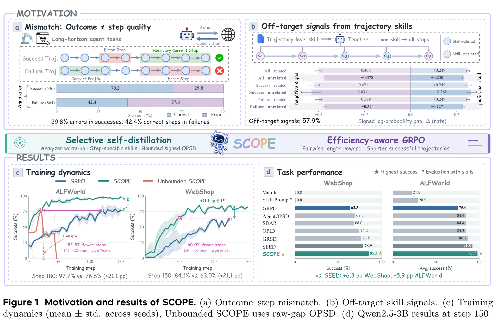

Figure 1：成功与错步不一致、skill 在无关位置也改概率，是选择性蒸馏的动机；更新数节省是在 SFT 初始化之后计，未含完整前期成本。

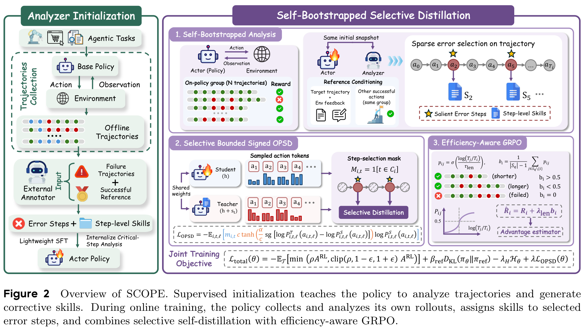

Figure 2：外部模型只负责离线初始化，在线分析由策略快照完成；不应把这套系统描述为从未使用外部教师。

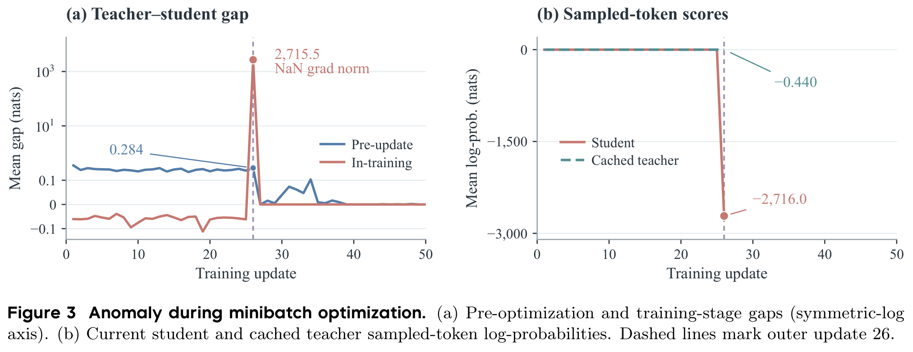

Figure 3：缓存教师与更新中学生的 gap 可突然扩大，支持做限幅；这是一段异常运行记录，不足以证明所有坍塌只有这一原因。

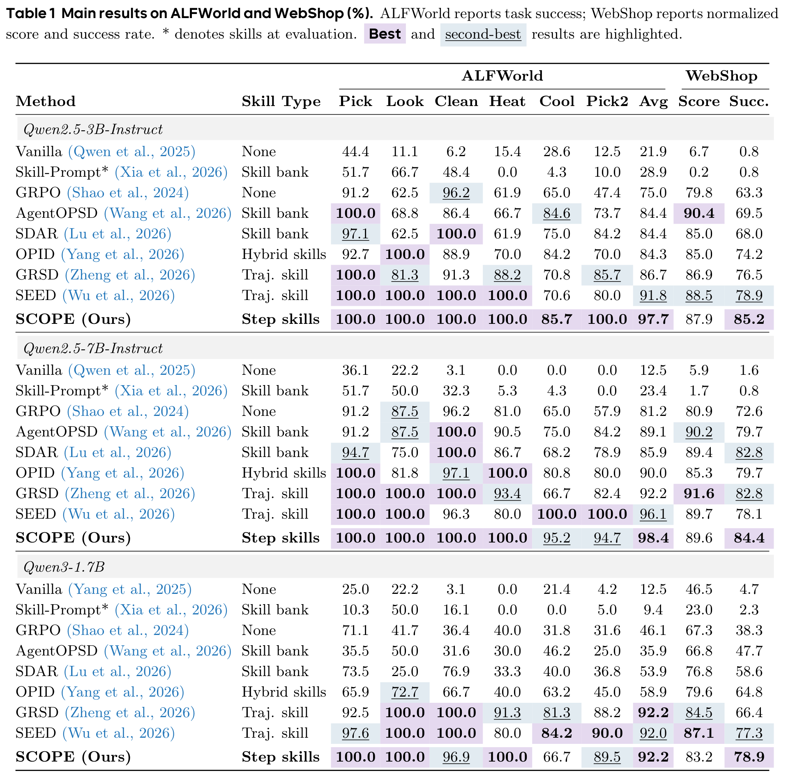

Table 1：success 的改善比 normalized score 更一致；Qwen3-1.7B 的 ALFWorld 只追平 GRSD，而非全面超越。

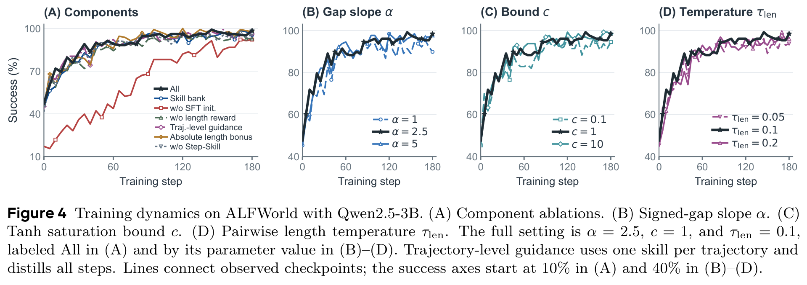

Figure 4：SFT 和各组件影响学习曲线，但纵轴截断，观察落差时要看实际刻度；每条线不能自动当成多 seed 均值。

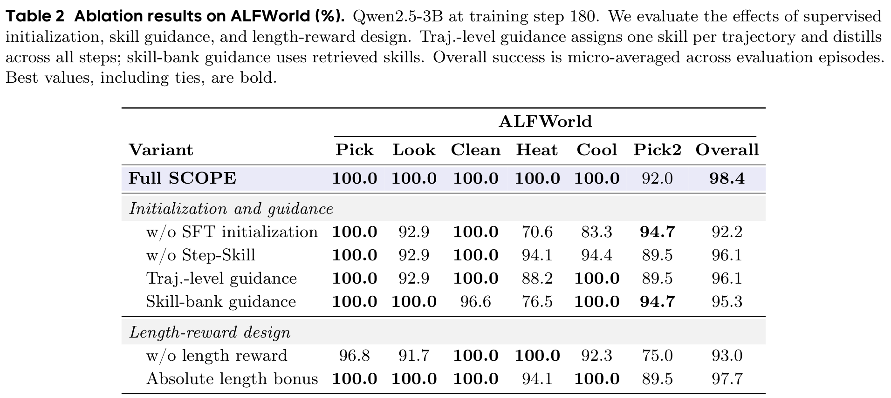

Table 2：step 180 的 Full SCOPE 为 98.4，w/o SFT initialization 为 92.2，Traj.-level guidance 为 96.1。后者同时改变 skill 粒度和覆盖范围，未分别识别两项贡献。作者正文把 SFT 降幅报为 6.3 points，表面显示值相减是 6.2，本文保留原表，不自行修作者底层精度。

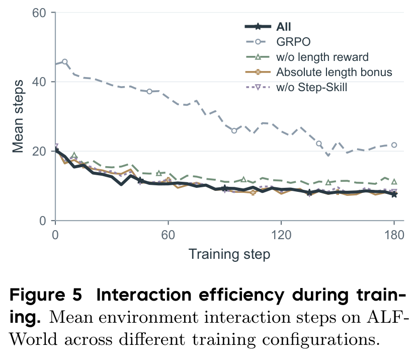

Figure 5：完整方法与去掉部分组件的交互数差异较小于它们和 GRPO 的差异；少走几步不能独自说明少算了多少。

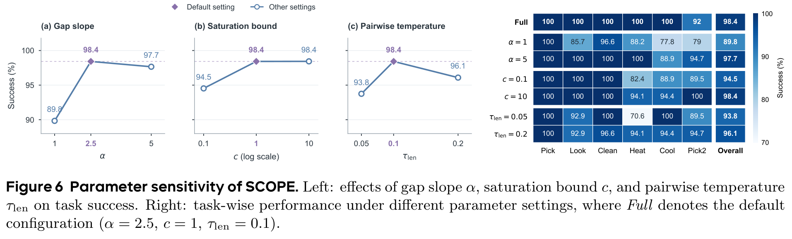

Figure 6：$\alpha$ 太小、$c$ 过紧会削弱指导；该 sweep 支持在所试范围内的选择，不是连续参数空间的最优性结论。

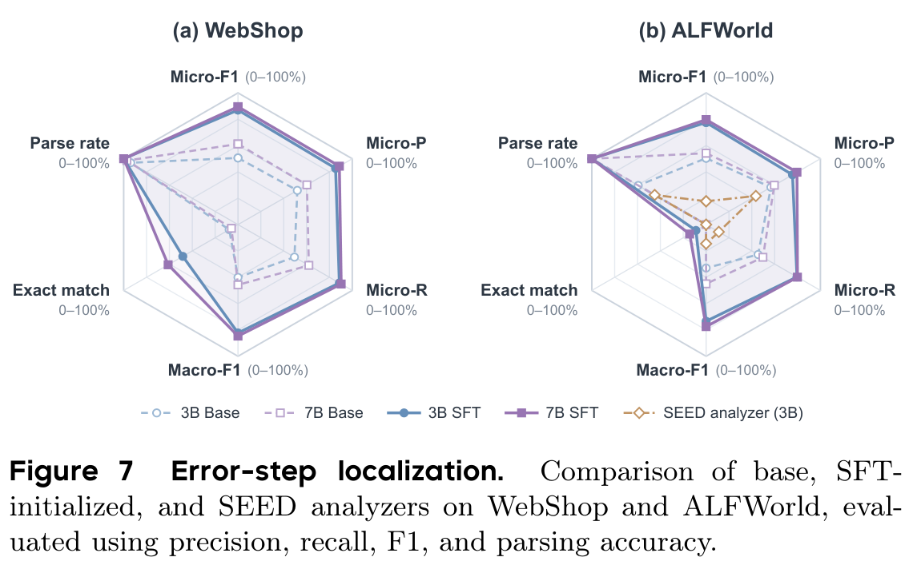

Figure 7：SFT 后错步定位指标明显改善；参照标签仍来自模型标注，测到的是相对此标注口径的一致性。

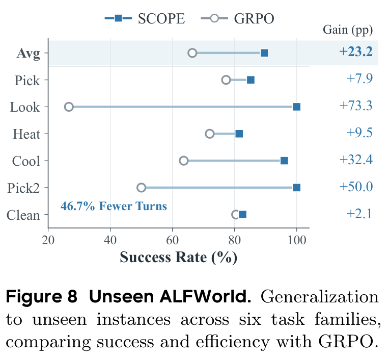

Figure 8：unseen 任务 success 与交互数同时改善，支持并非只靠拖长 trajectory 获胜；仍属于同一环境的未见实例。

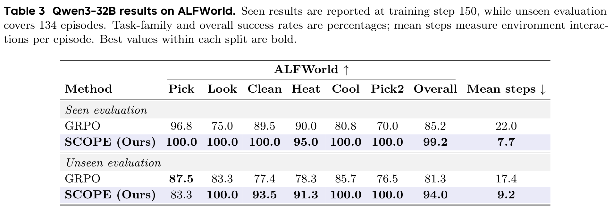

Table 3：32B 的 seen 总 success 为 99.2、GRPO 为 85.2；unseen 的 Pick 子项反而为 83.3 对 87.5，不能把总体提高说成每类均提高。

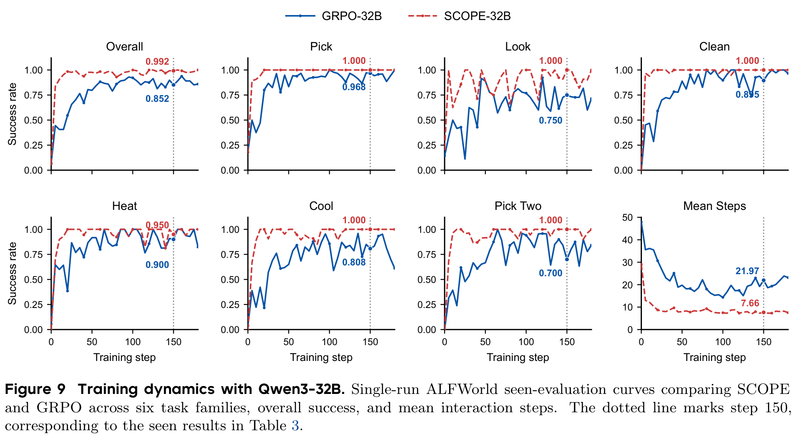

Figure 9：32B 训练曲线早期提升快且平均交互减少，但为 single-run，未提供跨 seed 方差。

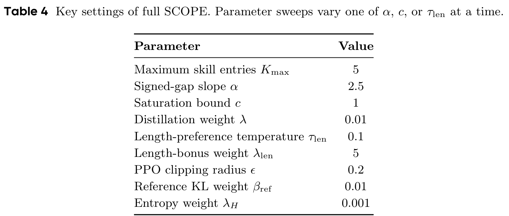

Table 4：限幅、辅助 loss、长度 reward 各有独立权重；复现时不能只设置 $c$，忽略外乘 $\lambda$。

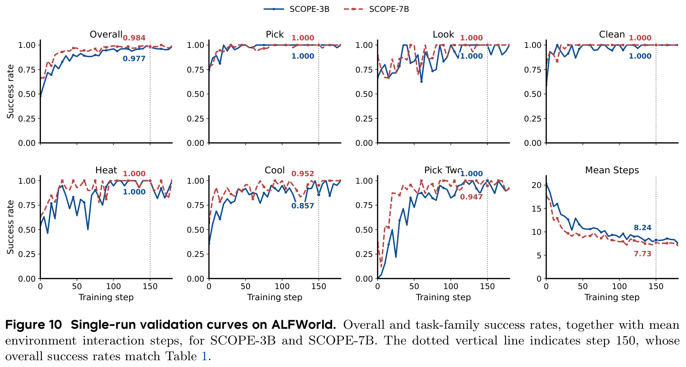

Figure 10：3B、7B 的附录 seen 曲线对应主表 step 150，不能与消融 step 180 的终点混排。

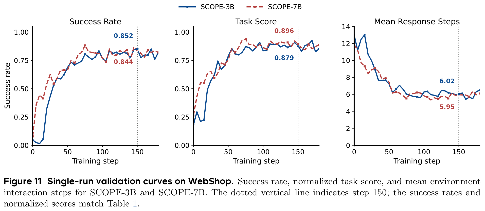

Figure 11：WebShop 的 success、score 与交互数变化不同，说明完整完成需求和部分匹配是两个口径。

## 6. 局限性

**作者限定的范围**：附录明确有界梯度推导针对固定训练 microbatch、固定教师分数和选步集合，且假设 token score gradient 范数有界；并不保证完整 RL 全局稳定。正文没有独立 Limitations 节，不能补写成作者承认了所有下面的问题。

**我的判断**：analyzer 和 actor 共享参数，可能共享错误认识。像学徒自查时仍不知道自己看错了量杯；missed error 不会获得局部纠正，错误 skill 又可能强化错误策略。空集处理避免胡乱给建议，却也会失去稀缺的学习机会。

只对所选 token 均值归一化，使改变选步数也会改变每 token 权重。长度是交互次数而非真实成本，复杂动作与便宜动作记同一票。若环境成功判定或原始 reward 不可靠，短成功 bonus 也无法修正目标。

实验层面，训练量与 SFT 成本披露不完整，主表和训练动态还存在不同聚合口径；若干曲线为单次运行。需要拆开 skill 粒度与覆盖 mask 的独立消融，并在具有不同反馈可靠性的环境中验证。这些留在正文，不塞入四条方法局限。

## 7. 一句话总结

SCOPE 像一名学会看回放的学徒：先指出具体哪步有问题，再接受这一步的纠正，同时控制批评力度。价值在于把密集监督放到相关位置，而非单纯让教师说更多；可信程度最终受错步定位与 skill 质量限制。

读它时要把训练效率和部署效率分开。部署不再调用 analyzer 是明确优势，在线训练却增加自分析与教师评分；少用 RL updates、少走 environment steps，并不自动意味着总 GPU 账单同比下降。

## 8. 可复用点

在已有 GRPO 系统先保存动作有效性、结果和步骤索引，建立 error-step JSON schema；无证据允许空集，重复归属必须消除。像修工作日志，先把哪一行出错记准确，再谈自动纠正。

辅助 loss 单独记录 gap 分位数、所选 token 数、正负系数和 gradient norm；保留 cached teacher 与 updated student 的区别。做 matched-coverage 消融：固定 skill 只换 mask，固定 mask 只换 skill 粒度。部署时确认 prompt 不再含 hindsight，避免把评测特权当作学到的能力。

## 9. 我的疑问

actor 更新后 analyzer 没有额外在线 SFT，分析质量是否也能持续提升？若 actor 变强但更会合理化自己的错误，会不会出现没人指出错误的闭环？像厨房主厨同时当唯一质检员，速度越快不代表检查越独立。

成功参考缺失时，错步选择的 precision 和 recall 怎样变？选步 token 数与性能是否只是难度的共同结果？如果把单步交互改成不同工具成本，pairwise length reward 是否仍能代表效率？这些问题原文没有充分回答。

**来源**：联网下载 arXiv v1，正文、附录理论、配置及提示模板共 23 页已读；本页 11 张 Figure、4 张 Table 均来自原始 PDF。未运行作者训练，结果为论文报告值。
