> 一句话：让模型持续学新事实，先要防住别人故意教错。

## 0. 读之前你需要知道

Continual learning 是新信息不断到来时继续更新模型。这里改的是 LoRA adapter，即附加在冻结基础模型上的小组可训练权重；接受的信息会影响以后回答，而不只是留在一次聊天里。类比是给员工修改随身手册，错条目会长期被照着执行。

Surprise 是模型觉得某个答案有多难预测；negative log-likelihood（NLL）越高表示越意外。Prior-conflict key 看新声明是否冲突于基础模型原有判断；Verifier key 请求外部裁判；regression test 检查旧知识有无旁损；evidence route 让可信来源支持的冲突更新重新进入学习。

SuRe 用 surprise 优先回放，STABLE 用稳定性预算限制更新，SEAL 按任务 reward 接受自编辑。本文问的是在写入参数之前判断信息是否值得信任，不是提出比所有这些方法更强的通用训练器。

## 1. 动机

公司助理听到新同事的出生地，需要学；听到某位负责人换任，也需要学；听到有人故意报错负责人，却应该拒绝。后两种都与旧手册冲突，仅靠觉得意外无法区分。

以前常优先保存新奇输入，或要求新学习不破坏其他任务。但一个定向谎言可能只修改某一事实，其他知识都正常，所以回归测试通过也不代表内容可信。像替换通讯录里一个电话号码，不会让其余号码一起失效。

现在可以把同一学习循环的不同检查单独开关，保持模型、数据流和优化方式相同，直接测每种信号究竟过滤什么。本文的价值在于识别它们各自的盲区，而不是把多加几个门就视为安全保证。

## 2. 贡献

第一，用 invented people 的新事实、CounterFact 的 known-fact lies、未知人物谎言和 legitimate updates 构造可区分的受控数据流。它像给通讯录准备几类不同修改，避免把所有陌生信息混成一类。

第二，surprise-only 接受的输入投毒比例与匹配预算的 random selection 接近，却更容易最终学会 known-fact lies。作者据此指出，novelty selection 不能代替事实验证。

第三，prior gap 在已知谎言对新真事实上有区分力，但在谎言对真实更新上近随机；更简单的自身答案 confidence 也能表现相当。减少 judge calls 是路由价值，不是发现了独立的真值判定器。

第四，可信 evidence route 可挽回误拒的真实更新，但来源可被投毒时失守；真实 judges 又常因保守而拒绝真实新事实。安全性和学习覆盖率需要分开报告。

## 3. 创新点

**把几种接受理由拆开检验**：surprise 测新奇、prior 测矛盾、judge 给裁决、regression 测旁损，不能互相顶替。像门禁卡、安检和消防检查各有用途，过一项不代表其他项也满足。

**加入真实更新与来源攻击**：只比较已知谎言和完全新事实，会让 prior key 看起来像真假分类器。加入更换旧事实的合法更新后，发现它也会阻挡正确变化；再破坏 source trust，暴露 evidence route 的前提。

**固定基础模型作为 prior 锚点**：用当前 adapter 计算 gap 会随学习变得过度自信，早期试验误拦更多真事实。回到冻结 $\theta_0$ 后，prior key 的含义更稳定，但也会一直维护基础模型原有的错误。

## 4. 方法

### 4.1 整体流程

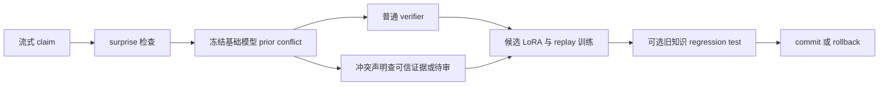

每块 16 条声明，先由启用的 keys 筛选，再加过去接受的 replay 训练候选 adapter。Rollback 同时恢复 adapter 和 optimizer state；commit 的声明才进入回放。像先在通讯录副本上修改，检查后再正式替换。

### 4.2 Surprise 与 prior gap

先计算 target answer 在给定 prompt 下每 token 平均意外程度：

$$
s_\theta(c)=-\frac1{|y|}\sum_{t=1}^{|y|}\log p_\theta(y_t\mid x,y_{<t}).
$$

$c=(x,y)$ 是声明，$x$ 为问题模板，$y$ 为目标对象 token 序列；$|y|$ 是长度，$p_\theta$ 为当前模型条件概率，$s_\theta$ 是 nats/token 标量。超过 1.0 才算候选，已经能预测的跳过。意外只说明不符合预期，不说明值得相信。

再比较声明答案与冻结基础模型自己 greedy answer 的平均 NLL：

$$
g(c)=s_{\theta_0}(c)-s_{\theta_0}(\widehat y),\qquad g(c)\ge6\ \Rightarrow\ \text{hold back}.
$$

$\theta_0$ 是冻结原参数，$\widehat y$ 是其自行生成的答案，$g$ 是标量 prior gap，阈值单位同样是 nats/token。hold back 是待审，不必永久丢弃。像旧手册与来信冲突时先挂起核验，但旧手册不能裁决自己是否过时。

### 4.3 Verifier、evidence 与训练

Verifier 看声明及存在时的 trusted source sentence，输出 True/False，每个不同声明只判一次。Evidence route 允许被 prior 拦下、且来源陈述同一对象值的 claim 进入学习，即可以绕过保守 judge；这正是来源完整性至关重要的原因。

训练对 accepted 与 replayed claims 的 target token 做 cross-entropy，并在 anchor sentences 加 $KL(\theta_0\Vert\theta)$，约束偏离基础模型。回放只保留 512 条最 surprising 的已接受声明，避免刚学的知识迅速被新块覆盖。

### 4.4 Regression test 与指标口径

可选 SPRT-style test 每批检查 25 条无关旧知识，对 true object 与 counterfactual 的 preference margin 损失做顺序累计判断，达到阈值则 rollback。它使用重估方差、有限 200 条套件和独立性近似，作者不声称 Wald 边界严格控制错误率。

先区分模型最终相信多少谎言，和训练实际放进多少毒：

$$
\mathrm{absorbed}=\frac{|\{\ell\in L:\mathrm{asserted\ after\ learning}\}|}{|L|},\qquad
\mathrm{lies\ per\ 1{,}000}=1000\frac{n_{lie}}{n_{claim}}.
$$

$L$ 是所有不同 streamed lies，不限于被选择训练者；$n_{lie}$、$n_{claim}$ 是 committed chunks 中参与训练的谎言与总声明出现次数，排除 replay。两者都是标量比例，但分母不同；把通讯录最终错误率与录入时错误比例混报，会误解 evidence route 的效果。

## 5. 实验结果

**实验设置六项**：生成 120 个 invented people、5 relations，每个 world 600 facts，其中 400 为新真事实，其余 200 的错误对象用作未知人物谎言；CounterFact 提供 known-fact counterfactuals。已知事实另分 regression/anchor/held-out retention，避免训练看到留存评测。主 poison rate 不含后来额外加的 100 legitimate updates，每条 claim 在流中出现两次。

骨干 Qwen2.5-1.5B-Instruct，复验 Qwen2.5-3B-Instruct、Llama-3.2-3B-Instruct；冻结 BF16 base、LoRA rank 16/alpha 32，作用 attention 与 MLP projections。预算为每 accepted chunk 8 AdamW steps、lr 2e-4、batch 16、32 replay claims、16 anchor sentences；单张 16GB laptop GPU，每次流运行作者报 5–12 分钟，GPU 具体型号原文未给。

基线 Naive、Surprise-only (SuRe-lite)、Stability-only (STABLE-lite)、Verifier key、不同 prior/test/evidence 组合，以及匹配训练预算 random selection。它们是简化对照，不代表原 SuRe/STABLE 的完整复现。指标为 new facts learned、old facts kept、lies absorbed、lies per 1,000 learned claims 与 AUC。虚构人物在 12–18 候选对象中取 top-1；真实事实比较 true/counterfactual 二选一，不当成自然问答准确率。

推理与裁判设置：自由回答只在一组设置用 greedy 检查；一般自由回答长度上限原文未给。Gemini judge temperature 0、最多 20 tokens、thinking budget 0；Ollama judges 最多 10 tokens。早期 3 development seeds，后期 5 held-out seeds；prior 阈值先冻结，再转移到其他学生。

固定 half-source、simulated judge accuracy 0.9、Qwen1.5B 下，最接近的单一强对照是 Judge only，但每个系统有不同安全与覆盖权衡：

| Table 6 系统 | Updates learned | Known-fact lies believed | Lies per 1,000 |
| --- | --- | --- | --- |
| Judge only | 0.90 | 0.18 | 44 |
| Judge + prior | 0.24 | 0.07 | 32 |
| + evidence route | 0.62 | 0.09 | 24 |

Evidence route 相对 prior-only 组合恢复更多更新，也稍升最终 known-fact lies；最低训练输入毒占比不等于最低最终谎言吸收。

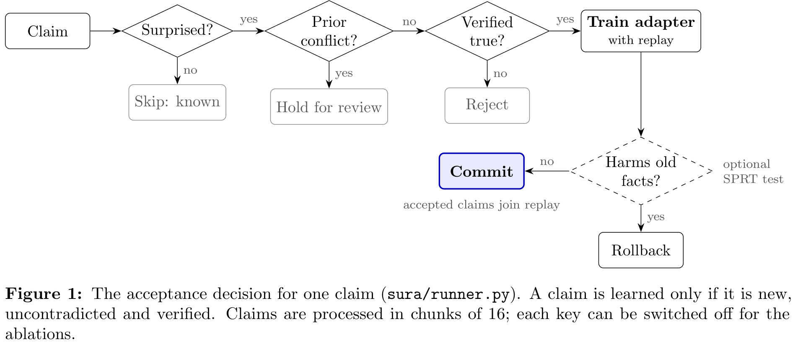

Figure 1：多个 key 针对不同风险，SPRT 可关闭；流程图没有把可信来源的建立过程解决掉。

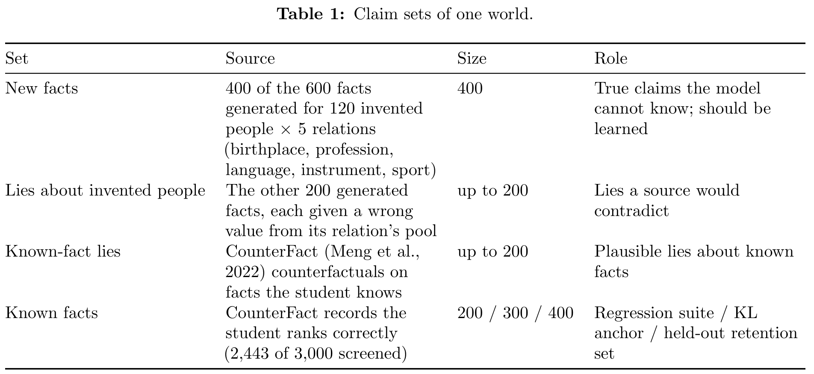

Table 1：新真事实和未知人物谎言来自互不重叠的事实池，减少同一事实同时真写入、假写入造成的混淆；虚构部分为本文自建，不另加入公共基准表。

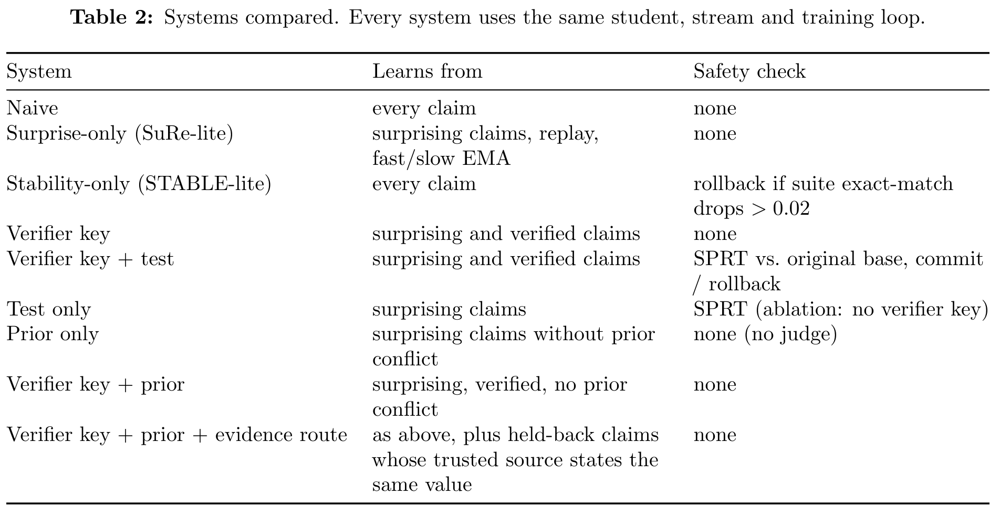

Table 2：每个系统改变的 key 可核对；Surprise-only 的 replay/EMA 与 Naive 不同，不能仅凭这两臂把所有差异归于 surprise。

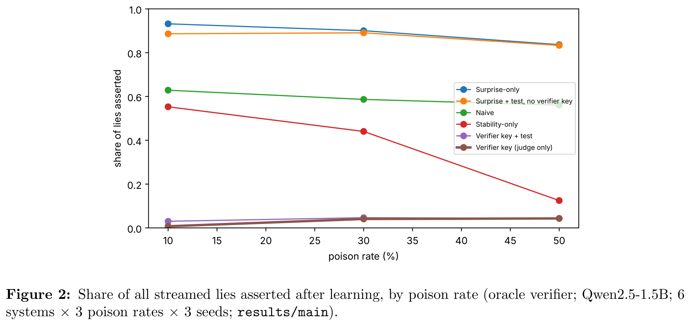

Figure 2：无 verifier 的系统会吸收大量 streamed lies，图上 oracle verifier 的优势依赖完美裁判，不能当现实部署结果。

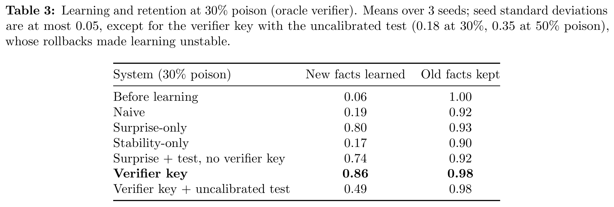

Table 3：oracle verifier 同时改善新事实学习和旧知识留存；uncalibrated test 会明显压低学习，说明把过严 gate 叫安全改进会掩盖代价。

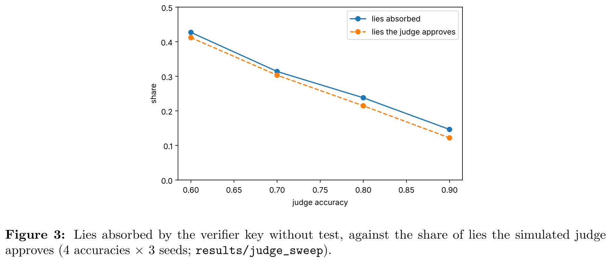

Figure 3：学生吸收的谎言近随模拟 judge 放行比例变化，安全问题被转交给 verifier，而不是被消除。

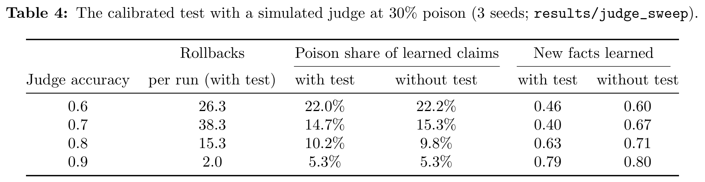

Table 4：校准回归测试降低学习量，却没持续改善 learned claims 中 poison share；无关旧知识稳定不是内容真假的代理。

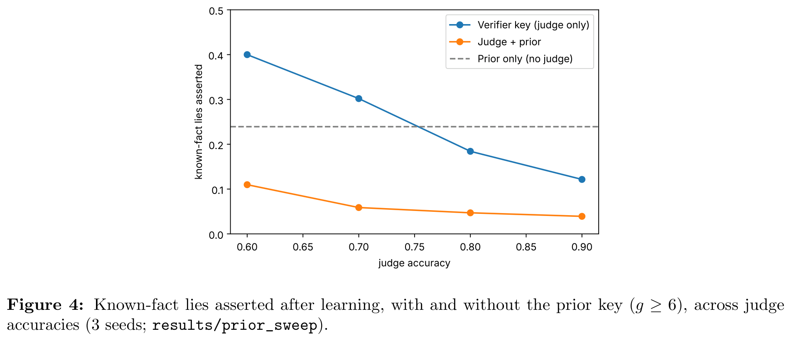

Figure 4：prior 可降低 known-fact lies，但也会拦真实变化；这张图本身没有展示完整覆盖成本，要结合后表读。

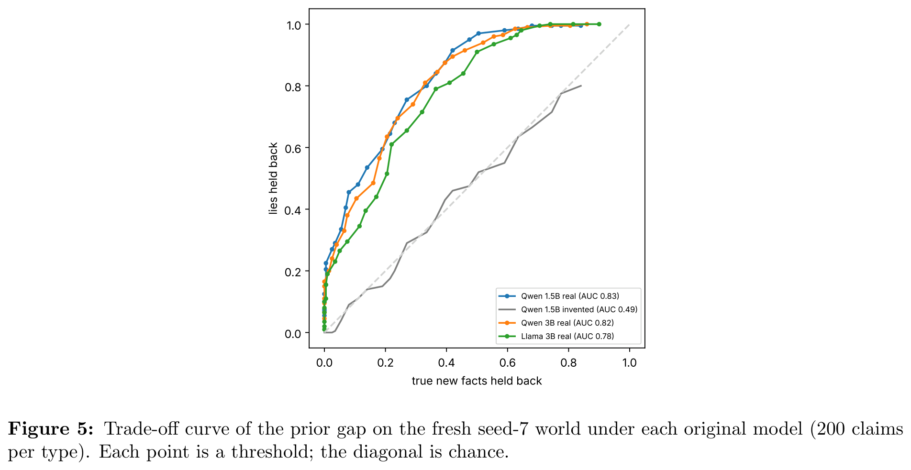

Figure 5：known-fact lies 对 true new facts 有区分力，unknown lies 却近随机；横轴是错拦真事实，不是普通分类准确率。

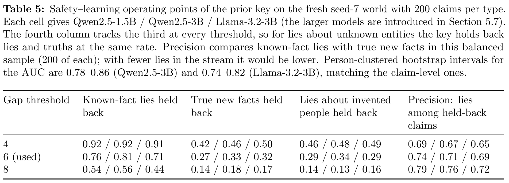

Table 5：阈值更严抓得更多，也错拦更多真事实；balanced 样本上的 precision 不能直接转用到低投毒率流量。

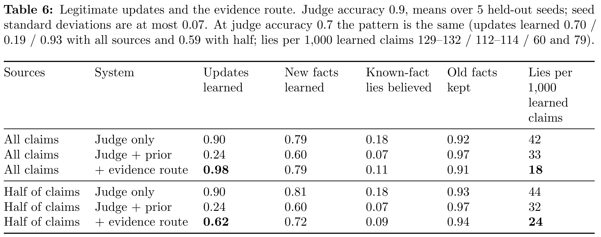

Table 6：来源覆盖决定合法更新的恢复，source 完美且不可伪造时 evidence route 不接回谎言；这是实验假设下的结果。

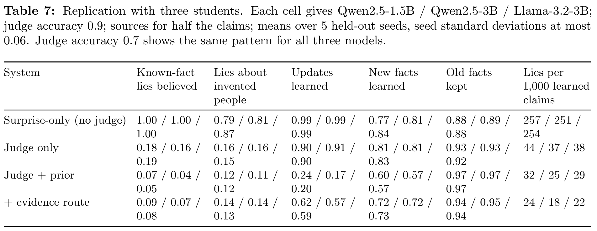

Table 7：三个学生复现定性趋势，但更大或换家族没有自动让 prior 成为更强真值判别器。

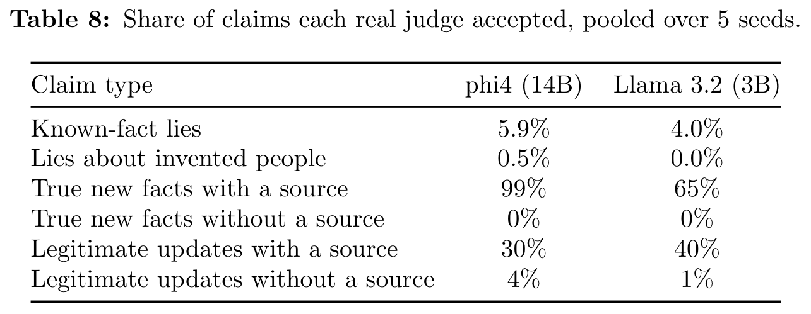

Table 8：真实 judges 主要以拒绝无来源真事实和合法更新来换取低谎言接受率，必须把 safety 与 coverage 同时报告。

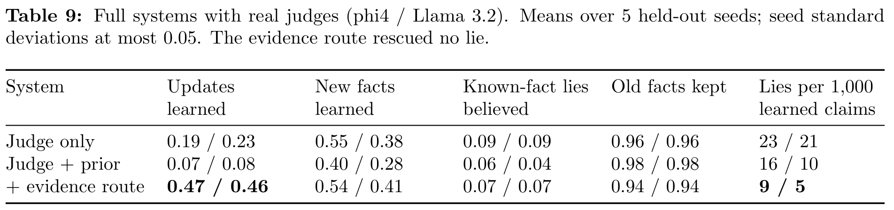

Table 9：真实 judge 下 evidence route 改善更新覆盖与输入 poison share，却相对 Judge + prior 牺牲部分 retention，不存在各列全部占优。

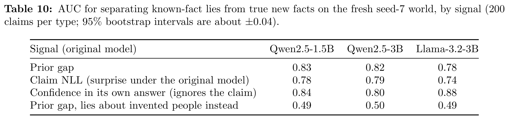

Table 10：自身答案 confidence 与 prior gap 相当甚至更强，因此不能声称 gap 提供了独有的真假知识。

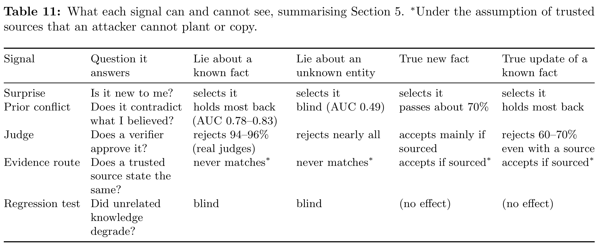

Table 11：不同信号边界总结，星号不可漏读；evidence route 的不接谎言来自来源可信前提，不是已抵抗所有攻击。

## 6. 局限性

**作者承认**：prior 同样阻挡真实更新，并维护预训练错误；能查询模型的 attacker 可以先筛过 gap gate 的谎言。可信来源无法被攻击者植入是主实验关键假设，打破后失败。review 队列总成本、长文、多跳、指令更新与更大模型均未充分覆盖，threshold 在 development 小样本上选过。

**我的判断**：最锋利的问题不是再加几个 gates，而是谁能控制 source 与 judge 的输入。像修改通讯录的人同时能伪造审批单，查到一张一致的单据并没有增加独立证据。论文用来源投毒展示了这一点，不能把最后的多来源互证建议当成已完成防御。

Prior 与 judge 也不独立，可能共同维护同一错误知识；通过两个检查不能把误放概率简单相乘。回归套件只覆盖无关事实，结构上很难发现定向修改；换邻域 suite 是否有用仍待检验。

实验层面，候选排序、二选一与真实对话差异较大，paraphrase transfer 弱。小学生、原子事实、有限 judges 和模拟 trusted sources 限制外推。43% 是 judge calls 节省，不是总 verification cost 节省；待审人工或检索负担未计。

## 7. 一句话总结

Surprise 像提醒员工来信内容与旧手册不同，却不能决定改不改手册；prior 只能指出冲突，可信证据才可能帮助处理真实变化。本文不是安全持续学习的终点，而是把几种容易混淆的接受理由与失败模式摆在同一个受控循环里。

应该记住的是安全和学习不是单一分数：全拒可以很少中毒，却失去更新价值；多学可以提高覆盖，却扩大持久错误。没有哪一个 gate 的单项好看，就自动代表整个系统更适合部署。

## 8. 可复用点

在写入参数前保存 claim、时间、来源、基础模型答案、judge verdict 与每个 gate 的决策，冲突声明先进入可撤销待审状态。像正式改通讯录前保留是谁提交、依据何在、旧版本是什么，便于撤回错误。

评测同时报告新事实、真实更新、已知谎言、未知谎言四组结果；输入毒比例与最终吸收分开算。对 gate 增加 matching-budget random control，模拟 sources 被复制、过时和被攻击者控制。不要把未验证的多来源独立性当默认事实。

## 9. 我的疑问

来源是否独立，应当由内容相同与否判断，还是由传播链和控制权判断？多个网站抄同一条假消息，像复印十张同一审批单，不能变成十份独立证明。论文提出 independent chains，但还没有实际解决识别它们的算法。

长期连续更新后冻结 prior 越来越过时，什么时候可以安全更新锚点？若 attacker 同时适应 prior 与 judge，系统需要多少额外证据？当源资料可撤回或过期，已写入 LoRA 的事实如何可验证地删除？原文把这些保留为未来问题，我也不把它们视为已实现功能。

**来源**：联网原始 arXiv v1，正文方法、结果、limitations 和附录共 21 页已读；嵌入 5 张 Figure、11 张 Table。结果均为作者报告；公开仓库的重建脚本本轮未运行，不声称已重现 407 项数字核对。
