> 一句话：拿完整的自己与受损副本比较，把差异当作练习提示。

## 0. 读之前你需要知道

蒸馏是让学生从教师的输出概率学习。On-policy distillation（OPD）强调在学生生成时访问的前缀上提供指导；self-distillation 用模型自身构造教师。类比是运动员不找新教练，先比较自己正常动作与受干扰动作的差别。

量化（quantization）把连续权重映到少量离散取值；剪枝（pruning）删掉部分连接；两者在本文只用于冻结的 weak scorer，训练中的学生仍从完整模型开始。Log-probability contrast 比较同一个 token 在两个模型下的对数概率，不是比较最终答案对错。

前序 DOPD 把训练前后模型的差异作为 policy-shift supervision；OPSD、SDPO 等则通过参考解答、示范或环境反馈增强自教师。WISD 的新选择是削弱原模型，保留正常版本作为较强成员，让无标签问题也能提供分布差异。

## 1. 动机

一名经验丰富的琴手想继续提高，却找不到更好的老师。他可以给自己戴上稍微妨碍动作的手套，再比较正常演奏与受干扰演奏在哪些音符上分歧。正常版本比受干扰版本更坚持的动作，可能包含熟练技巧。

**以前怎么做**：给模型解答或反馈，令带额外上下文的同一模型成为更强教师，再把指导蒸馏回普通输入的学生。困难在于这些额外信息不一定拿得到，取得可靠解答也有成本。

**为什么现在能做**：已有 weak-to-strong OPD 工作表明，一对模型之间的变化可以有用，即使两者都不强于学生。因此不必先找到绝对更强的教师，可以研究怎样从原权重构造有信息的相对差异。

这里必须保留一个前提：受损副本与正常版本的差别，至少一部分要对应有益能力。手套也可能只改变音色，而非暴露技巧；这个类比正对应本文最重要的方法边界。

## 2. 贡献

第一，提出 Weakening-Induced On-Policy Self-Distillation（WISD）：用冻结原模型和受损副本的 contrast 提供 dense supervision，不需要训练时参考解答或环境 reward。它仍需要任务 prompts、原模型计算与优化，不是没有任何数据或成本。

第二，给出无需 calibration data 的默认 weakening：3-bit round-to-nearest quantization 与 group-relative magnitude pruning。像只调整乐器阻力，不另外准备一套专家演奏。

第三，五个 reasoning models、五个数学和代码基准上，作者报告 quantization 与 pruning 的总体平均增益为 4.0 和 5.5 percentage points。两种 variant 分别在 25 个设置中的 21、23 个取得正增益，因此不是每一项都提高。

第四，用 weakening 强度、替代构造、简单 confidence baselines 和 reasoning-role 分析说明信号并非仅等于强化原模型最自信的 token。不过局部角色分配证据仍是诊断，不能当成完整因果解释。

## 3. 创新点

**把增强教师改成构造差分**：对比依赖 privileged information 的 self-teacher，WISD 让正常模型与弱模型看到完全相同上下文。像拿同一份曲谱比较两种演奏状态，减少参考解答改变上下文造成的分布差异。

**weakening 用来造监督而非压缩部署**：弱副本不是最终交付模型；量化后的权重还会 dequantize 回原架构评分。不能把这篇的 3-bit scorer 直接解释成推理显存缩到三比特或硬件加速已验证。

**以相对变化而非绝对 confidence 倾斜目标**：一个 token 在原模型中概率未必特别高，只要 weak copy 更不认可它，就可能得到较大相对权重。Table 3 的 Self-enhancing 与 Temperature weak 对照为此提供有限支持；它不是对所有可能 confidence regularizers 的排除。

## 4. 方法

### 4.1 整体流程

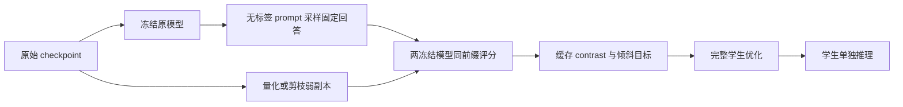

尽管名称包含 On-Policy，本文采用 Lightning Weave 的 offline DOPD：轨迹从原模型生成，评分模型和轨迹在优化全程固定；不是每一步都从最新学生重采样。像先录下训练视频，再反复练习，而不是每次训练都重新拍摄。

### 4.2 原模型与弱模型的 contrast

先计算同一状态同一 token 在正常版本与受损版本下的偏好差：

$$
r_w(a\mid s)=\log\pi_0(a\mid s)-\log\pi_w(a\mid s).
$$

$s=(x,y_{<t})$ 是问题与已有回答构成的状态；$a$ 是离散 token，$\pi_0,\pi_w$ 是共享词表上的概率向量，$r_w$ 是标量 reward-like signal。$\pi_w$ 来自对原参数的 weakening，不进行额外训练。两个完全相同模型会给零 contrast，因此有意制造差异是产生信号的必要步骤。

### 4.3 构造倾斜目标

把原概率乘以 contrast 的指数，再归一化成新目标：

$$
q_w(a\mid s)=\frac{\pi_0(a\mid s)\exp(r_w(a\mid s)/\alpha)}{\sum_{a'}\pi_0(a'\mid s)\exp(r_w(a'\mid s)/\alpha)}.
$$

$q_w$ 是词表维目标概率向量，$a'$ 遍历词表，$\alpha>0$ 控制倾斜强度，默认 2。它类似在原来每个练习动作的权重上加分，而不是把弱模型输出直接当标准答案。原式推得分子与 $\pi_0^{1+1/\alpha}/\pi_w^{1/\alpha}$ 成正比；这只是代数解释，也说明 weak probability 很小时会放大比值。

正文将优化目标写为固定原模型状态分布上的 reverse KL；附录 C.1 则给出实际缓存实现的 regression。先对目标与学生 log-probability 的差平方，再按 behavior probability 加权：

$$
\ell(p)=\frac{\alpha}{2m}\sum_j b_j(\log p_j-\log q_j)^2.
$$

$j$ 遍历 16 个原模型 token candidates 与一个 OTHER bucket，共 17 桶；$b,p,q$ 为这 17 维 behavior、student、target 概率向量，$m$ 为保留候选的 behavior probability 总和，OTHER 的 contrast 设为零。scorer 先对完整词表归一化，再取候选。这不是直接算全词表精确 KL，复现应以实现口径核对。

### 4.4 两种 weakening

默认每个 projection matrix 的每输出行按 128 输入列分组。Quantization 依据该组最大绝对权重定对称步长，3-bit 有 $2^3-1$ 个量化等级；学生本身不量化。Magnitude pruning 删去不超过组最大权重 $1/6$ 的连接，再恢复完整输出行原有的 $\ell_2$ norm。

阈值不是 sparsity 百分比，具体删多少由权重分布决定；group 内零权重与全零行有单独保留约定。Attention 与 feed-forward projections，包括 MoE expert projections，会变；embeddings、output heads、normalization 和 routing parameters 保留。像只给演奏动作增加干扰，不顺便改曲谱与音阶。

## 5. 实验结果

**实验设置六项**：数学训练来自 Skywork-OR1-RL-Data，代码来自 KlearReasoner-CodeSub-15K；每域 3,200 prompts，每题 4 回答，即每域 12,800 cached trajectories，数学和代码训练不同学生。测试 AIME24、AIME25、HMMT25 各 30 题，LCB v5/v6 为 279/131 题；AIME24 还用于探索 weak constructions，需视为 development 接触。

骨干为 Qwen3-4B、Qwen3.5-4B、OLMo-3-7B-Think、Qwen3.6-27B、Qwen3.6-35B-A3B。训练 200 optimizer updates、global batch 64、learning rate 1e-6 constant、BF16 student、distillation coefficient 2。硬件、卡数、墙钟时间原文未给。训练采样 temperature/top-p 均 1.0，默认 response limit 2,048 tokens。

基线包括 Original、OPSD、SDPO、PW-OPSD、LOPD，以及 Table 3 的简单信号。指标数学 Avg@32、代码 Avg@4，Math Avg. 等权三项、Code Avg. 等权两项、最终 Avg. 等权五项，使用未四舍五入值计算。推理按 A.2 为 thinking enabled、temperature 0.6、top-p 0.95、top-k disabled、output 40,960/context 49,152 tokens。

**原文冲突**：A.3 数学提取段却写每题 64 responses、最多 32,768 generated tokens；无法与 A.2 的 32 samples 和 40,960 上限统一。原文未说明两套设置各对应哪些结果，本笔记不替它消除冲突。

| 固定骨干 / 口径 | 本文较佳 variant | 表中最强外部基线或 Original | 判断 |
| --- | --- | --- | --- |
| Qwen3-4B / Math Avg. | Pruning 62.36 | PW-OPSD 62.44 | 低 0.08，且评测口径不同 |
| Qwen3-4B / Code Avg. | Pruning 52.96 | LOPD 47.79 | 高 5.17，不能当严格同设置增益 |
| OLMo-3-7B-Think / Math Avg. | Pruning 62.99 | PW-OPSD 62.01 | 高 0.98，采样数不同 |
| Qwen3.6-27B / 五项 Avg. | Pruning 81.76 | Original 76.58 | 同文对照高 5.18 |

像比赛需要同样跑道，借自他文的基线不能直接当作受控实验：OPSD/PW-OPSD 数学用 Avg@12、temperature 1.0、38,912 上限；代码基线用 pass@1、temperature 0.7、16,384 上限。原文虽列一起，公平比较仍受这些差异限制。

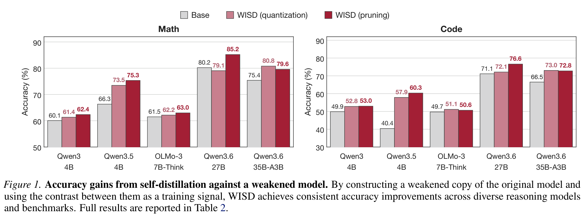

Figure 1：总体趋势是两种 weakening 带来收益，但 Qwen3.6-27B 的 quantization 数学均分低于 Original，不能概括为全部设置正增益。

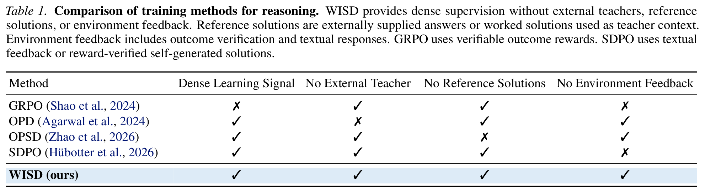

Table 1：比较的是训练所需外部信号，不是计算成本，也不代表训练 prompts 的产生过程完全无监督。

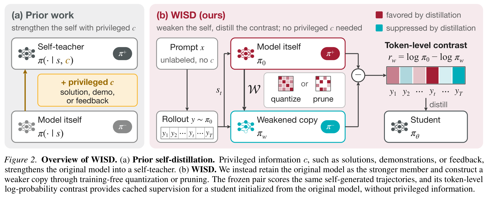

Figure 2：正常模型作为较强端，弱副本作为对照端，完整学生学习 contrast；不存在先把弱副本训强再蒸馏的环节。

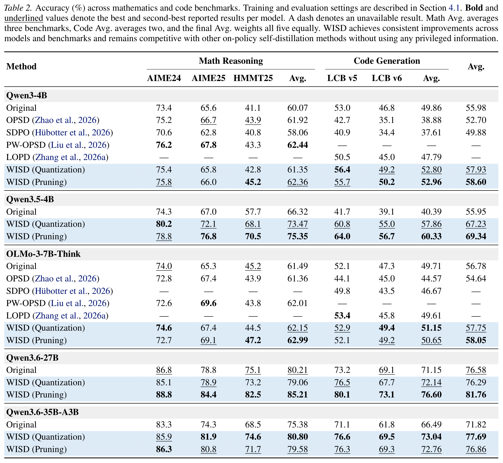

Table 2：最明显收益落在 Qwen3.5-4B，较大模型的 quantization 与 pruning 优劣不同；缺失横线不能当零分。各模型的外部基线覆盖也不相同。

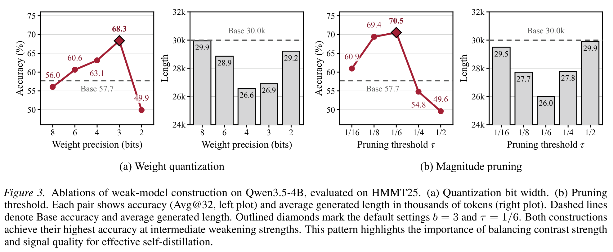

Figure 3：中等 weakening 最有效；强行把弱模型破坏到底会降低学生准确率，说明有信息差异与随机噪声不是一回事。平均生成长度也并非随 bit 数单调变化。

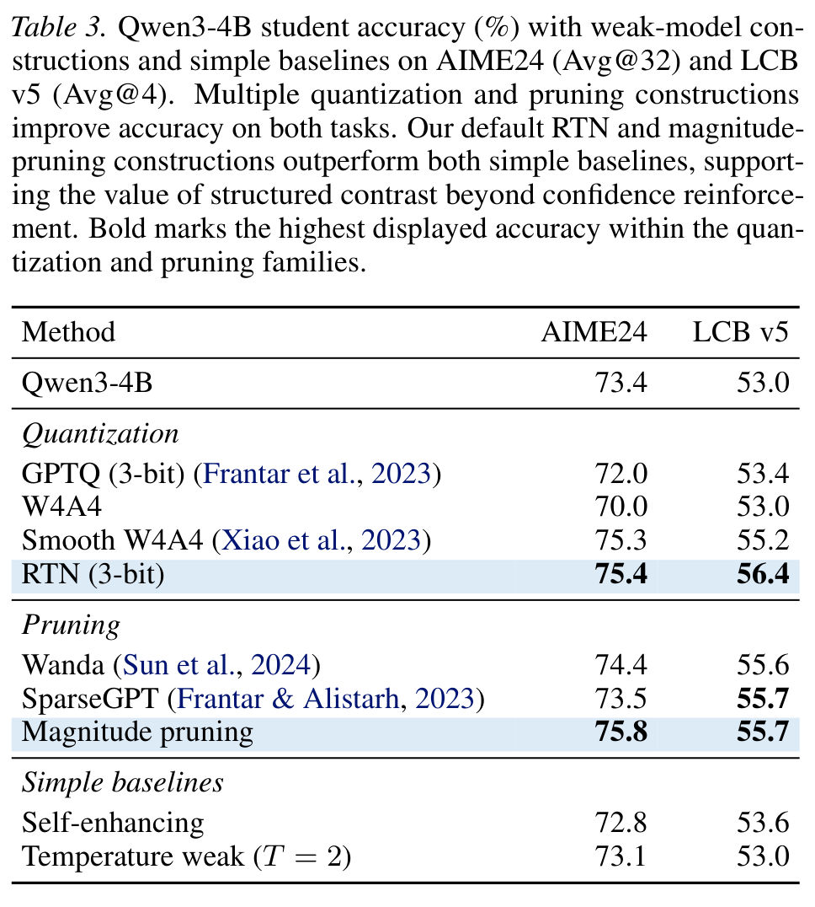

Table 3：默认构造胜过所试 Self-enhancing 和 Temperature weak；GPTQ 与 RTN 同为 3-bit 却不同，说明 bit width 不能单独代表训练信号质量。

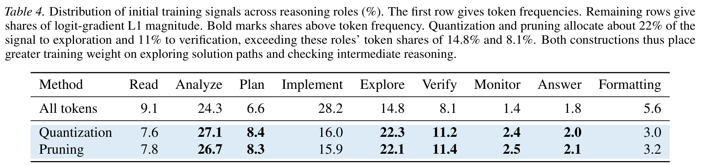

Table 4：Explore、Verify 得到的 initial logit-gradient L1 share 高于 token share；这衡量梯度分配，既不是正 reward 比例，也不是最终能力贡献百分比。

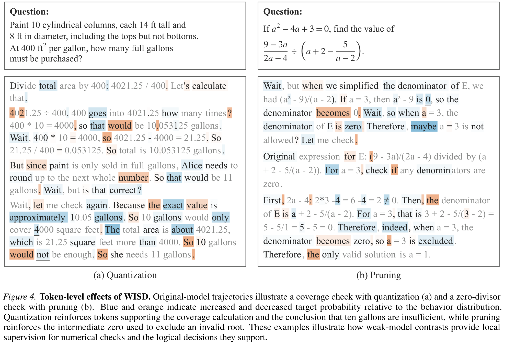

Figure 4：局部数字、否定词和零值获得不同目标概率，解释信号如何落到 token；两个挑选案例不能代替总体因果检验。

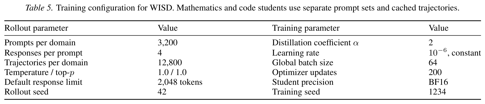

Table 5：轨迹一次生成并缓存，训练预算可核对；默认训练响应上限与评测长推理上限必须分开。

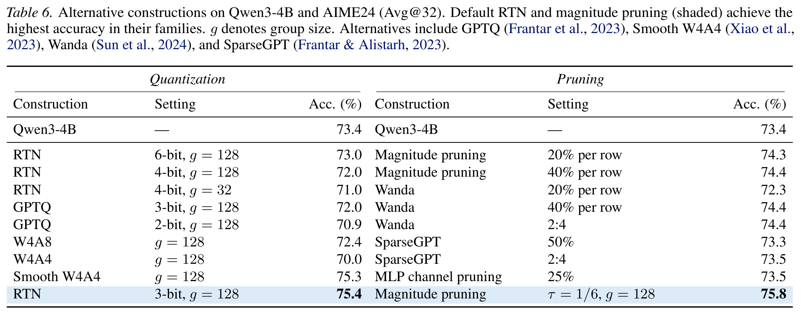

Table 6：多种 pruning 或 smoothing 也有效，但不是所有构造都改善；选择弱副本需要 development 判断，而不只是保证它更差。

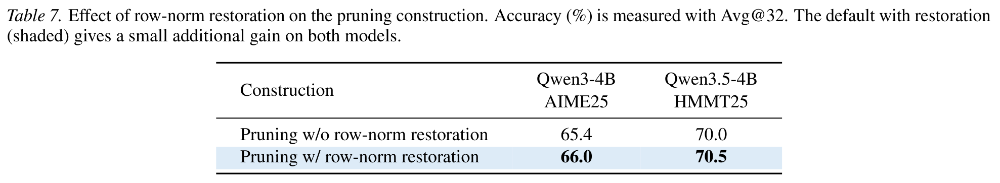

Table 7：row-norm restoration 只有小幅附加收益；它帮助保留尺度，但并未构成 weakening 有用性的主要独立证据。

## 6. 局限性

**作者明确呈现的边界**：Figure 3 展示过强破坏导致退化；论文未设独立 Limitations 节，不把以下批评伪装成作者自述。作者给出角色分析的样本选择和 assistant annotation 流程，说明它依赖外部分析标签，但这些标签不参与 WISD 训练。

**我的判断**：contrast 没有真实正确性约束。如果原模型的某个偏见比弱副本更顽固，比例目标照样会放大它。像手套让错音更小声，也不能证明正常演奏的错音值得加强。

固定 $d_{\pi_0}$ 限制训练后新状态覆盖；候选桶与 OTHER 进一步压缩未保留 token 的信息。较小 $\pi_w$ 会放大比值，weakening 强度还受权重分布与 scorer precision 影响，因此默认阈值不是跨模型保证。

实验方面，数学评测设置自相矛盾，基线来自不同生成预算，主比较没给硬件成本；sweep 的默认 pruning 使用 FP32-scored main run，而其他某些设置 BF16，不能把全部变化归因于阈值。角色分析只是初始梯度，尚未证明 Explore/Verify 的额外权重就是收益原因。

## 7. 一句话总结

WISD 像让熟练琴手比较正常演奏与受干扰演奏，再练习最能体现差异的地方；不必先找更强老师，但受干扰版本必须保留有用结构，不能只剩噪声。本文的强项是监督来源简单，弱项是差分为什么指向正确仍依赖经验。

因此可借鉴的是构造配对模型和受控 contrast 的实验设计，而不是推断剪枝本身天然产生真知识。严格复现还必须先澄清评测与实现目标，不能只照标题把它当成持续在线重采样算法。

## 8. 可复用点

先固定原模型 trajectories、candidate cache 和 scorer precision，只改变 weakening，才能判断变化来自哪里；每个阈值同时记录弱模型能力、学生任务分数、response length 与 probability tail。像换不同手套时保持同一段曲谱和录音设备。

训练前检查零行、group size 和 MoE expert 的处理，保证 output head 与 tokenizer 不被改动。加入相同 entropy 或相同 confidence 强度的随机扰动对照，测试有用的是结构性破坏还是一般正则；这是我的实验建议，本文未完成该全面对照。

## 9. 我的疑问

既然失真可以制造监督，哪些失真保留了任务语义、哪些只改变校准？能否在没有标签的条件下选出合适 weakening 强度，而不依赖已接触的 AIME24 或 HMMT25？像没有听众评分时，琴手怎样知道哪副手套提供了好练习？

如果反复更新原模型并重新构造弱副本，是否持续改善，还是逐渐放大稳定错误？论文只验证固定配对的一轮训练，不能把结果扩张为无限递归自我提升。

**来源与范围**：联网原始 PDF，已读正文方法、全部实验和附录 A–D；本页嵌入 4 张正文 Figure、7 张关键 Table。附录长文本案例与角色说明表未在本页逐项引用，自动裁片保留于项目 runtime。实验为论文报告，未本地训练复现。
