> 换个界面同一个模型就可能变笨，这篇把它算成了一本账。

## 0. 读之前你需要知道

**术语卡**

- **harness（驾驭层）**：把任务摆到模型面前、再把回答变成真实执行的那一层，包含提示词、工具、控制逻辑。生活类比：同一辆车，助力阻尼、踏板行程、仪表盘排布都算 harness，司机才是模型。
- **semantic action（语义动作）**：真正被执行的操作连同它的参数，比如点某个复选框、跑某条查询。生活类比：不管在点菜页面上怎么划，最后端上桌的那道菜。
- **interface（接口）**：论文把 harness 写成三元组 $I=(c_I,d_I,e_I)$，分别负责把状态编码成上下文、把回答解码成动作、把动作执行出去。生活类比：点菜的三段流程——写菜单、念菜单、厨房照单做。
- **optimal action score（最优动作分数）**：$F^*_I(s,a)=Q^*_I(s,a)+\tau\log\pi^{ref}_I(a\mid s)$，把长期价值和对该动作的既有偏好合成一个数。生活类比：一道菜的得分等于它本身多好吃，加上你本来就多爱它一点。
- **readout（读数）**：模型通过某接口表达出来的分数 $\hat F_{\theta,I}=\tau P_\perp\log\Pi_{\theta,I}$。生活类比：同一副嗓子在小房间和大礼堂里不一样，你听到的那个版本就是读数。
- **ceiling（天花板）** $C(I)$：这套 harness 下任何策略能达到的最好回报。生活类比：这座山的最高峰海拔。
- **mismatch（落差）** $M(\theta,I)$：当前模型比天花板少拿的那部分。生活类比：机器人离峰顶还差多少米。
- **decision geometry（决策几何）**：把每个状态的动作偏好画成地形图，再用 Bregman 散度量出你离最优位置丢了多少钱。

**它站在谁肩上**

- 正则化控制与 control-as-inference（Geist et al. 2019；Haarnoja et al. 2017, 2018）：给出 Gibbs 形式的最优策略与 Bregman 形式的价值差，本文 Eq. (3)、Eq. (6) 直接架在上面。
- O'Donoghue (2022)：把 Bregman 散度与正则化 MDP 的价值差对上；本文的 mismatch 就是这个量沿部署轨迹的累积。
- DPO 及其序列扩展（Rafailov et al. 2023, 2024）：借用同一套策略里藏着分数的视角，只是把对象从奖励换成接口。
- 提示格式敏感性（Sclar et al. 2024）与接口设计（Yang et al. 2024；Mu et al. 2025）：证明换格式会改分数，但没证明最优决策变没变；本文用可解的控制问题把两件事分开。
- 自动 harness 设计（Hu et al. 2025；Zhang et al. 2025b, 2026；Fernando et al. 2023）：用固定模型给候选打分，本文针对的正是这个口径。

## 1. 动机

一家公司换掉报销系统。以前表单是金额、日期、事由，现在顺序改成日期、事由、金额。字段一个没少，金额一分没变，正确答案两边完全一样，财务同事的出错率还是翻了三倍。你不能说他不会报销，也不能说新系统更难，只能说他的习惯是照旧顺序养成的。

**以前怎么做**：自动 harness 设计（ADAS、AFlow、Darwin Gödel Machine、Promptbreeder）先造一批候选，再拿训好的模型在每个候选下跑分，谁分高留谁。论文把全程冻结权重的那一步叫 frozen comparison。

**为什么不行**：这个分数混了两件本来不同的事——harness 本身能提供多少回报，以及当前 checkpoint 会不会用它。前一件与权重无关，后一件一训就变。论文原话是 "Comparing harnesses with a fixed model therefore mixes what each harness offers with how well that model uses it."，说的是固定模型比较 harness，会把 harness 给了什么和模型用得怎么样混成一个数。

**为什么现在能做**：一是 agent 后训练普及，同一批任务上能拿到好几个各自在某一 harness 下训到收敛的 checkpoint，可以横向摆开。二是正则化控制成熟到能把 harness 写成有限 MDP：把每个 harness 编译成有限状态图，用 soft Bellman 解出最优策略，每个状态的最优动作分数就精确可知，天花板能算出来而不只是跑个分。

## 2. 贡献

- **最优策略的对数几率精确等于相对动作分数**。证据：Prop 3.1 证明两套接口最优决策等价当且仅当分数场只差逐状态常数；Eq. (4) 给出 $\tau\log\frac{\Pi(a\mid s)}{\Pi(b\mid s)}=F^*(s,a)-F^*(s,b)$。
- **换 harness 后失败可拆成三项**。证据：Eq. (5) 拆成 target shift $g_{12}$、training residual $e_1$、readout drift $\eta_{12}$；只改呈现的 R1（反转观察字段顺序）让 52.0% 的状态换了最可能动作，成功率从 85.0% 掉到 19.2%。
- **部署回报精确等于 ceiling 减 mismatch**。证据：Eq. (8) 是恒等式；Table 8 里源 checkpoint 在 H0 下 $J=0.42289$、$M=0.01485$，与 $C-J$ 一致，附录 F.8 的最大残差是 $7.22\times10^{-16}$。
- **被冻结比较否掉的 harness，自适应后可能是最好的**。证据：H0–H5 之间 30 个有序 swap，冻结比较拒绝 22 个，13 个 $T\le0$ 直接排除，剩 9 个；其中 7 个升 ceiling 的自适应后全部超过源 pair，2 个降 ceiling 的没有收益（Table 10）。
- **ceiling 与 mismatch 能在自适应之前预测收益**。证据：$T-r_2$ 对 8 个预先记录的 swap 排序 Spearman $\rho=0.95$，冻结回报变化只有 $\rho=0.17$；编码 agent 上 $\tilde C-\tilde M$ 把 5 个 harness 排到 $\rho=1.0$（Table 2）。

## 3. 创新点

- **把 reference 先验折进分数**。新在哪：$F^*=Q^*+\tau\log\pi^{ref}$ 把动作本身好和模型本来就偏爱它合成一个可比较的标量。对比对象：只看 $Q^*$ 的价值分析和只看策略概率的行为分析。有用是因为：只有这样才能说清 harness 也能通过 reference 改最优决策——H5 只加系统指令、动作一个没动，ceiling 却变了。
- **接口写成三元组，语义策略是 token 策略的 pushforward**。新在哪：Eq. (1) 让权重固定和语义策略固定明确分成两件事。对比对象：把 prompt 敏感性当经验现象记录的工作。有用是因为：它解释了一个训好的模型为什么换个格式就坏，也解释了修复它为什么不需要重训。
- **把换 harness 和改权重放进同一个可加账本**。新在哪：$J=C-M$，训练只动 $M$，换 harness 两个都动。对比对象：用单一分数给候选排序的做法。有用是因为：它导出一个可检验的阈值 $T$，回答新 harness 什么时候值得再做一次自适应。
- **用 teacher 顶替 optimum 做部署测量**。新在哪：没有可解最优时用强模型的 log odds 代替 $F^*$，再套 Prop 6.1 的上界。对比对象：直接 rollout 估回报。有用是因为：同查询预算下，决定自适应划不划算的那一档小差异，误差小一个数量级。

## 4. 方法

### 4.1 整体流程

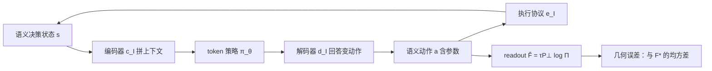

一句话读图：模型每步只做一件小事，在给定上下文下给 token 打分；harness 决定这个 token 怎么变成动作、动作怎么改状态。三处编码解码一改，同一组权重表达的动作偏好就变了。

### 4.2 模块拆解

**模块一：语义策略是 token 策略的 pushforward**

为什么需要：不同 harness 的输出格式不同，一个 JSON 对象和一个函数调用字符串可以发出同一条带参数的查询。要跨 harness 比决策，必须先把字符串这层剥掉，只比执行了什么。

$$
\Pi_{\theta,I}(a\mid s)=\sum_{y:\,d_I(y;s)=a}\pi_\theta\bigl(y\mid c_I(s)\bigr)
$$

这个式子把 token 层概率重新分配到语义动作上，权重只给能解码成同一个动作的输出。

- $a$：语义动作，取自有限集 $\mathcal A$，含全部参数。
- $s$：语义决策状态，除页面状态外还含工具返回、剩余预算、控制器记忆。
- $y$：一段完整输出；$c_I(s)$ 是喂给模型的上下文；$d_I(y;s)$ 是它被解成哪个动作。
- $\Pi_{\theta,I}(a\mid s)$：概率，非负且对 $a$ 求和为一。

关键是 $c_I$ 与 $d_I$ 都在右边，所以 $\theta$ 固定时语义策略未必固定。这就是全文的起点。

**模块二：最优动作分数与行为识别**

为什么需要：只说最优策略是 softmax 不够，还得说清 softmax 的输入里价值和先验各占多少。

$$
F^*_I(s,a)=Q^*_I(s,a)+\tau\log\pi^{ref}_I(a\mid s),\qquad
\Pi^*_I(\cdot\mid s)=\mathrm{softmax}\bigl(F^*_I(s,\cdot)/\tau\bigr)
$$

这个式子给每个候选动作打一个可比较的分，再归一化成概率。

- $Q^*_I(s,a)$：接口 $I$ 的 soft Bellman 方程解出的最优动作价值，实数。
- $\tau$：KL 正则系数，正数；训练与编码 agent 测量都取 0.1。
- $\pi^{ref}_I(a\mid s)$：该接口下的语义 reference，正数，训练中冻结。
- $F^*_I$：最优动作分数；$[F]$ 表示只按逐状态常数相区别的那一整类分数场。

于是得到 Prop 3.1：两套接口最优决策等价，当且仅当 $[F^*_{I_1}]=[F^*_{I_2}]$。对训到最优的 checkpoint，这条变成可测等式

$$
\tau\log\frac{\Pi_{\theta,I_{\mathrm{tr}}}(a\mid s)}{\Pi_{\theta,I_{\mathrm{tr}}}(b\mid s)}
=F^*_{I_{\mathrm{tr}}}(s,a)-F^*_{I_{\mathrm{tr}}}(s,b)
$$

两个动作概率的对数比乘 $\tau$，等于它们的分数差；左边能从模型前向直接算出，右边是控制问题的解。

- $a,b$：同一状态下的两个动作。
- $I_{\mathrm{tr}}$：训练用的接口。

生活类比：体温计只量温差，零点定在哪儿随你。分数场整体抬高一个常数，所有决策一个不变，所以行为只能识别差，识别不了绝对值。

**模块三：换接口后的三项分解**

为什么需要：换到新 harness 掉分，可能是新 harness 让最优动作变了，也可能是模型表达偏好的方式变了，得分清。

$$
\underbrace{\hat F_{\theta,2}-\bar F^*_2}_{\text{deployed error}}
=\underbrace{\bar F^*_1-\bar F^*_2}_{g_{12}:\ \text{target shift}}
+\underbrace{\hat F_{\theta,1}-\bar F^*_1}_{e_1:\ \text{training residual}}
+\underbrace{\hat F_{\theta,2}-\hat F_{\theta,1}}_{\eta_{12}:\ \text{readout drift}}
$$

这是恒等式，只是换了加法顺序，好处是三块各有物理含义。

- $\hat F_{\theta,I}=\tau P_\perp\log\Pi_{\theta,I}$：读数；$P_\perp=I-\mathbf 1\mathbf 1^\top/n$ 是去均值投影，把逐状态常数消掉。
- $\bar F^*_I$：最优分数的去均值版本，代表这一类的中心成员。
- $g_{12}$：目标漂移，新 harness 让最优分数移动多少。
- $e_1$：训练残差，本来在旧 harness 上就没训到最优的那部分。
- $\eta_{12}$：读数漂移，同组权重换接口后表达变了多少。

生活类比：换赛道，圈速变了。可能终点线挪了（$g$），可能你本来就没跑到位（$e$），也可能换了双不合脚的鞋（$\eta$）。三笔账不能合成一句话。

**模块四：从分数误差到丢掉的回报**

为什么需要：分数差多少不是钱，得换算成回报。固定接口，任取一个策略，它每一步相对最优丢的回报正好是那一步的 KL，沿自己的轨迹加权求和。

$$
J_I(\Pi^*_I)-J_I(\Pi)=\frac{\tau}{1-\gamma}\,\mathbb E_{s\sim d^\Pi_I}\,\mathrm{KL}\bigl(\Pi(\cdot\mid s)\,\|\,\Pi^*_I(\cdot\mid s)\bigr)
$$

这个式子算的是一个策略总共丢了多少回报，等于每一步的决策损失按到达频率加权平均。

- $J_I(\Pi)$：Eq. (2) 定义的正则化回报，实数。
- $d^\Pi_I(s)=(1-\gamma)\sum_t\gamma^t\Pr{}^\Pi_I(s_t=s)$：策略自己的折扣状态占用，和为 1。
- $\gamma$：折扣；post-training 用 0.95，附录 F.8 的精确对照取 1。
- $\mathrm{KL}$：两个动作分布的 KL 散度，非负。

换成分数写，这一步的损失就是 Bregman 散度 $D_\Phi(F^*,\hat F)$，其中 $\Phi(F)=\tau\log\sum_a e^{F_a/\tau}$ 是分数的平滑最大值。生活类比：爬山丢的高度差不是海拔，而是你现在相对峰顶的落差；落差小时它大约正比于水平距离的平方。

**模块五：ceiling 与 mismatch**

为什么需要：相对分数定死决策，却定不死 harness 值多少钱，因为所有奖励整体抬高一个常数不改任何决策。要把这份价值单独加回来。

$$
J_I(\Pi_{\theta,I})=C(I)-M(\theta,I),\qquad
M(\theta,I)=\frac{\tau}{1-\gamma}\mathbb E_{d^{\Pi_{\theta,I}}_I}\mathrm{KL}\bigl(\Pi_{\theta,I}\,\|\,\Pi^*_I\bigr)
$$

这个式子说：实际回报 = 这套 harness 的最高分 − 你离最高分还差多少。

- $C(I)=J_I(\Pi^*_I)$：ceiling，只和 harness 与目标有关，与权重无关。
- $M(\theta,I)$：mismatch，与 harness、checkpoint 都有关，含训练继承下来的误差。
- 一个 checkpoint 加它被部署的 harness，论文叫一个 pair。

于是两个 pair 的账是 $J_2-J_1=(C_2-C_1)-(M_2-M_1)$：新 harness 只有天花板涨幅超过新增落差，才对冻结的模型有好处。生活类比：换到一座更高的山，但你站得更低，净高度可能反而下降。

**模块六：自适应什么时候划算**

为什么需要：新 harness 一开始让模型变差，接着在它上面继续训可能反而更好，要给可检验条件。

$$
M(\theta_1,I_2)<C_2-J(\theta_0,I_1)=\Delta C+M(\theta_0,I_1)=:T
$$

这个式子说：自适应后剩下的落差，要小于新天花板减去源 pair 现有回报这个门槛。

- $\theta_0$：在 $I_1$ 上训好的源 checkpoint；$\theta_1$：在 $I_2$ 上自适应之后的 checkpoint。
- $T$：门槛，等于 ceiling 涨幅加上源 pair 本来就有的落差。
- $\Delta C=C_2-C_1$：ceiling 变化，可为负。

因为 mismatch 不可能为负，$T\le0$ 时怎么训都赢不了源 pair，这类 swap 不必试。生活类比：转行。新行业上限更高，但头一年收入会掉；只有学艺成本低于新上限减现有收入，转行才划算。作者另给三个分开的比较：recovery（对源 pair）、harness ranking（同一新 checkpoint 下比两套 harness）、gain over continuation（对继续在旧 harness 上训同样步数）。

**模块七：从采样动作估出 mismatch**

为什么需要：上面都假设动作分布精确可读、最优策略可解。部署的 agent 只给采样动作，还常常没有最优策略。

$$
\hat M=\frac{\tau}{(1-\gamma)m}\sum_{i=1}^{m}\mathrm{KL}\bigl(\hat p(\cdot\mid s_i)\,\|\,\Pi^*_I(\cdot\mid s_i)\bigr)
$$

这个式子算的是在 $m$ 个按占用分布抽到的状态上，平均每一步丢多少。

- $m$：pilot 状态数，校准后取 256。
- $N$：每个状态采多少动作，校准后取 1024。
- $\hat p$：计数加伪计数平滑后的动作分布，选定规则是每动作 $\alpha=0.5$。
- 截断时刻按 $\Pr(T=t)=(1-\gamma)\gamma^t$ 抽，所以 $s_T$ 正好是折扣占用的精确样本。

另一条路只查被问到的动作：$\tau\log[\Pi(a\mid s)/\Pi(b\mid s)]$ 就是分数差，串成链能恢复全部中心化分数，再套 Prop 6.1 的上界 $M(\theta,I)\le\varepsilon_d^2/\bigl(4\tau(1-\gamma)\bigr)$，其中 $x_s=\hat F_{\theta,I}(s,\cdot)-\bar F^*_I(s,\cdot)$ 是该状态的分数误差向量，$\varepsilon_d^2=\mathbb E\,\|x_s\|_2^2$ 是它在占用下的均方长度。误差小时上界近似二次增长，所以三项分解的误差是按和的平方、而不是平方的和，变成回报损失的。生活类比：估一锅汤咸不咸不用喝完，随机舀 256 勺、每勺尝 1024 次就够了；每勺只尝 16 次，伪计数会把味道抹平近一半。

### 4.3 关键细节

- **一个动作一个 token**。prompt 列出完整动作菜单（含全部参数），每个动作映射到 `A-Z/a-z` 里一个区分大小写的 token，下一 token 分布归一化后直接等于 $\Pi_{\theta,I}$。没有这一步，语义策略只能估不能算。
- **reference 是另一份冻结模型**。actor 是 Qwen3.5-2B 加 LoRA，reference 是同一底座不带 adapter 的冻结副本，读同样消息。H5 只改指令但 reference 输入也变了，所以 H5 的最优值要单独解，不能拿 H0 顶替。
- **训练分布做了覆盖加权**。$\mu_h=\tfrac12\delta_{s_0,h}+\tfrac12\nu_h$，起点占一半，其余可达非终态按纠错类别、完成进度、剩余预算分箱、控制器记忆分层，每层等质量。这样每个可达决策状态都有正训练质量，而动力学、奖励、最优动作偏好都不动。
- **Exact-PG 而不是采样估计**。每次更新采 4 个任务，用动态规划算当前策略的正则化价值与优势，再沿该任务全部可达状态和完整动作菜单求梯度和，四个梯度在同参数下求完再平均一次，所以任务等权、与状态图大小无关。
- **数值精度分三层**。前向 BF16，可训参数与优化器状态 FP32，类别 log-softmax 与动态规划 FP64。目的是让 $J=C-M$ 的残差停在 $10^{-16}$ 量级，否则恒等式检验没意义。
- **超参**。LoRA rank 16、$\alpha=32$、dropout 0、不训 bias；AdamW 常数学习率 $10^{-5}$、$\beta=(0.9,0.999)$、$\epsilon=10^{-8}$、weight decay 0、梯度裁剪 1；每套 harness 1,024 次更新、每次 4 任务（4,096 次任务抽取），每 64 步存一个 checkpoint（满预算 17 个）；状态 microbatch 8，按 prompt 长度与菜单大小分组；prompt 上限 2,048 token 不截断。

## 5. 实验结果

**实验设置**

- **数据集与切分**：主实验用 MiniWoB++ 三个任务族 `click-checkboxes`、`click-checkboxes-soft`、`ascending-numbers`。每族训练 480（合计 1,440）、校准 96（288）、训练探针 24（72）、测试 192（576）；按完整公开任务内容去重后才划分，测试集不参与参数更新与 checkpoint 选择。部署实验用 Terminal-Bench Lite 共 39 题，官方 verifier 判分，探针只用其中 3 题：`acl-permissions-inheritance`、`analyze-access-logs`、`bank-trans-filter`。
- **骨干模型**：MiniWoB++ 用 Qwen3.5-2B，底座、reference、H4 的 reviewer 三份权重全冻结。Terminal-Bench Lite 的被测模型是冻结的 Qwen3.5-9B，开启 thinking；teacher 是 GPT-5.6-luna，high reasoning effort。
- **训练预算**：每套 harness 1,024 次 Exact-PG 更新、每次 4 个任务；自适应两分支各再加 1,024 次（4,096 次任务抽取），优化器一阶二阶矩重置，任务抽取配对。每次训练一张 RTX 4090，另有一张卡评测。编码 agent 那组不训练、模型全程冻结，训练预算一项不适用；那组 GPU 小时数原文未给，只给了预测实验新增概率测量 2.19 GPU-hours。
- **基线**：harness 层面直接基线是 H0（一步一个原生动作）；方法层面对照三个——frozen comparison、只用 ceiling、同查询预算的 frequency rollout。
- **指标**：task success（%，精确完成的未折扣概率，用动态规划算）、regularized return $J$、mismatch $M$、ceiling $C$、geometry error（中心化分数与最优分数的均方差，单位 $10^{-2}$）、choice change（最可能动作改变的状态占比）、readout RMS、Spearman $\rho$。$M$ 与 geometry error 越低越好，其余越高越好。
- **推理设置**：MiniWoB++ 在 temperature 1 下对完整单 token 菜单归一化，关闭 thinking，每回合最多 10 次 actor 决策，$\gamma=0.95$、$\tau=0.1$，显式动作与工具成本全为 0。编码 agent 用 temperature 0.6、输出上限 32,768 token、上下文 65,536 token，每轨迹最多 50 次顶层决策，时间限制沿用任务自带。

**主表**

| 数据集 / 任务 | 指标 | 本文 | 最强基线 | 提升 |
| --- | --- | --- | --- | --- |
| MiniWoB++ 576 测试任务 | task success（%） | 88.17（H1 adaptation 在 H1 上） | 85.05（源 checkpoint 在 H0 上） | +3.1 pp |
| MiniWoB++ 72 个配置比较 | Configuration RMSE | 0.00230 | 0.00240（frequency rollout，同预算） | 低 0.0001 |
| MiniWoB++ 7 个自适应节点 | Ranking RMSE | 0.00286 | 0.02672（frequency rollout） | 低约 9 倍 |
| Terminal-Bench Lite 39 题、5 harness | 排序 Spearman $\rho$ | 1.0（$\tilde C-\tilde M$） | 0.7（只用 $\tilde C$） | +0.3 |

**原文实验图**

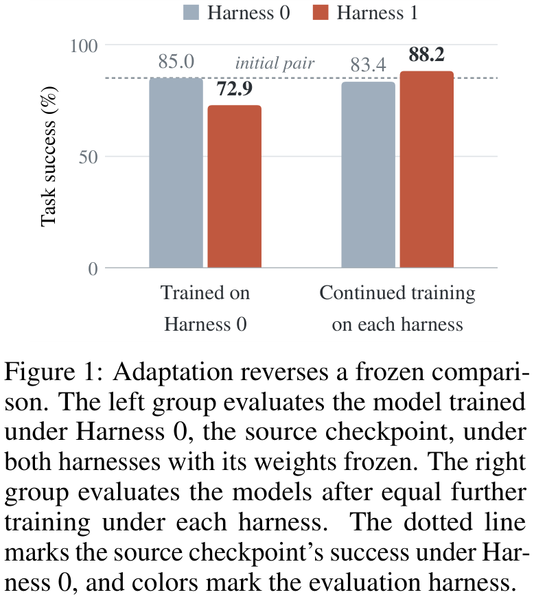

图 1：冻结比较把 Harness 1 判成坏选择（85.0 掉到 72.9），同样两个 harness 各训 1,024 步后，在 Harness 1 上训出来的模型是四根柱子里最高的 88.2，跨过了源 checkpoint 在 Harness 0 上的 85.0 那条虚线。这张图只讲顺序反转，不讲原因。

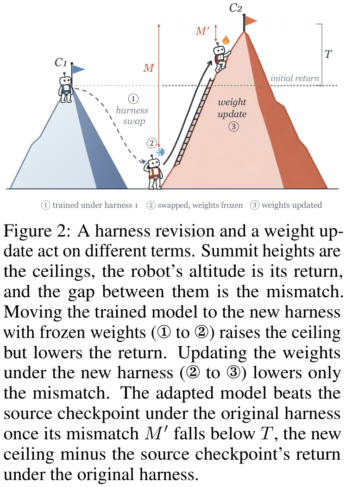

图 2：账本图解。山高是 ceiling，机器人高度是回报，两者之差是 mismatch。① 到 ② 只换 harness，山变高但机器人掉下去；② 到 ③ 只改权重，山不动，落差缩小。真正决定自适应划不划算的是 $M'$ 有没有掉到 $T$ 以下，而不是 ① 到 ② 掉了多少。

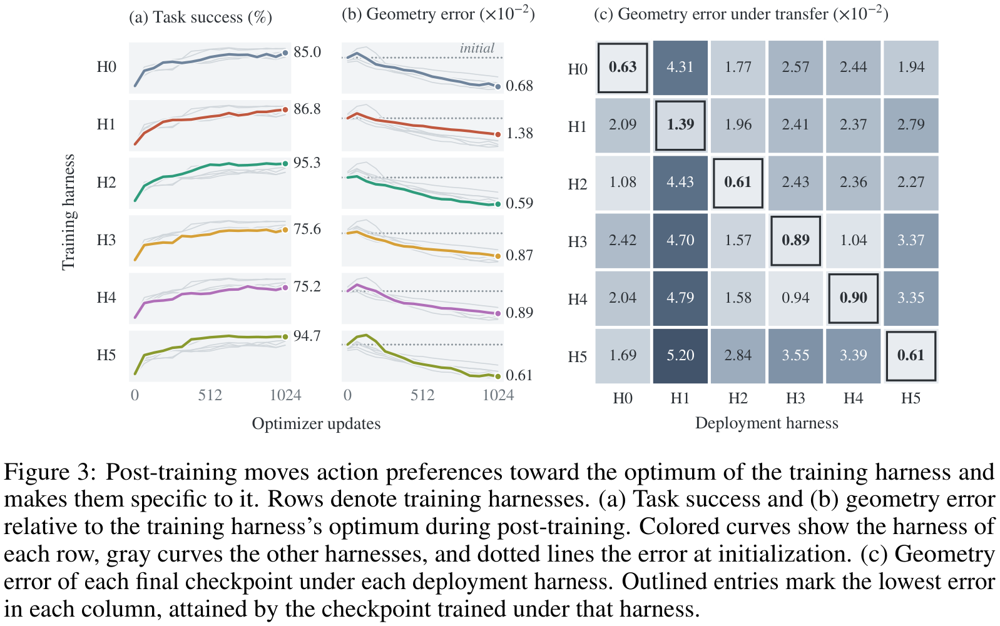

图 3：左两栏是六套 harness 训练时的 task success 与 geometry error，灰线是别的 harness，每条彩线都在往自己那套的最优靠，误差下降 69% 到 90%。右栏是 6×6 迁移矩阵，每列被加粗框住的最小值全落在对角线上——每个 checkpoint 都在自己训过的那套下误差最低，这是 harness-specific 的直接证据。

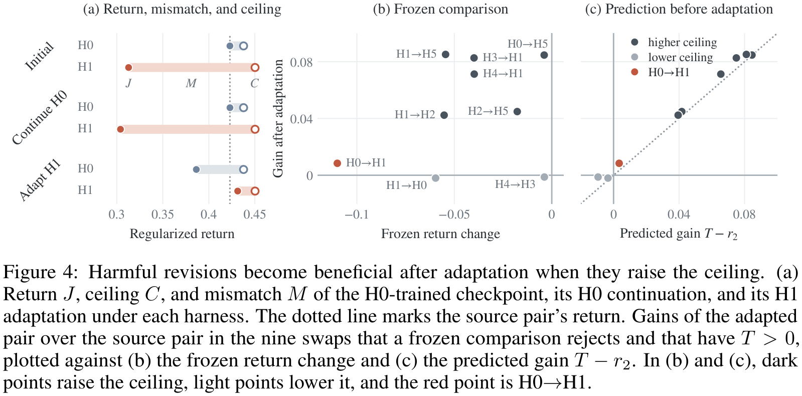

图 4：(a) 三种 pair 的 $J$、$M$、$C$ 拆开摆着看，H1 adaptation 那一行落差最短、回报最高。(b) 9 个 swap 的自适应收益对冻结回报变化作图，点几乎不落成线；(c) 对 $T-r_2$ 作图，点贴着对角线。同一批点换横轴，一个散沙一个直线，这就是冻结比较预测不了收益的图形证据。

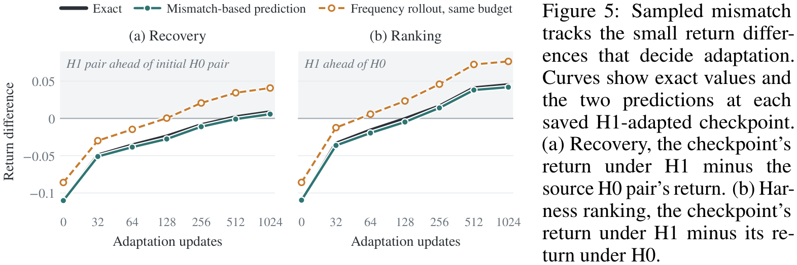

图 5：自适应过程中 recovery 与 ranking 两条小差异曲线的预测。实线是精确值，绿点是 mismatch 估计，橙虚线是同预算 frequency rollout。橙线在 (a) 里始终高估、在 (b) 里提前预测反转，绿线基本贴着实线——小差异这一档，估 $M$ 比估整个 $J$ 稳。

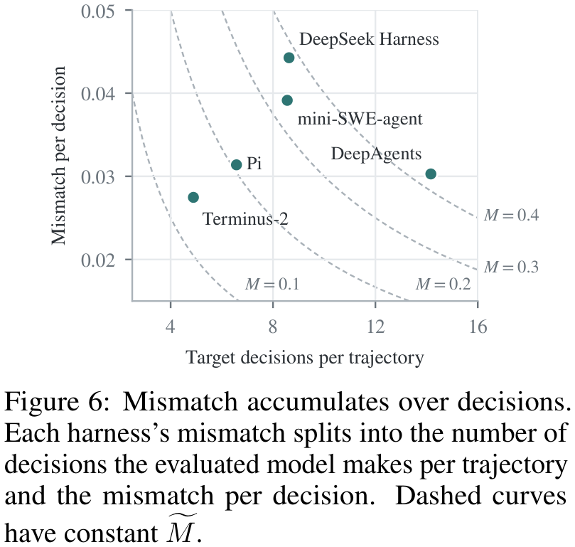

图 6：把每个编码 agent harness 的 $\tilde M$ 拆成每轨迹决策数乘每决策落差。DeepAgents 的每决策落差约 0.030、Terminus-2 约 0.028，差不多，但决策数是 14.2 对 4.9，累出来几乎是三倍，于是排到最末。

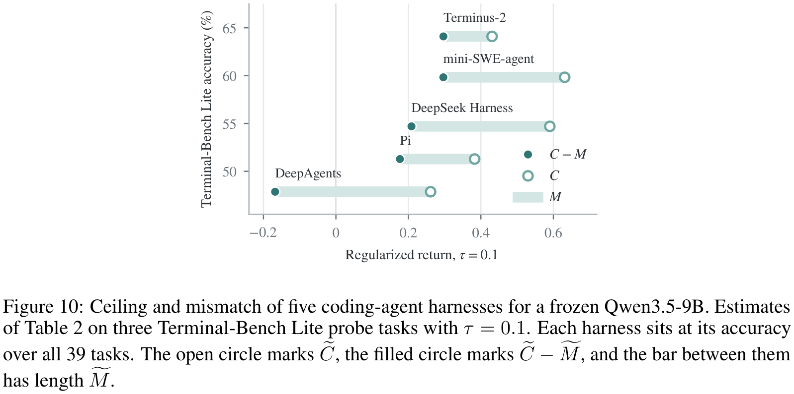

图 10：五个 harness 放在同一张 accuracy 对回报的平面上。空心圆是 $\tilde C$，实心圆是 $\tilde C-\tilde M$，浅色带子就是 $\tilde M$。DeepAgents 的 $\tilde C-\tilde M$ 是负的（$-0.168$），accuracy 也最低——两个量分开看都会排错，合起来才排对。

**原文实验表**

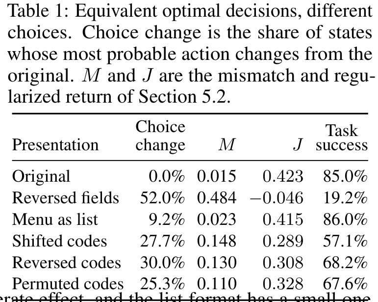

表 1：五种只改呈现、不改任何最优决策的变体。反转字段顺序让 52.0% 的状态换了最可能动作、$M$ 从 0.015 涨到 0.484、$J$ 从 0.423 掉到 $-0.046$、成功率 85.0% 变 19.2%；菜单改列表几乎无代价（86.0%）；改动作代码分配居中（57.1% 到 68.2%）。因为 ceiling 被数值验证为不变，这一列变化全部来自 readout drift。

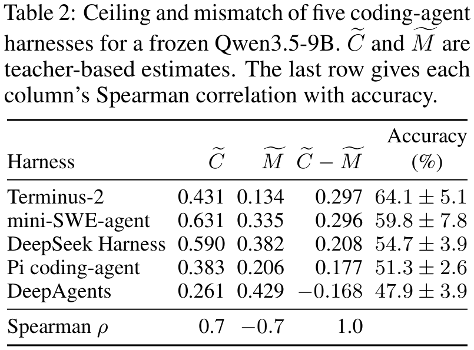

表 2：五个 coding-agent harness 配冻结 Qwen3.5-9B 的 teacher 估计。accuracy 从 47.9% 到 64.1%，$\tilde C$ 单独排序只有 $\rho=0.7$、$\tilde M$ 单独排序是 $-0.7$（方向还反了），$\tilde C-\tilde M$ 是 $1.0$。Terminus-2 天花板居中却靠最小落差领先；DeepSeek Harness 与 mini-SWE-agent 天花板最高，落差也最大。

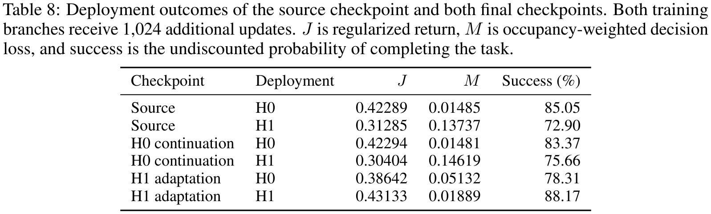

表 8：源 checkpoint 与两条分支的端点数字。源 pair 在 H0 下 $J=0.42289$、成功率 85.05%；冻结换到 H1 后 $J$ 掉到 0.31285、$M$ 从 0.01485 涨到 0.13737。H1 分支训完 $M$ 落到 0.01889、$J$ 升到 0.43133、成功率 88.17%，同时它在 H0 下的 $J$ 掉到 0.38642、成功率 78.31%——迁移有代价，代价写在 H0 那一行。

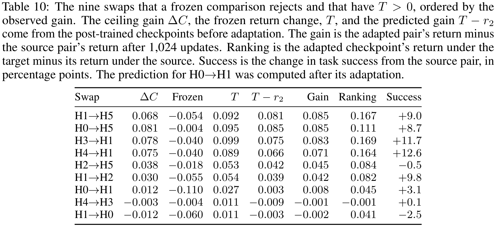

表 10：9 个冻结比较拒绝且 $T>0$ 的 swap 全表。前 7 个 $\Delta C>0$，自适应收益从 0.008 到 0.085；末两个 $\Delta C<0$，收益是 $-0.001$ 与 $-0.002$。H0→H5 与 H4→H3 的冻结回报变化都是 $-0.004$，一个收益 +0.085、一个 $-0.001$，说明冻结损失的大小完全读不出最终收益。

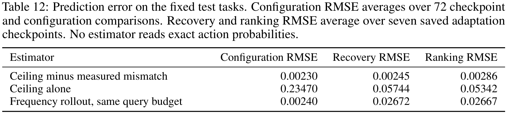

表 12：三种估计器的预测误差。大变化上 ceiling−mismatch（0.00230）与 frequency rollout（0.00240）差不多，只用 ceiling 差两个数量级（0.23470）；小差异上 frequency rollout 是 0.02672 与 0.02667，比 ceiling−mismatch 的 0.00245 与 0.00286 大一个数量级。

**消融告诉我们什么**

消融是只用 ceiling、只用 mismatch、两者相减这一组。MiniWoB++ 上两者都精确可算的那组（附录 F.8）：只用 ceiling 把最成功的 harness 排到最后，只用 mismatch 把 H0 排到两个更差的 harness 之下，只有 $C-M$ 把六套全排对；Terminal-Bench Lite 上重复了同样结论。第二组是估计器：同预算下 frequency rollout 在大变化上不输，但在决定划不划算的那一档明显更差，因为它估整个回报、误差在减法里被放大，而 mismatch 路线只估落差。

**这些实验够不够支撑结论**

理论部分是恒等式和不等式，成立与否取决于假设而不是数据。经验部分两块。MiniWoB++ 那块干净：有限图、单 token 菜单、精确解、576 个留出任务、2,000 次配对 bootstrap，$J=C-M$ 残差到 $10^{-16}$；但它是编译过的玩具环境，每回合 10 个决策、奖励二元、无显式成本。Terminal-Bench Lite 更接近现实，却只有 39 题、5 个 harness、每个 3 次运行，accuracy 标准差在 2.6 到 7.8 之间，$\rho=1.0$ 是 5 个点上算的，换个题集很可能不再满格。teacher 也不是最优，$\tilde C$ 只是下界、$\tilde M$ 只是到 teacher 的距离。我的判断是：理论成立，机制方向被证明，具体数值不能外推。

## 6. 局限性

**作者自己承认的**

- teacher 不必最优，所以 $\tilde C$ 估的是 ceiling 的下界、$\tilde M$ 量的是到 teacher 的距离，只比排序不比数值。
- 编码 agent 的动作被归并成 13 个类别（`inspect`、`modify`、`verify`、`setup`、`run`、`plan`、`delegate`、`wait`、`stop`、`context update`、`return`、`opaque`、`invalid`），估计在这个粗粒度上做，参数不同的同类动作被合并了。
- 形式结果要求有限状态与动作、有界奖励、$0\le\gamma<1$、$\tau>0$、reference 在每个可选动作上严格为正，且实际策略在被探测动作上概率为正。
- 新编码可能同时改变 reference 诱导的目标和模型读数，所以只改呈现的实验必须显式控制 reference（附录 B.1）。

**我看出来的**

- **隐形假设：两套 harness 的语义动作能对齐**。三项分解与整个跨 harness 比较都建立在同一个 $s$、同一个 $a$ 在两边有定义之上。真实 harness 改动常改变动作空间本身（加一个工具、删一个动作），这时 $g_{12}$ 里混进了目标集合都变了，分解退化成记账约定，而不是可检验的因果拆解。
- **边界条件：episode 长度**。MiniWoB++ 每回合 10 个决策，$M$ 沿轨迹累加，验证区间很短。论文只在编码 agent 上给了间接长程证据（图 6：决策数 14.2 的 DeepAgents 落差最大），那是估计值不是精确量，长程下 $M$ 会不会饱和、是否还近似二次增长，没有被验证。
- **ceiling 不是 harness 的纯客观属性**。它依赖 $\pi^{ref}$，而 H5 只加指令就同时改了 reference 和目标，所以加提示也能提高天花板这个结论成立的前提是 reference 跟着输入变。论文把这个效应当发现，我认为它同时也是一条口径依赖。
- **缺的对比**：没有和已有自动 harness 设计方法（ADAS、AFlow、Darwin Gödel Machine）在同预算下正面比选出好 harness 的效果，只比了怎么打分；也没有和每套 harness 各训一个模型再挑最好的这种朴素做法比成本。

## 7. 一句话总结

同一个模型换一套提示和工具就叫不动，不是因为模型笨，是因为它把旧 harness 的动作偏好背了下来；新 harness 值不值得为它重训，看天花板涨了多少、落差还了多少。

生活类比：换工作不能只比新旧两家公司的薪资上限，还得算上重新适应要掉的那几个月工资——只有上限涨幅盖得住适应成本，跳槽才真赚。

核心公式：

$$
\boxed{\;J_I(\Pi_{\theta,I})=C(I)-M(\theta,I)\;}
$$

## 8. 可复用点

- 如果我要在自己的项目里用：agent 做 A/B 时除了成功率，把配置的理论上限也报出来。最省事的做法是拿一个强得多的模型在同一 harness 下跑，用它的分数当 ceiling 替身，再报两者之差。差值变大往往说明配置没变差，只是模型还没适应。
- 换 prompt 格式之前先做 readout 体检：同一份 checkpoint、同一批状态，只改字段顺序或动作代码分配，看最可能动作改变了多少状态。改了超过两三成，先别信新格式的分数，那是读数在动。
- 采样估占用的正确姿势：跑 pilot 轨迹，按 $\Pr(T=t)=(1-\gamma)\gamma^t$ 随机截断取状态，取到的状态天然服从折扣占用，不用自己设计状态分布。
- 训练不收敛时先查：语义动作和 token 是否一一对应。多个 token 能解码成同一动作、或一段输出要靠解析器猜，语义策略就无法从下一 token 分布精确读出，后面所有诊断都会失真。
- 判断继续在旧配置上训还是换到新配置再训：先算 $T=\Delta C+M(\theta_0,I_1)$。$T\le0$ 就别换，换了也赢不了；$T>0$ 且当前落差远大于 $T$，才值得付适应成本。

## 9. 我的疑问

- 附录 F.8 那组精确对照用 $\gamma=1$、$\tau=0.1$、二元终局奖励，主实验用 $\gamma=0.95$，作者也承认两套 ceiling 不可比（"the ceilings differ from those of the post-training study"）。那 H0–H5 的排序在两套目标下会不会不一样？论文没给这个交叉检验。
- 阈值 $T$ 需要 oracle 的 $C_2$。部署时没有 oracle，论文用 teacher 顶替，但 teacher 的 $\tilde C$ 只是下界，把下界代进阈值会让 $T$ 偏小、判断偏保守。偏多少没有界。
- 如果 harness 改动同时改变动作空间（新增工具），语义动作无法一一对齐，Eq. (5) 的三项分解还成立吗？我倾向需要一个动作空间扩张的第四项，但论文没写。
- 这套推导依赖最优策略是 Gibbs 形式。DPO 这类不经 KL 正则、直接做偏好的后训练，训出来的策略未必落在同一族里，那时 readout 与 $F^*$ 的关系还成立吗？
- 五个编码 agent harness 的 $\rho=1.0$ 只有 5 个点，而 accuracy 的 run 间标准差最大到 7.8。换一批 Terminal-Bench Lite 的题重跑，排序还会这么整齐吗？论文没有给重复实验。
