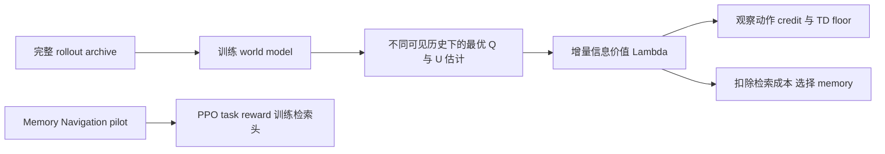
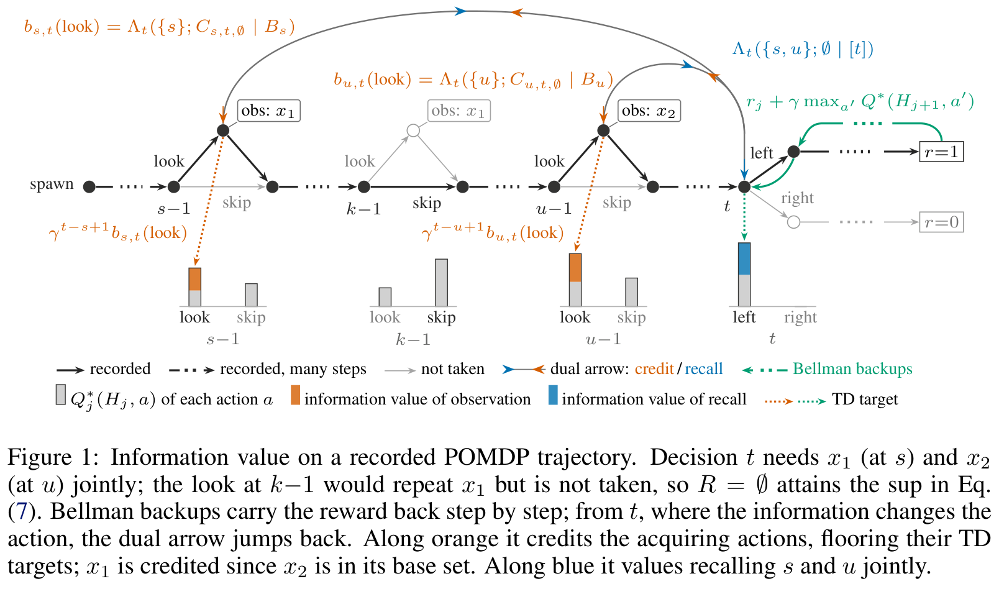
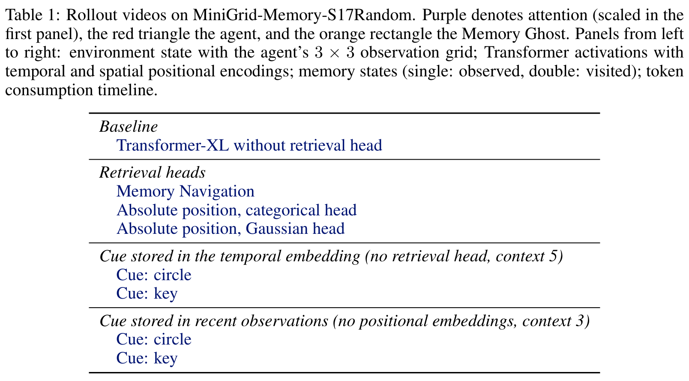

> 一句话：问清一条旧信息能改善多少决策，再决定该记住和奖励什么。

**证据边界**：这是理论加 pilot 的 workshop 工作。信息价值估计器、floored TD target 尚未实现，Memory Navigation 实验未使用二者。不能把该实验写成理论训练方法已经有效。依据联网下载的 11 页原始 PDF，已读定义、全部证明与补充材料说明；未运行代码，也未观看链接视频。

## 0. 读之前你需要知道

- **Partially Observable Markov Decision Process（POMDP）**：Agent 只能看到世界的一部分，需要过去信息帮助决策。像维修机器时，连接器拆下来以后，眼前已看不到原来的接线位置。
- **return** 是以后奖励的折扣和；**action value $Q$** 衡量在当前历史下选一个动作后有望得到多少回报。
- **Temporal Difference（TD）target** 用当前奖励加下一步价值估计训练 $Q$。奖励离早期动作很远时，信号需要多次逐步向前传播。
- **Observation Credit Assignment Problem（O-CAP）**：当后来用到了某条观察，怎样奖励当初为了获得它而做的动作。
- **Value of Information** 在这里不是信息量大小，而是允许使用某条信息后，最优可达到回报能增加多少。

已有 recurrent memory 压缩历史，external memory 把历史留在外面，Temporal Value Transport（TVT）把后续价值送回较早事件。本篇尝试把获取信息的 credit 与决定时的 retrieval 用同一价值定义联系起来。像档案管理员既要知道该调哪份旧档案，也要知道哪次实地调查值得奖励。

## 1. 动机

修理工拆下控制板前，先伸摄像头看一眼被挡住的接头。很久以后重新装回去，才用得上这张照片。若系统只在最终装对时给奖励，为什么当初要多看那一眼很难学；若每一步都扫描所有旧照片找线索，又会很贵。

**以前怎么做**：把历史压成一个状态，或让 attention 每次评分整份 memory。**为什么不够**：压缩发生在不知道未来要做什么时，可能删掉重要信息；全量 attention 的成本随 memory 增长，稀疏检索又不给没被选中的条目梯度。

**为什么现在能做**：存档 rollout 可以在不重新收集轨迹的情况下，构造看见某条信息与把它遮住的知识状态；world model 尝试从少量包含线索的经历学习后果。作者认为这样能在接近决策和奖励的位置估计信息价值，再把信号给早期观察动作。更快收敛目前仍是预期，不是结果。

## 2. 贡献

- **区分决策可用信息与评价条件**：$U_t(A\mid B)$ 的 $A$ 决定动作能看哪些历史，$B$ 决定从什么已知状态评价回报，避免把两者混成一个记忆集合。
- **构造 observation credit 的理论下界**：通过删除未来冗余观察并保留协同信息，定义 $b_{s,t}$，证明它与基线项相加不会超过真实最优 action value。
- **给出带检索成本的集合目标**：在信息价值中扣除每条 memory 的调用成本，得到理想 retrieval set。
- **提供独立的 Memory Navigation pilot**：用一个能在外部 memory 中相对移动的 Memory Ghost，在很短 context 下完成 MiniGrid 记忆任务；但没有把它连到前述估计器或 TD floor。

像先写出档案价值的会计准则，再做一个便宜的调档机械臂原型：准则的证明、估计器的构想、机械臂的实验是三个证据层次，不能合成一项已经端到端验证的系统。

## 3. 创新点

**新在用可达到回报变化衡量信息。** 相比用当前 policy 的 return 当 credit，本文先考虑在给定信息条件下最优能做到什么，因此不把当前模型暂时不会用信息误判为信息没用。

**新在处理重复与协同观察。** 多次看见同一接线图，只应给最早获取共享信息的动作合理 credit；两张照片必须合起来才解题时，又不应因单看无用而把两者都忽略。作者用对未来删除集合的 supremum 处理这个冲突，但它不是完整的 Shapley 或因果贡献分解。

**新在分解而非收紧下界。** 附录明确说拆分后的 floor 不比完整信息的普通 floor 更紧；预期优势是相关信息在奖励附近估计可能更容易。类比把账分成固定费用和某次调查的增量，账目更易估并不代表总账数值更大。

## 4. 方法

### 4.1 整体流程

上半部是提出的训练路线，下半部才是已运行 pilot；图中没有把未实现信号接到实验上。像设计图与样机分开标注，读者才能知道哪些环节已经接通。

Figure 1：橙色箭头将后续决策的信息价值送回获取观察的动作，蓝色箭头表示联合回忆；它是理论示意，不是训练曲线。

### 4.2 信息条件与边际价值

历史 $H_t=(h_0,\ldots,h_t)$，其中 $h_s=(a_{s-1},r_{s-1},o_s)$。索引集合 $A$ 指出允许读取哪些历史项目；探索 policy $\mu$ 假设每个动作都有正概率。

下面定义的是在决策时只看 $H_A$ 选择动作，再从 $H_B$ 条件下评价回报：

$$
U_t(A\mid B)=\mathbb E_{\pi_A}[G_t\mid H_B],\qquad
\pi_A\in\arg\max_{\pi\in\Pi_{A,t}}^{\prec}
\mathbb E_\pi[G_t\mid H_A].
$$

- $G_t=\sum_{k\ge t}\gamma^{k-t}r_k$ 是标量 return，$0<\gamma<1$。
- $\Pi_{A,t}$ 规定 $t$ 之前沿用 $\mu$，决策 $t$ 只依赖 $H_A$；**$t$ 以后的 policy 可再次依赖完整历史**。
- $\prec$ 为最优动作并列时的固定排序；$U_t$ 是随 $H_B$ 变化的条件价值函数。

对额外信息集合 $T$，边际价值是两种可见状态的可达到回报差：

$$
\Lambda_t(T;A\mid B)=U_t(A\cup T\mid B)-U_t(A\mid B).
$$

$A$ 是原有可见集合，$T$ 是新增集合，$B$ 是评价条件；差值单位仍是 return，不是 bits。Appendix B 的非负性需要 $B\subseteq A$，不能无条件推广到所有集合关系。retrieval 使用 $B=[t]$，允许动作只看子集，因此不能直接搬用信息增加必定逐轨迹更好的说法。

### 4.3 观测 credit 与 acquisition bound

定义 $B_s(a)$ 为观察发生前的历史加上获取动作，$C_{s,t,R}(a)$ 为决策前历史去掉观察 $s$ 和未来集合 $R$，但保留该获取动作。credit 寻找能让这次观察最有价值的删除集合：

$$
b_{s,t}(a)=\sup_{R\subseteq\{s+1,\ldots,t\}}
\Lambda_t(\{s\};C_{s,t,R}(a)\mid B_s(a)).
$$

- $s$ 是观察时刻，真正的获取动作发生在 $s-1$；$t\ge s$ 是后来使用信息的决策时刻。
- $R$ 用来去掉会替代 $s$ 的重复信息，同时尽量留下与 $s$ 协同的信息。
- $b_{s,t}$ 是标量 credit，不等于观察在实际行为中的必要性或因果效应。

论文证明：把不使用新增信息的可达到回报基线 $L_{s,t}(a)$ 与折扣 credit 相加，得到最优获取动作价值的下界：

$$
Q^*_{s-1}(H_{s-1},a)
\ge L_{s,t}(a)+\gamma^{t-s+1}b_{s,t}(a).
$$

$Q^*$ 为真实最优 action value；$L_{s,t}$ 包含从获取动作到 $t-1$ 的折扣奖励，以及在 $t$ 只使用获取前信息的价值；$\gamma^{t-s+1}$ 将后续决策尺度折回获取动作。所有项都以**精确真实量**定义。

据此，作者提出用该下界抬高普通 Bellman target：

$$
(\mathcal T_bQ)_{s-1}
=\max\left\{(\mathcal TQ)_{s-1},\max_t
\left[L_{s,t}(a)+\gamma^{t-s+1}b_{s,t}(a)\right]\right\}.
$$

$\mathcal TQ$ 为普通 TD target，$\mathcal T_bQ$ 为加 floor 后的 target；省略的历史与动作参数同上。它防止 target 低于这条合法 floor，**并不保证任意 $Q$ 估计或有限样本 target 都在 $Q^*$ 以下**。

### 4.4 估计与检索

拟议实现先在完整 archive 上训练 world model 预测下一 observation/reward，再回归不同历史子集的 $\widehat Q$，用最优动作下的回报拟合 $\widehat U$。current policy return、true optimal return、learned model 内最优 return 必须分开；模型内优化可能利用模型误差。

理想检索集合在信息价值与读取成本之间取舍：

$$
M_t^*=\arg\max_{M\subseteq[t]}
\left[\Lambda_t(M;\varnothing\mid[t])-C|M|\right].
$$

$M$ 为读取的 memory 索引集合，$C$ 是每项读取成本，$|M|$ 为项数。作者提出用上一时刻集合近似条件，以及 persistent pointer 的局部编辑，但明确说该近似尚待验证。最优集合定义本身仍是组合搜索，不能把它等同于便宜的实际检索算法。

## 5. 实验结果

像看一台调档样机，必须先问它是否使用了前面设计的智能评分器；本篇答案是没有，因此实验只验证检索原型。

**实验设置六项**

- **数据集与切分**：MiniGrid-Memory-S9 预训练，再在 S17Random fine-tune；环境生成与完整 train/test 切分原文未给。
- **骨干模型**：Transformer-XL，外加 internal action head 控制 Memory Ghost 的相对移动；完整参数量、层数和 hidden size 原文未给。
- **训练预算**：PPO 用 task reward 训练，不用 $\widehat\Lambda$、不加 TD floor；预训练 context 64 tokens，fine-tuning context 5。Memory Navigation 与 Gaussian retrieval 各 6 seeds，无 retrieval head 为 3 seeds。预训练总 steps、硬件和 wall-clock 原文未给。
- **基线**：Gaussian absolute-position retrieval、无 retrieval head、full-context pretrained model；附录另列 categorical head 视频。各 baseline 的所有超参数原文未给。
- **指标**：达到 mean return 0.95 所需 environment steps；这是 pilot 的学习效率，不是 theorem 中下界估计误差。
- **推理设置**：memory 按物理空间与时间索引，检索到的 memory 进入 Transformer-XL context；完整 inference temperature 与动作采样设置原文未给。代码和视频仅给链接，未在本轮运行或播放。

| 方法 | 达到 mean return 0.95 的 steps | seeds | 与最强基线关系 |
| --- | --- | --- | --- |
| Memory Navigation | 0.59M | 6 | 并非最快 |
| Gaussian absolute-position retrieval | 0.94M | 6 | pilot 中较慢 |
| without retrieval head | 1.38M | 3 | 仍能完成任务 |
| full-context pretrained model | 原文未给 | 原文未给 | 原文明确它更快 |

上表是对正文数字的提炼，**不是原文结果表截图**；论文没有提供这组数的训练曲线、置信区间或数值消融 Table。

Table 1：原表是 rollout 视频索引，列出不同 retrieval head 和绕过短 context 的行为，不是 quantitative results table；截图只能核对实验对象，不能证明曲线或显著性。

**最重要的失败检查**：无 retrieval head 的模型会按 cue 等待不同步数，把信息编码进 temporal embedding；移除 positional embeddings、context 3 时又能按 cue 走不同路径，把信息留在最近观察。任务完成不一定说明 Agent 学会了目标 memory 机制，这些旁路必须先堵住。

**实验够不够**：足以说明一个短 context 的局部 memory-navigation pilot 可以学习任务，不足以验证 information-value estimator、O-CAP credit 或 TD floor 更快收敛。本文没有这条端到端实验证据，不能用 pilot 的 0.59M 去替代理论算法的成绩。

## 6. 局限性

**作者承认**：核心估计器与 floor 尚未实现；exact bound 不会自动传给 learned estimates；动作最大化和对 $R$ 的 supremum 可能利用噪声、抬高估计 floor；训练仍需完整 histories，节省发生在 inference。时间索引也不能完美分离冗余与协同信息。

**我的判断**：像暂时只把档案室锁一秒，下一秒又开放全部档案，与真正长期限制能拿多少档案不是同一问题。$\Pi_{A,t}$ 只约束当前决策，未来恢复 full history，因此 $U_t$ 是一个理想化单步信息干预价值，不是持续小 memory policy 的真实最优值。

另外，探索策略 $\mu$ 会在后续行动中泄露被遮住的观察；archive 来自不断变化的 policy 时，需要保存版本。采样 full support 是可辨识推导条件，不等于有限数据已经覆盖稀有观察动作。theorem 与可训练估计之间，仍隔着 support、模型误差和优化误差。

实验层面的单任务、seed 数不相同和参数未给留在本节；方法字段不写成只测 MiniGrid。最应避免的误读是把 exact lower bound 当作 learned floor 的自动安全保证。

## 7. 一句话总结

**把一条观察是否有用，定义为它能让后续最优决策多拿多少回报，再尝试同时服务获取 credit 与 memory retrieval。** 类比给调查照片定价：用得上时既决定调哪张，也反推当初拍照值得多少。但这篇目前完成的是定义和 acquisition-bound 证明，连接估计器的训练收益还没有实现；检索样机的成绩应单独阅读。

## 8. 可复用点

- 为完整 rollout 保存 observation、action、reward、时间、policy 版本，后续才能做知识遮罩和避免混合不同探索分布。
- 先做已知模型的小 POMDP，核对 exact $U$、$\Lambda$ 与 floor，再测 learned estimate 是否越过 $Q^*$。像先用标准砝码校秤，再给珍贵档案定价。
- 比较普通 floor 与分解 floor 的估计收敛，而非只比最终任务 reward；作者声称的优势是估计容易，不是理论下界更紧。
- 做短 context benchmark 时检查 temporal/spatial side channels，包括等待步数、位置编码、Agent 轨迹和近期观察，避免模型绕开 memory 目标。

拟议机制抽为 [[../../../30 方法卡片/信息价值分解的观测动作下界]]，方法卡明确标为理论机制，尚无端到端实证。

## 9. 我的疑问

- 如果后续决策也始终受 memory budget 限制，能否得到相应的 acquisition bound？像档案一直受限，而非只在当下限制一次。
- 对 noisy supremum 使用保守置信下界，能否同时保留效率与合法 floor？
- 若最优 retrieval 需要先取一条索引记忆再定位另一条，局部 Ghost 需要多长搜索，所谓一层读取的总决策成本怎么算？
- 能否用无遮挡真模型实验，分离信息价值定义与 world-model estimation error，再讨论机器人场景？
- 真实 O-CAP 是否改善、分解 floor 是否更早有用、近似检索集合是否足够好，原文均未验证，后续不能从当前 pilot 推断答案。
