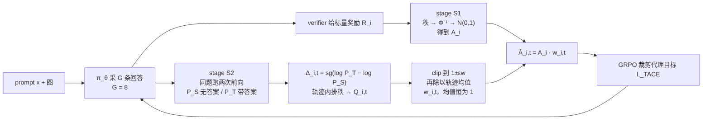
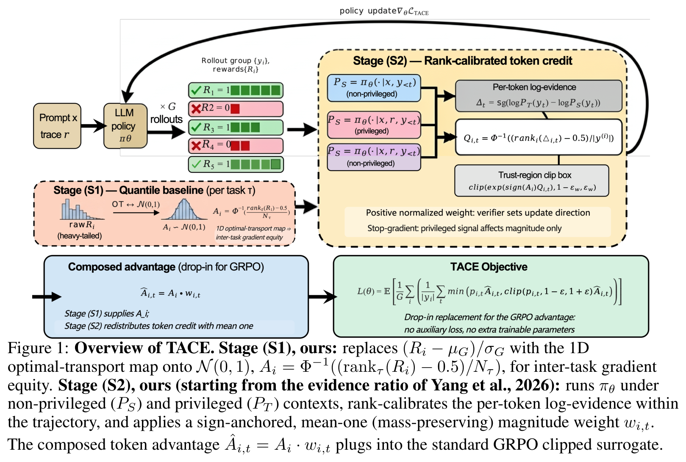
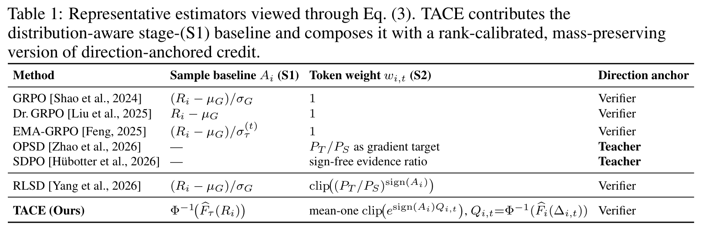
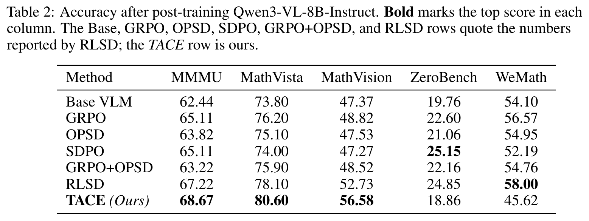
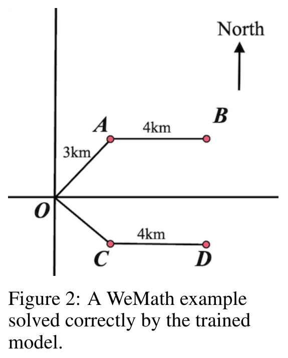
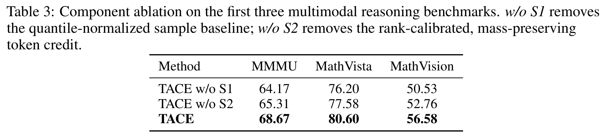
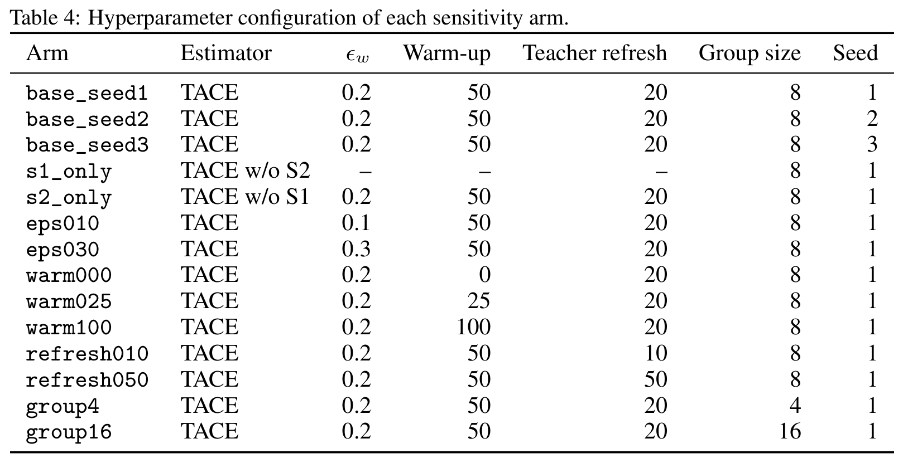
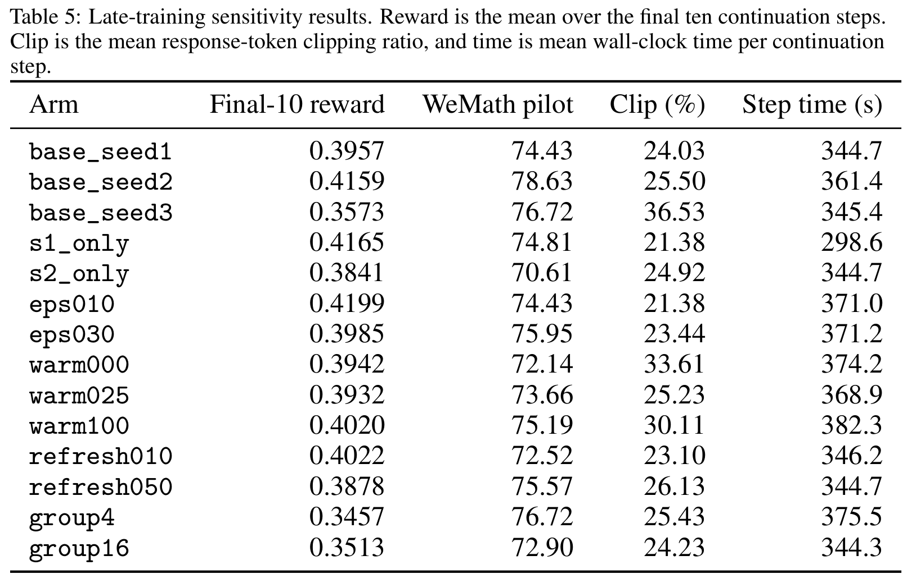
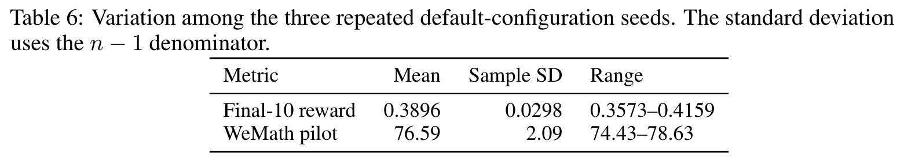

> 一句话：先把奖励换成分位数再算优势，再规定 token 之间只能重新分配这份优势，不能加码。

## 0. 读之前你需要知道

**术语卡**

- **RLVR（Reinforcement Learning with Verifiable Rewards，可验证奖励强化学习）**：不靠人打分，靠一个程序判对错，对给 1、错给 0，拿这个 0/1 去更新模型。生活类比：科目二的压线感应器，只报过或不过，不解释你哪一脚踩歪了。
- **GRPO（Group Relative Policy Optimization，组相对策略优化）**：同一道题让模型答 $G$ 次，把这 $G$ 个奖励减均值、除标准差，得到每条回答的优势 $A_i$，再把同一个 $A_i$ 贴到这条回答的每个 token 上。生活类比：全班考同一张卷子，老师只看你比班平均高多少分，不看你绝对考了几分。
- **advantage（优势）**：这条回答比随手答一条好多少。正数鼓励，负数打压。
- **rollout group（采样组）**：同一道题采出来的 $G$ 条回答，这篇里 $G=8$。
- **token 级信用分配（token-level credit assignment）**：一条回答几百个 token，得决定哪些 token 该为最终对错负责、各分多少。生活类比：项目组拿了奖金，是平均分给每个人，还是按贡献分。
- **privileged context（特权上下文）**：同一条回答再算一遍概率，但这次把标准答案塞进输入。模型看到答案后每个 token 的把握会变大，这个把握变大多少就是 token 重要性的线索。生活类比：考试时老师站在你旁边，你写到关键那步他点头，写废话他面无表情，点头幅度就是线索。
- **分布校准（distributional calibration）**：不动单个分数的大小，动整套分数的分布形状，让不同任务的分数量纲一致。生活类比：三个考场用三种尺子量身高（厘米、英寸、只记高矮两档），先把读数换成你在本考场排第几，再换成同一张百分位表。
- **budget-neutral（预算中性）**：token 之间可以互相挪，总预算不变，不许增发也不许克扣。生活类比：100 元奖金只在五个人之间挪，不能挪成 130 元。

**它站在谁肩上**

- Dr. GRPO（2025）：去掉每组的标准差，只减均值，理由是除以 $\sigma_G$ 会放大简单题的权重。不够：还是仿射变换，奖励分布的形状一个像素没改。
- EMA-GRPO（2025）：用任务级滑动平均 $\sigma_\tau^{(t)}$ 替代组内 $\sigma_G$，缓解多模态任务族之间的方差失衡。不够：换的只是仿射系数。
- OPSD（2026）/ SDPO（2026）：拿模型自己当教师，让带答案的那份副本直接决定梯度方向。不够：方向由教师定，答案泄漏会带偏；SDPO 的乘子连符号都不管。
- RLSD / Self-distilled RLVR（2026）：把特权证据收进一个 stop-gradient 乘子，符号交给 verifier 管，解决了方向问题。不够：乘子按原始置信度尺度走，轨迹均值不等于 1，总预算会漂。
- 语言模型训练里的最优传输（2024–2026）：主要当距离函数用，做 Wasserstein 正则、随机占优约束、隐空间安全投影。差一步：没人把它搬进 advantage 估计器内部当基线。

## 1. 动机

生活场景：三个老师给同一个学生打分。数学老师给 87 分，体育老师只写及格，语文老师给甲。班长想算这个学生的总水平，做法是把三个读数直接减平均再除标准差。问题是数学老师的分数在一个很长的百分制区间里浮动，体育老师只有两个取值，语文老师只有五档。三个分布形状完全不同，硬拉到同一把尺子上，那个体育的及格会在标准化后变成一个巨大的正数，而数学 87 分可能只算中等偏上。

**以前怎么做**：GRPO 把两件事压成一步。先标准化出 $A_i$，再原样复制给每个 token。后续所有改进都只动其中一半。Dr. GRPO 和 EMA-GRPO 改前面那半步（基线的仿射形式），token 仍然平均分。RLSD 这类 token 加权方法改后面半步，前面仍然是仿射基线。论文把这叫设计空间的**对角线**（diagonal），Table 1 就是把这条对角线摊开看。

**为什么不行**：两个失效模式互补，谁也修不了谁。仿射基线改不了奖励分布的形状，原文的说法是重尾、二值悬崖、任务间方差差都会原样穿过缩放进入梯度。反过来，按原始置信度尺度做的 token 权重会静默放大或衰减 verifier 发出的总信号。

原文有一句把目标说得最清楚：

> "it may redistribute credit, never inflate it."

意思是 token 通道只许重新分配信用，永远不许把总额吹大。这句话就是 budget-neutral 的全部含义。

**为什么现在能做**：三个条件同时到位。多模态 RLVR 的训练栈成熟了（VERL、EasyR1 都能直接跑），RLSD 已经把 stop-gradient 证据乘子这个零件做出来并且证明它不泄漏方向，一维最优传输的闭式解（Brenier 定理）是几十年前就有的老工具。缺的只是有人把老工具放到 advantage 估计器里面那个位置上。这篇补的就是这个位置。

## 2. 贡献

- **提出了分布感知的 stage (S1) 基线**：把 GRPO 的仿射标准化换成到 $\mathcal{N}(0,1)$ 的一维最优传输映射，并证明群体层面的任务间矩相等（inter-task moment equity），不是只对齐前两阶矩，还给了确定性的有限样本尾部上界。证据：Proposition 1 与 Proposition 2。
- **提出了秩校准、保质量（mass-preserving）的 stage (S2) 信用规则**：从 RLSD 的方向锚定证据比出发，在轨迹内对证据做秩校准，再把裁剪后的权重归一到均值 1。证明正性、双侧确定性界、精确信用质量守恒、符号锚定，以及对证据信号严格单调变换的不变性。证据：Theorem 1 与附录 A.3。
- **给了多模态 RLVR 上的实证**：在五个多模态推理基准上，组合后的估计器在多数基准上拿到最强结果，同时也暴露了它失效的那些设置。证据：Table 2 与 Table 3。

打个比方：这不是换发动机，是在同一条流水线的入口和出口各装一个标准件，让三台机器量出来的东西能对接。

## 3. 创新点

- **把 advantage 拆成两个可以独立替换的算子**。对比对象：所有把 GRPO 当成一个整体去改的工作。有用是因为拆开之后**哪一半坏了**变成可诊断的问题，Table 1 把七行方法排开就能看出：除最后一行外，没有一行同时改了两级。
- **把一维最优传输放进 advantage 估计器内部，而不是当损失函数里的距离项**。对比对象：Melnyk 等人的分布对齐、Li 等人的 token 加权偏好优化，那些都是在损失层面加一项。有用是因为放进估计器内部之后，分布不变性、异常值鲁棒、保序这三条不需要额外调参就自动成立。
- **在 token 通道上加了一条预算约束**。对比对象：RLSD 的 $\mathrm{clip}\left((P_T/P_S)^{\mathrm{sign}(A_i)}\right)$。有用是因为把**重新分配**和**放大信号**这两件事解耦了。原来的乘子如果教师全程很自信，轨迹均值可以漂到 1 以外，等于偷偷改了 verifier 发的预算。
- **把两条不变量写成了显式条件**。I1：$A_i$ 的边际分布不该依赖 verifier 的标定；I2：每个 token 优势的符号必须等于 $\mathrm{sign}(A_i)$。有用是因为这两条一写出来，后面所有设计选择都有了判据，而不是靠消融碰运气。

这四条合起来的效果，像把一台焊死的整机改成两个能单独更换的模块。

## 4. 方法

### 4.1 整体流程

这张图就是全文的骨架：左边一路只碰样本下标 $i$，右边一路只碰 token 下标 $t$，两条路在 $A_i \cdot w_{i,t}$ 这一处相乘，然后塞进原封不动的 GRPO 目标里。

### 4.2 模块拆解

**stage (S1)：分位数归一化（quantile-normalized）的样本基线**

为什么需要：不同任务的奖励分布形状差太远。二值 verifier 出的是两点分布，多值 verifier 可能重尾。仿射映射是保形映射，形状差异会一路留到梯度幅度里。

怎么做：对每个任务 $\tau$ 取当前这组的奖励，算出每条奖励在组内的排位，把排位映射成 $(0,1)$ 上的分位点，再经标准正态分位函数 $\Phi^{-1}$ 变成 $\mathcal{N}(0,1)$ 上的一个数。并列的奖励取它们分位像的平均。

公式：

$$
A_i \;\triangleq\; \Psi_\tau(R_i) \;=\; \Phi^{-1}\!\left(\hat F_\tau(R_i)\right),
\qquad
\hat F_\tau(R_i) = \frac{\mathrm{rank}_\tau(R_i) - 0.5}{N_\tau}
$$

先说这个公式在算什么：它把**这条回答在本组排第几**翻译成**在一个标准正态分布里，这个排位对应几分**。 $-0.5$ 是中间秩修正，避免排第一的样本被推到概率 0（那样 $\Phi^{-1}$ 会发散）。

- $R_i$：第 $i$ 条回答的奖励，一个标量，取值由 verifier 定。
- $\mathrm{rank}_\tau(R_i)$：这条奖励在当前组里的名次，$1$ 到 $N_\tau$ 的整数。
- $N_\tau$：任务 $\tau$ 这一组的样本数，也就是 rollout 条数，这篇里是 8。
- $\hat F_\tau$：经验 CDF，取值落在 $\left[\frac{1}{2N},\ 1-\frac{1}{2N}\right]$ 这个区间里。
- $\Phi^{-1}$：标准正态分位函数，把概率翻译成分数。
- $A_i$：校准后的样本级优势，无量纲。

三条性质直接把 I1 兑现。任务间梯度等权：只要奖励是连续分布，$A_i$ 的均值为 0、方差为 1，跟原分布什么形状无关。异常值和双峰鲁棒：单个特别大的奖励也只能落到秩网格的上端，出不了界。保序：$\Phi^{-1}\circ\hat F_\tau$ 单调不减，所以 $\mathrm{sign}(A_i)$ 仍然是 verifier 在组内的相对判决，可以安全地拿去当方向锚。

代价只有一次 $O(N\log N)$ 的排序，这一级没有引入任何新超参。

**stage (S2)：秩校准、保质量的 token 信用**

为什么需要：$A_i$ 是个干净的标量了，但它还得摊到几百个 token 上。平均摊（$w_{i,t}=1$）等于假设每个 token 一样重要。

怎么做：同一条回答跑两次前向。一次是普通上下文 $P_S=\pi_\theta(\cdot\mid x, y_{<t})$，一次把标准答案塞进去 $P_T=\pi_\theta(\cdot\mid x, r, y_{<t})$。两者对数概率之差就是**看到答案后这个 token 变得多确定**。这一步完全照搬 RLSD，并且带 stop-gradient，不许它反传。

第一个改动是轨迹内秩校准：

$$
\Delta_{i,t} = \mathrm{sg}\!\left(\log P_T(y_t) - \log P_S(y_t)\right),
\qquad
Q_{i,t} = \Phi^{-1}\!\left(\frac{\mathrm{rank}_i(\Delta_{i,t}) - 0.5}{|y^{(i)}|}\right)
$$

先说在算什么：把**看到答案后的确定性增量**在**同一条轨迹内部**排名次，再把这个名次换成标准正态分位点。这样一条轨迹里每个 token 拿到的 $Q$ 只由它在自己轨迹里的相对位置决定。

- $\Delta_{i,t}$：第 $i$ 条轨迹第 $t$ 个 token 的对数证据差，实数值，可正可负。
- $\mathrm{sg}(\cdot)$：stop-gradient，前向照算、反向不传。
- $\mathrm{rank}_i(\Delta_{i,t})$：这个 $\Delta$ 在第 $i$ 条轨迹所有 token 里的名次，$1$ 到 $|y^{(i)}|$。
- $|y^{(i)}|$：这条回答的 token 数。
- $Q_{i,t}$：校准后的 token 证据分，标准正态分位点。

这一步换来的是对教师置信度的免疫。原文写得很直白，因为只用轨迹内的排序，它对 $\Delta$ 的任何严格单调变换都不变。教师整体更自信也好、更保守也好，只要排序不变，分配就不变。这也是它与公式 (4) 在 token 层面的对应物。

第二个改动是信用质量守恒：

$$
u_{i,t} = \mathrm{clip}\!\left(e^{\,\mathrm{sign}(A_i)\,Q_{i,t}},\ 1-\epsilon_w,\ 1+\epsilon_w\right),
\qquad
w_{i,t} = \frac{u_{i,t}}{\frac{1}{|y^{(i)}|}\sum_{s=1}^{|y^{(i)}|} u_{i,s}}
$$

先说在算什么：先把证据分做成一个带符号的指数权重、裁剪到 $1\pm\epsilon_w$ 之间，再除以这条轨迹上的均值，让均值精确等于 1。

- $\mathrm{sign}(A_i)$：verifier 对整条轨迹的判决，只有 $+1$ 或 $-1$，负责方向。
- $Q_{i,t}$：上一步的秩校准证据分，负责在轨迹内挑出关键 token。
- $\epsilon_w$：信用通道的裁剪半径，这篇取 0.2。
- $u_{i,t}$：裁剪后的原始权重，落在 $[1-\epsilon_w, 1+\epsilon_w]$。
- $w_{i,t}$：归一后的权重，均值恰好 1。

除以均值这一步是整篇论文最省力的一个设计。它不改变 token 之间的相对大小（全条轨迹同除一个正数），只把总质量钉死在 1。训练时还有一个 50 步的 warm-up：$w_{i,t}\leftarrow(1-\lambda)+\lambda w_{i,t}$，$\lambda$ 从 0 线性升到 1。前期基本是纯 GRPO，等证据信号稳定了再放开分配。

**两阶段的组合**

$$
\hat A_{i,t} = A_i \cdot w_{i,t}
\;=\; \Phi^{-1}\!\left(\hat F_\tau(R_i)\right)\cdot
\frac{u_{i,t}}{\frac{1}{|y^{(i)}|}\sum_s u_{i,s}},
\qquad
u_{i,t}=\mathrm{clip}\!\left(e^{\,\mathrm{sign}(A_i)Q_{i,t}},1-\epsilon_w,1+\epsilon_w\right)
$$

这个组合后的 $\hat A_{i,t}$ 直接替换掉 GRPO 里的 $A_i$：

$$
\mathcal{L}_{\mathrm{TACE}}(\theta) = \mathbb{E}\left[\frac{1}{G}\sum_{i=1}^{G}\frac{1}{|y^{(i)}|}\sum_{t=1}^{|y^{(i)}|}\min\!\left(\rho_{i,t}\hat A_{i,t},\ \mathrm{clip}(\rho_{i,t},1-\epsilon_{\mathrm{low}},1+\epsilon_{\mathrm{high}})\hat A_{i,t}\right)\right]
$$

符号说明：$\rho_{i,t}$ 是 PPO 的重要性比，$\epsilon_{\mathrm{low}}$ 与 $\epsilon_{\mathrm{high}}$ 是**非对称**裁剪半径，这篇取 $(0.2,\ 0.28)$，这是个容易看漏的细节。没有辅助损失，没有新增可训练参数。

为什么两阶段不打架：$f=\Phi^{-1}\circ\hat F_\tau$ 单调，$w$ 只读它的符号；而 $w_{i,t}>0$ 且均值 1，所以第二级只挪位置不改总量。两级作用的下标集合不相交（$i$ 是组内样本，$t$ 是轨迹内 token），附录 A.4 把这个**组合性**单独证了一遍。

### 4.3 关键细节

- 退化组处理：一组内所有奖励相同（二值 verifier 很常见，全对或全错）时，直接设 $A_i=0$，不给梯度。和 GRPO 的惯例一致。
- 并列奖励：取分位像的平均，保证相同结果拿相同信用。
- 裁剪半径 $\epsilon_w=0.2$ 决定 token 之间最多能差多少倍。由 Theorem 1，权重被卡在 $\frac{1-\epsilon_w}{1+\epsilon_w}$ 到 $\frac{1+\epsilon_w}{1-\epsilon_w}$ 之间，$\epsilon_w=0.2$ 时是 $0.667$ 到 $1.5$，也就是最关键 token 的信用最多是最不关键的两倍出头。
- 额外开销：每组一次排序、每条轨迹一次排序、外加一次特权上下文前向。论文没给这三次操作在总训练时间里的占比。
- 理论保证的数字：Proposition 2 给出 $\max_i|A_i| \le \Phi^{-1}\!\left(1-\frac{1}{2N}\right)$，而仿射标准化在同一构造下能到 $\sqrt{N-1}$。$N=8$ 时是 1.53 对 2.65，$N=256$ 时是 2.89 对 15.97。同一构造下仿射基线能冲到 15.97，秩映射封在 2.89，差五倍以上。这是这篇最硬的一块。

## 5. 实验结果

**实验设置**

- 数据集与切分：训练用 MMFineReason-123K，由 MMFineReason-1.8M 过滤而来，保留的是 Qwen3-VL-4B-Thinking 在四次独立 rollout 里全都做错的题。评测五个套件：MMMU（大学多学科 VQA）、MathVista（视觉情境数学推理）、MathVision（竞赛级视觉数学）、ZeroBench（当代模型做不出的压力测试）、WeMath（细粒度数学）。验证集怎么切原文未给。
- 骨干模型：所有 run 都用 Qwen3-VL-8B-Instruct。
- 训练预算：PPO 式训练，每步 256 条 prompt，每题 8 条 rollout，温度 1.0，上下文 8192 token（prompt 4096 + response 4096）。总优化步数、总 GPU 数、总 rollout 量原文未给；只说了流水线建在 VERL 与 EasyR1 上。
- 基线：Base VLM（不做后训练）、GRPO、OPSD、SDPO、GRPO+OPSD（Yang 等人的加性融合基线）、RLSD。这六行都是**照抄 RLSD 报的数**，不是本文重跑；只有 TACE 和消融是本文自己跑的。
- 指标：五个基准都报 accuracy（%），越高越好。
- 推理设置：解码温度、最大生成长度、答案抽取与判分脚本原文未给，只说沿用 RLSD 的多模态协议。

主表（只留能说明问题的行，最强基线单列）。形状是三项变好、两项变差，而变差那两项比不治疗还差，像体检报告只念前三行。

| 数据集 | 指标 | 本文 TACE | 最强基线 | 提升 |
| --- | --- | --- | --- | --- |
| MMMU | accuracy (%) | 68.67 | RLSD 67.22 | +1.45 |
| MathVista | accuracy (%) | 80.60 | RLSD 78.10 | +2.50 |
| MathVision | accuracy (%) | 56.58 | RLSD 52.73 | +3.85 |
| ZeroBench | accuracy (%) | 18.86 | SDPO 25.15 | −6.29 |
| WeMath | accuracy (%) | 45.62 | RLSD 58.00 | −12.38 |

**原文实验图**

图 1：这张图是全篇的架构总览，值得看清的是它把两支流画成了并列的两条线。左边 stage (S1) 的直方图从重尾变成钟形，中间 stage (S2) 的三个盒子里，最后一个盒子仍标着 $P_S=\pi_\theta(\cdot\mid x,r,y_{<t})$ 却写着 non-privileged，这是原图的一处标注笔误，按上下文应为 $P_T$。

表 1：这张表才真正说明了论文的定位。七行方法里除了最后一行，其余都只改了 S1 或 S2 其中一个，没有一个同时改两级。看这一列 Direction anchor 更清楚：OPSD 与 SDPO 的方向来自 Teacher，其余五行来自 Verifier，这是本文坚持待在 Verifier 一侧的原因。

表 2：主结果。这张表把混合模式摆得很直白，赢的三列都在左边，输的两列都在右边，而且 WeMath 那一格（45.62）比 Base VLM 的 54.10 还低 8.48 个点，ZeroBench 的 18.86 也低于 Base 的 19.76。原文对这一点的说法是 "ZeroBench and WeMath remain stronger under existing baselines"，语气比数字轻。

图 2：这是一道 WeMath 的图示题，模型要把图上的 OA = 3 km、AB = 4 km 读出来，发现题目问的是米，再乘 1000 选 C。这个案例想说明模型学到的是视觉抽取加单位换算的协同，不是背答案格式。它是定性示意，不是定量证据。

表 3：消融。两行降级估计器在各列都掉，最大的坑都在 MathVision。去掉 S1 掉 6.05 分、去掉 S2 掉 3.82 分，这个排序在三个基准上一致，是本文关于**分布校准是主要贡献者**这一论断的唯一直接证据。

表 4：敏感性实验的 14 个 arm 配置。两张表要对着看才有用，其中 s1_only 对应 TACE w/o S2、s2_only 对应 TACE w/o S1，命名和正文的 w/o 写法是反的，读的时候容易混淆。

表 5：短程敏感性结果。14 个 arm 都只跑 40 步续训，看的是 Final-10 reward 与 WeMath pilot 两列。把三行 base_seed 放在一起看最有信息量：同配置换种子，WeMath pilot 就在 74.43 到 78.63 之间摆，摆幅比大多数 arm 之间的差距还大。

表 6：三个重复种子的波动幅度。Final-10 reward 的样本标准差 0.0298，WeMath pilot 是 2.09，极差 4.20 分。这张表的作用是给上面所有敏感性结论标上噪声底。

**消融告诉我们什么**：两级都有贡献，但 S1 的贡献明显更大（三个基准上都是去掉 S1 掉得更多）。不过有一处细节值得留意：Table 3 里 TACE w/o S1 在 MathVista 上正好是 76.20，与 Table 2 里 GRPO 的 76.20 完全一样；在 MathVision 上是 50.53，反而低于 RLSD 的 52.73。也就是说，把 RLSD 的原始乘子换成本文的秩校准加均值归一版本，单独用并不比 RLSD 强，S2 的收益必须叠在 S1 上才显出来。

**这些实验够不够支撑结论**：三条要分开看。

理论部分够。Proposition 1、2 与 Theorem 1 都有完整证明，附录 B 还补了二值奖励的闭式解（Proposition 3）、秩映射的有限样本精度（Proposition 4，走 DKW 不等式）、一维传输的最优性（Proposition 5）和组合信号的确定性界（Proposition 6，$|\hat A_{i,t}|\le z_N\rho_w$）。这些是纯数学，和实验无关。

主结果的对比强度不够。六个基线行是照抄 RLSD 的，训练超参、评测脚本、解码设置都沿用它，没有独立重跑。三胜两负里的两负幅度很大（WeMath 低 12.38 个点，且低于不训练的 Base），一篇要论证**分布校准有用**的论文没有解释这两个回归，只归因为 verifier 结果稀疏或特权信号弱。这个归因没有被任何实验检验。

敏感性部分作者自己很克制。14 个 arm、每个 40 步、两张卡，作者明确说这只能当稳定性诊断，不能拿来选配置。这个态度值得学，但也意味着表中所有超参结论都不能当调参建议用。

## 6. 局限性

类比：作者承认的是体检报告上已经写出来的异常项，我看出来的是报告根本没查的那几项。

**作者自己承认的**：

- 分析只覆盖 verifier-only RLVR 加标量 outcome 奖励的多模态推理，向量奖励要用多边际最优传输，留作未来工作。
- 分布校准不解决稀疏结果和弱 token 证据，ZeroBench 与 WeMath 的回归就是证据。
- 敏感性研究只有 40 步续训，作者自己说不能作为模型选择依据。

**我看出来的**：

- 隐形假设一：秩映射可用的前提是同一组内奖励有可比的名次。二值 verifier 全对或全错时这一组直接退化，$A_i=0$，梯度为零。多模态题如果难度集中，这种退化组会很多，而论文没有报退化组的比例。
- 隐形假设二：token 证据 $\Delta_{i,t}$ 的排序在轨迹内是有意义的。但一条 200 token 的轨迹和一条 2000 token 的轨迹，秩的真实含义完全不同，而两者都映射到同一个 $\mathcal{N}(0,1)$。长轨迹里真正关键的几步会被大量填充 token 稀释掉名次。原文没有讨论长度这个混杂因素。
- 边界条件：$\epsilon_w=0.2$ 把最大权重锁在 1.5 倍。如果某条轨迹真的只有一个 token 关键（比如只差一个数字），这个上限不允许把信用集中过去。理论上限保证了稳定，同时限制了这个方法能表达多大的倾斜。
- 缺的对比：没有和 process supervision 类方法比（PRM、步骤级奖励）。也没有做**只换 S1 的其他实现**的对照，比如直方图均衡化或 Box-Cox，读者无法判断收益是来自最优传输这个具体选择，还是来自任何非线性的单调重映射。
- 缺的对照：没有报训练曲线、没有报 reward 随步数的变化、没有报 KL 或熵。整个实验部分没有一张学习曲线图，只有终点的五个数字加一个 40 步的短程表。这让**训练是否更稳**这个主张无法被检验，而稳定性本来是这类估计器最该证明的东西。

## 7. 一句话总结

同一道题采八条回答、让程序判对错，这个流程里有两个独立的漏洞：判分给出的分数形状各异，而翻正翻负的信号又被平均摊到每个 token 上。这篇把前一个漏洞用排名换尺补齐，后一个用均值归一锁死总额。类比：三家银行各用各的货币发奖金，先把奖金按各行内部排名换成统一汇率，再规定小组内部分钱时总额必须一分不差。

核心公式（组合后的 token 级优势）：

$$
\boxed{\;
\hat A_{i,t} \;=\; \Phi^{-1}\!\left(\hat F_\tau(R_i)\right)\cdot
\frac{\mathrm{clip}\!\left(e^{\,\mathrm{sign}(A_i)\,\Phi^{-1}\left(\hat F_i(\Delta_{i,t})\right)},\,1-\epsilon_w,\,1+\epsilon_w\right)}
{\frac{1}{|y^{(i)}|}\sum_{s}\mathrm{clip}\!\left(e^{\,\mathrm{sign}(A_i)\,\Phi^{-1}\left(\hat F_i(\Delta_{i,s})\right)},\,1-\epsilon_w,\,1+\epsilon_w\right)}
\;}
$$

## 8. 可复用点

类比：这篇论文像一套新装的水管，下面几条是哪些接头能直接拧到我自己家的管子上。

- 如果我在自己的项目里用：把 GRPO 的 $(R_i-\mu_G)/\sigma_G$ 换成 `scipy.stats.norm.ppf((rankdata(R)-0.5)/len(R))`，一行代码，不改任何其他结构。退化组记得判 `len(set(R))==1` 后置零。
- 如果我只想拿 S1 的尾部控制：可以先只上 S1，量一下 `max|A|` 的变化。论文给的参照是 $N=8$ 时从 2.65 降到 1.53。
- 如果我要做 token 加权又怕改坏：先上均值归一这一步（除以 `w.mean()`），再考虑换证据信号。这一步几乎无风险，因为它在数学上不改变 token 之间的相对大小。
- 训练不收敛时先查：退化组比例。二值 verifier 加高难度题库时，一组全错会让 $A_i=0$，一整批都没梯度。这个现象在本文的框架里是可观测的，值得先打日志。
- 如果要做多轮 agent 的回合级信用分配：这篇的框架能直接套，把 $|y^{(i)}|$ 换成回合数、把轨迹内秩换成回合内秩，均值归一那一套照搬。但这是我基于论文结构的推断，原文没有做多轮实验。

## 9. 我的疑问

读完像拿到一张施工图，尺寸有几处对不上，先记下来。

- WeMath 掉 12.38 个点、还低于 Base VLM，这个幅度不像随机波动（表 6 给的种子极差是 4.20）。到底是秩映射把 WeMath 的细粒度分档信息压没了，还是这套训练把模型往**看答案**的方向带偏了？论文没有给任何中间诊断。
- Table 3 中 TACE w/o S1 的 MathVista 分数与 Table 2 中 GRPO 完全相同（76.20），是巧合还是同一批 run 复用？原文没说这两个估计器的实验是否共享 checkpoint 或数据 seed。
- 五个基准的评测是本文自己跑还是也照抄 RLSD？原文只明确说了 baseline 行照抄，TACE 行是自己的，但没说评测脚本、答案抽取、prompt 模板是不是同一套。跨论文对比时这个口径差别可能就是几个点。
- 一维最优传输在理论上是最优的，但它对**两组奖励分布完全一样但含义不同**的任务没有区分能力。比如两道题都是一半对一半错，秩映射给出完全相同的优势分布，这算不算一种新的混淆？论文的 inter-task equity 主张恰好把这种同构当成优点。
- 附录 C 的 14 个 arm 里，s2_only（即 w/o S1）的 Final-10 reward 只有 0.3841，低于默认配置的 0.3957，比表 3 里 w/o S1 掉得更多的结论一致；但 s1_only（w/o S2）的 0.4165 反而最高。短程 reward 与外部 accuracy 不同向这件事，作者提了一句就带过了，我没看到更细的分析。
