> 一句话：把进度和关键事实记下来，需要时清空旧对话继续做事。

依据：联网下载的 28 页原始 PDF，页眉标为 COLM 2026；正文、训练和评测附录、memory corruption 分析、目标函数与工具定义均已读。本文没有独立运行代码，图表为原件裁图。

## 0. 读之前你需要知道

- **LLM agent** 是能反复调用工具、观察结果并继续行动的语言模型，不只是一次作答。像研究助理不断搜资料、读网页、调整下一步。
- **ReAct** 用 Thought–Action–Observation 循环组织过程：先想、再调用工具、再读结果。若每轮都保留全部历史，旧网页和失败尝试会越积越多。
- **working memory** 在本文是外部维护的任务状态，并非模型参数或人脑记忆。**Memory Management（MM）** 管理进度与事实；**Context Optimization（CO）** 清空对话历史并重新开始。
- **episode** 指两次 reset 之间的一段推理；整个任务可跨多个 episode。换一本草稿本不等于重新接一个任务。
- **SFT** 是用示范教模型生成行为；**RL** 是按完成结果优化策略。本文的 Multi-episode Agentic Reinforced Policy Optimization（Multi-episode ARPO）把最后成绩传给之前各段。

它与 Mem1 的固定压缩调度、MemAgent 的静态长文处理不同，目标是动态交互产生的上下文。生活中对应整理研究桌面：既要记已确认的线索，也要知道哪个问题还没有解决。

## 1. 动机

调查一件事时，桌上不断堆积旧报纸、查错的名字和重复打印的网页。资料看起来更多，真正要用的线索反而更难找。把所有纸扫进抽屉又会丢掉下一步从哪里继续的状态。

**以前怎么做**：一直保留历史，或按固定轮数、接近上下文上限时截断和摘要。**为什么不够**：固定触发不一定对应任务阶段，压缩也可能把未完成子任务、实体关系和否定证据丢掉；错误规划还会引出更多无关检索。

**为什么现在能做**：模型已能生成结构化工具调用，因此可以让写记忆、删记忆和重启上下文本身成为 action，而非只能由外部程序决定。CORAL 进一步用示范和结果奖励教会模型这些动作。但认知心理学只是动机类比，论文没有由此证明模型拥有与人类相同的认知资源机制。

## 2. 贡献

- **将记忆写入和上下文重置分开**：MM 保存 Task Progress 与 Verified Facts，CO 只保留已保存状态再开始，使每次 reset 的代价可见。
- **给出训练与推理一致的 episode 切分**：同一真实执行轨迹按 CO 边界切开，后段输入使用前段真正写下的 memory，不拼接无关尝试。
- **扩展为 Multi-episode ARPO**：按最终答案与格式得到 reward，广播到该任务此前所有 episode，再按题归一化优化。
- **报告准确率和成本的共同变化**：Qwen3-8B 的 GAIA Avg@8 为 42.8，输入 token 从 ReAct 的 1,078K 降到 136K；Claude Sonnet 4 在 BrowseComp 前 150 题上从 22.7 到 30.7。

像给调研助理配备一份项目清单与证据笔记，贡献不仅是桌面更干净，还包括教会他交接前写什么、交接后怎样继续。主结果同时有弱项，不能简化成超过所有同尺寸系统。

## 3. 创新点

**操作层面**：CORAL 即 COgnitive Resource Self-ALlocation，把清理上下文暴露为可调用工具。相比外部按阈值压缩，模型能根据任务状态选择 reset；不过 system prompt 仍提供每 3–5 次工具调用等指导，不能把它描述成完全无先验的自主发现。

**监督层面**：前段学习计划、存事实和何时结束 episode，后段学习从 checkpoint 恢复。相比把整条轨迹摊平成一个对话，这更接近运行时真正能看到的信息，像培训交班人员时真的让接班者只看交班单。

**优化层面**：终局奖励跨 reset 边界传播，避免前段只因没有直接输出答案就失去信号。但广播不是精细因果 credit assignment；它把有效铺垫和无效绕路都赋同一最终标签，作者自己把这列为局限。

## 4. 方法

### 4.1 整体流程

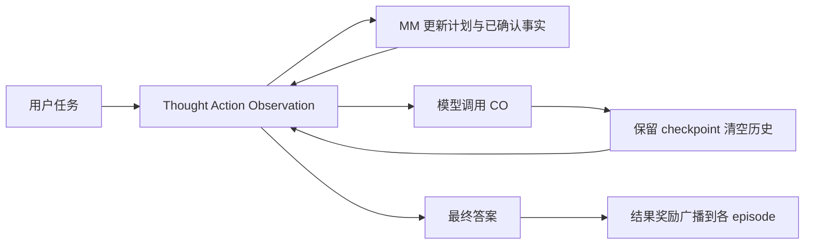

这像同一项目多次交班：档案接续，聊天记录不全部搬过去。

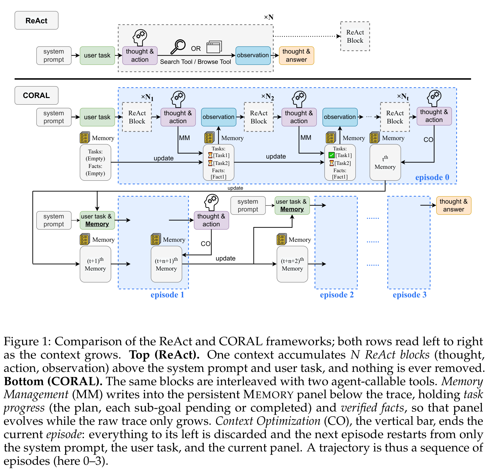

Figure 1：MM 写 memory 时原始历史仍在，只有 CO 才切断旧历史；两种动作在信息可审计性上并不等价。

### 4.2 工具与状态

MM 允许 ADD、UPDATE、DELETE；Task Progress 用 YAML 记录 objective、tasks 与 PENDING/COMPLETED/FAILED 状态，Verified Facts 存原子事实。工具 schema 有可选 source 引用，prompt 也希望附 URL，但没有强制的来源回取和复核闭环。

论文用下式表示每个 episode 开始时看见的上下文：

$$
c_i=\begin{cases}
(s,q),&i=1,\\
(s,q,o_{i-1,M_{i-1}}),&i>1.
\end{cases}
$$

- $s$ 是 system prompt，$q$ 是原始任务，均为 token 序列。
- $i$ 为 episode 编号，$M_{i-1}$ 为前段步数；$o_{i-1,M_{i-1}}$ 为 CO 返回的 memory state。
- $c_i$ 是新上下文序列，不含前段完整网页、观察与推理。

附录实际 reset template 还带 task_checkpoint；形式化公式把它概括为保留状态。重置前必须更新精确进度和下一步，否则后段会把过时清单当现状。verified 只是模型作出的状态标记，并非经过可信执行环境认证。

### 4.3 SFT 与跨 episode RL

SFT 按 episode 训练，只监督模型自己产生的 reasoning 和 action，mask 掉 observation，避免要求模型预测外部网页。错误终局轨迹也可能保留有价值的计划与工具行为，但这不保证其中每一步都正确。

RL 将最终奖励分配给一条轨迹的每段：

$$
R_i=R_i^{\mathrm{format}}R_i^{\mathrm{answer}},\qquad
R_i^j=R_i\quad(j=1,\ldots,N_i),\qquad
\widehat A_i^j=\frac{R_i-\operatorname{mean}(\mathcal R)}{\operatorname{std}(\mathcal R)}.
$$

- $i$ 编号同题的不同完整 trajectory；$j$ 编号其中 episode，$N_i$ 是 episode 数。
- $R_i^{\mathrm{format}}$ 检查格式及工具 JSON，$R_i^{\mathrm{answer}}$ 由 LLM judge 检查最终答案；$R_i$ 是标量。
- $\mathcal R$ 是同题所有 episode 的 reward multiset，包含重复广播的奖励，**不是每条 trajectory 只出现一次**。
- $\widehat A_i^j$ 为序列标量优势，同一轨迹各段相同。

随后在每段真实初始上下文上计算 current/old-policy ratio，用 DAPO 式非对称 clipping、按全体 episode token 平均优化。这样前段写 checkpoint 的动作也能得到奖励，但没有单独判断该动作贡献多少。

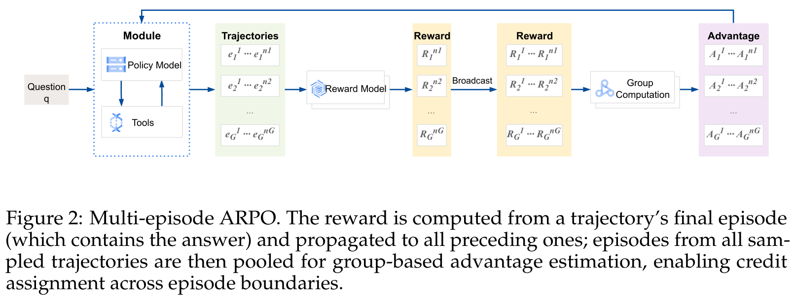

Figure 2：先得到每条轨迹终局 reward，再复制到其全部 episode，最后按题 pooling；这与把每段独立打分是两种方法。

**我的推导**：由 multiset 定义，组内 reward 均值实际为 $\sum_iN_iR_i/\sum_iN_i$，这里每个 $N_i$ 是轨迹的 episode 数。reset 更多的轨迹会在归一化统计中出现更多次。模型自己控制 reset 次数，因此这一权重是否引入非预期偏好值得单独消融；本文没有隔离这个因素。

## 5. 实验结果

像比较两个研究助理，需要看题目难度、拿到的工具、训练经历和总检索账单，而非只比最后一次口头回答。

**实验设置六项**

- **数据集与切分**：GAIA text-only validation 103 题，Level 1/2/3 分别 39/52/12；Knowledge QA 为 NQ、HotpotQA、2WikiMultiHopQA、Musique、Bamboogle，本文未列各自实际测试题数。BrowseComp 取前 150 题。训练问题由 WebShaper 独立合成；2,932 条 web trajectories 中 1,642 正确、1,290 错误，另加 NuminaMath/OpenMathReasoning 的 241 条数学轨迹；共 3,173 条，509 次 CO 后切成 3,682 个 SFT conversations。RL 只用 web tasks。
- **骨干模型**：训练主体 Qwen3-8B；示范由 Claude Sonnet 4 生成。Prompting 跨 Qwen2.5-7B-Instruct、Qwen3-8B、QwQ-32B、Qwen3-32B、Claude Sonnet 4；另有 Qwen2.5-7B 的 SFT 结果。
- **训练预算**：SFT 全参数 3 epochs，learning rate $10^{-5}$，per-device batch 4、gradient accumulation 2、effective batch 64，max sequence 65,536，bfloat16、ZeRO-2、YaRN factor 2。RL actor learning rate $10^{-6}$、batch 64、mini-batch 16、每题 8 轨迹、最多 50 turns，无 KL。GPU 数量、硬件型号、RL 总 steps、wall-clock 原文未给。
- **基线**：direct inference、既有训练过的 web agents、同 backbone 的 ReAct，以及 CORAL Prompting/SFT/RL。主表的第三方系统不是严格相同训练数据和算力的消融。
- **指标**：主表 Pass@1（Avg@8），即 8 次独立运行的平均正确率；附录另报 Pass@8、Maj@8、Best/Worst Pass@1 和标准差。成本是每 trajectory 输入 token、LLM calls、peak context、MM/CO 次数。
- **推理设置**：评测 temperature 0.7、top-p 0.8；使用 Web Search 和 Web Browse，同骨干 ReAct 对照使用相同两种工具。RL rollout temperature/top-p 均为 1.0。答案采用 LLM-as-a-Judge，附录给判断模板但未明确 judge model；不能自行指定。

| 任务 | 指标 | CORAL | 最强基线 / 对照 | 结论 |
| --- | --- | --- | --- | --- |
| GAIA 7–8B 总体 | Pass@1（Avg@8） | RL 42.8 | CK-Pro-8B 43.7 | 总体未领先 |
| GAIA Level 2 | Pass@1（Avg@8） | RL 45.7 | CK-Pro-8B 42.3 | 较难层级领先 |
| GAIA Level 3 | Pass@1（Avg@8） | RL 19.8 | 同档第三方最高 8.3 | 仅 12 题，方差大 |
| NQ | accuracy | 71.0 | DeepResearcher 61.9 | 本文表内领先 |
| 2Wiki. | accuracy | 79.2 | SimpleDeepSearcher 79.8 | 并非所有 QA 领先 |
| BrowseComp 前 150 | accuracy | Sonnet 4 Prompting 30.7 | 同骨干 ReAct 22.7 | +8.0 pp |

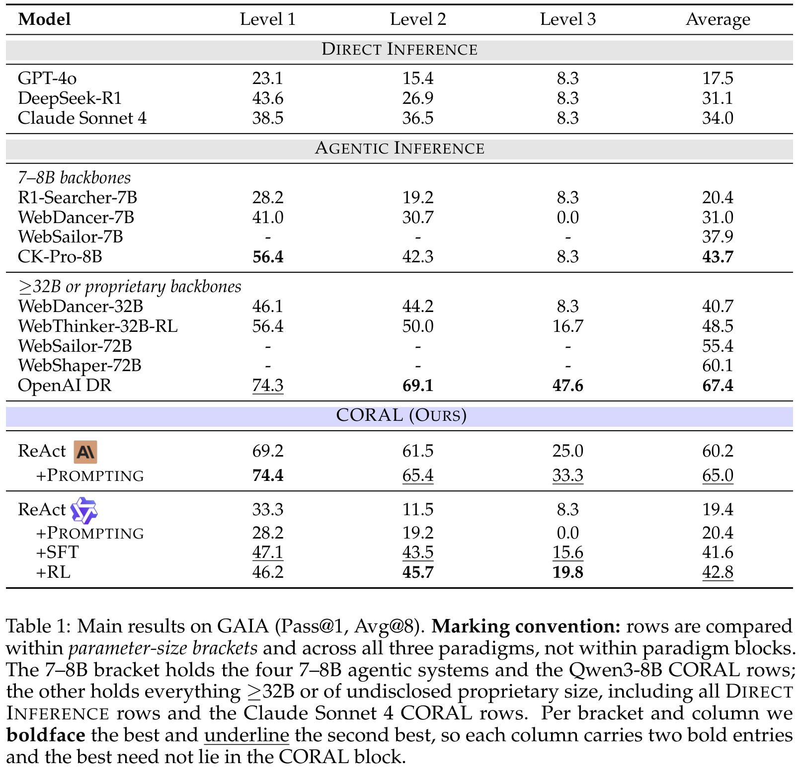

Table 1：主表用图标区分 Sonnet 4 与 Qwen3-8B；65.0 与 42.8 属于不同模型，不能把 proprietary prompting 的收益归给 8B 训练。

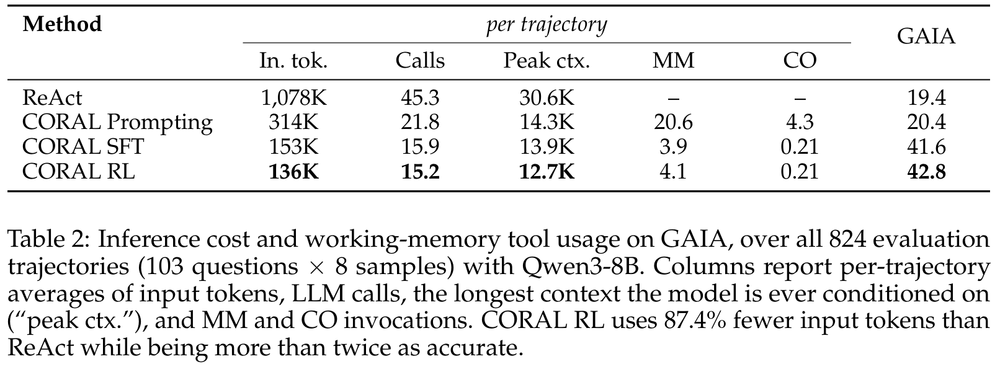

Table 2：训练后输入 token 和 calls 都下降，CO 仅 0.21 次/trajectory，不能把全部节省归因于频繁 reset。正文/摘要的 6–7 倍概述与本表比例不完全一致，笔记保留原始计数和表中 87.4% 减少。

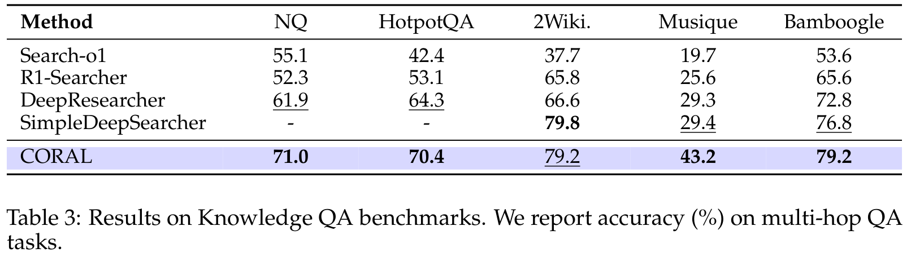

Table 3：迁移到多个 QA 集有效，但 2Wiki. 仍略低于最强基线；开放 web 条件与固定语料检索条件不能混比。

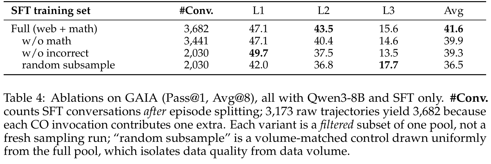

Table 4：等量 2,030 conversations 下 correct-only 的 39.3 好于 random subsample 的 36.5，完整池又达 41.6；因此错误轨迹的增益与增加数据量不能混为一种解释。

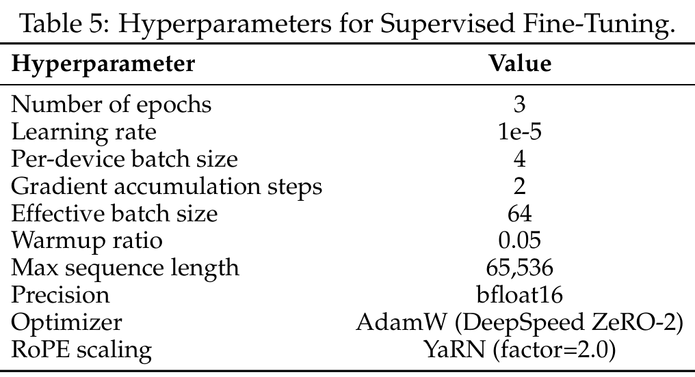

Table 5：SFT 的长序列支持和 episode 切分共同构成训练配置，不能把结果当作仅加两个 prompt 工具的效果。

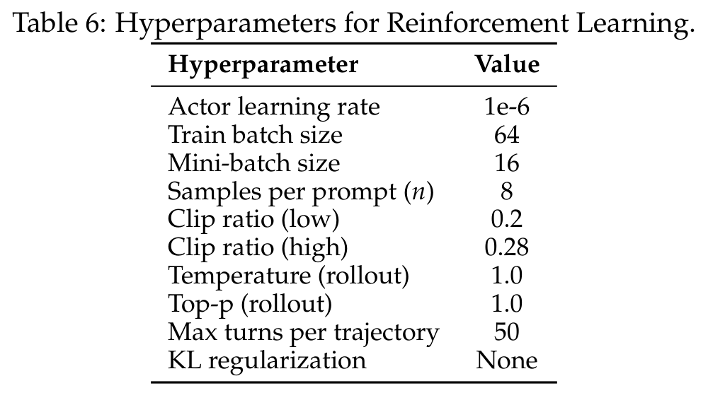

Table 6：RL 沿用 asymmetric clip 和无 KL，max turns 限制仍在；multi-episode 并非没有总执行预算。

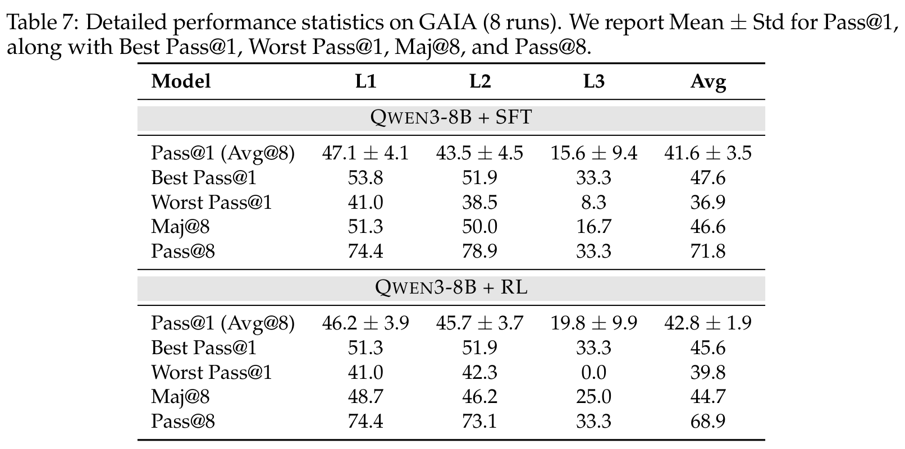

Table 7：RL 将平均分从 41.6 提到 42.8、标准差从 3.5 降到 1.9，但 Pass@8 从 71.8 降到 68.9、Maj@8 从 46.6 降到 44.7。更稳定的单次表现不等于更广覆盖。

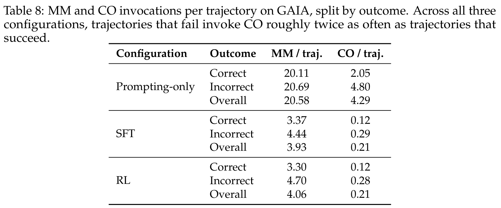

Table 8：失败轨迹 reset 更多是按结果分组的相关性，难题可能同时导致失败与 reset，不能由表推出多 reset 导致失败。

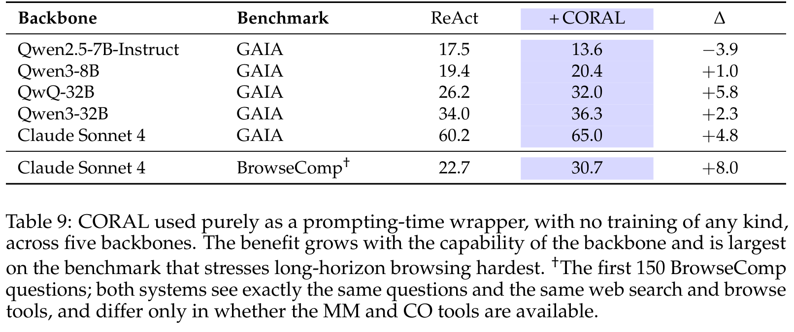

Table 9：Prompting 对 Qwen2.5-7B-Instruct 为负收益；工具调用能力是实际前提，框架并非即插即用必然有效。

## 6. 局限性

**作者承认**：所有 episode 共享最终 reward，无法区分有效准备与绕路；memory 被当权威，reset 后无法用原始历史交叉验证；GAIA Level 3 少、BrowseComp 只评前 150、训练模型覆盖有限。

**我的判断**：像只保留结案摘要而销毁调查底稿，清理可以减少干扰，也会使错误事实失去反证。Appendix D.2 人工污染记忆的定性试验支持这一风险，但没有给污染率曲线；作者把 post-reset corruption 写成原则上不可检测过强，因为新检索仍可能提供反证。更准确的边界是旧证据通道已丢失且系统缺少强制回取协议。

另一个疑问是效率归因。训练后 CO 非常少，MM 也从约 20 次降到约 4 次，说明规划和避免重复检索可能比 reset 次数更重要。缺少保持训练数据、只移除 MM 或 CO 的机制隔离对照，不能把 cost–accuracy 改进全部解释为 context reset。

实验上的小样本方差和第三方预算不一致保留在本节；frontmatter 只放信息损失、记忆信任、credit assignment 与 episode weighting 四条方法边界。

## 7. 一句话总结

**让 Agent 把完成到哪里和确认了什么写成检查点，再按需要换一份干净上下文继续。** 像长篇调查中定期整理档案，省下重读旧资料的时间；但如果摘要写错且原证据已扔掉，整洁也会让错误更牢固。论文真正可复用的是记忆与重置的分离，以及训练输入必须匹配 reset 后可见状态，不是把清空历史本身当作万能增益。

## 8. 可复用点

- 把 Task Progress 与 Verified Facts 分开维护；reset 前保存下一项精确动作，reset 后只从真实 checkpoint 恢复，避免训练时偷看旧历史。
- 给每条事实强制保存来源、证据片段、时间和可回取引用，并在关键决策前复核。这是根据局限提出的工程改进，不能称为本文已实现能力。
- 分别监测 MM 和 CO；像核对交班单与销毁旧档案，两种动作的代价不同。不要以 reset 越频繁作为优化目标。
- 同时报告 Avg@8、Pass@8 与 Maj@8，防止只看到平均正确率提升；按 trajectory 数和 episode 数分别归一化做受控消融。

机制抽为 [[../../../30 方法卡片/任务进度与事实检查点重置]]，并与已有 [[../../../30 方法卡片/双档笔记与上下文交接]] 区分：后者按慢变知识和快变状态分档，本篇按 task progress 和 verified facts 分档。

## 9. 我的疑问

- 保留证据 pointer 并按需回取，能否兼顾输入成本与可纠错性？像只把底稿移入档案室，而非真正销毁。
- 去掉 CO、只训练 MM 后，能保留多少收益？训练后平均只重置 0.21 次值得做直接对照。
- 以 trajectory 等权归一化替代 episode 等权，是否会改变学习到的 reset 策略？
- 哪些错误轨迹值得用于 SFT，能否按 checkpoint 事实正确性筛选，而非只看终局答案？
- LLM judge 的具体模型和 RL 总 steps 原文未给，后续复现应先补齐，不能从 effective batch size 或平均 calls 反推。
