> 一句话：同一个回答里，每一个词都换一个最合适的老师来教它。

## 0. 读之前你需要知道

**术语卡**

- **教师（teacher）/ 学生（student）**：出「软标签」的一方叫教师，被训练的一方叫学生，教师给的是概率分布而不是硬答案。生活类比：老师不报答案，只说「七成是 A、两成是 B、一成是 C」。这篇论文里两者是同一个模型、同一套参数。
- **在线蒸馏（On-policy Distillation, OPD）**：训练轨迹是学生自己当场生成的，不是别人写好的现成答案。生活类比：教练不看标准录像，站在场边看你亲自打一局。
- **在线自蒸馏（On-policy Self-distillation, OPSD）**：OPD 的特例，师生合并成同一个模型，唯一区别是教师手里多一份学生看不到的资料。生活类比：做完卷子把答案纸摊在桌上再做一遍，用「看过答案的自己」纠正「没看答案的自己」。
- **特权参考（privileged reference）**：只有教师能看到的那份额外信息，本文里是数据集给的参考答案（含推理过程和最终答案）。生活类比：开卷考试，书只在监考老师手上。
- **参考曝光（reference exposure）**：教师能看到参考答案的多少，由截断策略（truncation strategy，留哪一段）和曝光比例（exposure ratio，留多少）两个旋钮控制。生活类比：答案册整本给、只给前三页、只给后三页，或者随机撕几页。
- **教师池（multi-teacher pool）**：一组教师，共用同一个模型，只是各自看到的参考答案版本不同。生活类比：同一个专家分别读过完整答案、半份答案、后半份答案，就成了三个意见略有差异的顾问。
- **advantage（优势）**：教师对学生实际采样到的那个词的支持度，取对数概率之差，为正表示教师在挺你。

**它站在谁肩上**

- Hinton et al. (2015)：知识蒸馏的起点，用教师软分布训练学生。要额外维护一个更大的教师模型，训练数据还是固定离线语料。
- Gu et al. (2024) MiniLLM、Agarwal et al. (2024)、Lu & Lab (2025)：把蒸馏搬到学生自己生成的轨迹上（OPD），缓解曝光偏差（exposure bias）。仍需一个独立、通常更强的教师。
- Zhao et al. (2026)、Hübotter et al. (2026)、Shenfeld et al. (2026)：OPSD，师生合成同一个模型，靠特权参考区分。高信息量的参考答案会让教师分布过尖（overly sharp），和学生当前学习节奏对不上。
- Tan & Hong (2026) Paint、Han et al. (2026b)、Yang et al. (2026c)：自适应 OPSD，按学生-教师差距调曝光比例。但它们都在**响应级**自适应，一条回答里所有 token 共用一个教师。
- Xu et al. (2025, 2026a)：用师生接力评估教师是否合适。本文借来量化 token 级教师偏好。

## 1. 动机

一道十二步的解析几何题，你请了三位家教。第一位擅长开局建模；第二位擅长中段算代数；第三位擅长收尾，专门揪符号和边界条件。

如果整道题只能请一位，你只能挑一个「平均还过得去」的，然后在某些步骤上忍受他的短板。如果每一步都能换人，你就能让最懂这一步的人来讲那一步。这篇论文的主张就是这个：**每一步都该换老师**。

**以前怎么做**

现有 OPSD 把教师钉死在两种粒度上。第一种全程固定：OPSD（Zhao et al., 2026）和 SDPO（Hübotter et al., 2026）从头到尾给教师完整参考答案，教师不变，学生每一段都被同一个分布推着走。第二种是响应级自适应：Paint（Tan & Hong, 2026）等按学生和教师的差距动态决定这次给教师看多少参考答案，教师确实变了，但只在两条不同的回答之间变。

**为什么不行**

作者的原话是「The adaptive teacher should operate at the token level, because every token requires its own dedicated teacher.」，意思是自适应该发生在 token 级，因为每个 token 都需要属于自己的教师。

同一份参考答案里，有的段落讲思路，有的段落算数值，有的收尾检查。教师读过「思路段」之后，对下一个词的判断会被那段思路带偏；学生此刻真正需要的可能是「数值段」的约束。偏好在一条回答内部起伏，响应级方法把这条曲线抹平成了一条水平线。

作者用一张图把这个现象摆出来。

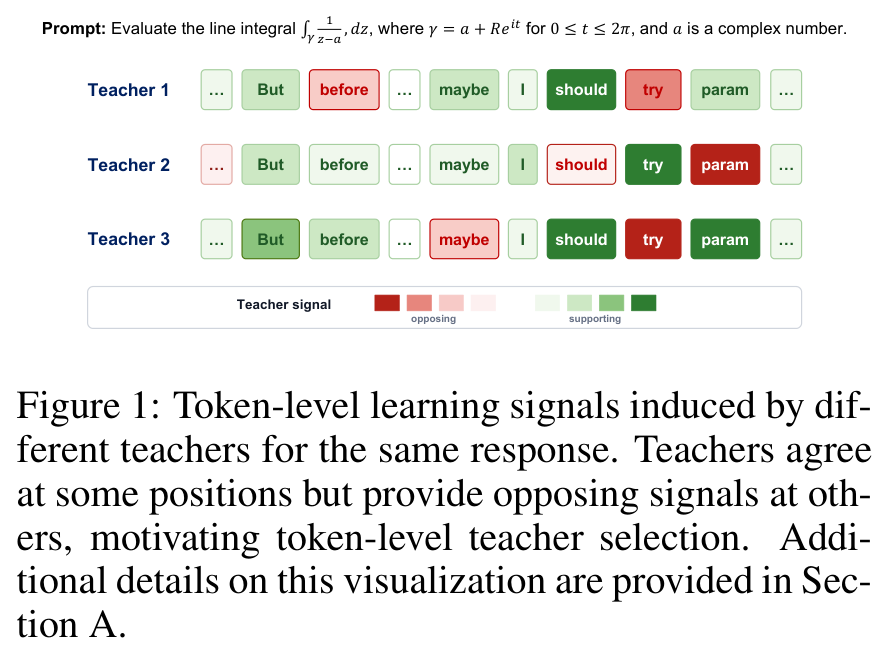

图 1：同一条学生回答，三位教师（prefix-0.5、suffix-0.5、random-span-0.5）逐 token 给出的学习信号。绿色支持学生采样到的词，红色反对，颜色越深分歧越大。三个箭头指的位置上意见并不一致——第 3 个词只有 Teacher 1 反对，第 6 个词 Teacher 2 强烈反对而另两位支持。这张图证明「同一条回答共用一个教师」这个前提站不住。

**为什么现在能做**

三件事凑齐了。算力上，OPSD 已经把教师变成「同一个模型的另一次前向」，多几个教师就是多几次前向，不用多训模型、不用多占权重。方法上，先导实验找到了两个不需要训练路由器的廉价信号（投票定方向、KL 定强弱），否则就得先训一个选择器。工程上，veRL 的 PPO trainer 加 vLLM rollout 已经能批量跑多条不同上下文的教师前向。

## 2. 贡献

- **把「教师偏好因 token 而异」从直觉变成测量**。证据：教师介入实验，7 个介入位置 × 7 个候选教师 × 3 种介入长度，共 75264 次生成；同一 rollout 内不同位置的首选教师重合率只有 48.44% 到 51.56%（表 1）。
- **找到两个可操作的选择信号**。证据：首选教师落在多数派子集里的比例是 77.94% 到 90.68%（表 2）；多数派人均收益 +3.34%，少数派只有 +1.88%（表 3）；多数派里 KL 最远的教师比最近的多 +1.57 到 +1.83 个百分点（表 4）。
- **提出 MTA-OPSD，第一个 token 级自适应 OPSD 方法**。证据：三个模型规模上平均分都最高，比 base model 高 +5.9 / +1.5 / +2.8（表 5）。
- **把「池子有用」和「选师有用」拆开证明**。证据：同一教师池，随机指派 53.6，平均所有教师损失 53.7，逐 token 选师 57.0（表 7）。

## 3. 创新点

- **自适应的粒度从 response 降到 token**。对比对象是 Paint 这一路响应级方法。有用是因为偏好真的按 token 变，表 1 里约一半的位置首选教师不同。
- **教师池由「一个模型 × 多种参考答案视图」拼成，不是多个模型**。对比对象是常规多教师蒸馏和模型集成，那些要维护多个独立模型。有用是因为参数量不涨，只涨前向次数。
- **选师分两级：先按方向过滤，再按信息量排序**。对比对象是单用 KL 或单用投票。有用是因为单用 KL 会把方向相反的教师也挑进来——表 8 第一行只按 KL 最远挑，平均 52.9，比不用池子的 OPSD 还低。
- **选的是「多数派里最远的」，不是「最温和的」**。直觉上该挑和学生最接近的教师，本文结论正相反：先确认方向一致，再挑分布差异最大的，理由是差异大才带得来新的概率质量。

## 4. 方法

### 4.1 整体流程

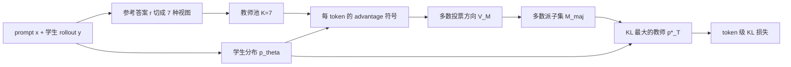

一句话解释这张图：学生先自己走一遍，参考答案被切成七种视图喂给七个教师，每个位置先用符号投票定方向、再在多数派里挑 KL 最大的那个，最后只用这一个教师的分布算损失。

### 4.2 模块拆解

**起点：OPSD 的目标函数**

为什么先说这个：MTA-OPSD 只改了一行——用哪个教师。得先知道被改的那行长什么样。

OPD 的做法是让学生在教师看得到的每个位置上，把自己的下一词分布拉向教师的下一词分布。

$$
\mathcal{L}_{\mathrm{OPD}}(\theta) = \mathbb{E}_{x}\left[\sum_{i=1}^{L} D_{\mathrm{KL}}\big(p_\theta(\cdot \mid c_i)\,\|\,p_T(\cdot \mid c_i)\big)\right]
$$

这个公式在算「学生和教师在每个位置上的分布差多远，然后加起来取期望」。符号逐个说：

- $x$：输入的题目（prompt）。
- $y = \{y_1, \dots, y_L\}$：学生自己生成的回答，长度 $L$，$y_i$ 是第 $i$ 个 token。
- $c_i = (y_{<i}, x)$：第 $i$ 个位置之前的所有内容，也就是「已经写出来的半句话加原题」。
- $p_\theta(\cdot \mid c_i)$：学生在这个位置对下一个词给出的分布。
- $p_T(\cdot \mid c_i)$：教师在同一位置给出的分布。
- $D_{\mathrm{KL}}$：两个分布的 KL 散度，非负，越小说明两个分布越像。

OPSD 把教师换成同一个模型、但多喂一份参考答案 $r$，即 $p_T(\cdot \mid c_i) = p_\theta(\cdot \mid c_i, r)$，带进去得到：

$$
\mathcal{L}_{\mathrm{OPSD}}(\theta) = \mathbb{E}_{x}\left[\sum_{i=1}^{L} D_{\mathrm{KL}}\big(p_\theta(\cdot \mid c_i)\,\|\,p_\theta(\cdot \mid c_i, r)\big)\right]
$$

$r$ 是数据集提供的 ground-truth 参考解答，含推理过程和最终答案。左右两边是同一个 $\theta$，所以这不是在拟合外部模型，而是让学生向「看过答案的自己」靠拢。

**第一块：先导实验——怎么知道哪个教师更合适**

为什么需要：直接做法是「每个 token 配每个教师各训一遍，看谁好」，组合数是 token 数乘教师数，根本跑不完。得找一个便宜的代理指标。

怎么做：保留学生已经生成的前缀，在某个位置让候选教师接管，写一小段，然后把控制权交还给学生，让它把剩下的写完。这条「学生-教师-学生」接力回答的准确率，减去纯学生回答的准确率，就是这个位置上该教师的偏好分数。

$$
z_{1:i-1} = y_{1:i-1} = p_\theta(x), \qquad
z_{t:t+k} = p_T(y_{<i}, x) = p_\theta(c_i, r)
$$

这个式子在说「第 $i$ 个位置之前是学生写的，从第 $i$ 个位置开始由教师写 $k$ 个 token」。符号说明：

- $i$：介入开始的位置，$1 < i < L$。
- $k$：介入长度（teacher-intervention length），取 64、128、256。
- $z$：接力得到的完整回答，后面交还学生补完：$z_{i+k+1:L} = p_\theta(z_{<i+k+1}, x)$。

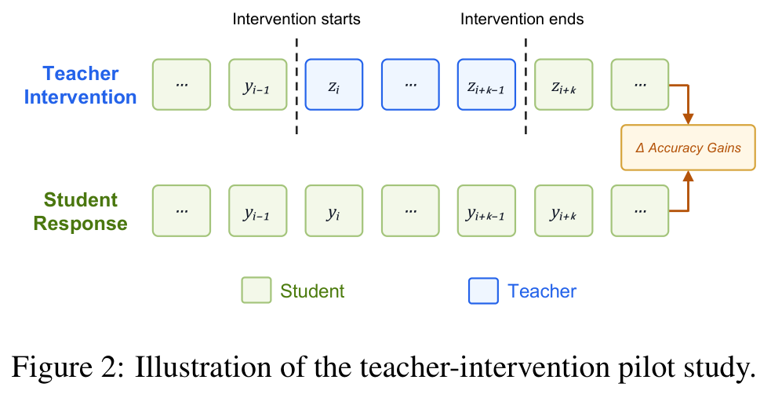

图 2：师生接力评估的流程。上面一排是「教师介入」的时间线，教师只接手中间 $k$ 个 token，两端仍然由学生生成；下面一排是纯学生回答的对照组，两者的准确率之差就是教师在这个位置上的偏好分数。这张图把「教师偏好怎么被量化」讲成了一件可以照着复现的事，也是整篇论文最关键的实验设计。

实验规模：64 道 DeepMath-103K 的题（至少中等难度），每个 rollout 取 7 个介入位置（25%、50%、75% 三处等距位置，加上学生熵最高/最低、师生 KL 最大/最小四处极值位置），7 个候选教师（三种截断 × 两种曝光比例，再加一个全参考教师），每个配置采 2 条教师续写、每条再采 2 条学生接力，合计 $64 \times 7 \times 7 \times 3 \times 2 \times 2 \times 2 = 75264$ 次生成。

三个发现直接撑起了后面的设计。

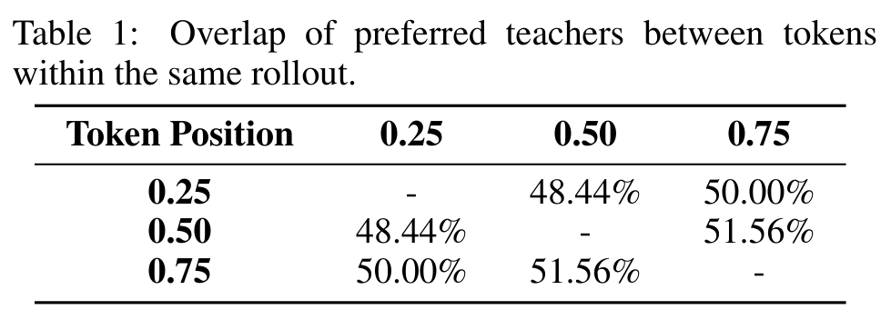

表 1：同一条 rollout 内，不同位置的首选教师重合率。对角线是「自己跟自己」，所以是横杠。这张表证明偏好在 token 之间确实会变——若每个位置都偏爱同一个教师，表里应该接近 100%。

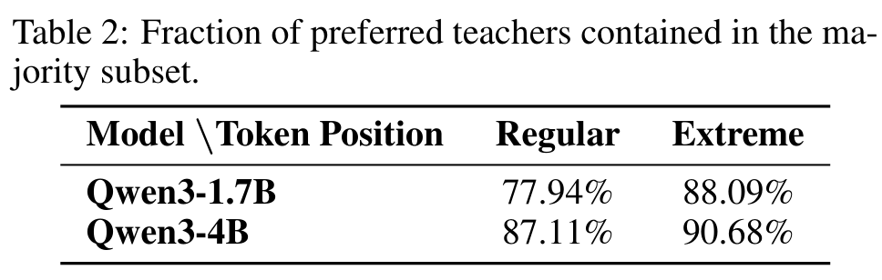

表 2：首选教师落在多数派子集里的比例。常规位置 77.94% / 87.11%，统计极值位置 88.09% / 90.68%。这张表证明多数投票是靠谱的第一道筛子：十次里有八到九次，最好用的教师确实站在多数派这边。

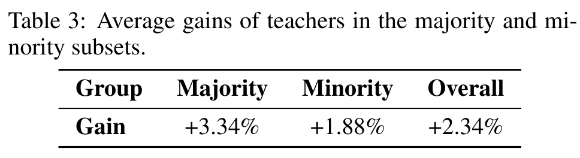

表 3：多数派和少数派教师的人均收益（Qwen3-4B，$k=256$）。多数派 +3.34%，少数派 +1.88%，全池平均 +2.34%。这张表证明按符号分组不是随意切分，多数派那组确实更能提分。

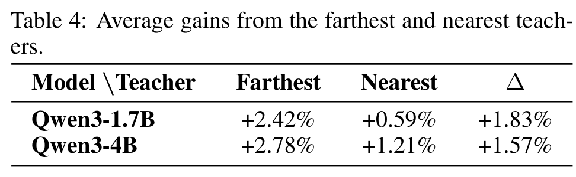

表 4：多数派内部，KL 最远和最近的教师各自的平均收益。最远比最近多 +1.83（1.7B）和 +1.57（4B）个百分点。这张表给出第二个信号：方向定下来之后，用 KL 距离挑强弱。

**第二块：教师池**

为什么需要：token 级换教师的前提是「有得换」。如果只有一个教师，逐 token 选择就退化成了什么都没做。

怎么做：造一组教师，它们共用同一个模型 $p_\theta$，只在看到的参考答案上不同。

$$
\mathcal{M} = \{p_{T_1}, p_{T_2}, \dots, p_{T_K}\}, \qquad
\mathcal{R} = \{r_1, r_2, \dots, r_K\}, \qquad
p_{T_k} = p_\theta(\cdot \mid x, r_k)
$$

第一个式子在说「池子里有 $K$ 个教师」，第二个在说「每个教师配一份自己的参考答案」，第三个在说「第 $k$ 个教师就是把 $r_k$ 拼到原题后面之后的那个模型」。符号说明：

- $K$：候选教师数量，本文固定为 7。
- $r_k$：第 $k$ 份参考答案视图，由截断策略和曝光比例决定。
- $\mathcal{M}$：教师池；$\mathcal{R}$：对应的参考答案集合。

七份视图是：全参考（full reference）、prefix-0.5、prefix-0.75、suffix-0.5、suffix-0.75、random-span-0.5、random-span-0.75。prefix 留参考的前一段，suffix 留后一段，random-span 随机抠几段。所有截断都保留最终答案，否则「看不到答案」和「看到了但被截断」会混在一起。

**第三块：多数投票定方向**

为什么需要：有的教师在支持学生当前写的这个词，有的在反对。不管方向直接挑，可能挑到一个正把学生往反方向拽的教师。

怎么做：先算每个教师对学生实际采样到的那个 token 的支持度。

$$
a_{T}(y_i \mid c_i) = \log p_T(y_i \mid c_i) - \log p_\theta(y_i \mid c_i) = \log \frac{p_T(y_i \mid c_i)}{p_\theta(y_i \mid c_i)}
$$

这个公式在算「教师比学生自己更看好这个已选中的词多少」。符号说明：

- $a_T(y_i \mid c_i)$：教师 $T$ 在位置 $i$ 对学生所选 token 的优势，可正可负，单位是 nat。
- $p_T(y_i \mid c_i)$：教师给这个已选中 token 的概率。
- $p_\theta(y_i \mid c_i)$：学生自己给这个 token 的概率。

$a_T > 0$ 时教师觉得「这个词选得对，我给的概率比你还高」；$a_T < 0$ 时教师觉得「这个词我不看好」。取符号就得到每个教师的一张选票：

$$
v_{T_k}(c_i) = \operatorname{sgn}\big(a_{T_k}(y_i \mid c_i)\big) =
\begin{cases}
+1, & a_{T_k}(y_i \mid c_i) > 0, \\
-1, & a_{T_k}(y_i \mid c_i) < 0.
\end{cases}
$$

这个式子在说「支持记 +1，反对记 −1」。把七张票加起来取符号，就是多数派的方向：

$$
V_{\mathcal{M}}(c_i) = \operatorname{sgn}\left(\sum_{k=1}^{K} v_{T_k}(c_i)\right), \qquad
\mathcal{M}_{\mathrm{maj}}(c_i) = \{p_{T_k} \in \mathcal{M} \mid v_{T_k}(c_i) = V_{\mathcal{M}}(c_i)\}
$$

第一个式子在说「七票求和再取符号」，第二个在说「投了多数方向的那批教师组成多数派子集」。符号说明：

- $V_{\mathcal{M}}(c_i) \in \{+1, -1\}$：该位置的多数方向。
- $\mathcal{M}_{\mathrm{maj}}(c_i)$：多数派教师子集，后面的挑选只在这个子集里进行。

这一步是逐 token 独立执行的，不同位置可以有不同的多数方向，也可以有不同的子集成员。

**第四块：KL 选择定强弱**

为什么需要：多数投票只保证方向对，不区分子集内部谁更好用。表 4 说明 KL 距离能区分。

怎么做：在多数派子集里挑和学生分布差得最远的那个。

$$
p_T^*(c_i) = p_\theta(\cdot \mid c_i, r^*) = \underset{p_{T_k} \in \mathcal{M}_{\mathrm{maj}}(c_i)}{\arg\max}\; D_{\mathrm{KL}}\big(p_\theta(\cdot \mid c_i)\,\|\,p_{T_k}(\cdot \mid c_i)\big)
$$

这个公式在算「在方向一致的教师里，选那个分布离学生最远的」。符号说明：

- $p_T^*(c_i)$：该位置最终选中的教师分布。
- $r^*$：这个教师对应的参考答案视图。
- $\arg\max$ 的范围限制在 $\mathcal{M}_{\mathrm{maj}}(c_i)$ 里，方向相反的教师不会被选到。

**第五块：换成 token 级教师之后的损失**

把上面选出来的教师代回 OPSD 的目标，就得到最终要优化的东西。

$$
\mathcal{L}_{\text{MTA-OPSD}}(\theta) = \mathbb{E}_{x}\left[\sum_{i=1}^{L} D_{\mathrm{KL}}\big(p_\theta(\cdot \mid c_i)\,\|\,p_T^*(\cdot \mid c_i)\big)\right] = \mathbb{E}_{x}\left[\sum_{i=1}^{L} D_{\mathrm{KL}}\big(p_\theta(\cdot \mid c_i)\,\|\,p_\theta(\cdot \mid c_i, r^*)\big)\right]
$$

这个式子和 OPSD 的损失长得一模一样，唯一的区别是 $r$ 变成了 $r^*$，而 $r^*$ 是逐 token 取值、同一条回答里可以变的。整篇论文的改动就落在这一个星号上。

### 4.3 关键细节

**为什么两步的顺序不能换**

多数投票负责「可靠性」，KL 负责「信息量」。顺序不能换，因为 KL 距离本身不是教师质量的度量——一个方向完全反了的教师，KL 也可能很大。表 8 第一行就是这个反例：不做多数投票、直接按 KL 最远挑，平均 52.9，比单教师 OPSD 的 54.0 还低。

**方向为正和为负时，最远教师在做什么**

$V_{\mathcal{M}} = +1$ 时，多数派教师给 $y_i$ 的概率比学生自己还高，挑最远的意味着「继续加强这个词，同时把整体分布改一改」。$V_{\mathcal{M}} = -1$ 时，多数派都觉得这个词不行，挑最远的意味着大幅压低它、把概率质量挪到别的候选上。两种情况下纠正力度都强于最近教师。

**代价：从 1 次教师前向变成 7 次**

固定教师的 OPSD 每一步只要一次教师前向（把完整参考答案拼进去）。MTA-OPSD 要七次，因为七份参考答案视图的文本不同，必须分别跑。学生 rollout 只跑一次，选择逻辑（七个对数概率的符号投票加 KL 比较）几乎不花算力。

成本大致是教师前向的 7 倍。原文没给任何 FLOPs、墙钟时间或显存数字，这个倍数是我按方法结构推的。

实现上还有一处省算力的设计：token 级蒸馏目标只保留教师分布概率最高的 top-100 项（follow Zhao et al., 2026），不在 15 万词表上算完整 KL。

**训练超参**

学习率 $1 \times 10^{-6}$，全局 batch size 32，训 300 步，4 张 H200，全参数训练（不用 LoRA），veRL 的 PPO trainer 加 FSDP2 分片、vLLM rollout。训练题难度按模型分层：Qwen3-1.7B 用 5–7 级，Qwen3-4B 用 6–8 级，Qwen3-8B 用 7–10 级。

## 5. 实验结果

**实验设置**

- **数据集与切分**：训练取自 DeepMath-103K，用多少条 prompt 原文未给；难度按模型分三档（5–7 / 6–8 / 7–10）。评测用 AMC23、AIME24、AIME25。是否做过去污染处理，原文未给。
- **骨干模型**：Qwen3 系列的 Qwen3-1.7B、Qwen3-4B、Qwen3-8B，训练和验证都开 thinking 模式。
- **训练预算**：300 步，全局 batch 32（约 9600 条 rollout，这个数是我乘的），4 张 H200，学习率 $1 \times 10^{-6}$，全参数训练。
- **基线**：两个固定教师方法加一个响应级自适应方法。OPSD（Zhao et al., 2026），前向 KL 加 token 级逐点 KL 裁剪；SDPO（Hübotter et al., 2026），用 Jensen–Shannon divergence；Paint（Tan & Hong, 2026），按学生-教师差距决定曝光比例。另有 Base Model 作起点。
- **指标**：Avg@12，同一题采 12 次取平均正确率。每 50 步在测试集上评一次，报最好的那一次。
- **推理设置**：验证最大生成长度 38912 token。采样温度、top-p、12 次采样的具体参数原文未给。

**主结果**

原文没有结果图，折线、柱状、散点一张都没有，结论全部用表呈现。

| 模型 | 指标 | 本文 | 最强基线 | 提升 |
| --- | --- | --- | --- | --- |
| Qwen3-1.7B | Average | 57.0 | 54.0（OPSD / Paint） | +3.0 |
| Qwen3-1.7B | AIME25 | 41.1 | 38.6（Paint） | +2.5 |
| Qwen3-4B | Average | 77.2 | 76.4（OPSD） | +0.8 |
| Qwen3-4B | AIME25 | 68.1 | 66.1（Paint） | +2.0 |
| Qwen3-8B | Average | 79.2 | 78.1（Paint） | +1.1 |
| Qwen3-8B | AIME25 | 70.3 | 68.3（Paint） | +2.0 |

「最强基线」列刻意不用 base model。摘要里的 +5.9 是相对 base model 的，相对最强基线只有 +3.0。两个数都对，但说的事情不一样。

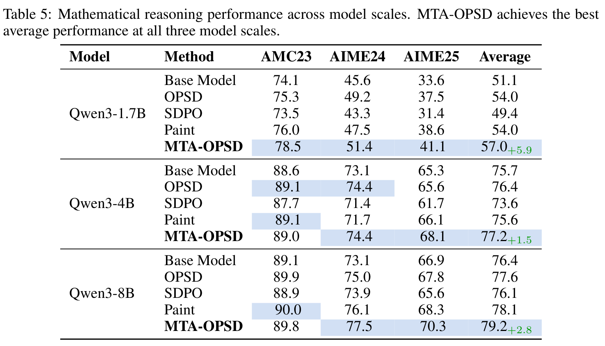

表 5：三个规模的主结果。这张表能看出的第一件事是赢了平均但没赢单科——Qwen3-4B 的 AMC23 是 89.0，比 OPSD 的 89.1 低 0.1；Qwen3-8B 的 AMC23 是 89.8，比 Paint 的 90.0 低 0.2。收益几乎全部集中在 AIME25 这一列。第二件事是 4B 上 AIME24 的 74.4 和 OPSD 完全相同，说明这一档模型在这个基准上已经到顶。

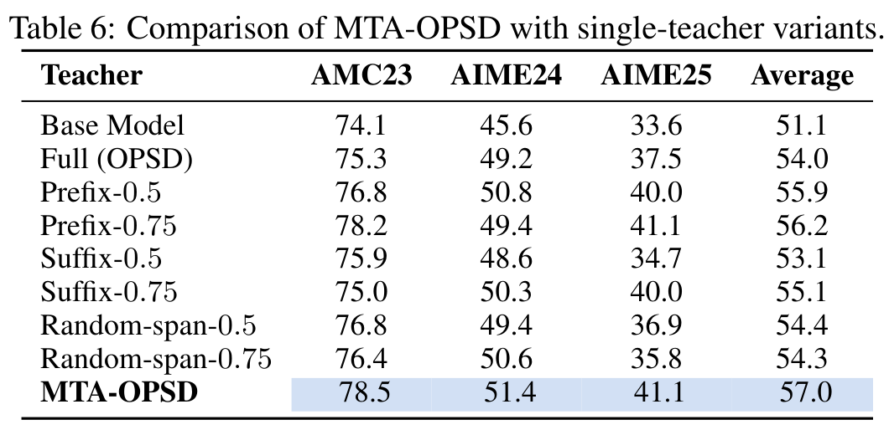

表 6：教师池与七个单教师配置的对比（Qwen3-1.7B）。这是全文最该细读的一张表。池子里最好的单个教师是 Prefix-0.75，平均 56.2；逐 token 选师是 57.0，只高 0.8。也就是说，从 Full (OPSD) 的 54.0 涨到 56.2 这 2.2 分，主要来自「换了个更合适的参考答案视图」，真正来自「按 token 换人」的只有最后 0.8 分。

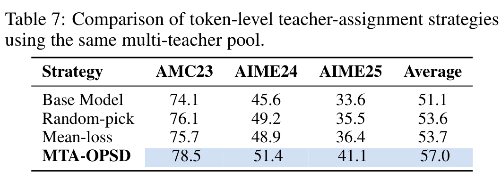

表 7：同一个教师池，三种指派策略。这张表把「池子有用」和「选师有用」拆开了：随机指派 53.6、平均所有教师损失 53.7，两个都比单教师 OPSD 的 54.0 还低。池子本身不带来收益，指派错了甚至有害；57.0 这个数只有逐 token 选师才拿得到。

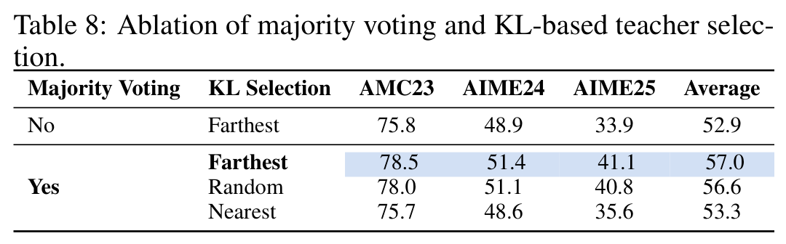

表 8：两步选择机制的逐步拆解。这张表说明两件事。没有多数投票、只按 KL 最远挑，掉到 52.9，比不用池子还差，说明 KL 单用是危险的。加上多数投票之后，子集内随机挑 56.6、挑最近 53.3、挑最远 57.0：方向过滤贡献的是 52.9 到 57.0 这 4.1 分，KL 排序在子集内再补 0.4 分（对随机而言），但方向做反（挑最近）会丢 3.7 分。

**消融告诉我们什么**

三条。教师池的价值被高估、选择机制的价值被低估：表 6 里最好的单教师已到 56.2，表 7 里随机指派只有 53.6，同一批教师换个派法差 3.4 分。多数投票是承重墙：表 8 去掉投票从 57.0 掉到 52.9，换掉 KL 只掉 0.4。被选中的教师分布均匀，作者原话「The assignments are distributed relatively evenly across the teacher pool, indicating that the selection mechanism does not collapse to a single dominant teacher.」，但只有文字没有数字。

**这些实验够不够支撑结论**

够支撑主结论。三个规模、三个基线、三组消融、七万五千次生成的先导实验，在一篇预印本里算扎实。

不够的有五处：没有方差，每种设置只跑一次，而 AIME 一题就是 3.3 个百分点，+0.8 可能落在噪声里；没有算力对比，7 倍教师前向没和「单教师多训 7 倍步数」比过；用测试集挑 checkpoint，每 50 步评一次报最好，绝对分数被抬高；只有数学，开放任务没验证；没和 token 选择类方法（Wang et al., 2026c）对照。

## 6. 局限性

**作者自己承认的**

结论一节写「Future work may explore self-evolving teacher pools and more stable multi-teacher training.」，意思是教师池还得靠人工设计，多教师训练也不够稳——池子不是学出来的，训练有稳定性问题。

附录 E 承认同一截断策略下，曝光比例更高不一定带来更大的 KL 距离（Qwen3-4B 的 suffix 截断下只有 49.1% 的情况成立）。这等于说曝光比例这个旋钮不能单独决定教师合不合适。

**我看出来的**

- **隐形假设：多数教师的方向就是正确方向**。七个教师共享同一份参考答案，只是截断位置不同，错误高度相关。参考答案本身在某一步把学生带偏时，七个人会一起投错票，多数投票把错误放大成「共识」。
- **隐形假设二：KL 大等于信息量大**。KL 大也可能只是行文风格不同。表 4 只在常规位置验证了这条，统计极值位置没单独报。
- **边界条件**：要有一份唯一、可验证的参考答案才能切出七种视图。开放写作、多解数学题、没有标准答案的任务，教师池造不出来。
- **成本没算账**：七次教师前向的代价全文没量化。7 倍算力如果给 OPSD 多训 7 倍步数，谁赢是未知的。
- **缺的对比**：没和 token 选择类方法（高熵 token 筛选）比，也没和稀疏化蒸馏比。
- **增益与规模不单调**：+5.9 / +1.5 / +2.8，4B 上 AMC23 还降了 0.1。4B 为什么最差，原文没解释。

## 7. 一句话总结

每个 token 自己挑老师：先看哪个方向是多数派，再从多数派里挑跟自己差别最大的那个来讲。

生活类比：七位顾问看同一本书的不同章节。先举手看多数人觉得这一步该往前还是该退，再在这批人里挑那个和你现有判断差得最远的——差得远，他嘴里才有你不知道的东西。

核心公式：

$$
\boxed{\;p_T^*(c_i) = \underset{p_{T_k} \in \mathcal{M}_{\mathrm{maj}}(c_i)}{\arg\max}\; D_{\mathrm{KL}}\big(p_\theta(\cdot \mid c_i)\,\|\,p_{T_k}(\cdot \mid c_i)\big)\;}
$$

## 8. 可复用点

- 如果我要在自己的项目里用：把教师池实现成同一模型的 $K$ 次前向，参考答案按 prefix / suffix / random-span × 曝光比例切，$K = 7$，算力按 $K$ 倍教师前向预算。
- 选师逻辑可以脱离蒸馏单独用。任何「多个打分器给同一样本打分」的场景，都可以先用符号投票定方向、再用分布距离定强度，两步都不用训练路由器。
- 想要更便宜：只对高熵 token 选师，低熵 token 直接用全参考教师。低熵位置的选择几乎不影响结果，却占了大部分算力。
- 训练不收敛时先查两件事：教师被选中的频率分布有没有坍缩到某一个教师；多数投票的方向正负比例是不是长期偏一边（一直 +1 说明池子没提供新信息）。
- 报分时可以照抄它的做法：主表同时给相对 base 和相对最强基线两个差值。

## 9. 我的疑问

- 表 6 里 Prefix-0.75 单教师已到 56.2，池子 57.0。这 0.8 分有多少是「按 token 换人」的真贡献，多少是「七次前向平均掉了噪声」？要分清得加一组「同参考不同初始化」的对照，原文没有。
- 七个教师共享同一份参考答案，投票一致率有多高？如果 $V_{\mathcal{M}}$ 长期是 +1，这套机制就退化成「用 full reference 教师加一点扰动」。原文只给了被选教师的频率，没给投票方向的正负比例。
- 为什么 Qwen3-4B 增益最小（相对最强基线只有 +0.8）？是难度分层选得偏简单，还是 4B 在 AMC23/AIME24 上已无空间？
- 7 倍算力换成单教师 OPSD 训 7 倍步数，谁赢？这个问题不回答，「token 级选师」的必要性就没有闭环。
- 附录 E 说曝光比例和 KL 不单调，那 KL 测的是信息量还是参考解答的行文差异？若只是行文差异，表 4 的结论就是相关而非因果。
