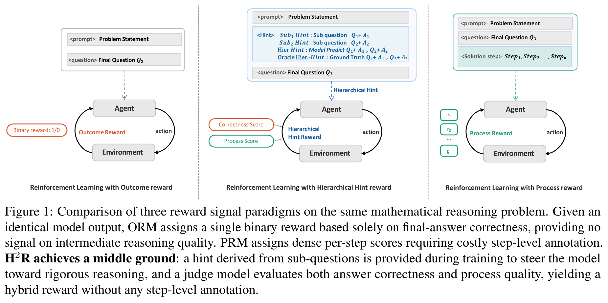
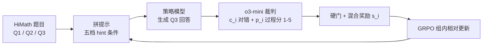
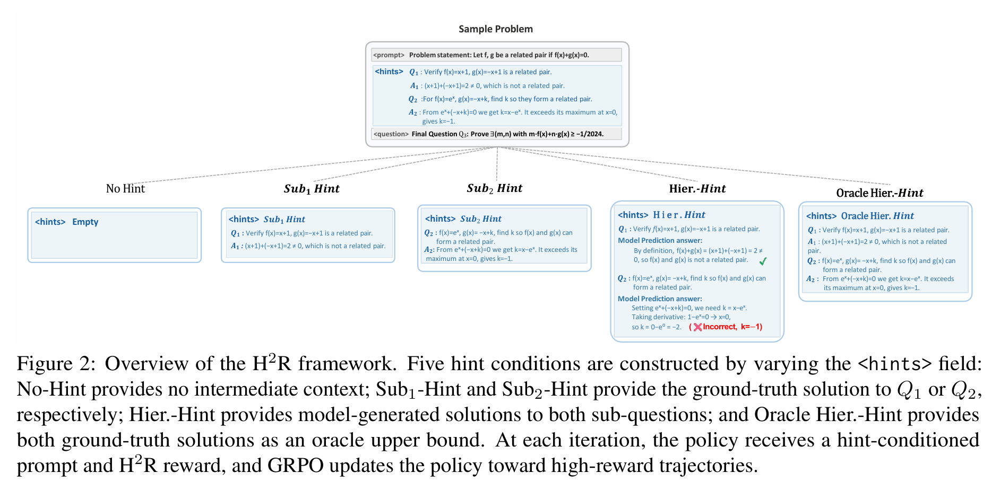
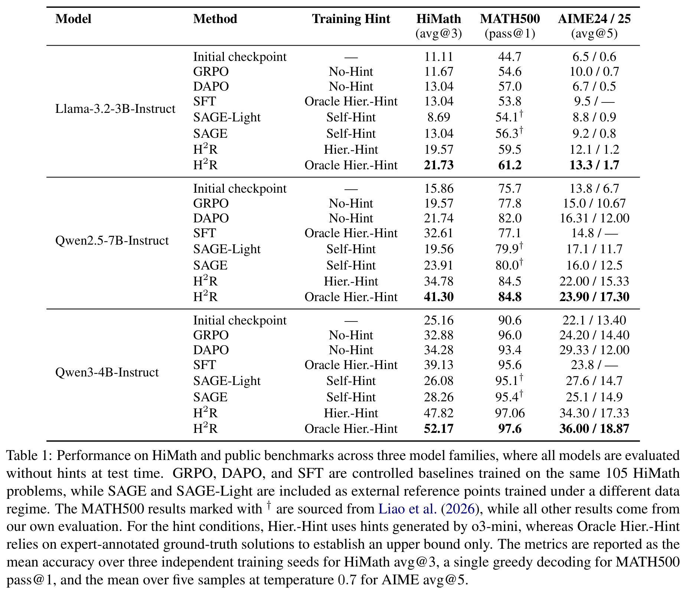
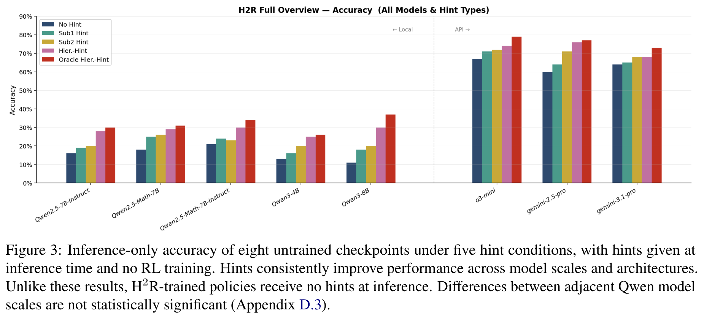
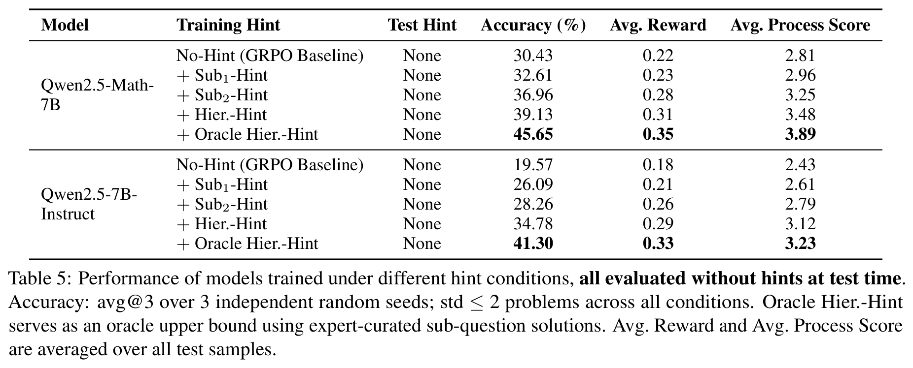
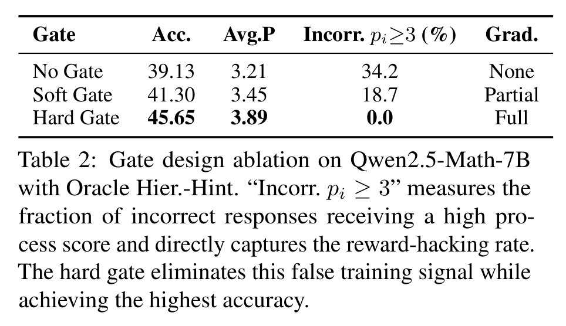
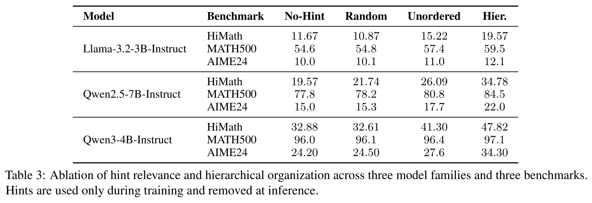
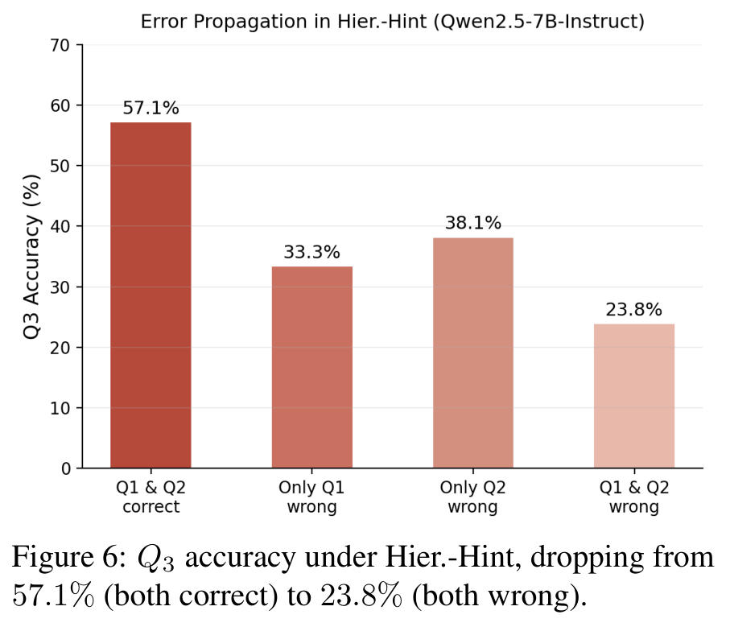

> 一句话：把大题里现成的几个小问当台阶，训练时塞给模型当提示，再按答案对错加过程分给奖励。

## 0. 读之前你需要知道

**术语卡**

- **H2R（Hierarchical Hint-based Reward，分层提示奖励）**：本文的方法名。论文标题排印为 H$^2$R，正文统一写 H2R。生活类比：给爬楼梯的人每一层标个号。
- **RLVR（Reinforcement Learning with Verifiable Rewards，可验证奖励的强化学习）**：模型写完答案，用一个能自动判对错的检查器给 1 或 0，再拿这个分更新模型。生活类比：驾校科目二，压线就挂，考官不用懂你的心路。
- **ORM（Outcome Reward Model，结果奖励）**：只看最后答案对不对。生活类比：只看快递送没送到，不管路上摔了几次。
- **PRM（Process Reward Model，过程奖励）**：每一步都打分。生活类比：教练站跑道边，你每跑一百米就喊一句这步不错。
- **credit assignment（功劳分配）**：一条长推理只拿一个总分时，判断哪一步该表扬哪一步该批评。生活类比：五个人合写报告被打回，领导只说重写，谁的责任说不清。
- **hint（提示）**：这道题前面几小问的答案或思路，训练时拼进输入。生活类比：爬山路上有人在半山腰插了路标。
- **hard gate（硬门）**：答案判错时，过程分一律清零。生活类比：预检没过，直接不进专家门诊。
- **GRPO（Group Relative Policy Optimization）**：同一道题采样一组回答，用组内相对好坏算优势，不用额外的价值网络。生活类比：同批考生内部排名，比跨年比绝对分稳。
- **New Definition questions（新定义题）**：题干先给一个没见过的新概念，让你当场用它推理。生活类比：进考场才发规则书，背题库没用。
- **avg@k / pass@1**：avg@k 是采样 k 次取平均正确率；pass@1 是单次贪心解码的对错。生活类比：考 k 次取平均分，和只考一次。

**它站在谁肩上**

- DeepSeek-R1（2025）：证明只有 0/1 结果奖励也能逼出长链推理，但信号太稀疏，中间错在哪没人管。
- Let's Verify Step by Step（2023）：PRM 的开山工作，每步人工标好坏；标注贵，换领域常失效。
- Math-Shepherd（2024）：用蒙特卡洛自动造步级标签，省人工，但每题要采样很多次，还要求推理能被切成干净的步。
- SAGE（2026）：让模型自己给自己写提示（Self-Hint），是本文最直接的外部对照，用了约 220K 训练题。

## 1. 动机

小孩做一道数学大题，家长只看最后那个数对不对。数错了，前面写对的四步全白搭；数碰巧对了，中间胡写也照样得表扬。这件事放在模型身上，就是这篇论文要修的东西。

**以前怎么做**：主流做法是 RLVR，答对给 1，答错给 0。另一条路是 PRM，每一步都打分。

**为什么不行**：0/1 太粗。作者的原话是 "sparse rewards are too coarse, while dense rewards are too costly"，稀疏奖励太粗，稠密奖励太贵。一步之差全盘归零，模型学不到「我离对只差最后一步」；反过来，靠歪理凑出正确选项也能拿满分。PRM 则是每步都要人标，或者用教师模型合成，规模上不去，换领域还不一定灵。

**为什么现在能做**：竞赛题本来就被出题人拆成了 Q1、Q2、Q3。这几个小问不是模型编的，是题目自带的可验证中间站，过去被当成「题干格式」，没人把它接进奖励里。

## 2. 贡献

它做成了什么，看结果。

- **新基准 HiMath**。151 道新定义题，每题三个递进小问。证据：o3-mini 只解出 66.9% 的 Q3，Gemini-3.1-pro 63.5%，开源的 Qwen2.5-Math-7B 只有 17.9%，同样这批模型在 MATH500 上普遍超过 75%，说明 HiMath 留了大片空位。
- **分层提示本身就有用，不用训练**。证据：八个模型在推理期直接给提示，Sub1-Hint 涨 +2.8% 到 +13.8%，Sub2-Hint 涨 +0.7% 到 +17.4%（Figure 3）。
- **H2R 训练完，测试期不给提示也能涨**。证据：Qwen2.5-Math-7B 从 30.43 到 39.13（Hier.-Hint），再到 45.65（Oracle Hier.-Hint）。
- **跨模型跨基准都成立**。证据：三个模型家族在 MATH500 和 AIME 上都压过 GRPO、DAPO、SFT；在 HiMath 上分别比用约 220K 题训练的 SAGE 高 6.53、10.87、19.56 个百分点，而 H2R 只用了 105 题。
- **硬门把 reward hacking 率压到 0**。证据：No Gate 时 34.2% 的错答案拿到高过程分，Soft Gate 降到 18.7%，Hard Gate 是 0.0%，同时准确率一路升到 45.65%。

生活类比：成绩单原来只印一个总分，现在多印一栏卷面分，但总分不及格时卷面分不计入。

## 3. 创新点

做法上哪里是新的。

- **把子问题结构接进奖励，而不是接进提示词**。对比对象：CoT prompting、推理期的问题分解。有用是因为：提示只在训练期出现，测试期整段删掉，部署时既不加长 prompt，也不要求题目被提前拆好。
- **五档提示条件构成一条受控梯子**。对比对象：SAGE 的 Self-Hint 只有「自生成」一档。有用是因为：No-Hint / Sub1-Hint / Sub2-Hint / Hier.-Hint / Oracle Hier.-Hint 五档能把「有没有提示」「提示早不早」「提示准不准」三件事拆开量。
- **混合奖励加硬门**。对比对象：纯 ORM 的 0/1 和 PRM 的步级打分。有用是因为：不需要任何步级标注，也能拿到过程信号；硬门保证这个信号只加在答对的轨迹上。作者对定位的说法是 "H2R achieves a middle ground"，取中间路线。
- **两个反事实对照**。对比对象：常见的只做「去掉提示」的消融。Random-Hint 换掉提示内容但保留格式和监督量，Unordered-Hint 保留内容但打乱顺序和层级标签，一个管语义相关性，一个管层级顺序。

生活类比：把教练的场边口令录下来，只在训练馆的喇叭里放，比赛当天喇叭是关的。

图 1：同一道题、同一份模型输出，三种奖励给法并排：ORM 只给 1/0，PRM 给每一步的 $r_1 \dots r_n$，H2R 在训练输入里塞分层提示、再用裁判同时判对错和过程质量。这张图说明 H2R 省掉的是「步级标注」，不是「中间监督」。

## 4. 方法

### 4.1 整体流程

一句话解释：每轮从题库里取题，按当前档位把提示拼进输入，模型答 Q3，裁判同时给对错和过程分，奖励算完后用 GRPO 更新，下一轮换一批题。

生活类比：五档提示就是驾校的五个辅助档位，从「什么都不给」到「教练替你扶着方向盘」，逐档关掉辅助，看学员到底会不会自己开。

图 2：五档提示条件是怎么由同一个 `<hints>` 字段变出来的。注意 Hier.-Hint 那一格写的是 `Model Prediction answer`，也就是模型自己算的 Q1、Q2，而且 Q2 那步算错了（$k=-2$，正确是 $k=-1$）还被标了 `Incorrect`，这正是现实部署时拿到的提示。这张图说明 H2R 在训练期就故意让模型吃自己的错答案。

### 4.2 模块拆解

**模块 A：HiMath 的三层题面**

为什么需要：奖励要能对到「某个中间结论对不对」，题目本身必须先有可验证的中间结论。

怎么做：从公开竞赛题和教材网站收新定义题，PDF 用 Mathpix 转 LaTeX 再人工校对。151 题按题目级切成 105 训练、46 测试，同一题的三小问不会跨切分。

关键约束：Q1 建立定义层面的基础，Q2 给出 Q3 直接要用的中间结论。这个顺序是题目原有的，不是作者加的。

**模块 B：五档提示条件**

| 档位 | `<hints>` 里放什么 | 用途 |
| --- | --- | --- |
| No-Hint | 空 | 等价于标准 GRPO 基线 |
| Sub1-Hint | Q1 的专家解 | 是「早」的中间结果，看基础步骤值不值钱 |
| Sub2-Hint | Q2 的专家解 | 是「近」的中间结果，看邻近约束值不值钱 |
| Hier.-Hint | 模型自生成的 Q1 与 Q2 解 | 现实场景：没有专家标注 |
| Oracle Hier.-Hint | Q1 与 Q2 的专家解 | 上界，只用来量天花板 |

Hier.-Hint 这一档原文自己有两处对不上：3.2 节说它给的是「更强外部模型生成」的解，Table 1 题注写提示由 o3-mini 生成，而 Figure 2 和附录 J 又按「模型自生成的 Q1、Q2」来画图和分组。本笔记按 Figure 2 的写法理解，分歧记在第 9 节。

**模块 C：混合奖励**

为什么需要：只看对错分不出「答对但过程烂」和「答对且过程干净」。

怎么做：裁判对第 $i$ 条回答输出两个数——答案对错 $c_i$ 和过程分 $p_i$，再把它们压成一个标量。

公式：

$$
s_i =
\begin{cases}
\alpha + (1-\alpha)\cdot \min\left(1, \dfrac{p_i}{\tau}\right) & \text{if } c_i = 1\\[4pt]
0 & \text{if } c_i = 0
\end{cases}
$$

先说这个公式在算什么：答对了，保底拿 $\alpha$，再按过程分往上加一点，封顶 1.0；答错了，一律 0。

- $c_i \in \{0,1\}$：第 $i$ 条回答的最终答案对错，由 LLM 裁判判，不是字符串匹配。
- $p_i \in [1,5]$：裁判给的过程质量分，1 最差 5 最好。
- $\alpha \in (0,1)$：答案正确这件事的保底权重，本文固定 0.6。
- $\tau$：归一化阈值，把 1 到 5 的离散分映射进 $[0,1]$ 的加分区间，本文固定 4。
- $\min(1, p_i/\tau)$：截断，$p_i \ge \tau$ 之后不再加分。

代入 $\alpha=0.6$、$\tau=4$ 就是论文里的实例化式：

$$
s_i =
\begin{cases}
0.6 + 0.4\cdot \min\left(1, \dfrac{p_i}{4}\right) & \text{if } c_i = 1\\[4pt]
0 & \text{if } c_i = 0
\end{cases}
$$

这个式子说明两件事。第一，奖励落在 $[0.6, 1.0]$，过程分最多值 0.4，永远翻不过「答对」这道坎。第二，$\tau=4$ 小于量表顶端的 5，所以 $p_i=4$ 和 $p_i=5$ 拿到一样的加分，5 分那一档实际是饱和的。

**模块 D：硬门与防摆烂**

为什么需要：过程分衡量的是「像不像正经推理」，不是「证明对不对」。Q3 又常常是把结论写在题干里让你证，模型只要把结论抄一遍、中间塞几步废话，裁判就可能给高分。

怎么做：答案错，$s_i$ 直接置 0，不管过程分多高。这就是 hard gate。作者的原话是 "a model can mimic correct reasoning by copying the conclusion and padding it with invalid steps"，模型可以靠抄结论加废话来模仿正确推理，硬门就是堵这个口子。

另外两道锁：裁判是 reference-anchored 的，每道题都配人写参考解，只判「和参考解在推导与结论上是否一致」；提示里也从来没有 Q3 的答案，抄提示抄不到终点。

需要说清一点：**奖励不是按「用了第几层提示」算的**。提示档位是训练条件（自变量），每个档位单独训一个模型；奖励函数在所有档位下都是同一个式子。层级改变的是输入，不是打分规则。

### 4.3 关键细节

- 裁判：主裁判 o3-mini，零样本。裁判 prompt 强制两件事——输出 `correctness` 0/1 和 `process_score` 1-5；且 **$c_i=0$ 时 $p_i \le 3$**。
- 训练：GRPO，verl 框架。组大小 $G=2$，clip epsilon 0.2，学习率 $1\times10^{-6}$，AdamW，余弦调度。
- 长度：最大响应 2048 tokens，超长的样本被过滤掉。作者说这个截断只影响极小一部分生成，且在各档位间分布均匀。
- 算力：单次训练 4 张 NVIDIA H100 跑 3–4 小时；所有模型、所有档位、3 个随机种子合计约 600 GPU 小时。
- 调用成本：每轮约 4,200 次奖励裁判调用，评测再约 1,334 次，合计约 5,700 次；提示生成是一次性的 105 次 o3-mini 调用，之后全程复用。
- 批大小与训练步数：原文未给。

## 5. 实验结果

**实验设置**

- **数据集与切分**：训练用 HiMath 的 105 题，测试用留出的 46 题（题目级切分，同题三小问不跨集）。跨域评测用 MATH500 和 AIME24 / AIME25。
- **骨干模型**：Llama-3.2-3B-Instruct（数学优化程度低）、Qwen2.5-7B-Instruct（中）、Qwen3-4B-Instruct（高，实际用的是 Qwen3-4B-Instruct-2507 检查点）。提示档位消融另加 Qwen2.5-Math-7B 和 Qwen2.5-7B-Instruct。
- **训练预算**：4 张 H100、单次 3–4 小时、3 个随机种子，合计约 600 GPU 小时；105 道训练题。批大小与步数原文未给。
- **基线**：Initial checkpoint（不训练）、GRPO（No-Hint）、DAPO（No-Hint）、SFT（Oracle Hier.-Hint，同样 105 题），外部参照 SAGE 与 SAGE-Light（均用 Self-Hint，训练数据体制与本文不同，SAGE 用约 220K 题）。消融另含 Random-Hint、Unordered-Hint，以及 No Gate / Soft Gate / Hard Gate。
- **指标**：HiMath 用 avg@3（三个种子平均），MATH500 用 pass@1（单次贪心），AIME 用 avg@5（温度 0.7 采样 5 次取平均）。辅助指标是 Avg. Reward 与 Avg. Process Score。
- **推理设置**：所有模型测试时都不给提示；MATH500 贪心解码，AIME 温度 0.7；Q3 多为证明题，对错由 o3-mini 裁判对照人写参考解判定，不做字符串匹配。测试期最大长度原文未给。

生活类比：这一节的实验像药厂做对照试验，同样的病人、同样的剂量，只换一片药的颜色和吃法，看差异到底是药带来的还是包装带来的。

主表（Hier.-Hint 是实际可部署的那一档，Oracle Hier.-Hint 只作上界）：

| 模型 | 指标 | 本文（Hier.-Hint） | 最强基线 | 提升 |
| --- | --- | --- | --- | --- |
| Llama-3.2-3B-Instruct | HiMath avg@3 | 19.57 | 13.04（DAPO / SFT / SAGE 并列） | +6.53 pp |
| Qwen2.5-7B-Instruct | HiMath avg@3 | 34.78 | 32.61（SFT，用 Oracle Hier.-Hint） | +2.17 pp |
| Qwen3-4B-Instruct | HiMath avg@3 | 47.82 | 39.13（SFT，用 Oracle Hier.-Hint） | +8.69 pp |
| Qwen2.5-7B-Instruct | MATH500 pass@1 | 84.5 | 82.0（DAPO） | +2.5 |
| Qwen2.5-7B-Instruct | AIME24 avg@5 | 22.00 | 16.31（DAPO） | +5.69 |
| Qwen3-4B-Instruct | AIME24 avg@5 | 34.30 | 29.33（DAPO） | +4.97 |

有两点值得单独看。SFT 那一栏用的还是专家提示，H2R 的 Hier.-Hint 只用模型自生成提示，仍然更高，说明收益不是「多喂了监督」这么简单。Oracle Hier.-Hint 在 Qwen2.5-Math-7B 上到 45.65，比 Hier.-Hint 的 39.13 高 6.52 个百分点，这 6.52 就是「提示质量」还欠的账。

表 1：三个模型家族、八个方法、三个基准的全量对照。这张表能看出 H2R 在 HiMath 上的提升幅度最大（Hier.-Hint 对 GRPO 是 +6.53、+2.17、+8.69 pp，Oracle 档在 Qwen2.5-Math-7B 上到 +15.22 pp），在 MATH500 上已经接近饱和（Qwen3-4B 从 96.0 到 97.06），跨域提升主要体现在 AIME 上。

图 3：八个未训练检查点在五档提示下的推理期准确率，图里没有任何 RL。三件图形才能看出的事：一，五根柱子从左到右单调上升，中间没有交叉；二，Sub2-Hint 那一根几乎每次都比 Sub1-Hint 高，说明靠后的中间结论更值钱；三，粉色（Hier.-Hint）到红色（Oracle Hier.-Hint）在每一组里都还留着一段距离，提示质量始终是瓶颈，这一条和 Figure 6 的误差传播结论对得上。

表 5：训练档位的阶梯消融。Qwen2.5-Math-7B 的准确率是 30.43 → 32.61 → 36.96 → 39.13 → 45.65，Avg. Process Score 同步从 2.81 爬到 3.89。这张表说明两件事同时发生：答案在变对，过程分也在变高，不是只靠裁判给分放水。

表 2：门控消融。关键那一列是 `Incorr. pi≥3`：答案错却拿到高过程分的比例，No Gate 34.2%，Soft Gate 18.7%，Hard Gate 0.0%。这张表说明不加硬门时有三分之一的错答案在被当作好推理奖励，硬门一关就清零，还顺带把准确率从 39.13 推到 45.65。

表 3：提示相关性 / 层级顺序的反事实消融。Random-Hint 在 HiMath 上和 No-Hint 最多差一道题（46 题里一题约 2.17 个百分点），MATH500 上最多差 0.4 分；Unordered-Hint 落在两者中间，大约收回一半增益。这张表说明收益来自「语义相关的层级结构」，不是来自「多给了点上下文」。

图 6：Qwen2.5-7B-Instruct 在 Hier.-Hint 下按自生成提示对错分组后的 Q3 准确率。两根提示都对时 57.1%，只有 Q1 错掉到 33.3%，只有 Q2 错掉到 38.1%，两根都错是 23.8%。这张图说明 Q1 出错比 Q2 出错更致命（掉 24 个点对 19 个点），因为 Q1 是定义层面的地基；也说明两根都错时还剩 23.8%，模型不是盲抄自己的错答案。

**消融告诉我们什么**

三道消融各自锁住一个变量。Table 5 锁提示档位，证明「越靠近终点的提示越值钱」，而且过程分跟着涨，排除「只是裁判手松」。Table 3 锁提示内容与顺序：Random-Hint 保留格式和监督量但换掉语义，一点没涨，说明不是「多给了 context」；Unordered-Hint 保留内容但打乱层级，只收回一半，说明层级顺序本身贡献了另一半。Table 2 锁奖励结构：没有硬门时三分之一错答案拿高分，硬门清零。这三条合起来，是在把「为什么涨」一步步逼到奖励设计上。

**这些实验够不够支撑结论**

支撑得比较扎实的部分：HiMath 上的档位单调性有 3 个种子、有 10,000 次 paired cluster bootstrap（Hier.-Hint 比 No-Hint 高 15.22 个百分点，95% CI $[4.3, 26.1]$，$p=0.006$；Oracle Hier.-Hint 高 21.74 个百分点，95% CI $[9.4, 33.4]$，$p<0.001$）。裁判这件事也做了交叉验证：换成 GPT-4o 和 DeepSeek-R1 重打分，三个条件的排序不变；25 条人工盲审里随机层 19/20 一致，合并层 23/25，Cohen's κ = 0.80。

不够的部分见下一节。

## 6. 局限性

**作者自己承认的**

- **数据规模**：HiMath 只有 151 题，作者明确说这不足以证明「广泛通用推理能力」，需要更多任务和数据集。
- **自动评测**：判分混合了答案匹配和 LLM 裁判，作者承认自动评测抓不住数学推理的全部细节，人工验证只做了 25 条。
- **缺 PRM 基线**：明确写了没做直接的 PRM 对照，理由是 HiMath 的 Q3 是证明题，没有规范答案串可以自动切步标注，改造 PRM 管线要另做一套裁判标注，成本超出本研究范围。

**我看出来的**

- **隐形假设**：默认题目自带「可验证的、逻辑递进的三小问」。生活类比：默认每座山都有人提前修好三个观景台。碰上只有一句问话的题（MATH500 里绝大多数就是），这套奖励就无处落脚。
- **边界条件**：提示由 o3-mini 一次性生成后全程复用，105 次调用。提示质量一旦定死，训练过程中不会随模型变强而变好；作者也承认瓶颈在「能不能生成可靠的中间状态」，而不是「有中间状态会不会用」。
- **缺的对比**：没和真正的 PRM 比，也没和「用裁判给每步打分」的稠密版本比。所以「比 PRM 便宜」这句话成立，「和 PRM 比谁更准」这句话没被检验。
- **一个口径问题**：正文 4.2 节在讲 Qwen2.5-Math-7B 时写 Hier.-Hint 的 bootstrap 增益是 15.22 个百分点，但这个数按 Table 1/Table 5 是 Qwen2.5-7B-Instruct 的（34.78 − 19.57 = 15.21），Qwen2.5-Math-7B 的 Hier.-Hint 增益是 8.70。原文没说清这组统计量是在哪个模型上算的。

## 7. 一句话总结

以前改卷只看最后那个数对不对，这篇论文把题目自带的前两小问当成半山腰的路标，只在训练时插上，让模型学会自己插路标，考试时把路标全撤走。

类比：像学骑车时有人在后面扶，扶的人只在练习时出现，上路时后座是空的。

核心公式：

$$
\boxed{\;s_i = \alpha + (1-\alpha)\min\left(1, \frac{p_i}{\tau}\right)\ \text{ if } c_i=1,\quad s_i = 0\ \text{ if } c_i=0\;}
$$

## 8. 可复用点

生活类比：出门前把工具在桌上一字排开，路上要用哪个，伸手就够得着。

- 如果我要在自己的项目里用：先把任务里「天然存在的中间可验证量」找出来（不一定是子问题，也可以是单元测试通过数、编译成功、检索命中），把它做成训练期的条件输入，测试期删掉。
- 如果我要在自己的项目里用：奖励写成「硬门 + 有界加分」而不是「加权求和」。硬门保证底线，有界加分保证过程信号不会盖过结果信号。
- 训练不收敛时先查：过程分是不是在给错答案发钱。先算一遍 `Incorr. pi≥3`，超过 10% 就先修门控，别调学习率。
- 做消融时先查：涨了是因为「多给了信息」还是「给对了信息」。照 Random-Hint 和 Unordered-Hint 的拆法做两个对照，一次把语义和结构分开。
- 裁判和生成器不要用同一个模型。这篇用 o3-mini 既造提示又当裁判，虽然做了交叉裁判验证，但自评偏好这条隐患一直在。

## 9. 我的疑问

生活类比：审稿人拿计算器逐行验算，专挑两个数字对不上的地方。

- 既然 $\tau=4$ 已经让 5 分饱和，为什么量表还设 5 档？是为了让「4 分和 5 分」在裁判眼里有区分度但不影响奖励，还是单纯沿用常见量表？
- 表 5 里 Oracle Hier.-Hint 的 Avg. Process Score 在 Qwen2.5-7B-Instruct 上只从 3.12 涨到 3.23，但准确率从 34.78 跳到 41.30。过程分几乎没动、准确率大涨，说明过程分和正确率的耦合没有想象中紧，那它作为「防 reward hacking 的监控指标」还可靠吗？
- 105 道训练题、3 个种子、46 道测试题。46 题上一题约 2.17 个百分点，Table 3 里 Random-Hint 和 No-Hint 的差最大就一道题。这个分辨率下，「Unordered-Hint 收回一半增益」是不是也可能只是一两题的抖动？
- 提示只在训练期出现，测试期没有。那么模型学到的到底是「用中间结论」这个能力，还是「HiMath 这类题的解法模板」？AIME 上的提升（22.00 对 16.31）偏向后者还是前者，论文没拆。
- 正文说 Hier.-Hint 用 o3-mini 生成的提示，附录说 Hier.-Hint 下模型看的是自己预测的 Q1/Q2。这两处说的是同一件事吗？如果是，那 o3-mini 生成的提示用在哪一步？原文没交代清楚。
