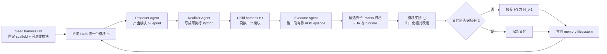
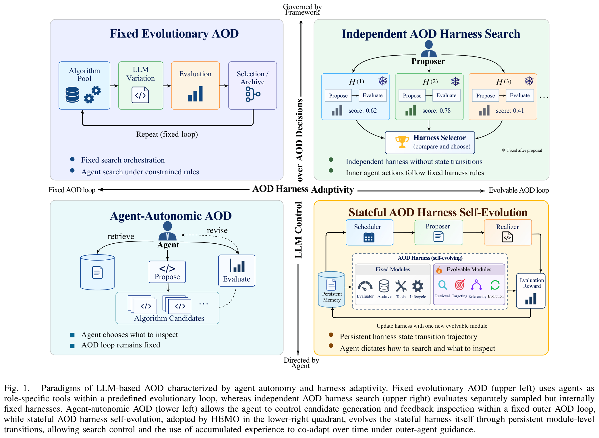
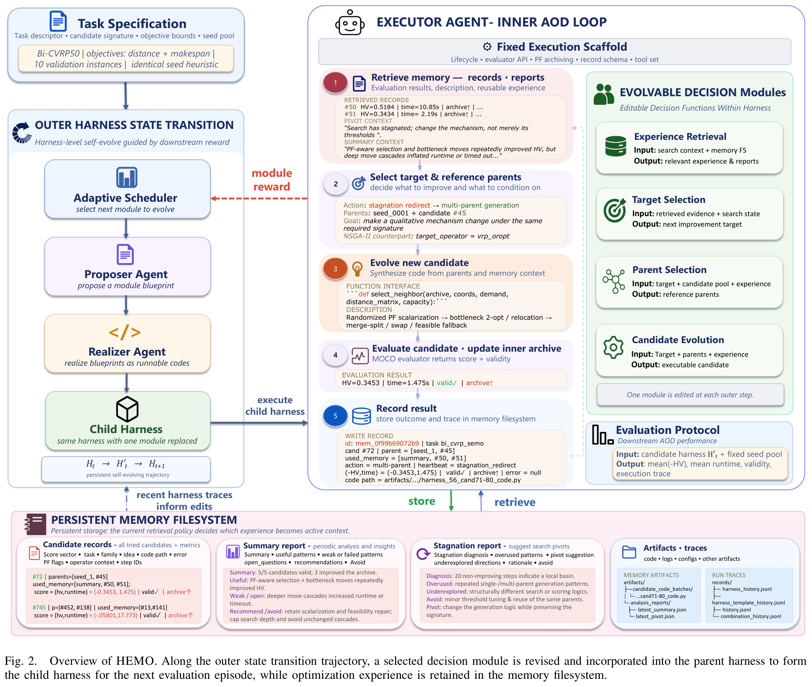
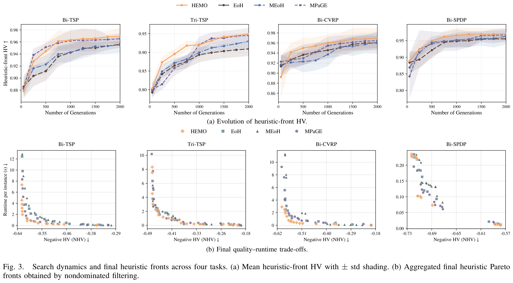
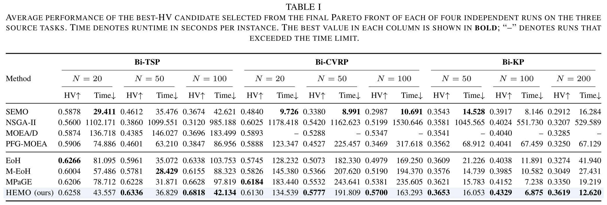
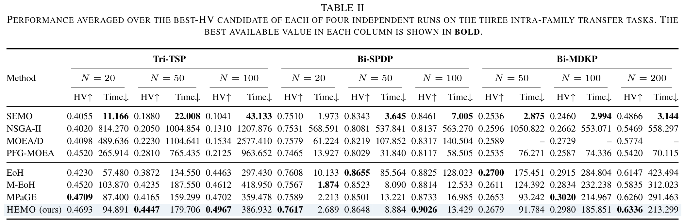
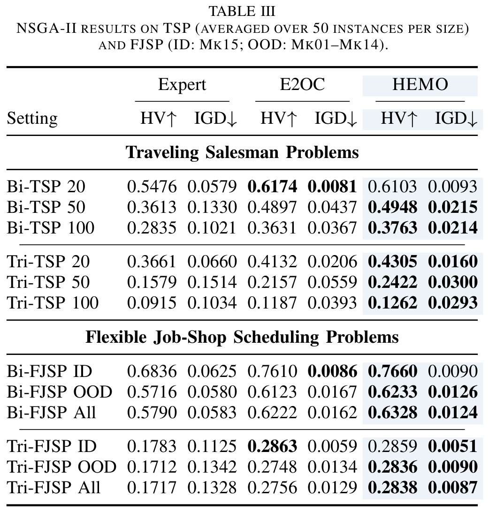
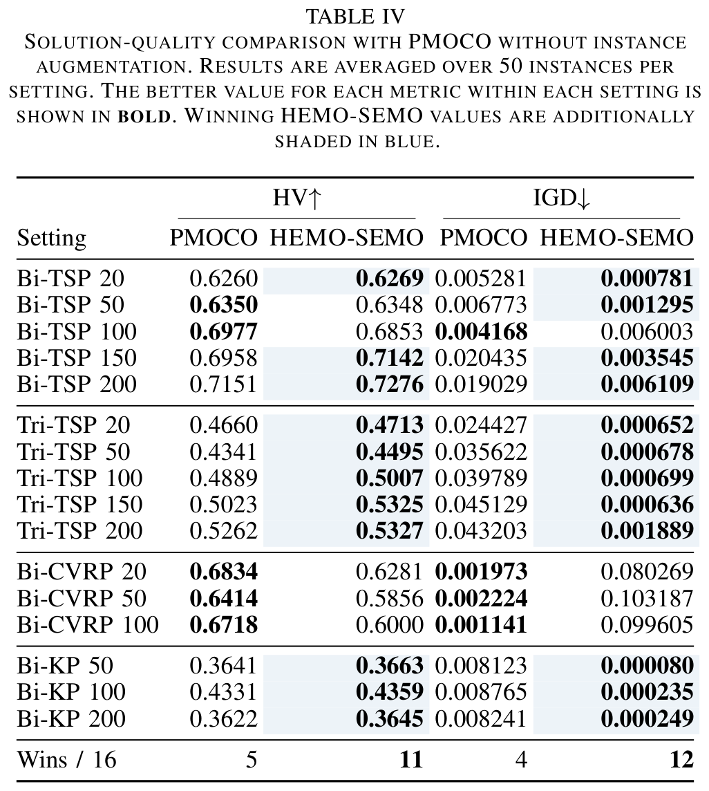
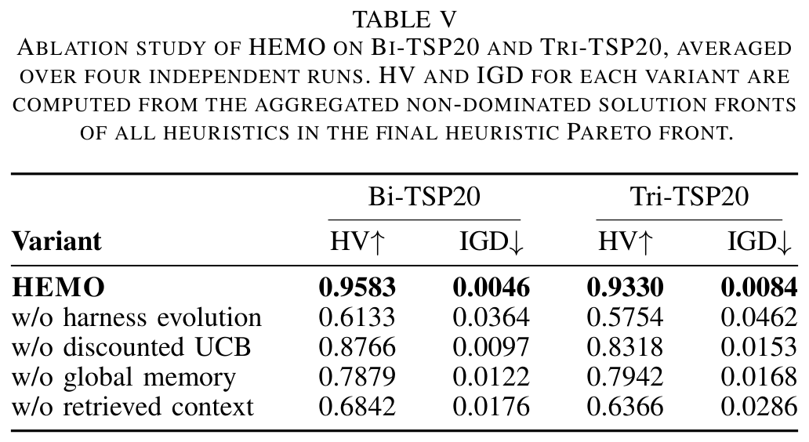
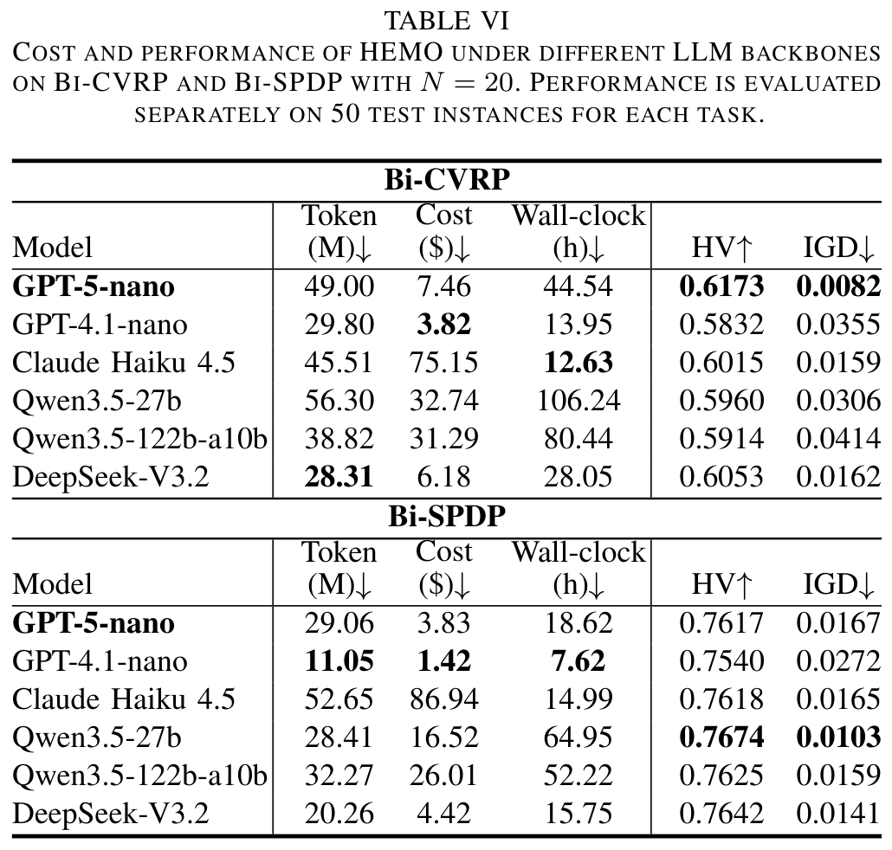

> 一句话：让**设计算子**的那套流程自己也能被改写，而不只是改写算子。

## 0. 读之前你需要知道

**术语卡**

- **MOCO（multi-objective combinatorial optimization，多目标组合优化）**：在离散的可行解集合里同时优化几个互相冲突的目标。生活类比：搬家既要箱子少、又要每箱不太沉，两个要求天然打架，只能找一排都不算亏的方案。
- **Pareto 支配（Pareto dominance）**：解 $x$ 在每个目标上都不比 $y$ 差，且至少一个目标严格更好，就说 $x$ 支配 $y$。生活类比：同样的钱、更大的房子、还离地铁更近，这套房就支配了另一套。
- **Pareto front（PF，帕累托前沿）**：所有不被支配的解在目标空间里连成的那条边界。生活类比：手机市场里性能够强又够便宜的那一排机型，想再提一项就得牺牲另一项。
- **hypervolume（HV，超体积）**：前沿与一个参考点围出的体积，越大说明解又靠近理想点、又铺得开。生活类比：用一块固定大小的画布量你画出的最优方案区域面积。
- **算子（operator）**：构造、改写、挑选候选解的那段算法组件。生活类比：厨师手里那把刀，切丝还是切块，直接决定菜的形态。
- **AOD harness**：论文自己的定义是外层控制过程，决定设计上下文怎么拼、候选什么时候评估、搜索状态怎么记、什么时候停。原文一句：“We call this control process the AOD harness”，说的是这个外层控制过程就是 AOD harness。生活类比：厨房的排班表与备菜流程，刀的样式是算子，谁在什么时候把哪批料递给谁，是 harness。
- **discounted UCB**：给每个可选项算近期平均奖励加探索奖励的分，老观测按折扣衰减。生活类比：换季时先试最近卖得动的菜，但太久没试的也要给一次机会。

**它站在谁肩上**

- FunSearch（2024）与 AlphaEvolve（2025）：用 LLM 进化可执行程序，证明代码本身可以当搜索空间；但外层搜索框架写死，模型看到什么上下文由预设规则拼。
- EoH（2024）、MEoH（2025）、MPaGE（2026）、E2OC（2026）：把 LLM 算子生成搬进多目标求解器，从单启发式做到多算子组合；但进化的对象始终是算子本身，跑算子发现流程的那套脚手架不动。
- Meta-Harness（2026）、Self-Harness（2026）、CORAL（2026）：开始把 harness 本身当优化对象或让 agent 自组织；但它们面向通用 agent 任务，没有把下游多目标解质量直接接到 harness 的信用分配上。

## 1. 动机

想象一家餐厅。菜谱（算子）可以不断换，可后厨那套流程——谁去冰箱拿料、先试哪道菜、失败记录写在哪、什么时候换方向——二十年没改过。菜谱换到一定程度就卡住了：不是菜谱不好，是流程已经配不上新菜谱。

**以前怎么做**：LLM 自动算子设计（automatic operator design，AOD）把写算子变成进化算子。给模型一批历史候选和评分，让它改一版代码，跑一遍多目标求解器，好的留下。EoH、MEoH、MPaGE、E2OC 都是这个骨架，改进点在候选怎么生成、多样性怎么保、多个算子之间的依赖怎么建模。

**为什么不行**：这套骨架的外层是固定的——检索哪几条历史、先改哪个算子、拿谁当父代、一轮里候选怎么迭代，全由人预先写好。论文的判断是 “most methods evolve the operators while leaving the process that discovers them fixed”，意思是：被进化的只有算子，发现算子的那套流程没被进化。放在 MOCO 里这个缺陷会放大：Pareto 权衡在搜索过程中一直在变，早期好用的策略到后期可能正好挡住路。

**为什么现在能做**：三件事凑齐了。其一，LLM 已经能稳定把设计意图翻译成可运行代码，改一个函数不再是难事。其二，多目标评估能给出二维信号（解质量与运行时），比单目标标量分数更能判断一次改动值不值。其三，长程搜索会产出成百上千条带谱系的候选记录，外部文件系统足够便宜，可以把经验存下来反复取用。

## 2. 贡献

这四条不是四个零件的简单并列，而是一条链：先换看问题的角度，再给出能跑的框架，最后用两类骨干和迁移实验证明它不是只对一个设定有效。生活类比：不是给球队换个前锋，而是把教练的换人规则也一起换了。

- **提出有状态 harness 自进化这个视角**。证据：harness 维护持久状态 $H_t=(C_t,B_t)$，沿一条状态轨迹做局部更新，与固定外层流程、固定 harness 内放权给 agent、独立采样一堆 harness 再挑一个这三种范式都不同（图 1 的四象限）。
- **做出 HEMO 框架**。证据：用下游多目标 AOD 表现（候选 Pareto 归档的 −HV 与 runtime）给模块打信用，用折扣 UCB 决定下一步改哪个模块，用 memory filesystem 留住跨状态的经验。
- **八个 MOCO 任务、两个结构不同的进化骨干上验证**。证据：SEMO 骨干下 9 个源任务设定中 7 个 HV 最高（表 I）；NSGA-II 骨干下 TSP 六个设定中五个 HV 与 IGD 双优（表 III）。
- **同族跨任务迁移有效**。证据：源任务上进化出的 harness 不动，直接搬到同族目标任务，9 个设定中 5 个 HV 第一、其余 4 个第二（表 II）。

## 3. 创新点

生活类比：以前是给车换零件，现在是改行车电脑的换挡逻辑——零件还是那些零件，但什么时候换挡变了，整车的表现就跟着变。

- **搜索对象从算子本身上移到发现算子的决策函数**。对比对象：EoH/MEoH/MPaGE/E2OC 只改算子代码。有用的原因：Pareto 权衡变化时，该变的是什么时候改哪个算子、拿谁当父代，这些恰好写在 harness 里，改算子改不到。
- **状态持久加单模块局部编辑**。对比对象：Meta-Harness 在外层搜 harness 代码，但每次是一个独立候选；这里是 $H_t \to H'_t \to H_{t+1}$ 的连续轨迹，一步只换一个模块。有用的原因：相邻状态只差一个模块，比较才有意义，信用也才能落到具体模块上。
- **信用直接来自下游多目标表现**。对比对象：多数 harness 进化靠任务成功率这类标量，或干脆靠 proposer 自己判断。有用的原因：这里用 $(-\mathrm{HV}, \mathrm{Runtime})$ 两维的相对改进做归一化奖励，尺度无关，HV 与 runtime 量纲不同也能合成一个数。
- **非平稳假设下的模块调度**。对比对象：固定顺序轮流改模块。有用的原因：一个模块的效用会随其他模块被改动而变化，折扣 UCB 让曾经没用、现在可能有用的模块重新拿到机会。

**和直接进化算子差在哪，代价多大**。差别有三层：搜索空间从算子代码变成 harness 的模块实现；评估单位从一个算子变成一段有界 episode 产出的候选归档；经验载体从最近若干条候选变成跨状态持久的 memory filesystem。代价也很实在：自进化是一次性投入，作者报告 Bi-KP + SEMO 约 37.67 小时、$4.22（GPT-4.1-nano 调用费），Bi-CVRP + NSGA-II 约 80.08 小时、$12.67，四个源任务里最大的一轮约 216.56 小时、$29.52；此外 Claude Opus 4.8 的 Proposer 与 GPT-5 的 Realizer 平均每次完整运行另计约 $12.53 与 $21.80。

## 4. 方法

### 4.1 整体流程

这张图讲的是改一个模块、跑一段搜索、按结果记账、再决定下一步改谁的闭环；记忆不在这条环上显形，但它同时被读和写。

### 4.2 模块拆解

五个部分合起来才成立，缺一块就退化成普通 AOD。生活类比：装修时一次只改一间房，改完住一周看顺不顺，不舒服就退回上一版，而不是把整屋推平重来。

**状态与状态转移**

为什么需要：如果每轮重新生成整个 harness，前后两版差异太大，评估差异说不清是哪个改动带来的。

怎么做：把当前 harness 记成 $H_t=(C_t,B_t)$，$C_t$ 是全量代码、$B_t$ 是记录各模块当前规格的蓝图；每步只选一个模块 $m_t$，让 Proposer 出蓝图、Realizer 落成代码，替换进去就是子代。

公式：

$$
H'_t = H_t[m_t \leftarrow \phi_t]
$$

先说它在算什么：把父代 harness 的第 $m_t$ 个模块换成新实现 $\phi_t$，其余原样保留，得到待评估的子代。

- $H_t$：第 $t$ 步的 harness 状态，由代码 $C_t$ 与蓝图 $B_t$ 组成
- $m_t$：本步被选中的模块，取自 $\mathcal{M}=\{m^{(1)},\dots,m^{(K)}\}$，$K=3$（SEMO 骨干）或 $K=4$（NSGA-II 骨干）
- $\phi_t$：Realizer 产出的可执行替换实现，输入输出签名必须与旧模块一致
- $H'_t$：子代 harness，等着跑一段 episode

接受规则：只要父代 $H_t$ 不 Pareto 支配子代 $H'_t$，子代就成为下一个当前状态；同时把 $(H'_t, s(H'_t))$ 与 episode 产出的候选分别写进外层、内层两个 Pareto 归档。

**下游评估与模块奖励**

为什么需要：一个模块改得好不好，不能看代码像不像样，要看它跑出来的算子质量。

怎么做：每个子代 harness 用同一个固定种子池起跑，跑完一段有界 episode，得到候选算子的最终 Pareto 归档；对这个归档里的候选求平均，得到 harness 的二维分数。

公式：

$$
s(H'_t) = \frac{1}{|\mathcal{P}(H'_t)|}\sum_{a \in \mathcal{P}(H'_t)} \big(-\mathrm{HV}(a),\ \mathrm{Runtime}(a)\big)
$$

先说它在算什么：把一段 episode 产出的候选归档压成一个质量与耗时的二维分数，两维都是越小越好。

- $\mathcal{P}(H'_t)$：该 episode 结束时候选算子的 Pareto 归档
- $a$：归档里的一个候选算子
- $\mathrm{HV}(a)$：该候选在验证实例上的超体积，前面加负号把越大越好翻成越小越好
- $\mathrm{Runtime}(a)$：单实例运行秒数，越小越好
- $|\mathcal{P}(H'_t)|$：归档里候选的个数

再算这一改进步多少，按维度做尺度无关的归一化：

$$
r_{t,d} = \mathrm{clip}\!\left(\frac{s_d(H_t) - s_d(H'_t)}{\max\big(|s_d(H_t)|,\ |s_d(H'_t)|\big)},\ -1,\ 1\right)
$$

先说它在算什么：子代比父代好多少，用一个相对比例表示，再卡在 $[-1,1]$ 里。

- $s_d$：分数向量的第 $d$ 维，$d=1$ 是 $-\mathrm{HV}$，$d=2$ 是 runtime
- 分母取父代与子代绝对值的较大者：避免 HV 与 runtime 量纲不同时，其中一维吃掉全部权重
- $\mathrm{clip}(\cdot,-1,1)$：单步改动最多拿满一分，防止一次运气好就锁死调度器

$$
r_t = \frac{1}{D}\sum_{d=1}^{D} r_{t,d}
$$

先说它在算什么：把两维的相对改进等权平均成一个标量奖励，只用于模块信用分配。

- $D$：评估维度数，这里 $D=2$
- $r_t$：本步奖励，取值在 $[-1,1]$
- 注意：多维分数 $s(H'_t)$ 本身不被压扁，仍然用于 Pareto 归档；压扁只发生在给模块记账这一步

**折扣 UCB 调度器**

为什么需要：模块效用不是平稳的。改完父代选择之后，记忆检索模块的价值可能整个变掉。

怎么做：给每个模块维护折扣选择次数 $n^{(\gamma)}_{m,t}$ 与折扣奖励和 $R^{(\gamma)}_{m,t}$，每步先乘折扣因子 $\gamma$，被选中的模块加一次访问和本次奖励，再按下面的式子选下一个模块。

公式：

$$
\mathrm{UCB}_t(m) = \bar{r}^{(\gamma)}_{m,t} + c\sqrt{\frac{\log\!\big(1+\sum_{j\in\mathcal{M}} n^{(\gamma)}_{j,t}\big)}{n^{(\gamma)}_{m,t}}}
$$

先说它在算什么：给每个模块打一个近期平均奖励加探索奖励的分，分高的先改。

- $\bar{r}^{(\gamma)}_{m,t} = R^{(\gamma)}_{m,t}/n^{(\gamma)}_{m,t}$：折扣后的平均奖励
- $n^{(\gamma)}_{m,t}$、$R^{(\gamma)}_{m,t}$：折扣选择次数与折扣奖励和，每步统一乘 $\gamma$
- $\gamma \in (0,1)$：折扣因子，实验取 0.98
- $c$：探索强度，实验取 $\sqrt{2}$
- 冷启动规则：每个模块先各被选一次，之后才用这个式子
- 附录 G 给的性质：没被选的模块，折扣次数变小，探索项的保证下界按 $\gamma^{-\ell/2}$ 增长，所以太久没试的模块会被重新捞起来

**持久记忆与 heartbeat**

为什么需要：一次 AOD 运行会产生成百上千条带谱系的候选，全塞进上下文不现实；只存不取，等于没存。

怎么做：memory filesystem 把每次评估写成结构化记录（分数向量、任务、族、想法、代码路径、错误、是否改进归档、是否在 Pareto 前沿上、HV 高不高、runtime 低不低、父代与用过的记忆 id、算子上下文等）。另外周期性调用两个诊断工具，论文把每次调用叫一次 **heartbeat**：一次产出 **summary report**（有用模式、失败模式、开放问题、建议、避坑），另一次产出 **stagnation report**（停滞诊断、被过度使用的模式、未探索方向、结构性 pivot 建议）。每种报告只保留最新一份作为活跃引用。

**固定执行 scaffold**

为什么需要：如果评估接口也能被改，harness 可以靠改评分口径刷分。

怎么做：四个接口全程冻结。① Evaluation interface：求解器配置、数据生成、评估实例、反馈构造与 harness 循环解耦；② Multi-objective archive interface：固定的非支配排序规则把新候选并进归档，保证前沿过滤与多样性口径一致；③ Diagnostic and heartbeat interface：诊断工具与可调用接口固定，只有怎么取用诊断结果可进化；④ Memory-writing interface：统一 schema 落盘。作者的说法是 “the execution-critical scaffold remains fixed”，即执行关键的那层脚手架不动，只让决策模块动。

四个可进化模块（原文名照抄）：**Experience Retrieval**（从记忆里挑哪些历史记录与报告进入当前上下文）、**Target Selection**（多算子求解器里先改哪个算子）、**Parent Selection**（拿哪些已评估候选当父代）、**Candidate Evolution**（一段 episode 内候选怎么往前推：迭代式、种群式、轨迹式、分阶段或混合）。SEMO 骨干下目标是单个完整启发式，Target Selection 退化成平凡选择，可进化模块是 3 个；NSGA-II 骨干下四个都可进化。

### 4.3 关键细节

- 初始化不是从一个点开始：手写 seed harness 之外，再生成一小批备选蓝图并落地，形成初始 harness 池（实验里是 5 个状态），评估后建成 harness 层的 Pareto 归档，再从里面挑 $H_0$。
- 每段 episode 的候选种群都从同一个固定种子池起跑，这是为了可比与清洁信用分配；不加这一条，子代与父代的差异会混进初始种群噪声。
- 折扣 UCB 不是无条件更优。附录 G 自己写了：平稳设定下保留全历史估计更准，这里是用一点统计效率换非平稳响应速度。
- 推理阶段怎么挑 harness：排除初始化阶段产生的状态，在剩下的 harness 归档里，按归一化欧氏距离到经验理想点选一个，然后源任务与迁移任务都用这一个，不再重跑自进化。
- 同任务推理会用自进化期间最后至多 1,000 条记忆记录热启动；跨任务迁移只搬 harness，不搬记忆，目标任务从空记忆开始。
- LLM 温度统一 1.0。

## 5. 实验结果

生活类比：看球不能只报终场比分，要看每一节的走势，才知道这支队是开局猛还是后程强。所以下面既给最终数字，也给过程曲线。

**实验设置**

- 数据集与切分：八个任务，四个族。背包族 Bi-KP→Bi-MDKP，路由族 Bi-CVRP→Bi-SPDP，TSP 族 Bi-TSP→Tri-TSP，调度族 Bi-FJSP→Tri-FJSP；箭头左边做 harness 自进化，右边只做同族迁移。每个尺寸 50 个固定测试实例；设计阶段用的实例更小更少（TSP 20 城 10 个、CVRP 50 客户 10 个、KP 50 项 10 个、SPDP 20 节点 20 个、FJSP 用 Mk15 一个或 15 个合成实例），细节见附录表 XIV。
- 骨干模型：两套进化骨干，SEMO（增量归档）与 NSGA-II（代际种群加非支配排序与拥挤距离）。LLM 分工是 Proposer=Claude Opus 4.8、Realizer=GPT-5、Executor=GPT-4.1-nano；所有 LLM-based AOD 基线在推理时统一用 GPT-5-nano。
- 训练预算：自进化是一次性开销，Bi-KP+SEMO 约 37.67 小时、$4.22，Bi-CVRP+NSGA-II 约 80.08 小时、$12.67，最大一轮约 216.56 小时、$29.52。候选预算：SEMO 设计阶段 init 100 / steps 2,000，测试 10,000（SPDP、TSP 为 20,000）；NSGA-II 进化阶段 pop 50 / gen 15，测试 pop 200 / gen 200（CVRP、Tri-TSP 为 100，FJSP 为 200×30）。外层 harness 步数上限原文只给了记号 $B_{\mathrm{outer}}$，具体数值原文未给。
- 基线：三组共九个。传统 MOEA：SEMO、NSGA-II、MOEA/D、PFG-MOEA；神经方法：PMOCO；LLM-based AOD：EoH、MEoH、MPaGE、E2OC。
- 指标：**HV↑** 与 **IGD↓**，都报归一化后的值；HV 用固定的问题与尺寸专属参考点、理想点（附录表 VII），IGD 的参考前沿取所有对比方法解集的非支配并集。此外报 Time↓（每实例秒数）。
- 推理设置：候选种群 20；LLM-based AOD 的候选生成预算 SEMO 2,000、NSGA-II 4,000，逐候选评估超时相同；结果取 4 次独立运行平均；MOEA 每个测试运行统一 3,600 秒超时；最终测试每个求解器配置独立跑 5 次取均值；评估跑在 AMD EPYC 9555 上。

主表只留能说明问题的行，最强基线那一列按同设定里最好的对手填：

| 任务（规模） | 指标 | HEMO | 最强基线 | 提升 |
| --- | --- | --- | --- | --- |
| Bi-TSP N=100 | HV↑ | 0.6818 | MPaGE 0.6628 | +0.0190 |
| Bi-CVRP N=100 | HV↑ | 0.5700 | MPaGE 0.5381 | +0.0319 |
| Bi-KP N=200 | HV↑ | 0.3619 | MPaGE 0.3350 | +0.0269 |
| Bi-TSP N=20 | HV↑ | 0.6258 | EoH 0.6266 | −0.0008 |
| Tri-TSP N=100（迁移） | HV↑ | 0.4967 | MPaGE 0.4702 | +0.0265 |
| Bi-SPDP N=100（迁移） | HV↑ | 0.9026 | EoH 0.8825 | +0.0201 |
| Bi-MDKP N=200（迁移） | HV↑ | 0.6336 | MPaGE 0.6260 | +0.0076 |
| Bi-TSP 20（NSGA-II） | IGD↓ | 0.0093 | E2OC 0.0081 | +0.0012（更差） |

**原文实验图**

图 1：这张图把谁在控制搜索和 harness 能不能变拆成两个轴，HEMO 落在右下角——既让外层 agent 指挥搜索，又让 harness 自己沿轨迹变形；另外三个象限分别对应固定流程、只给 agent 放权、以及独立采样一堆 harness 再挑一个。

图 2：这张图给出了 harness 内部的账本结构——左边是外层状态转移（Scheduler → Proposer → Realizer → Child harness），右边是 Executor 跑的内层 AOD 循环（取记忆、选目标与父代、生成、评估、写记录），底部是存候选记录、summary、stagnation 报告与代码工件的 memory filesystem；一眼能看出**可进化的只有决策函数，固定的是脚手架**。

图 3：左列曲线显示 HEMO 并不是一开始就领先。Bi-TSP 上它起点约 0.88，前 250 代快速抬到 0.94 后继续爬，最终停在约 0.97，而三条基线在 1,000 代后基本走平；Tri-TSP 上它起点最低（约 0.80），中段翻到最上，说明收益来自持续精修而不是初始种群运气。右列的质量与运行时散点里，HEMO 的点更多压在低 runtime 一侧，同样质量下更省时间。

**原文实验表**

表 I：SEMO 骨干下的源任务主结果，9 个任务-尺寸设定里 HEMO 拿下 7 个 HV 最高；代价是 Bi-TSP N=20 这一档（0.6258）输给 EoH（0.6266），说明小规模上进化流程还没跑出优势。

表 II：把源任务进化出的 harness 原样搬到同族目标任务，9 个设定里 5 个 HV 第一、4 个第二，没有任何一档掉出前二——迁移的是搜索流程而非某个算子，这一点比单点涨分更有信息量。

表 III：NSGA-II 骨干下的两组对照。TSP 六个设定里 5 个 HV 与 IGD 双优，唯一例外是 Bi-TSP N=20（E2OC 0.6174 对 HEMO 0.6103），而 N=50 与 N=100 上 HEMO 反超。FJSP 上 Bi-FJSP 的 ID、OOD、All 三档 HV 全胜；Tri-FJSP 的 Mk15 上 E2OC 的 HV 略高（0.2863 对 0.2859），但 HEMO 在 OOD 与 All 两档把 HV 与 IGD 都拿回来。

表 IV：与神经方法 PMOCO 比，16 个设定里 HEMO-SEMO 拿下 11 个 HV、12 个 IGD；但 Bi-CVRP 三档全输（0.6281 对 0.6834 等），作者也在局限性里承认 PMOCO 在 CVRP 上更强。

表 V：消融的落差比主表更能说明机制。`w/o harness evolution` 把 HV 从 0.9583 打到 0.6133（Bi-TSP20）；`w/o discounted UCB` 掉到 0.8766，是四组里最轻的；`w/o global memory` 掉到 0.7879；`w/o retrieved context` 掉到 0.6842，几乎追平根本不自进化那一档。

表 VI：换 LLM 骨干的代价与效果权衡。GPT-5-nano 在 Bi-CVRP 上 HV 最高（0.6173）但花 $7.46、44.54 小时；GPT-4.1-nano 只要 $3.82、13.95 小时，HV 掉到 0.5832；DeepSeek-V3.2 的 token 最省（28.31M），HV 0.6053。

**消融告诉我们什么**：收益不是来自某单一部件。三个消融都掉，但掉法不同——去掉折扣 UCB 只掉约 0.08，说明调度器是**效率件**；去掉全局记忆掉约 0.17，去掉把记忆放进上下文掉约 0.27，说明存储本身不值钱，值钱的是让检索到的经验真的进入决策上下文。这条对做记忆系统的项目有直接参考价值。

**这些实验够不够支撑结论**：支撑 harness 进化比不进化好是够的，八个任务、两个骨干、四组基线，消融也齐全。支撑比现有 AOD 更好要打折：小规模档位（Bi-TSP N=20）输给 EoH，CVRP 上输给 PMOCO，说明优势与问题族、规模都相关。另外外层步数上限、harness 归档规模这些关键量没在正文给数，自进化跑多少步才收敛，读者无从判断。

## 6. 局限性

生活类比：体检只查了三项指标，报告说一切正常，但你并不因此知道自己没别的毛病。

**作者自己承认的**：

- 模型可达性：Proposer 与 Realizer 用的是闭源模型，自进化依赖外部 API 与成本；作者提的出路是把成功轨迹蒸馏到小模型或开源权重上。
- 评估成本与跨任务记忆迁移：候选评估要跑多个实例，开销大；跨任务实验只迁移 harness，不迁移任务记忆，作者设想做一个能区分可复用设计知识与任务专属观测的可迁移 memory filesystem，并提醒要防负迁移。
- 泛化不均：HEMO-SEMO 在 Bi-CVRP 上打不过 PMOCO，说明相对优势依问题而定。

**我看出来的**：

- 隐形假设：假设**改一个模块**的收益能被其他模块的当前状态大致线性叠加。可四个模块是耦合的——换了记忆检索策略，父代选择的最优策略也会变，单模块编辑把这种交互压成了序列。
- 边界条件：评估接口冻结保证了不能刷分，但也意味着评估协议本身不适合当前阶段时无法自救；换问题族就得重跑一次 30 到 200 小时的自进化。
- 缺的对比：没有与同一预算下多跑几轮算子进化的等算力对照。自进化多花的几十小时如果直接给 EoH 加预算，差距会不会缩小，论文没答。
- 另一处口径问题：表 I 的 HV 是四次独立运行中 best-HV candidate 的平均，而表 V 的消融 HV 是最终启发式 Pareto 前沿里所有启发式的聚合非支配前沿算出来的，两者数值不可直接横比（0.6258 对 0.9583 不是同一口径）。

## 7. 一句话总结

以前是厨师不停换菜谱、后厨流程二十年不动；这篇让后厨流程本身也进菜单——每轮只改一个环节，改完就看这一轮出的菜好不好、上菜快不快，好的留下、坏的退回。

核心公式：

$$
\boxed{\ \mathrm{UCB}_t(m)=\bar{r}^{(\gamma)}_{m,t}+c\sqrt{\frac{\log\!\big(1+\sum_{j} n^{(\gamma)}_{j,t}\big)}{n^{(\gamma)}_{m,t}}}\ }
$$

它是整篇的方向盘：奖励来自下游解质量与运行时，折扣让旧信用过期，探索项保证被冷落的模块还能被想起来。

## 8. 可复用点

生活类比：把家里的配电箱画清楚、每一路标上名字，以后换电器不用重拉线。harness 的模块边界就是这个配电箱。

- 如果我要在自己的项目里用：把外层流程显式拆成 3 到 4 个可替换的决策函数，冻结评估与归档接口，再让 LLM 一次只改一个——这比让 agent 自由重写整个 pipeline 稳定得多，也比整包重采样省评估。
- 训练不收敛时先查：奖励是不是被某一维吃掉了。这篇用 $\max(|s_d(H_t)|,|s_d(H'_t)|)$ 做分母就是为了这个；如果你的两维量纲差两个数量级，先把归一化做对再谈调度。
- 做记忆系统时先分清存储与检索：`w/o global memory` 掉约 0.17、`w/o retrieved context` 掉约 0.27，说明检索策略比存储容量更值钱。
- 冷启动别直接上 UCB：先让每个模块各被选一次，否则早期一次坏运气会把某个模块永久压死。

## 9. 我的疑问

生活类比：看完菜谱还想知道火候到底多大、锅要不要预热——这些没写在步骤里的人才有数。

- 外层到底跑多少步？正文只给 $B_{\mathrm{outer}}$ 这个记号，附录 H 给了初始 5 个 harness、$\gamma=0.98$、$c=\sqrt{2}$，却没给步数，复现时这一项最难猜。
- 四个模块的进化顺序会不会自我强化？比如先改 Candidate Evolution 拿到一次大奖励，折扣 UCB 就会反复选它，Target Selection 永远轮不到——论文没有给出各模块被选中次数的分布。
- 单模块编辑在 NSGA-II 上要处理算子间交互（Target Selection 才有意义），但改 A 算子时 B 算子的最优实现会变的这件事，靠冻结其他模块真的能捕捉到吗？
- 表 I 的 best-HV candidate 是 4 次运行里挑最好的，这种 max 统计会不会系统性高估 HEMO——毕竟它每轮评估的候选数更多？
