> 一句话：先让学生试做，再由老师接手示范，最后让学生自己完成。

原文依据：联网下载的 19 页原始 PDF，正文第 1–11 页、实验设置 Appendix A、完整结果 Appendix B；案例 Appendix C 已阅读，但不把个案当作总体因果证明。原图均从该 PDF 裁出，保留论文编号。

## 0. 读之前你需要知道

**术语卡**

- **可验证奖励强化学习（Reinforcement learning from verifiable rewards, RLVR）**：模型尝试作答，程序检查答案，再增加有利行为的概率。像做数独后由检查器判断整盘对错。
- **rollout**：模型从题目开始生成的一整条尝试；**token** 是模型处理文字的小单位。一次解题过程是一条 rollout，其中每个书写片段对应若干 token。
- **Group Relative Policy Optimization（GRPO）**：同题生成多条回答，按组内奖励差异决定哪些更应强化。整组都错时，就像全班都交白卷，排名无法告诉老师谁的方法更好。
- **trajectory-level intervention** 改变训练时实际走过的解题路径；**token-level supervision** 告诉学生每一步应怎样分配词的概率。老师接过笔示范，与在学生作业旁标注改法，是两件事。
- **KL divergence** 衡量两个概率分布的差异。它约束的是模型的选择倾向，不等同于答案一定正确。

**它站在谁肩上**：LUFFY 把教师轨迹放进 RL；POPE 给教师 prefix，再让学生接续；KDRL 在学生轨迹上增加 reverse-KL。PIVOT 关心的是：学生是否真正学会老师接手时的行为，而非只在老师铺好的路上走到终点。

## 1. 动机

学车时，教练替你把车开上大路，再让你握方向盘，并不能保证你学会了自己起步。另一种做法是全程口头提示，但车已经开进死胡同时，一句往左也未必能让你找到完整的脱困路线。

这对应论文区分的两个问题。**以前怎么做**：用强教师提供成功轨迹，或者在学生自己生成的轨迹上给密集概率监督。**为什么不够**：成功教师轨迹可能离学生习惯太远；错误学生轨迹又可能让教师同时倾向于继续原路线和回头纠正。

作者没有把所有教师方法都说成无效，而是通过 Survo 对照说明，两种机制单独使用都可能不足。**为什么现在能做**：训练框架已能让学生和教师分段生成，并保存教师 token 分布，于是可以同时改变探索路径与学习目标。论文的核心是把这两种用途接在同一批数据上。

## 2. 贡献

- **把能得到奖励与能学会分开检验**：Survo 上，POPE 使用 oracle prefix 仍只有 0.14 avg@8；直接监督 prefix 的 Prefix-Fwd 为 59.05。不是把老师答案改对就自动完成教学。
- **提出 PIVOT 联合训练**：学生生成 prefix，教师生成 correction segment，学生继续；在 GRPO 外，只对教师生成的 segment 加教师 KL。
- **给出可执行的配置研究**：比较 intervention position、KL direction、teacher capacity、fixed teacher budget 与 top-k support，而非只报告最终总分。
- **展示困难任务上的收益**：三类逻辑游戏 mean avg@8 从最强基线 KDRL 的 19.5% 到 35.6%；数学结果也逐项给出，而不是把不同采样预算混为一个平均分。

像补习班比较教学法，这篇不只问最终考几分，还检查老师什么时候接手、示范多久、学生是否练过老师示范的步骤。但这些对照仍属于本文设置，不能直接推出所有任务上的通用教学定律。

## 3. 创新点

**第一，示范落在学生已经走到的状态上。** 相比从教师开头接续，middle intervention 先让学生尝试，再让教师基于这个 prefix 继续。像修理学徒自己组到一半的机器，师傅展示的是如何从他的当前状态接下去。

**第二，接管片段同时承担两种作用。** 相比只把教师内容当上下文，PIVOT 明确把这些位置纳入 KL supervision；相比只在学生错误轨迹上给概率反馈，它真的把教师 recovery path 写进训练轨迹。新意是两个动作的配合，不是单独发明分段生成或 KL。

**第三，以固定教师 token 预算比较示范深度。** 两次长接管和多次短接管总 token 数相同，但效果不同，表明示范是否形成连贯步骤值得独立控制。这里固定的是教师 token 数，并非已证明 GPU 时间、前向计算和训练成本完全相同。

## 4. 方法

### 4.1 整体流程

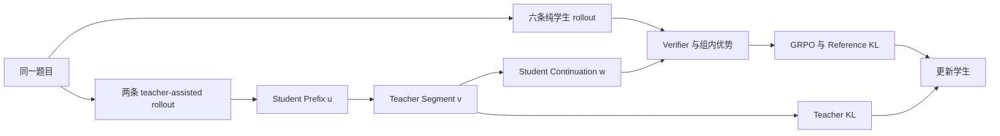

这像八份练习里保留六份独立作业，另两份由老师中途示范，再把整题成绩和示范步骤一起用于教学。

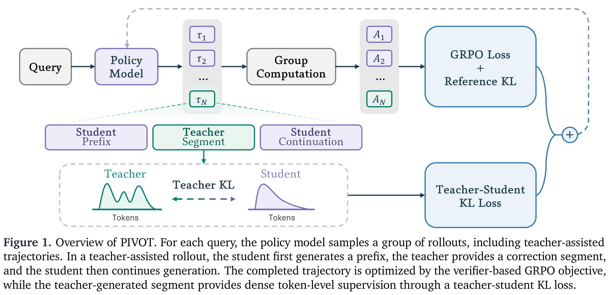

Figure 1：同一条接管轨迹既参与组内奖励计算，又把教师片段提供给额外 KL，两个信号的作用位置不同。

### 4.2 模块拆解

**构造 teacher-assisted rollout。** 需要让教师看到学生的实际起步，又保留学生自己完成任务的部分。原文把回答写为三段，并用下式表示生成概率：

$$
p_{\theta_{\mathrm{old}},T}^{(\ell_u,\ell_v)}(\tau\mid q)
=\pi_{\theta_{\mathrm{old}}}(u\mid q)
\pi_T(v\mid q,u)
\pi_{\theta_{\mathrm{old}}}(w\mid q,u,v).
$$

- $q$ 是一道题；$\tau=(u,v,w)$ 是 token 序列。
- $u$ 为学生 prefix，$v$ 为教师 segment，$w$ 为学生 continuation；$\ell_u=|u|$、$\ell_v=|v|$ 是非负 token 长度。
- $\pi_{\theta_{\mathrm{old}}}$ 为 rollout 时学生策略，$\pi_T$ 为教师策略；各条件概率均为标量。

当 $\ell_u=0$ 就退化为 prefix intervention。注意生成分布含教师因子，**整条轨迹并非纯学生 on-policy 样本**。

**联合目标。** 需要同时保留结果奖励、限制学生偏离参考模型，并使学生学习教师片段。原文最小化：

$$
\mathcal L(\theta)=\mathcal L_{\mathrm{GRPO}}(\theta)
+\beta_{\mathrm{ref}}\mathcal L_{\mathrm{ref}}(\theta)
+\beta_T\mathcal L_{\mathrm{KL}}(\theta;\mathcal S_T).
$$

- $\theta$ 是学生参数向量；各 $\mathcal L$ 为标量损失。
- $\mathcal L_{\mathrm{GRPO}}$ 使用组内优势和 clipped importance ratio；$\mathcal L_{\mathrm{ref}}$ 对固定 reference policy 做 KL regularization。
- $\mathcal S_T$ 是 batch 内教师生成 token 的位置集合；教师 KL **只作用于此集合**。
- $\beta_{\mathrm{ref}}$、$\beta_T$ 是非负系数；后者随训练 cosine decay。

**KL direction。** 下面比较的是同一上下文上整个 next-token 分布，而非只模仿一个被采到的词：

$$
\mathcal L_{\mathrm{KL}}^{\mathrm{forward}}
=\frac1{|\mathcal S_T|}\sum_{(i,t)\in\mathcal S_T}
D_{\mathrm{KL}}\!\left(\pi_T(\cdot\mid h_{i,t})\Vert\pi_\theta(\cdot\mid h_{i,t})\right),
$$

$$
\mathcal L_{\mathrm{KL}}^{\mathrm{reverse}}
=\frac1{|\mathcal S_T|}\sum_{(i,t)\in\mathcal S_T}
D_{\mathrm{KL}}\!\left(\pi_\theta(\cdot\mid h_{i,t})\Vert\pi_T(\cdot\mid h_{i,t})\right).
$$

- $i$ 为轨迹编号、$t$ 为 token 位置；$h_{i,t}$ 是题目与已有 token 构成的上下文。
- 两个 $\pi$ 在词表上都是概率向量；KL 值为非负标量。
- forward KL 的期望取在教师分布上，reverse KL 取在学生分布上，交换顺序会改变惩罚方向。

作者把 reverse KL 的困难任务优势解释为 mode-seeking，把 forward KL 的较强初始能力情形解释为 mode-covering；论文明确说没有直接测量 reasoning-mode coverage，不能把解释写成机制已证实。

### 4.3 关键细节

默认 $G_S=6,G_T=2$，学生先生成 512 tokens。逻辑任务教师最多生成 4,096 tokens，数学任务最多 8,192 tokens，随后交回学生。KL 保留教师 top-30，并将其余概率归入一个 tail bucket；不能直接扔掉尾部后称为 full-vocabulary KL。

$\beta_T$ 从 0.1 cosine-decay 到 0；$\beta_{\mathrm{ref}}=0.01$，clipping coefficient 为 0.2。教师不是检测到某种错误才触发：本文默认是固定 token 时点的接管，不具备已验证的自适应错误定位器。

## 5. 实验结果

像比较家教效果，必须先知道学生起点、练习题难度、老师投入和考试次数，分数才有意义。

**实验设置六项**

- **数据集与切分**：SynLogic 的 Survo、Minesweeper、Kakurasu hard setting，每类训练 2k、测试 500。数学合并 Polaris-53K 与 Skywork-OR1-RL-Data 的 math subset；基模每题采 8 次，仅留成功不超过 3 次者，剔除无效答案并对 OOD 去重，再划训练 30k、验证 1k、Math-ID 测试 2k。训练题 77.7% 在筛选中全错。OOD 为 AIME 2024/2025、MATH500。
- **骨干模型**：逻辑学生 Qwen3-1.7B，数学学生 Qwen3-4B；默认教师均为 Qwen3-4B-Thinking；容量消融用 Qwen3-30B-A3B-Thinking。
- **训练预算**：verl + GRPO；逻辑 3 epochs，数学 1 epoch；learning rate $3\times10^{-6}$，rollout batch 64 prompts，mini-batch 32，每题 8 rollouts，prompt 上限 2,048。GPU 型号、卡数、wall-clock 原文未给。
- **基线**：RL only；SFT+RL 先用同分布 5k verified-correct teacher traces；LUFFY 每组替换一条完整教师轨迹；POPE 为两条轨迹提供教师 prefix，并排除 prefix loss；KDRL 在学生所有 token 上加 reverse-KL，固定系数 0.1。均共享 GRPO 与每题 8 条预算，但教师调用和 KL token 数不同。
- **指标**：avg@k 为采样平均正确率，pass@k 为多次尝试至少一次成功的口径，均越高越好。逻辑、Math-ID、MATH500 用 k=8；AIME 用 k=64。
- **推理设置**：thinking mode，temperature 0.7；逻辑长度上限 8,192，数学 16,384，评测沿用训练长度。逻辑用 SynLogic verifier，数学用 Math-Verify；没有额外 format 或 length reward。

**主结果提炼**：数值均为原文百分数；提升为对同列最强基线的百分点差，非相对百分比。

| 任务 | 指标 | PIVOT | 最强基线 | 提升 |
| --- | --- | --- | --- | --- |
| Survo | avg@8 | Reverse KL 72.90 | KDRL 41.68 | +31.22 pp |
| Minesweeper | avg@8 | Reverse KL 25.44 | KDRL 13.88 | +11.56 pp |
| Kakurasu | avg@8 | Reverse KL 8.38 | KDRL 2.93 | +5.45 pp |
| Math-ID | avg@8 | Reverse KL 23.05 | POPE 22.09 | +0.96 pp |
| AIME 2024 | avg@64 | Forward KL 63.33 | SFT+RL 60.94 | +2.39 pp |
| AIME 2025 | avg@64 | Forward KL 52.45 | RL only 49.74 | +2.71 pp |
| MATH500 | avg@8 | Forward KL 95.40 | RL only 94.30 | +1.10 pp |

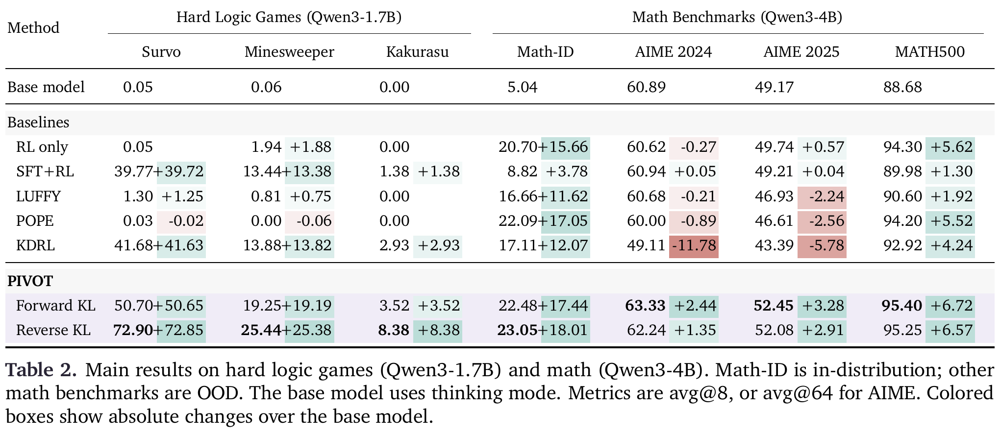

Table 2：困难逻辑上 reverse KL 的收益突出，已有较高起点的 OOD 数学上 forward KL 更好；不能用一个 KL 方向代表所有任务最优。

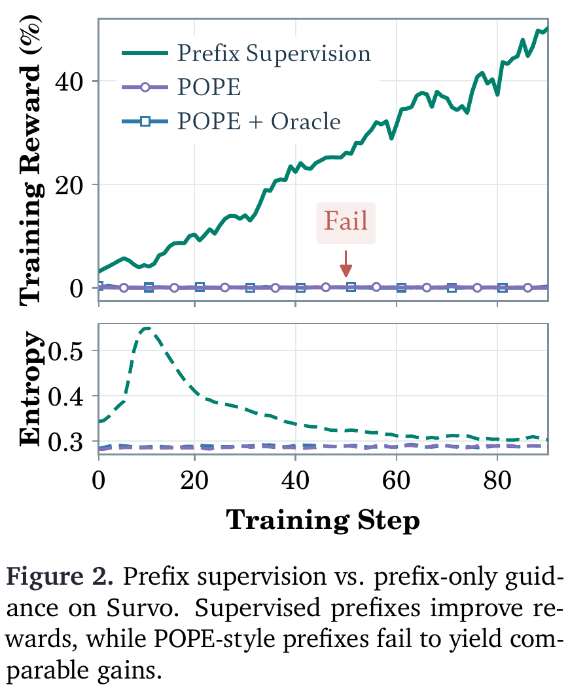

Figure 2：直接监督 prefix 的训练奖励持续上升，两个仅供应 prefix 的设置近乎停滞；配合 Table 3，说明只改善 prefix 正确性不足以让学生学会独立解题。

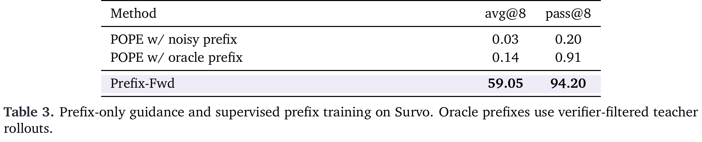

Table 3：oracle prefix 比 noisy prefix 更好，但都远低于 Prefix-Fwd，支持把 prefix 质量与 prefix 可学习性分开讨论。

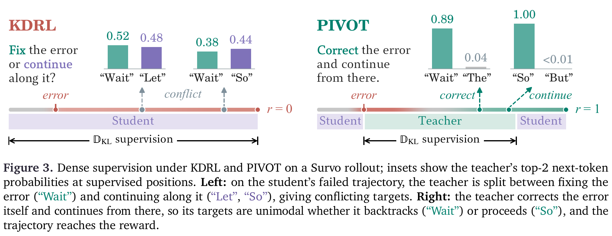

Figure 3：个案中 KDRL 教师分布在继续与纠错之间分裂；PIVOT 实际写入纠错路径后，局部目标更集中。这是机制示例，并非所有错误上下文的统计结论。

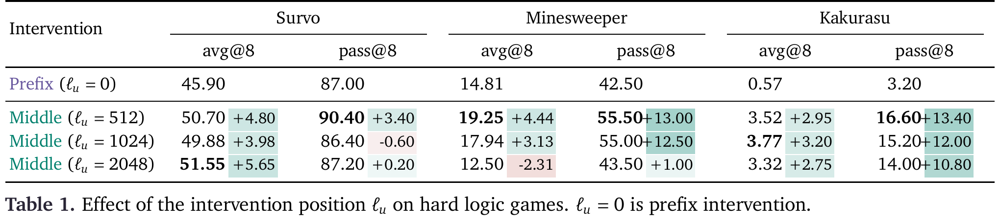

Table 1：512-token middle intervention 在三个任务两项指标上都优于 prefix；继续后移并不单调变好，说明学生尝试与剩余预算需要折中。

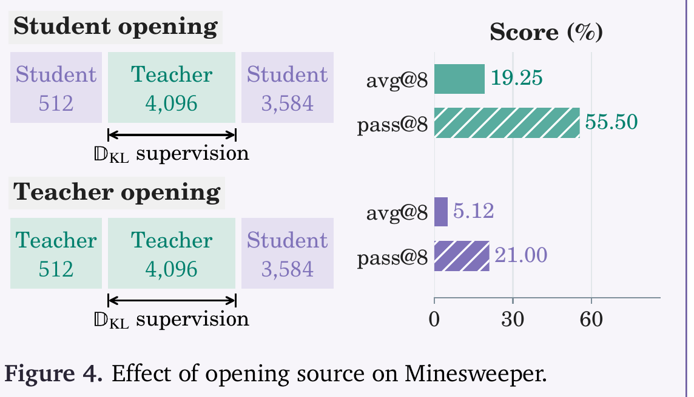

Figure 4：把 opening 改成教师生成后，后续同样的教师片段和 KL 预算表现下降，支持学生状态对齐的解释，但没有完全隔离所有 prefix 内容差异。

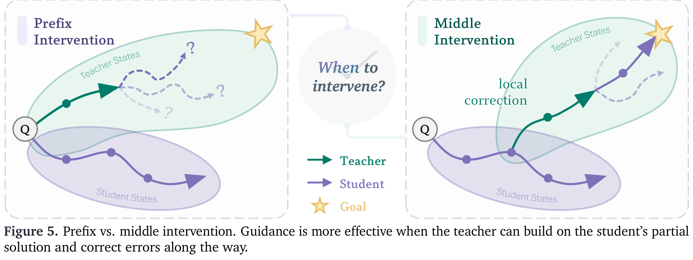

Figure 5：这是作者的概念示意，表达从学生状态接手比从教师状态开局更容易交接；图中区域不是实测表示空间。

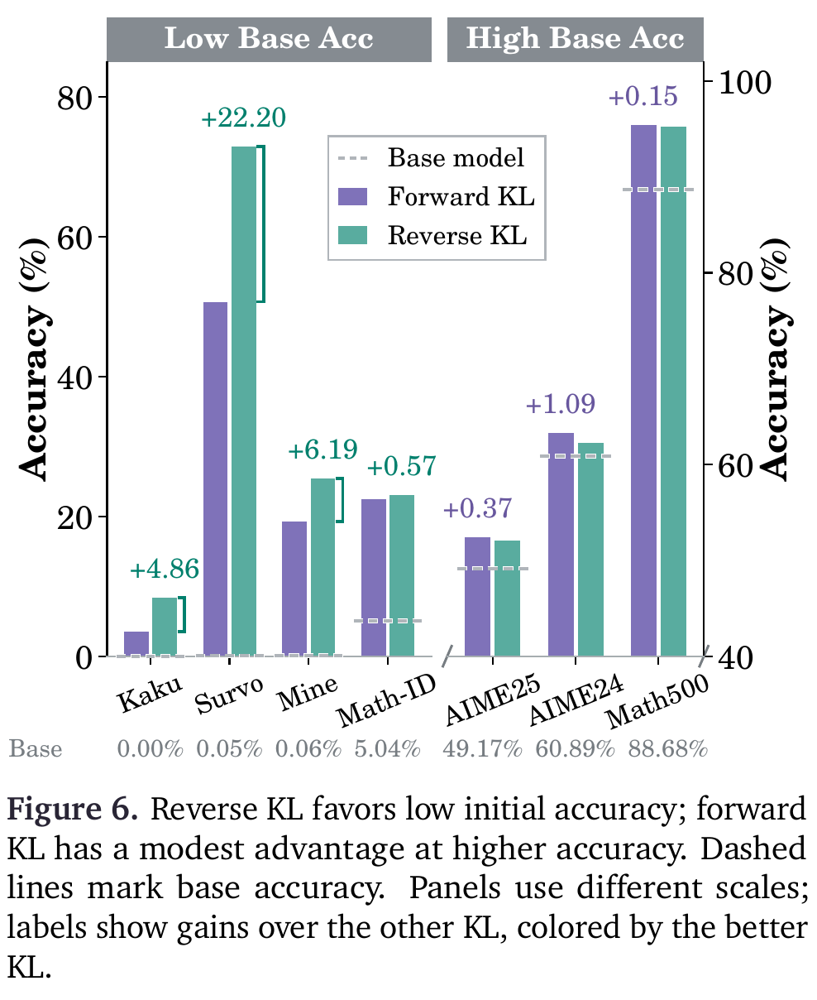

Figure 6：低初始准确率面板偏向 reverse KL，高初始准确率面板略偏 forward KL；左右纵轴尺度不同，不能直接按柱高比较跨面板难度。

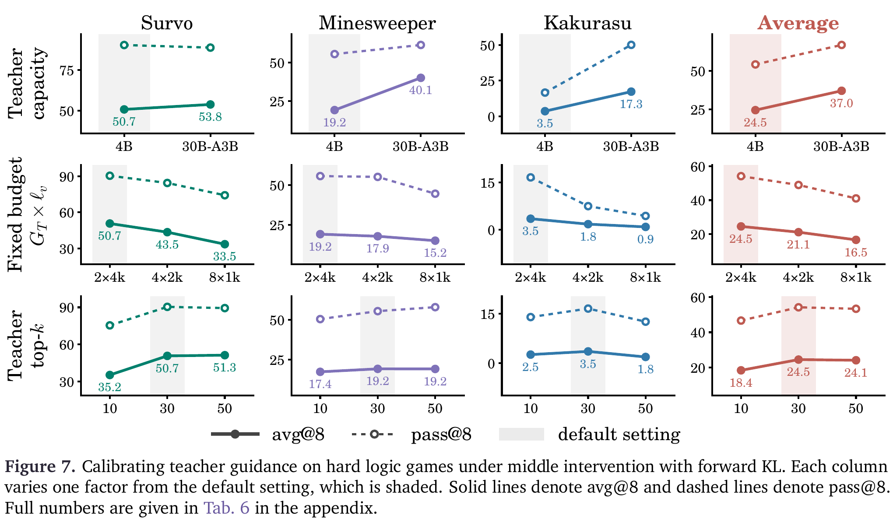

Figure 7：固定教师 token 预算时，多段短接管的曲线持续下降；top-k 从 10 到 30 有益，再到 50 没有统一收益，教师规模增大也不保证所有 pass@8 都提高。

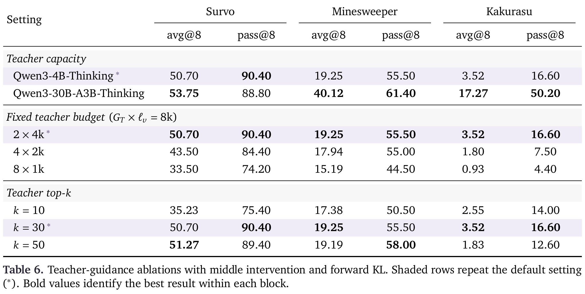

Table 6：给出了上述消融的精确数值，尤其 Survo 更强教师的 avg@8 提高而 pass@8 略降，说明平均质量与多样性覆盖不完全一致。

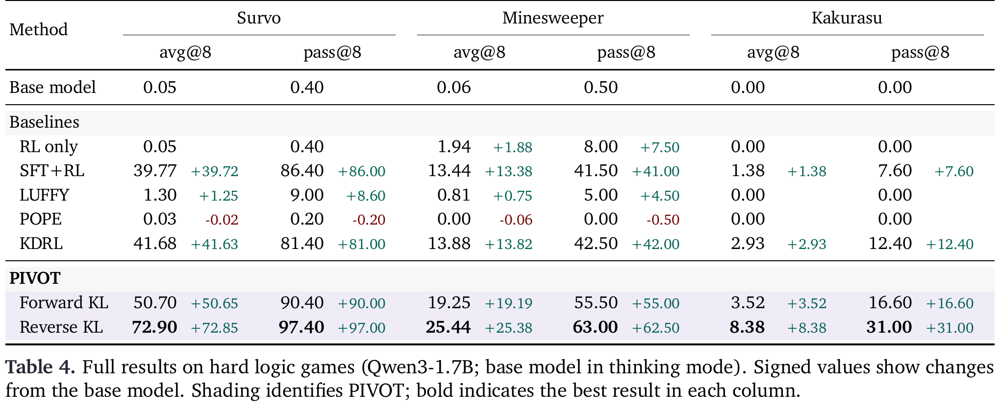

Table 4：完整逻辑结果保留 pass@8；Kakurasu 虽相对改进明显，绝对 avg@8 仍低，不能写成困难逻辑已解决。

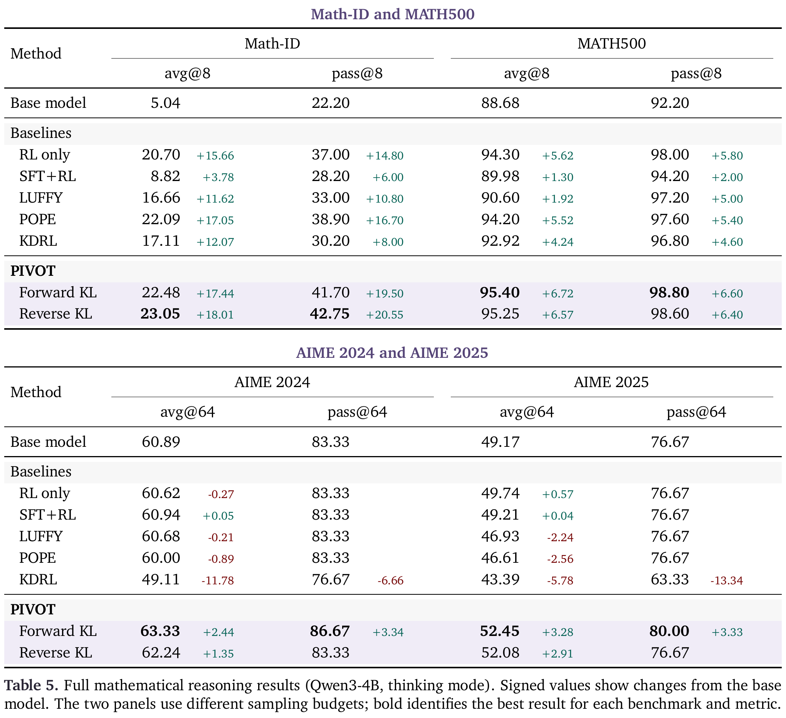

Table 5：数学分成两种采样预算；forward KL 在三个 OOD 的 avg@k 最优，reverse KL 在 Math-ID 最优，收益具有任务依赖性。

**实验是否足够支撑结论**：能支持本文模型和数据下的联合配方有效。不能仅由这些结果断言学生获得全新推理机制，也不能把固定 token 预算等同等计算成本；独立种子方差和置信区间原文未给。

## 6. 局限性

**作者自己承认的**：主要评估逻辑与数学，向 code generation、instruction following、open-ended reasoning 迁移尚待研究；intervention 与 supervision settings 固定，没有随学生能力变化而调节。

**我的判断**：像接力跑，教练跑得更快还不够，交棒点必须让学生接得住。固定的 $\ell_u$ 既不是正确性判断，也没有保证落在可恢复状态上；教师段还会吃掉最终答题预算。强教师能解的上下文，未必是学生能完成的上下文。

另一个方法问题是采样分布：接管轨迹中 $v$ 来自教师，前面介绍的 GRPO ratio 却按当前学生与旧学生写。正文未完整交代教师 token 在 policy-gradient 项中的 masking 或行为分布修正。我没有检查未公开训练代码，因此这里只指出论文记号与实现细节的缺口，不判定实现存在 bug。

**实验层面的不足**：没有给硬件总成本和重复试验方差；KDRL 使用恒定 teacher coefficient 与学生 top-30，而 PIVOT 使用衰减系数与教师 top-30，因此主比较并非只改变是否接管这一项。前述数据覆盖和基线控制问题保留在本节，不塞入 frontmatter 的四条方法局限。

## 7. 一句话总结

**让老师从学生当前做到的位置接手一段，并让学生练会这段，再把任务交回学生。** 类比学车：教练不只替你开出死胡同，还让你复习刚才怎样转向；但接管太晚，剩下的路程再短也可能来不及完成考试。这篇最有价值的区分是轨迹能成功、学生能接续、学生能独立生成并不是同一个条件，实验只验证了特定配方下最后一种能力的提升。

## 8. 可复用点

- 在已有 RLVR rollout worker 中记录每段 token 的生成来源，明确 student/teacher mask；让 verifier 看完整轨迹，让 teacher KL 只看教师段。先检查 ratio 与采样来源是否一致，再启动训练。
- 比较接管方案时固定教师 token 总数，并同时记教师调用次数、GPU 时间、截断率和独立评测分数。像记家教账单，不能只记上了几节课。
- 保留学生 prefix 后再做 correction；用 teacher opening 替换对照，检验收益是否来自状态对齐。默认 512 只是本文配置，迁移时应重新验证。
- 先做三种受控实验：仅 intervention、仅 supervision、两者结合，再统一 KL 系数日程与 top-k 来源。训练不起色时检查教师段是否纳入 KL、tail bucket 是否正确、最终答案是否被截断。

可跨任务复用的机制已抽为 [[../../../30 方法卡片/分段教师接管与局部蒸馏]]；本文不需要为每个逻辑游戏另建方法卡。

## 9. 我的疑问

- 如果把 intervention position 从固定 token 数改为可恢复性判断，能否在相同成本下更有效？类似教练根据危险程度接管，而非每开五百米必接管。
- 教师 segment 的 GRPO policy loss 究竟如何 mask、如何处理行为概率？需要等公开代码后核对。
- 在 KDRL 也用相同 coefficient decay、相同 top-k support 后，联合机制的净收益还剩多少？
- reverse KL 的收益能否由直接测量模式覆盖、错误恢复率来验证，而不仅凭最终准确率解释？
- 原文未给的 GPU 时间、重复运行方差和公开代码状态应继续保持未知，不能从表中补造。
