> 一句话：先判断是答案太像还是评分尺失灵，再决定该训练谁。

依据：联网下载的 16 页原始 PDF；已读正文、Algorithm 1、完整超参数、rubric 诊断、计算量与 IFEval 附录。未检查训练仓库，论文报告、公式推论与个人判断在下文分开。

## 0. 读之前你需要知道

- **rubric** 是自然语言评分准则，例如是否写出方程、是否给出正确数值；**rubric generator** 为题目生成准则，**judge** 根据准则给回答打分。
- **policy** 是真正回答问题的模型；**GRPO** 对同题多回答按组内奖励差异更新。若整组得分一样，归一化 advantage 变成零，这称为 **advantage collapse**。
- **co-evolution** 在这里指回答模型和评分准则生成器交替更新；不是 judge 自己一起变强。RACE 的 judge 始终冻结。
- **routing** 决定一组数据走哪条训练路径，**phase switching** 决定当前更新回答角色还是 rubric 角色。

像老师教学生做作文，同时修订评分细则：全班都是满分，可能因为大家都写得很好，也可能细则过于宽松。前序 EvoLM 固定轮换两个阶段，RACE 想根据这类信号决定何时换阶段。它改变的是训练分配机制，不提供外部正确答案。

## 1. 动机

一张评分表最初能分出作文高低，学生学会套路后，每份作文都能满足几个宽泛要求。继续按这张表训练，所有人得同分；定期再写一张新表，又可能在根本不需要时浪费时间。

**以前怎么做**：固定 rubric，或者按固定轮数交替训练回答与 rubric。**为什么不够**：不同题目的奖励退化时间不同；组内同分可能来自回答雷同，也可能来自评分准则太粗，统一安排会混淆两种情况。

作者用共享 Qwen3-8B 的 fixed-length alternation 作诊断，发现 rubric JSON 更规范不一定带来更有区分力的 reward。**为什么现在能做**：组内 rewards、回答文本和旧分差本来就存在，可用它们建立缓存与事件触发调度。这里的 operational definition 是启发式诊断，不能直接视为评分失败原因的因果识别。

## 2. 贡献

- **组级分流**：区分 informative、diversity-collapsed、rubric-failed；只让 informative 更新 policy，将 rubric-failed 缓存起来专门训练 rubric。
- **阶段级事件触发**：持续出现高分且低区分度时进入 rubric phase，rubric reward 改善停滞时回到 policy phase。
- **阈值在线调整**：用 Target-Rate Quarantine Controller（TRQC）和 phase controller 跟踪 quarantine rate 与阶段长度，避免初始阈值完全固定。
- **给出多类任务和消融证据**：八任务非加权平均 73.0，高于 EvoLM 的 71.3；同为 500 policy updates 时，RACE 另用 200 rubric updates，EvoLM 用 500。

像医院分诊先把病例送到该去的科室，再根据拥堵调整排班；贡献是协调更新资源，而非宣称单个裁判已获得独立真值。

## 3. 创新点

**先分清哪种退化，再选训练对象。** 相比只过滤零 advantage，RACE 用 surface 和 semantic diversity 将同分组拆成两类：答案也太像就 mask，答案不同但仍同分则缓存为 rubric-failed。好处是 rubric 训练更有针对性；前提是多样性确实能帮助判断原因。

**把固定日程改成状态触发。** 相比 EvoLM 的 50/50 alternation，RACE 观察 reward saturation 与 rubric improvement。但它仍有目标 phase length，只是目标用于软控制而非硬定时，不能把它说成完全没有 schedule 参数。

**利用旧比较方向训练新 rubric。** 相比每次重算旧 rubric，缓存 $(x,y^+,y^-,m_{\mathrm{old}})$，只让候选 rubric 在这对回答上打分，节省旧评分调用。像保留旧作文评语作为改卷标尺，效率更高，但旧评语错了也可能一路继承。

## 4. 方法

### 4.1 整体流程

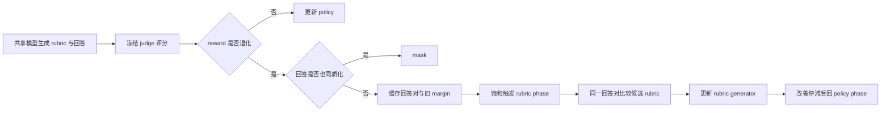

这像同一位老师轮流扮演答题者和出评分表的人，由训练状态决定当前练哪项。

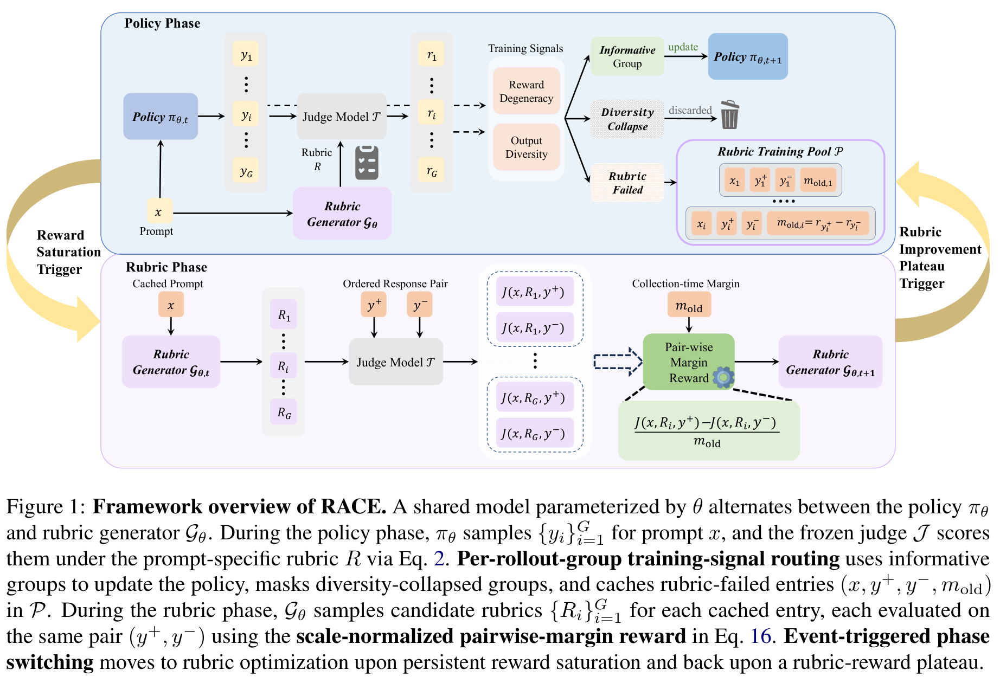

Figure 1：两种角色共享参数，judge 冻结；rubric phase 复用缓存回答，不重新让 policy 生成新答案。

### 4.2 组级分流

先测 reward 标准差与 tie rate，满足下面任一条件就判为 reward-degenerate：

$$
\sigma(\mathbf r)\le\sigma_{\mathrm{rt}}^*
\quad\lor\quad
\tau_{\mathrm{tie}}(\mathbf r)\ge\tau_{\mathrm{tie}}^*.
$$

- $\mathbf r=(r_1,\ldots,r_G)$ 是同题 $G$ 个标量评分。
- $\sigma$ 是组内标准差；$\tau_{\mathrm{tie}}$ 是两两得分差小于 $\epsilon_{\mathrm{tie}}$ 的比例。
- 星号量为路由阈值；$\lor$ 表示或，两个统计刻画的是数值区分度而非答案真值。

对退化组，再检查 distinct-trigram ratio $d_{\mathrm{tri}}$ 与平均 pairwise cosine distance $d_{\mathrm{emb}}$。前者是全部回答中 unique trigrams 占总 trigrams 的比例；后者来自冻结 encoder 的归一化向量。两者都低才归为 diversity-collapsed，其他退化组归 rubric-failed。

**关键边界**：措辞不同但质量相同的好答案，也可能得相同高分；不同回答同分不必然说明 rubric 坏了。这个规则是训练路由策略，不能当作错误归因的已验证分类器。

### 4.3 缓存 margin 与 rubric reward

旧 rubric 选出得分最高的 $y^+$ 和剩余回答里最低的 $y^-$，tie 用确定性规则打破，保存旧分差。候选 rubric 的目标是扩大这个既定方向的分离：

$$
m_i=J(x,y^+;R_i)-J(x,y^-;R_i),\qquad
S_{\mathrm{rubric}}(x,R_i)=
\operatorname{clip}\!\left(
\frac{m_i}{\max(|m_{\mathrm{old}}|,\epsilon_{\mathrm{norm}})},-c,c\right).
$$

- $x$ 为题目，$R_i$ 为候选 rubric；$J$ 是冻结 judge，输出标量分数。
- $m_i$ 是新分差，$m_{\mathrm{old}}$ 是收集时旧 rubric 的分差。
- $\epsilon_{\mathrm{norm}}=0.05$ 防止小分母，$c=1.0$ 限制 reward 范围。
- 所有候选 rubric 用同一缓存回答对，减少比较对象变化；负 $m_i$ 会处罚排序反转。

**我的判断**：当旧 margin 为零或旧排序错误时，算法仍有确定的 preferred direction；它优化的是旧方向的分差，并没有来自外部的优劣标签。clip 还会让足够大的 margin 变成同一 reward，不能无限增大区分度。

### 4.4 阶段切换与比例控制

policy phase 统计低标准差且高均分的组占比，做 EMA 后超过 $\tau_{\mathrm{sat}}^P$ 就切换。rubric phase 比较相邻两个长度为 $W$ 的窗口平均 reward，改善不超过 $\tau_{\mathrm{imp}}^R$ 就返回。

TRQC 用 quarantine rate 的标准化误差调整路由阈值：

$$
e_q^t=\frac{\widehat q_t-q^*}{\max(q^*,\epsilon_q)},\qquad
\sigma_{\mathrm{rt}}^{t+1}=\operatorname{clip}(\sigma_{\mathrm{rt}}^t-\eta_\sigma e_q^t,0,1),
$$

$$
\tau_{\mathrm{tie}}^{t+1}=\operatorname{clip}(\tau_{\mathrm{tie}}^t+\eta_\tau e_q^t,0,1).
$$

- $\widehat q_t$ 是隔离比例 EMA，$q^*$ 为目标，$\epsilon_q$ 为稳定项。
- 两个 $\eta$ 是正控制增益；隔离太多时降低 std threshold、提高 tie threshold，从而减少隔离。
- phase controller 同样用最近阶段长度与 $L^*,M^*$ 的偏差修正切换阈值；实际事件仍由 reward 决定。

默认 $q^*=0.20,L^*=25,M^*=12$，pool 为 FIFO、容量 2,048。共享权重按角色模板交替更新，冻结 judge 不变；因此 policy 更新也可能改变 rubric 行为，反之亦然，不是两个独立模型互不干扰。

还有一项会影响复现的细节：缓存回答对固定，但产生它们的 policy 已随训练改变。FIFO 只按进入顺序淘汰，不等于主动检测这些回答是否仍代表当前错误分布。旧 margin 保留了当时 rubric 的尺度，也保留了当时的偏好与噪声。我的判断是，应同时记录缓存年龄、当前模型对该回答对的排序，以及清空或刷新缓存后的性能；论文没有给出这组对照，不能把缓存命中本身当作训练样本仍然有用的证据。

## 5. 实验结果

像比较排班策略，应同时看最终服务质量、调度机制和总工作量，不能只看换班次数。

**实验设置六项**

- **数据集与切分**：Tulu 3 preference mixture 去重后 271K prompts，只用题目，不用参考答案。下游八任务 GSM8K、MBPP+、BBH、MMLU、PopQA、GPQA、ZebraLogic、AGI-Eval；实际各测试 split/样本数原文未逐项列明。rubric 用 JudgeBench、RewardBench2；100 个固定 prompts 做诊断，IFEval 单独报告。
- **骨干模型**：共享 Qwen3-8B（8.2B parameters）扮演 policy 与 generator，冻结 Qwen3-1.7B 作训练 judge；另用 GPT-5.4 评价 rubric discrimination。
- **训练预算**：500 policy updates；RACE 200 rubric updates，总计 700，EvoLM 对应 500+500。16 张 H800、两节点；8 learner ranks 使用 ZeRO-3，8 vLLM engines。learning rate $10^{-6}$、KL coefficient 0.001，每次一 epoch、一 minibatch，microbatch 1，无 warmup；每步 64 prompts、每题 8 samples。
- **基线**：GPT-4.1/Qwen3-8B prompted rubrics、Skywork-RM-V2、RaR、RRD、RLCER、Rubric-ARM、EvoLM。正文称统一协议，Appendix B.2 又说 baselines 用 previously reported results；不能宣称全部由本文在同机器重新运行。
- **指标**：下游各原任务分数百分数，Avg. 为八任务非加权平均；JudgeBench 的 Avg. 是四域平均，不是旁边的 Overall；RewardBench2 为六域平均。另统计 JSON validity、label-only、Specific、$\sigma(r)=0$ 和 mean reward std。
- **推理设置**：actor sampling temperature 1.0，prompt 截 2,048、generation 上限 16,384、packed sequence 上限 18,500；异步 lag 最多 4、truncated importance ratio cap 2.0。下游各任务 decoder 细节、semantic encoder 型号原文未给。RACE 报三次独立 runs，但表中未列逐项方差。

| 任务 | 本文 | 最强基线 | 比较 |
| --- | --- | --- | --- |
| 八任务 Avg. | 73.0 | EvoLM 71.3 | +1.7 pp（表值相减） |
| GSM8K | 95.9 | EvoLM 95.8 | 小幅领先 |
| MBPP+ | 68.7 | RaR 68.6 | 小幅领先 |
| BBH | 72.3 | GPT-4.1 prompted 71.7 | 领先 |
| GPQA | 56.1 | Qwen3-8B prompted / Rubric-ARM 56.9 | 未领先 |
| Zebra | 83.9 | Qwen3-8B prompted 84.3 | 未领先 |
| AGI-E | 87.5 | RRD 88.9 | 未领先 |

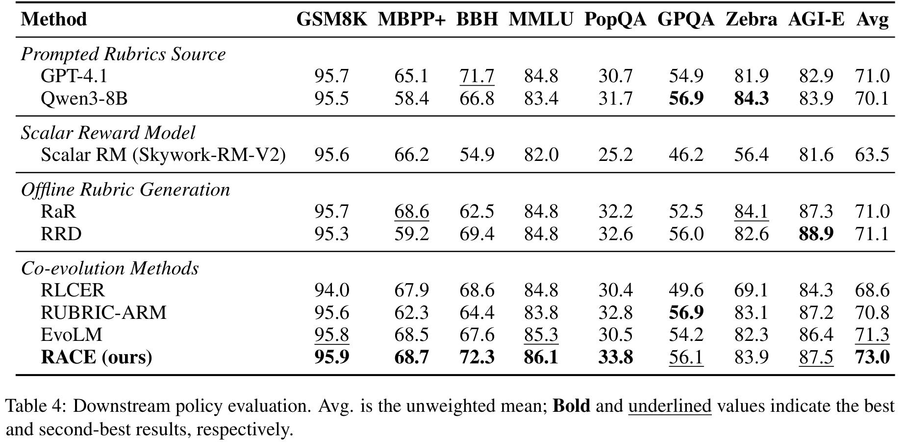

Table 4：RACE 比 EvoLM 八项都好，但并非比每个方法每项都好；低均分任务与高均分任务等权进入 Avg.。

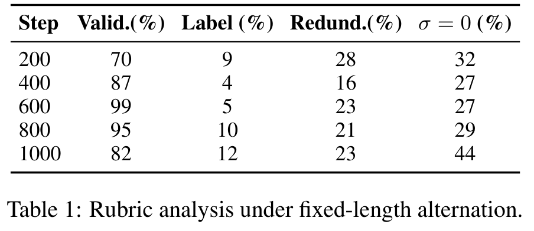

Table 1：fixed alternation 下 validity 波动与 exact advantage collapse 同时存在，格式更好不等于 reward 更可用于训练。

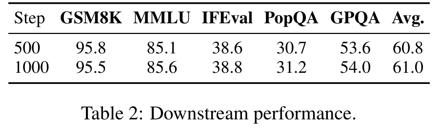

Table 2：旧诊断中从 step 500 到 1000 的五任务均分只略增；该五任务含 IFEval，不能和 Table 4 八任务 Avg. 横向比较。

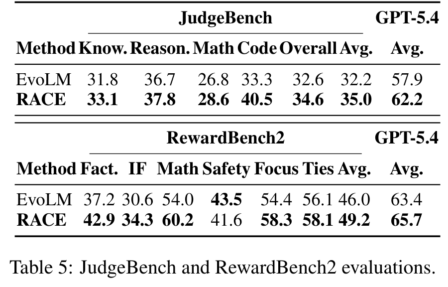

Table 5：RACE 对 EvoLM 的 rubric discrimination 在两种 judge 下均改善，但 RewardBench2 Safety 下降；JudgeBench 的 Overall 与四域 Avg. 分开保留。

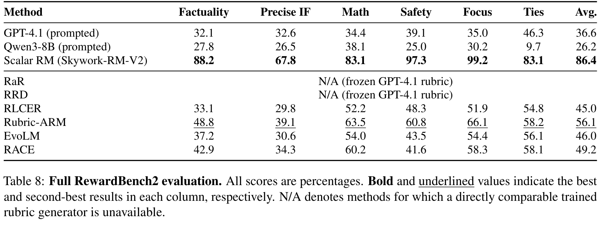

Table 8：Scalar RM 的 RewardBench2 Avg. 为 86.4，高于 RACE 的 49.2，却对应更差 policy Avg.，直接说明静态 reward-model benchmark 分数不能代替训练效用。

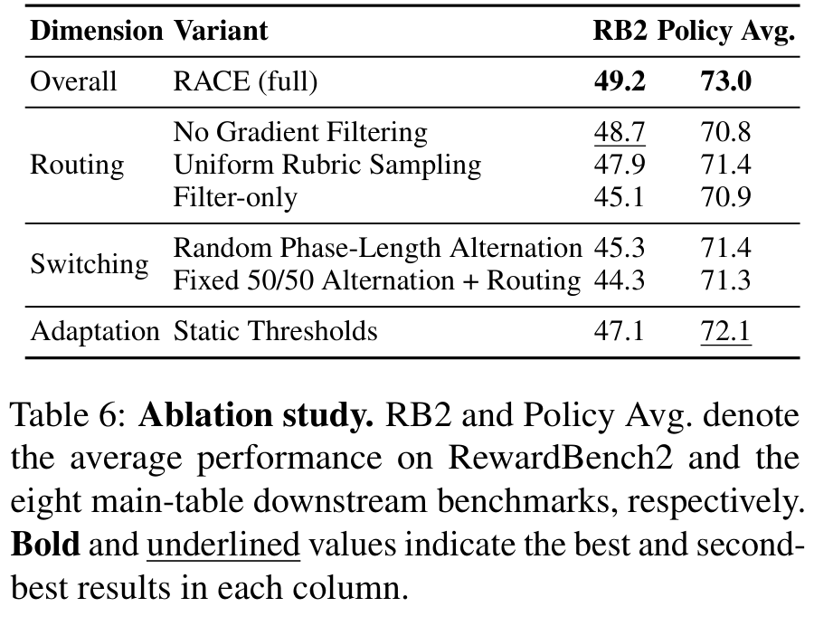

Table 6：No Gradient Filtering、Uniform Rubric Sampling、Filter-only、随机/固定 phase 和 Static Thresholds 都劣于完整配置，支持多组件协作，但消融没有逐一排除所有相互作用。

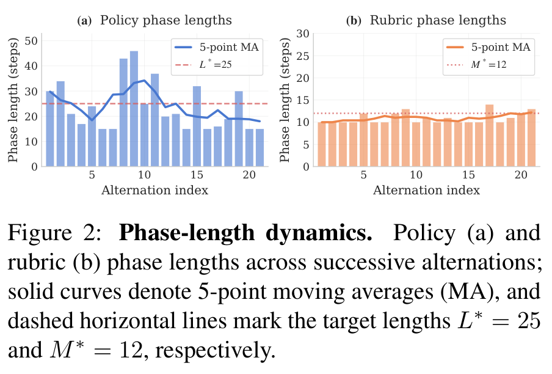

Figure 2：policy phase 长度先升后降，rubric phase 更接近目标；这展示动态排班，不能据曲线就断言闭环稳定或调度全局最优。

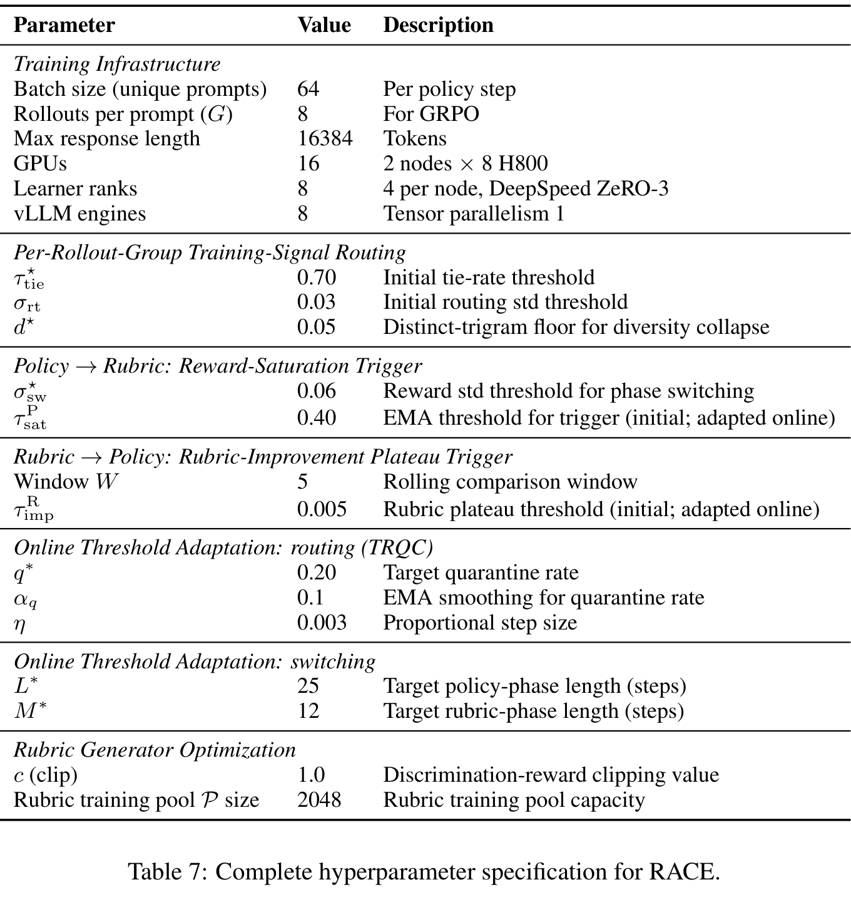

Table 7：将 routing、phase switching 和 adaptation 的阈值分组列出；semantic diversity threshold 等部分细项仍未在表中完整对应。

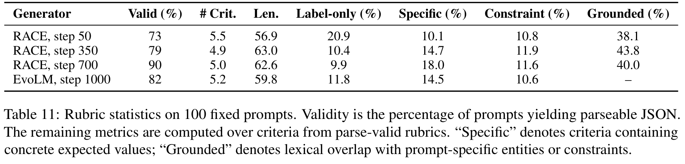

Table 11：Specific 与 criterion length 增加属于文本特征；具体数值要求也可能写错，不能把词更具体当作事实更正确。

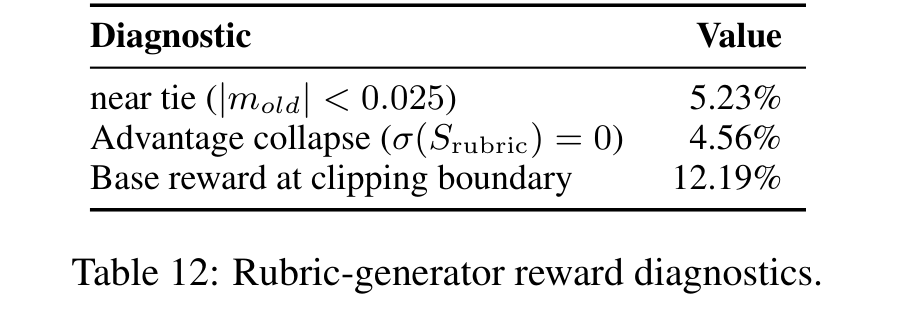

Table 12：rubric reward 仍有 near tie、collapse 和 clipping-boundary 样本；该比例来自 retained subsample，分母不等于全部训练组。

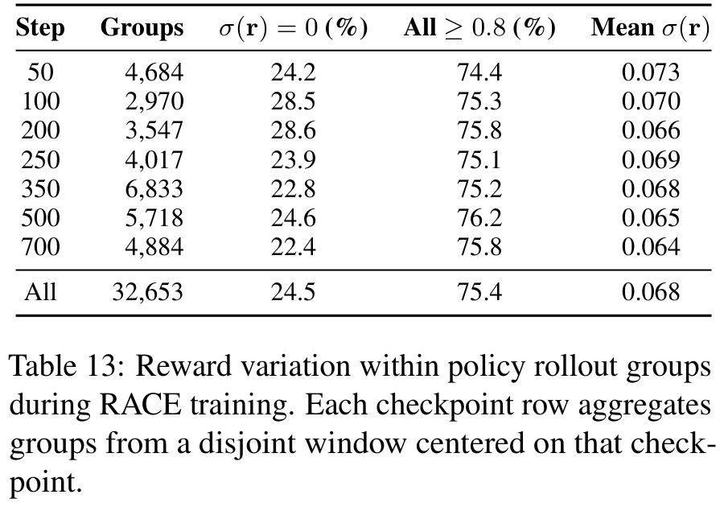

Table 13：policy exact collapse 总体仍为 24.5%，后期 mean std 继续收缩；方法缓解退化但没有消灭它。

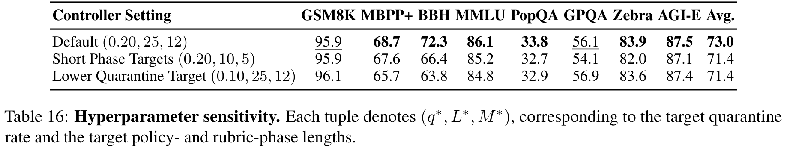

Table 16：更短目标 phase 或更低 quarantine target 均降至 71.4，说明 soft targets 依然重要，不是取消固定日程后就无须调参。

## 6. 局限性

**作者承认**：训练只有共享 8B 与冻结 1.7B judge，其他家族和规模未验证；主评单轮任务，多语言、多轮和长程仍待探索。这些实验覆盖问题放正文，不写进方法字段。

**我的判断**：像旧老师把两篇同分作文随意排了先后，新评分表被要求拉开这个顺序，可能只是把偶然差异写得更确定。$m_{\mathrm{old}}$ 很小时，tie-breaking 与 judge 偏好尤其重要；负 margin 受罚使纠正旧错序也可能受罚，缺少外部锚点。

分流同样依赖代理：semantic difference 不等于 quality difference，相同高分可能是任务已学会。TRQC 追踪目标隔离率也可能把固定比例当目标本身。共享权重和延迟反馈形成耦合控制系统，论文未给闭环稳定性或防抖保证。

**成本与复现边界**：Appendix E 给出每次 policy update 512 回答、64 rubrics、512 judge scores；rubric update 512 rubrics、1,024 judge scores。更新步更少不自动等于总 FLOPs 更低。正文另需 frozen encoder 计算 semantic diversity，但无额外 model inference 的表述未解释其特征是否复用，需代码和成本日志核对，当前不判定实现有 bug。

## 7. 一句话总结

**当一批回答得分区分不开时，先判断数据是否同质化，再决定继续训练回答模型还是修订评分准则。** 像教学中根据课堂反应改评分表，比固定隔几天换表更灵活；但评分表变得更会拉开旧排序，并不保证旧排序正确。这篇的可取处是把组级筛选、失败缓存和阶段切换连成可检查流程，可信度仍受冻结 judge 和启发式诊断限制。

## 8. 可复用点

- 将 reward spread、tie rate 与 output diversity 分开记录，保存被 mask 组的真实原因；像分诊记录不能只写未收治，还要说明为什么。
- 缓存原 rubric、回答对、分差、时间和 judge 版本；候选 rubric 用同一对回答比较，另留独立人工或验证器样本检查错序强化。
- 先实现固定阈值和 routing，再逐步加入 phase triggers、controllers；日志分别画 phase length、quarantine rate、有效 policy groups 与成本，避免多个控制器一起调却无法归因。
- 复现 IFEval 时保存原始 completion 与去掉 think 后 final answer，严格按同口径比较。本文 final-answer-only 为 RACE 78.2、reproduced EvoLM 77.6，不能和早先 full-completion 成绩混用。

通用机制抽为 [[../../../30 方法卡片/奖励退化分流与事件触发共演化]]；rubric 文本更具体是否更正确，要另加独立核验。

## 9. 我的疑问

- 旧 margin 接近零时，能否允许 abstain 或重新判别，而不是把任意 tie-break 变成新 rubric 的学习目标？像两篇同分作文不必硬定冠亚军。
- 两个角色使用独立 adapters 后，能否减少共享参数导致的遗忘与阶段振荡？
- 基于语义多样性的 rubric-failed 标签有多准，是否有独立质量标注的诊断集？
- 用等总生成 token、等 judge compute 而非等 policy updates 比较，收益还剩多少？
- 编码器、阈值初始化分位点、judge score 范围和控制增益的全部细节，应在复现前确认，不能从 Table 7 未列项自行补全。
