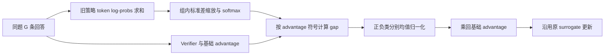
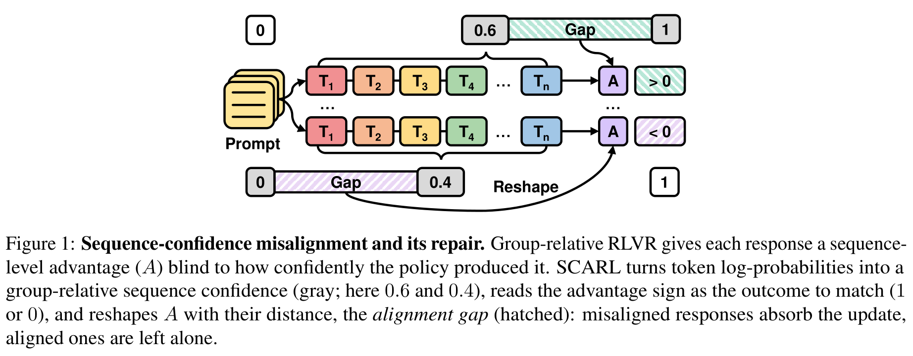
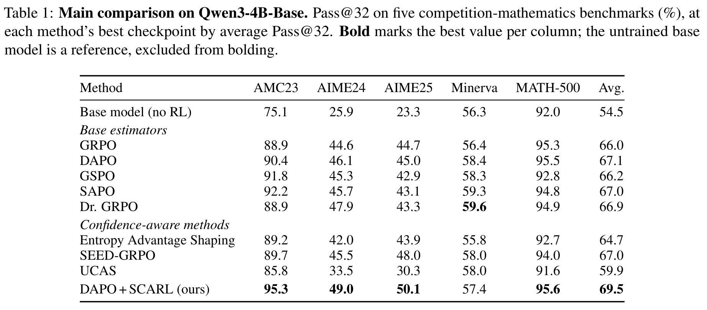
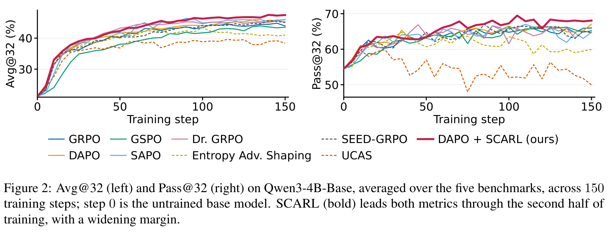
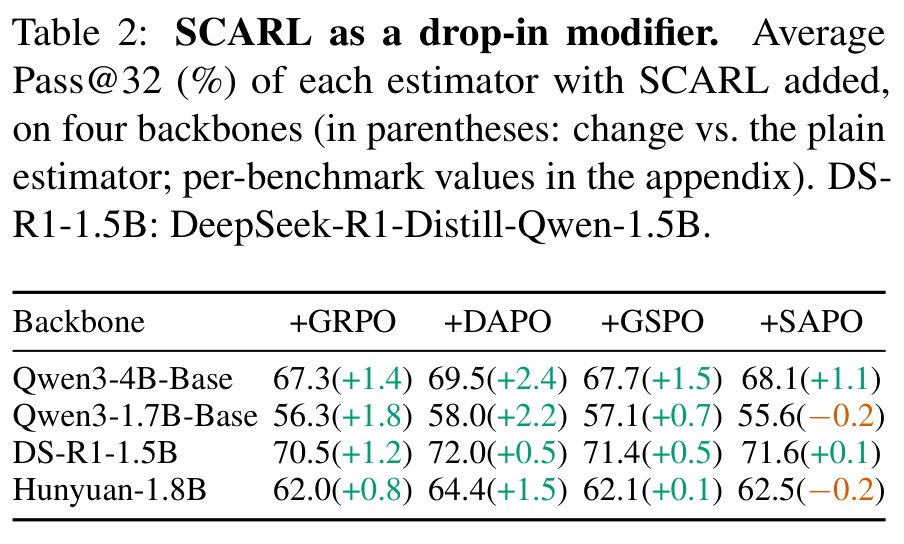
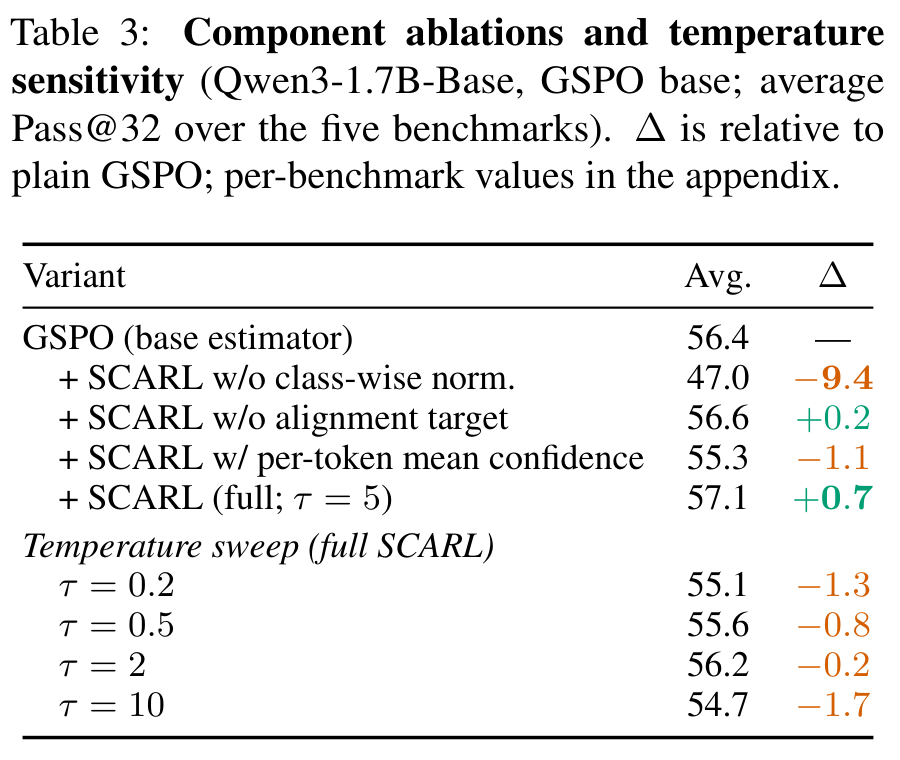
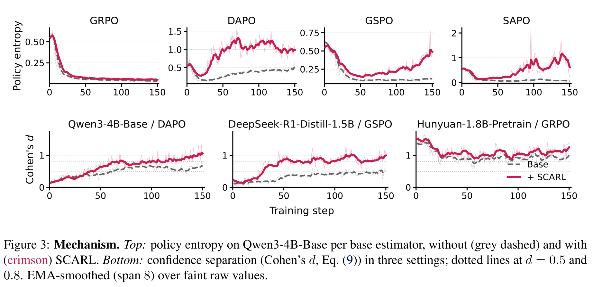
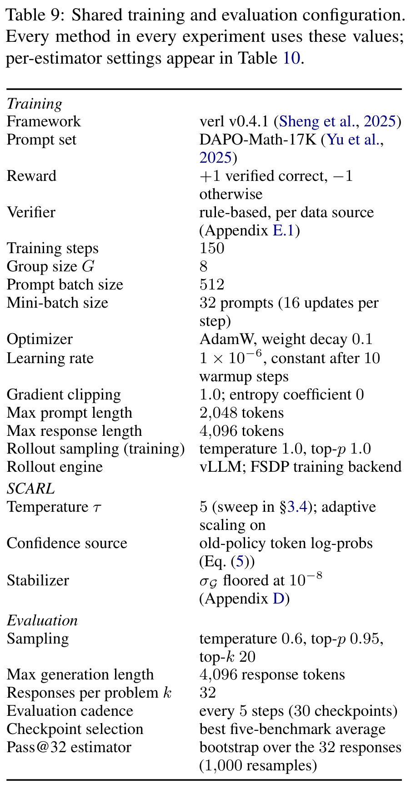
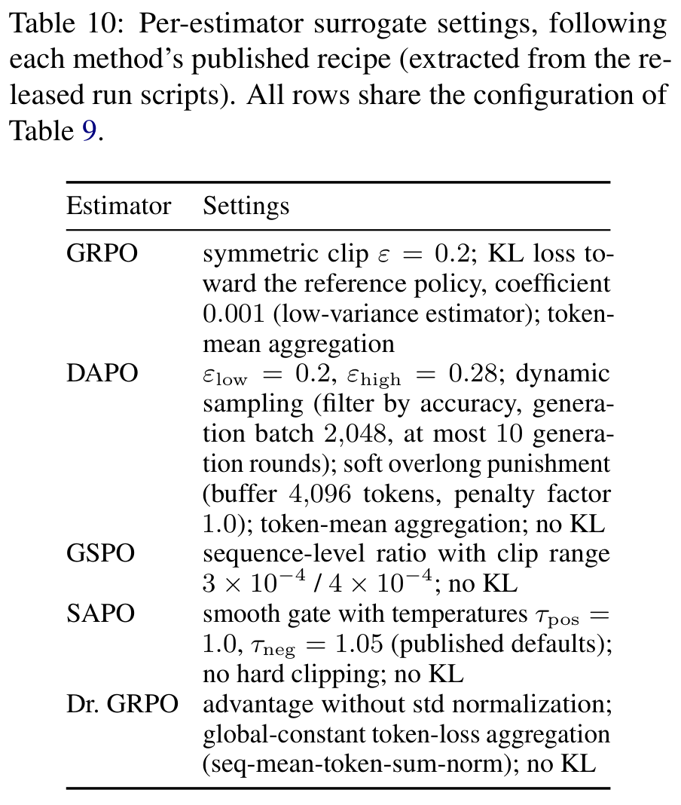

> 一句话：把更多练习力度分给侥幸答对和自信答错的回答。

依据：联网取得的 18 页原始 PDF；已读正文、Appendix A 方法讨论、B 全结果、C 证明、D 参考实现及 E–F 评测细则。这里核对的是论文及其附录代码片段，没有运行 GitHub 仓库。

## 0. 读之前你需要知道

- **Reinforcement learning with verifiable rewards（RLVR）**：模型作答后由规则检查答案，再调整生成概率，像做题后按标准答案奖惩。
- **Group Relative Policy Optimization（GRPO）**：同题采多条回答，用组内奖励的相对差异估计 advantage；**advantage** 表示一次尝试相对同组平均值有多好，不是模型对答案的信心。
- **sequence log-likelihood**：模型生成整条回答时每个 token 的 log probability 之和，越大通常表示该具体序列越容易被模型生成。
- **policy entropy**：生成选择的分散程度；选择过于集中可能减少探索，但熵高也可能只是胡乱尝试。
- **Avg@32** 看平均一次抽样答对的比例；本文 **Pass@32** 用特定 bootstrap 口径衡量多次采样覆盖，不能只看名字就当成普通的命中率。

前序工作 GRPO、DAPO、GSPO、SAPO 主要改变奖励归一化、ratio 或 clipping；confidence-aware 方法再按确定性调整更新。SCARL 关注同样答对的两条回答是否应得到同样强化：像老师对已经熟练背出的答案与刚刚摸索出来的答案，分配不同复习时间。

## 1. 动机

一位学生每天都熟练做对简单题，另一道难题偶然做对一次。如果老师给两道题完全相同的复习资源，简单题会越来越熟，刚学会的难题却可能很快忘记。答错也一样：坚定重复错误规则，与尝试新思路失败，不应毫无区别地处罚。

**以前怎么做**：二元奖励下，同组同结果的回答通常有相同 advantage，整条回答的每个 token 都继承它。**为什么不够**：advantage 本身不看这条回答原本容易生成还是很罕见，可能继续强化高概率成功模式并压低稀有探索。

**为什么现在能做**：训练计算 importance ratio 时已经有旧策略 token log-probabilities，可以直接求和得到序列信号，不需再调用教师或增加前向。作者希望把 confidence 与 outcome 的不匹配变成更新权重。我的理解是重新安排已有学习资源，并未创造新的正确答案或额外奖励。

## 2. 贡献

- **给出 sequence-confidence alignment 的操作定义**：同一 outcome class 的回答应趋向相同 confidence，并据此构造 alignment gap。它是作者选择的训练准则，不是概率论中必须满足的真理。
- **提出可插拔的优势乘法变换**：保留 rewards、importance ratios、clipping，只给基础 advantage 乘一个正权重，并在正负类内部各自归一化。
- **证明有限范围的代数性质**：正性、类内权重均值为 1、confidence 相等时精确退回基础估计器；不能把这些性质扩张为最终正确率必然上升。
- **报告多设置收益**：Qwen3-4B-Base 上 DAPO 的平均 Pass@32 从 67.1 到 69.5；四个模型乘四种估计器，16 对中有 14 对提高。

像班主任重新分配每组的练习时长，论文证明的是分配规则没有把奖励改成惩罚、总权重可控制；是否考得更好仍由实验回答。

## 3. 创新点

**新在按 outcome 选择不同的 confidence gap。** 正 advantage 用 $1-p_i$，负 advantage 用 $p_i$。相比统一奖励不确定性，这会强化罕见成功、重点纠正高概率错误，同时少处罚罕见错误，像对新学会的题加强复习，对反复犯的熟悉错误重点纠偏。

**新在按类恢复尺度。** 由于 $p_i$ 是整组 softmax share，未经归一化的正负权重天然尺度不平衡；SCARL 不直接拿 gap 乘 advantage，而是在每个 sign class 内除以均值。这是消融中最重要的一环。

**新在与原 surrogate 解耦。** 它改 advantage space，而非把 GRPO 全部替换成另一套优化器。相比仅改变 clipping 的方法，两者可以组合。但可组合不等于总是增益：SAPO 的两个小模型设置都略降，说明更新机制之间存在相互作用。

## 4. 方法

### 4.1 整体流程

像先按考试结果分组，再在每组内找谁最需要补课；不改变原来的答案判分规则。

Figure 1：confidence 是组内 share，target 由 advantage 符号决定，gap 再转为训练权重；图中的 0.6 不能读成该回答有 60% 概率正确。

### 4.2 模块拆解

**sequence confidence。** 先衡量行为策略对整条具体回答的生成倾向：

$$
c_i=\sum_{t=1}^{|y_i|}\log\pi_{\theta_{\mathrm{old}}}(y_{i,t}\mid x,y_{i,<t})
=\log\pi_{\theta_{\mathrm{old}}}(y_i\mid x)\le0.
$$

- $x$ 是题目，$y_i$ 是第 $i$ 条 token 序列，$|y_i|$ 为长度。
- $\theta_{\mathrm{old}}$ 是采样时策略参数；$c_i$ 为非正标量。
- token log-probs 必须与 ratio 使用同一来源；padding token 不参与求和。

原文刻意用 sum 而不是 per-token mean，所以长回答在其他条件相同时通常更低。作者认为这是整个行为的概率，我的判断是它也混入了长度、格式与措辞选择，不能独立代表认知确信。

**group-relative confidence。** 为使不同组的 log-likelihood 尺度可比，先除以组内标准差，再做 softmax：

$$
\widetilde c_i=\frac{c_i}{\tau(\sigma_G+\delta)},\qquad
p_i=\frac{\exp(\widetilde c_i)}{\sum_{j=1}^{G}\exp(\widetilde c_j)}.
$$

- $G$ 为组大小，$\sigma_G=\operatorname{std}(c_1,\ldots,c_G)$ 为标量。
- $\tau>0$ 是温度，$\delta>0$ 是稳定项；$p\in(0,1)^G$，元素和为 1。
- 共同平移在 softmax 中抵消；温度控制相对权重差异，不是采样 temperature。

**alignment-gap shaping。** 根据基础 advantage 的 sign，把相对 confidence 与 target 比较：

$$
t_i=\mathbf1\{\widehat A_i\ge0\},\qquad
\widetilde w_i=|t_i-p_i|=
\begin{cases}1-p_i,&t_i=1,\\p_i,&t_i=0.\end{cases}
$$

- $\widehat A_i$ 是基础序列 advantage，$t_i\in\{0,1\}$ 为 sign class。
- $\widetilde w_i$ 是正的 raw gap；二元奖励下 sign 与正确性对应，但一般不能把 sign 直接改写成原始 reward 标签。
- $\widehat A_i=0$ 时约定进入正类，但乘回以后仍为零。

**class-wise normalization。** 正负类分开除以自己的 raw-gap 均值，然后乘回原 advantage：

$$
w_i=\frac{\widetilde w_i}
{\frac1{|S(i)|}\sum_{j\in S(i)}\widetilde w_j},\qquad
\widehat A^{\mathrm{SCARL}}_{i,t}=w_i\widehat A_{i,t}.
$$

- $S(i)$ 是包含 $i$ 的 sign class，$|S(i)|$ 为其样本数；样本数不超过 1 时设 $w_i=1$。
- $w_i$ 为正标量，同一回答所有 token 共用；它依赖旧策略并 stop-gradient。
- 每个非空类有平均 $w_i=1$；confidence 在类内完全一致时，所有 $w_i=1$，恢复基础方法。

这好比同一组的总复习券数保持不变，只调整每人拿多少。**必须区分权重和梯度**：即使权重和守恒，各回答的梯度方向、长度与 clipping 状态不同，实际梯度总量也不会自动守恒。

### 4.3 关键细节

默认 $\tau=5$，同一 rollout 的权重在 epoch 内固定，避免当前参数不断变化造成移动目标。实现需稳定 softmax；附录 Listing 1 用 population std 与 additive eps，实践说明却写 released implementation 用 $\max(\sigma_G,10^{-8})$。两者在小方差组附近可能不同，复现时应查真实源码，不能把两个写法说成逐点相等。

全组 reward 相同则基础 GRPO advantage 为零；SCARL 无法从中恢复学习信号。DAPO dynamic sampling 会滤掉这类组。保符号证明假定有限 logits 的精确 softmax，浮点下极端概率的稳定性仍需工程处理。

## 5. 实验结果

像比较两种复习分配法，必须固定练习题、考试次数和挑成绩的规则，才能知道收益来自什么。

**实验设置六项**

- **数据集与切分**：训练 DAPO-Math-17K；评测 AMC23 40 题、AIME24 30、AIME25 30、Minerva Math 272、MATH-500 500。原文未给独立 validation split；每 5 steps 在五基准上评估并选最佳平均 checkpoint。
- **骨干模型**：主比较 Qwen3-4B-Base；扩展 Qwen3-1.7B-Base、DeepSeek-R1-Distill-Qwen-1.5B、Hunyuan-1.8B-Pretrain。
- **训练预算**：150 steps，group size 8，prompt batch 512，mini-batch 32；AdamW、weight decay 0.1，learning rate $10^{-6}$，warmup 10 steps，gradient clipping 1.0。每次单节点 8 张 A100 40GB，vLLM + FSDP，参数及优化器 offload、gradient checkpointing；wall-clock 时长原文未给。
- **基线**：GRPO、DAPO、GSPO、SAPO、Dr. GRPO；confidence-aware 的 Entropy Advantage Shaping、SEED-GRPO、UCAS 按各自配置运行。因此同一 base 加 SCARL 的配对更适合隔离效果，不同算法之间并非只有一处差别。
- **指标**：Avg@32、本文 bootstrap Pass@32，五基准做平均；机制指标为 policy entropy 与 Cohen’s d。
- **推理设置**：训练 temperature 1.0、top-p 1.0；评测 temperature 0.6、top-p 0.95、top-k 20，每题 32 回答；prompt 上限 2,048、response 上限 4,096。训练与 AMC/AIME 用 Answer: 抽取和 DAPO scorer；Minerva、MATH-500 用 boxed 答案与 Math-Verify。

**Pass@32 的特殊口径**：对已生成的 32 个回答有放回抽样 1,000 次，每次抽 32 个，计算至少一个正确的比例。若其中有 $c$ 个正确，其 bootstrap 期望为：

$$
1-\left(1-\frac c{32}\right)^{32}.
$$

$c\in\{0,\ldots,32\}$ 是正确回答数；该标量不同于直接观察 32 次中是否至少成功一次。它同时受组内正确样本数量影响，不能无条件当作可解题集合扩大的严格证据。

| 任务 / 汇总 | 指标 | DAPO + SCARL | 最强基线 | 原文报告或差值 |
| --- | --- | --- | --- | --- |
| 五基准 Avg. | Pass@32 | 69.5 | DAPO 67.1 | +2.4 pp |
| AMC23 | Pass@32 | 95.3 | SAPO 92.2 | +3.1 pp（相减） |
| AIME24 | Pass@32 | 49.0 | Dr. GRPO 47.9 | +1.1 pp（相减） |
| AIME25 | Pass@32 | 50.1 | SEED-GRPO 48.0 | +2.1 pp（相减） |
| Minerva | Pass@32 | 57.4 | Dr. GRPO 59.6 | -2.2 pp（相减） |
| MATH-500 | Pass@32 | 95.6 | DAPO 95.5 | +0.1 pp（相减） |

Table 1：总体最优不代表每列最优，Minerva 由 Dr. GRPO 领先；各方法均取最佳 checkpoint，不能把这些数当固定最终 step 的成绩。

Figure 2：SCARL 的 Avg@32 和 Pass@32 在后半程同时较高，UCAS 的两条曲线则明显不同，说明采样效率与此口径 coverage 应共同观察。

Table 2：16 对有 14 对提升；两个 SAPO 设置下降 0.2，支持广泛但非普遍增益，不能写成不调参必涨分。

Table 3：去掉 class-wise norm. 降至 47.0，低于 GSPO 的 56.4；去掉 alignment target 只到 56.6；per-token mean confidence 为 55.3。温度默认 5 最好，其余四档均低于 plain GSPO，说明该超参数有实际选择成本。

Figure 3：SCARL 改善多数组的熵曲线，但 GRPO 两条曲线最终都接近低熵；Cohen’s d 更大也可能来自类内方差收缩，不能单独证明绝对 confidence 已校准。

Table 9：共享配置保留训练和评测 sampling 的区别，bootstrap 以及每 5 steps 选择 checkpoint 都影响分数解释。

Table 10：各 base estimator 的 KL、clip 与 dynamic sampling 不同；同一种 SCARL 权重进入不同 surrogate，实际通过的梯度并不相同。

**这些实验支撑什么**：在本文计算协议下，配对改进和结构消融支持此权重规则有效。没有直接证明所有模型的真实 solution-space boundary 扩张，也没有通过独立干预完全识别 entropy 提升是否是性能收益的唯一原因。

## 6. 局限性

**作者承认**：只研究二元规则奖励的竞赛数学，未研究 shaped/continuous rewards；模型最大到 4B；推理时拒答或答案选择尚未探索。后两项属于实验和应用覆盖，不填进 frontmatter 方法局限。

**我的判断**：像同组学生的复习券份额，$p_i$ 只说明相对分配，不是能否答对的客观概率。把长回答的低 sequence probability 解释成不自信，可能混入长度和语言多样性。更重要的是，同 outcome 必须同 confidence 是设计选择：正确解法难度不同，合理概率本可不同，趋同不是天然正确的学习目标。

代数证明只保证正权重和权重均值。若迁移到同一 sign class 内 advantage 大小不同的场景，$\sum_iw_i=|S|$ 并不推出 $\sum_iw_i\widehat A_i=\sum_i\widehat A_i$；因此类内 advantage budget 的严格守恒需要附加条件。正文实验的二元组内 advantage 更接近该条件。

**实验层面**：最佳 checkpoint 由同一五基准挑选，存在选择乐观性；未给独立训练重复的方差。机制图是相关证据。论文称 compute-matched，但 DAPO dynamic sampling 的额外生成轮数可能影响实际 rollout 工作量，需要完整成本日志才能核对，不因这个疑问直接断言算力不公平。

## 7. 一句话总结

**把同样结果的一组回答重新分配训练力度，让偶然成功更牢靠，让自信错误受更强纠正。** 类比老师少布置学生早已熟练的题，多复习刚摸索出来的解法。不过，它只能使用已有 reward 和组内概率，不能把全错组变成有正确示范，也不能凭正权重这一条保证训练稳定、熵不降或泛化必然提高。

## 8. 可复用点

- 在 advantage estimator 后加 detached sequence weights，直接复用 old log-probs 和 response mask，不增加模型前向；旧概率来源应与 importance ratio 一致。
- 分别记录正类、负类的平均权重和极值，确认每类均值为 1，并监测真实 weighted gradient、clipping fraction 与 response length。像核对总课时与实际学习效果，两种账都要记。
- 复现时同步报告普通 any-correct 与论文 bootstrap Pass@32；固定 checkpoint 的结果与 best-checkpoint 结果分开。
- 做 continuous reward 扩展前，验证同 sign class 内是否仍有相同 advantage；否则重新检查所谓预算守恒，而非直接搬用结论。

可复用机制见 [[../../../30 方法卡片/按结果类别归一化置信度权重]]；不需要为每个基础优化器另抽一张相同方法卡。

## 9. 我的疑问

- 如果控制回答长度与格式后，sequence confidence 仍有相同收益吗？像两名学生写答案详略不同，不能只按作业页数判断熟练程度。
- 能否直接检测新解法或新可解题，而非用受正确样本数影响的 bootstrap coverage 代理？
- 在不依赖测试集选 checkpoint 的协议下，14/16 的改善能否保持？
- 使用 weighted advantage 均值而非 weight 均值守恒，能否安全扩展到 continuous rewards？
- entropy-aware shaping 的 informal argument 在真实共享参数、clipped surrogate 下需要哪些额外条件？附录没有给全局收敛或熵单调保证。
