> 让一个会动手的检查员自己去翻电脑，确认任务到底做完没有。

## 0. 读之前你需要知道

**术语卡**

- **CUA（computer-using agent）**：靠鼠标、键盘和屏幕操作软件的智能体。生活类比：坐在你旁边替你点电脑的实习生，能开应用、填表、存文件。
- **VLM judge**：拿几张截图或一段轨迹，一次模型调用就给出成功或失败判断的裁判。生活类比：只看案发现场几张照片就下结论的侦探。
- **rubric（任务清单）**：把一句任务拆成若干条可检查的要求。生活类比：验房师的检查清单，逐项打勾。
- **hard / soft requirement**：`hard` 是必须满足才算成功的要求，`soft` 是附加检查，不改变硬性结论。生活类比：考试里的大题必答，卷面整洁只是加分项。
- **attested / asserted evidence**：`attested` 是直接观察到的任务状态，`asserted` 是执行 agent 的自述或动作前的意图。生活类比：现场拍到的照片，和当事人说我已经做完了。
- **persistent / volatile state**：`persistent` 是写进文件、数据库、设置里的状态，`volatile` 是当前屏幕、UI dump 这类随时会变的状态。生活类比：银行流水，和柜台屏幕上一闪而过的余额。
- **abstain（弃权）**：证据不足时不硬判成功或失败。生活类比：证据不足就不起诉，而不是凑一个判决。
- **audit path（审计路径）**：一条独立的取证路线，从轨迹或机器状态里找支持或反驳。生活类比：三个侦探分头查同一案子。
- **checker**：一串只读操作加一个判断条件，用来检查某条要求。生活类比：一张化验单，先抽几管血，再按指标判读。

**它站在谁肩上**

- VLM judge 路线（Pan et al. 2024；Sun et al. 2025）：把轨迹压成几张图或一段文字，一次调用给分。它快，但只看得到喂给它的观测。
- `Auto-Generated verifier`（Xue et al. 2026b）：让模型给每个任务写一段检查程序，跑一次拿二值结果。程序能读状态，但读哪里由模型一次决定。
- `CUAJudge`（Xue et al. 2026a）与 `OS-Themis`（Li et al. 2026）：把任务拆成关键点或里程碑，再对着抽样帧检查。它们比单次打分细，但仍然围绕固定观测转。
- agentic verification（Cui et al. 2026；Sanayei et al. 2026；Wan et al. 2026）：让验证器主动翻轨迹或环境。VeriCUA 把这条路线做成一套同时覆盖在线和离线的共享流程。
- 评测底座：`AndroidWorld`、`OSWorld`、`ScienceBoard`、`WebArena`、`OSReward`。它们提供可复现的终态、轨迹和参考标签，本文才有得比。

## 1. 动机

你让远程实习生把会议纪要存进笔记应用，他回你已保存。截图里文字确实在，可文件没有落盘。你又让他只拍一段视频，他拍了三段，最后画面停在相机待机页。只看最后一张截图，你会给他打满分。这就像请了一个只会发截图的监工，照片好看不等于活干完。

**以前怎么做**：一条路是 `VLM judge`，把指令、轨迹和几张截图塞给模型，一次调用判成功或失败。另一条路是 `Auto-Generated verifier`，让模型写一段程序去查应用状态，跑一次给二值结果。

**为什么不行**：两条路都只拿到局部视图。作者的原话是 "VLM judges are restricted to supplied observations, while generated programs depend on accessible state." 这句话说的是裁判受限于你给的观测，程序受限于它想得到的状态。固定几帧可能刚好漏掉决定性的一步；程序可能查错表、查错目录，或者只查了文件存在却没查内容对不对。给每个平台、每种访问方式单独写验证器，工程成本还会继续涨。

**为什么现在能做**：CUA 基准开始暴露机器状态，安卓有 adb 和快照，桌面有虚拟机和文件系统，网页有 `a11ytrees`。执行 agent 结束后，验证器可以对着同一份终态反复取证。加上会调用工具的 VLM，验证才有条件从看一眼变成自己去查。

## 2. 贡献

- **把验证定义成 agentic exploration**。证据：Figure 1 用同一套踩点→列清单→查证据→裁决的流程，覆盖在线机器和离线录像，不再按平台各写一套。
- **先看环境，再列任务清单**。证据：Figure 1 的 Markor 例子里，验证器先找到笔记目录和偏好文件，再把文件存在、位于 Markor 目录内、内容匹配这三条写成 `hard` 要求；发现目录只是证据位置，不被写成额外成功条件。
- **GUI 与 code 两套动作共用一套证据规则**。证据：AndroidWorld 上从 GUI only 换到 hybrid，`recall` 从 57.6 升到 87.9，`decision rate` 从 45% 升到 82%，false positives 仍是 3/41（Table C.1）。
- **在线和离线都拿到更高的一致性**。证据：Table 1 三个在线环境的 `Acc` 分别为 90.5、79.5、86.4，均为最高且 `False Positive Rate` 最低；Table 2 的 `OSReward-Hard` 为 70.4，高于最强基线 `OS-Themis` 的 65.7。
- **把增益拆到证据来源和测试时探索上**。证据：三次默认 pass 加一次 `vision fallback` 后，agreement 和 `decision rate` 都到 87.0%（Figure 5a）；换更强 backbone，VeriCUA 的 `Acc` 从 70.4 升到 73.1，而 `CUAJudge`、`OS-Themis` 的 `BalAcc` 反而下降（Table 4）。

这套东西像给验收员配了钥匙、手电和化验箱，而不是只递给他一张客厅照片。

## 3. 创新点

- **新在哪：验证的对象从输出变成收集证据的过程**。对比对象：一次调用打分的 `VLM judge`，以及一次生成程序的 `Auto-Generated verifier`。有用是因为：某条要求没查清时，验证器可以继续选工具，而不是在第一次判断上硬撑。
- **新在哪：rubric 由环境上下文落地，而不是只由指令生成**。对比对象：直接让模型根据任务写检查点的做法。有用是因为：应用把文件存哪、状态藏在哪个数据库，指令往往不说；先踩点能避免把猜测的路径写成要求，也能找到真正能回答问题的证据源。
- **新在哪：动作空间按状态来源分层，证据带类型**。对比对象：把截图、文件、数据库都当成同一种观察的裁判。有用是因为：屏幕上有文字只能证明它看得见，文件读出来才能证明它存住了；`attested` 与 `asserted`、`persistent` 与 `volatile` 分开，裁决才有依据。
- **新在哪：规则仲裁加弃权，而不是让模型直接吐 verdict**。对比对象：端到端 judge 的单个 success/fail。有用是因为：同一批 findings 可以复算，阈值可以重估，证据不足时还能明确说不知道，而不是编一个标签。
- **新在哪：把测试时探索用作补充证据，而不是重复采样**。对比对象：同一配置多跑几次再投票。有用是因为：`vision fallback` 换的是观测通道，补的是另一类证据；在相同 pass 数下仍比重复默认配置更好。

这套流程像医生看病：先问诊，再开化验，最后按指南判读；每张化验单还要注明是现场采样还是病人自述。

## 4. 方法

### 4.1 整体流程

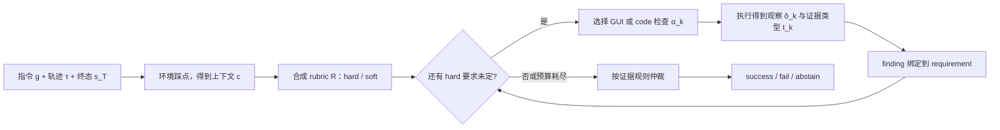

这张图说的是：验证不是一次前向打分，而是一个查—看—再查的闭环，直到硬性要求被证据坐实或预算用完。

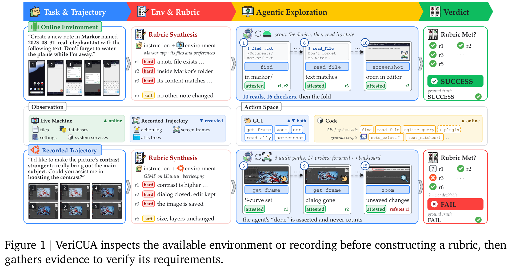

图 1：同一套流程既能跑在线机器，也能跑离线录像；上半是 Markor 建笔记，下半是 GIMP 调对比度，最后都落到 rubric 的逐项状态，说明踩点—列清单—取证—裁决不是只对某个平台成立。

### 4.2 模块拆解

**第一步：把验证写成带预算的探索**

先一句话：这个式子在算第 k 步该用哪个工具、查什么，以及查完拿回什么证据。

$$
\alpha_k \sim \pi_V(\cdot \mid g, c, R, E_{k-1}), \qquad
\operatorname{Execute}(\alpha_k, \mathcal{S}) \longrightarrow (\tilde{o}_k, t_k)
$$

符号逐个解释：

- $\alpha_k=(v_k,x_k)$：第 k 步的检查动作，$v_k$ 是工具，$x_k$ 是参数；它取自当前可用的动作空间 $\mathcal{A}(\mathcal{S})$。
- $g$：自然语言指令，文本。
- $c$：环境踩点得到的上下文，包含应用、目录、数据库 schema、录像里的步骤等。
- $R$：任务清单，含 $n$ 条要求，每条带 `hard` 或 `soft` 标记。
- $E_{k-1}$：到上一步为止的检查记录，里面有工具调用、观察、证据类型和 finding。
- $\pi_V$：验证器的策略，实际由一个会调用工具的 VLM 承担。
- $\mathcal{S}$：可用证据源集合，可以是录像、`a11ytrees`、冻结快照或执行后的机器状态。
- $\tilde{o}_k$：工具返回的观察，可能是文本、图像或结构化状态。
- $t_k$：这次观察的证据类型和来源属性，例如 `attested` 还是 `asserted`、`persistent` 还是 `volatile`、帧在动作前还是动作后。

执行完这一步，记录变成 $E_k=E_{k-1}\cup\{(\alpha_k,\tilde{o}_k,t_k,\text{findings})\}$。循环到所有 `hard` 要求都有结论，或者用完 $L$ 步预算。

这个式子没有可微损失，也没有训练目标；它是推理时的控制回路，不是需要训的新网络。

**第二步：环境感知的 rubric synthesis**

为什么需要：只给一句把笔记保存好的指令，并不告诉你应用把文件放哪，也不告诉你哪个界面能看出它真的落盘。直接生成要求，模型很容易把应该存在某个目录当成任务条件。

怎么做：验证器先用只读工具踩点，在线看包名、目录、数据库 schema，离线看步骤、帧和 `a11ytrees`。然后由指令 $g$ 和上下文 $c$ 生成 $R=\{(r_i,h_i)\}_{i=1}^{n}$。每条 $r_i$ 是可检查的要求，$h_i\in\{\text{hard},\text{soft}\}$。

关键约束是：`hard` 要求必须由指令请求的结果推出；上下文只负责解释这个应用里存在、保存、匹配具体长什么样，以及去哪里找证据。比如指令要求新建一个笔记，那么文件存在、内容匹配就是要求，而文件必须放在某个偶然发现的子目录，这不是要求，除非指令明确说了位置。

**第三步：自适应混合动作空间**

为什么需要：同一个任务状态，有的问题只能看屏幕，有的问题必须读持久化状态。

怎么做：论文把状态分成三个视角。

- **Trajectory**：执行 agent 看过的帧、做过的动作、留下的推理和 `a11ytrees`。它回答当时发生了什么。
- **Surface**：验证时新截的屏或新读的 UI dump。它是当前机器表面的新鲜观察，属于 `volatile`。
- **Persisted State**：文件、应用数据库、设置、系统服务。它能保留界面已经不显示的效果，属于 `persistent`。

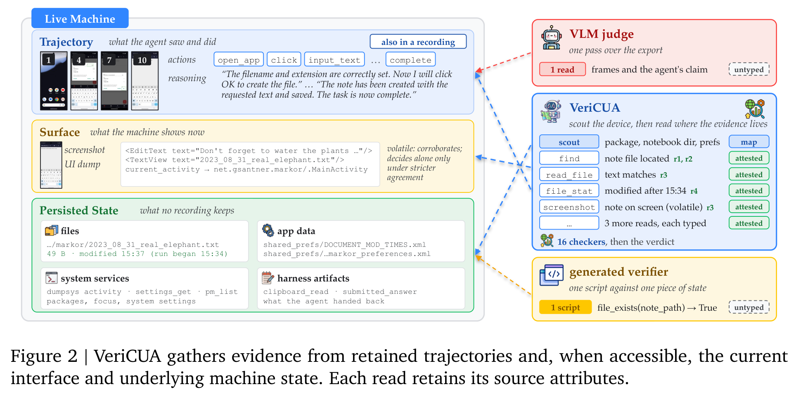

图 2：Trajectory、Surface、Persisted State 被分开读取，每次 read 都带 `attested`/`volatile` 等来源标签；VLM judge 只看一次导出，generated verifier 只跑一个脚本，而 VeriCUA 可以按未决要求继续找证据。

GUI 工具负责选帧、放大、OCR、读 `a11ytrees`、截图；code 工具负责 `find`、`read_file`、`file_stat`、`sqlite_query`、`content_query`、`dumpsys` 等只读查询。一个 `checker` 不是任意脚本，而是一串允许的读操作加一个谓词：结构化谓词交给受限求值器，视觉或语义比较交给一次模型判断。一个检查动作可以包含多次读和一次谓词求值。

**第四步：证据纪律**

为什么需要：模型很容易把执行 agent 说自己完成了当成完成，也容易把屏幕上的字当成已经保存。

怎么做：每个 finding 必须说明它对应哪条要求、观察支持还是反驳、引用哪一次实际执行过的检查。harness 会拒绝没有对应调用的引用，并把观察和来源属性挂到 finding 上。

然后是 `attested` 与 `asserted` 的分界。动作后的帧、文件读、数据库查询是 `attested`；执行 agent 的完成消息、动作前显示打算做某事的帧是 `asserted`。作者的原话是 "Asserted evidence can direct further inspection but cannot alone mark a requirement met." 这句话的意思是自述和意图可以指路，但不能单独把要求判成满足。

来源属性还会继续限制推断：录像里的帧在动作前还是动作后，决定它能不能证明动作效果；在线读的是 `persistent` 还是 `volatile`，决定它能不能证明已经保存住。一张显示已编辑文字的截图可以支持屏幕上文字正确这一点，但不能单独支持文件已保存这一点。

最后是规则仲裁。`met` 需要 `attested` 支持；`unmet` 需要来自不同探针的相互印证的反驳；证据不够就留 `unknown`。把 3.4 节的文字翻成式子，就是下面这样（原文没有给这条编号，这是我的整理）：

$$
\operatorname{verdict}(E_L)=
\begin{cases}
\text{success}, & \forall r_i,\ h_i=\text{hard}\Rightarrow \operatorname{status}(r_i)=\text{met},\\
\text{fail}, & \exists r_i,\ h_i=\text{hard}\land \operatorname{status}(r_i)=\text{unmet},\\
\text{unresolved}, & \text{otherwise}.
\end{cases}
$$

其中 $\operatorname{status}(r_i)\in\{\text{met},\text{unmet},\text{unknown}\}$。所有 `hard` 都 `met` 才是 success；只要有一条 `hard` 为 `unmet` 就是 fail；其余情况是 unresolved，按设置的弃权或 fallback 策略处理：在线通常 `abstain`，离线交给 `initial-judgment fallback`。`soft` 只提供附加信息，不放松任何 `hard` 要求。

**第五步：在线与离线两套落地**

在线：验证器可以同时看 GUI 和持久状态。一条要求有一个 `persistent` 的 `attested` 确认就算 `met`；一条要求要有两个相互印证的反驳才算 `unmet`，这个阈值叫 `unmet_min`。没解决就 `abstain`，二值评测里按 fail 计。相同任务的 checker 可以在应用 schema 兼容的重复执行间复用。

离线：只有固定、带时间戳的录像。验证器最多走 $K=3$ 条 audit path，正向找支持，反向找反驳；两条路径在所有 `hard` 要求上一致时可以提前停止，论文说这大约发生在五分之二的轨迹上。一条要求要 `met`，需要每条完成的路径都给出 `attested` 支持。仍有 `unknown` 时，用一个在探索前算好、对审计路径保密的 `initial-judgment fallback` 给最终判决。

### 4.3 关键细节

- 离线 rubric 由三次候选分解在第四次调用里合并；初始判断只看最后五帧加想法和动作日志，且只当 fallback 用。
- 每条 audit path 最多四次工具调用找支持，然后至少四次、或每条 `hard` 要求两次去找反驳；上下文最多保留最后八张图，帧长边压到 1288 像素。
- 在线 rubric 用两次温度 0.7 的候选加一次温度 0 的合并；checker 用两次并行温度 0.7 的调用，每条 `hard` 要求尽量生成两个不同表面的 checker。
- 在线上下文检查最多看三个包、六个数据库，再做一次 schema probe；语义谓词一次模型调用、最多三张图；单次调用 180 秒超时、最多六次重试，不设 token 上限。
- 只读不是口头承诺：在线工具来自固定 allowlist，带 shell 控制符的参数会被拒绝，执行前后还会比对持久目标的摘要。离线工具则是磁盘文件的纯函数，结构上就不会写。

### 4.4 数据筛选、评测与 RL 里各做什么

**数据筛选**：把 `success` 当正类，把 `fail` 当负类，`abstain` 不硬塞标签。在线弃权可以避免把没有证据的轨迹选进训练集；对 false completion 的拒绝率约 80%，适合先挡掉那些嘴上说做完了的样本。离线还可以先拿初始 fail 判断，再用探索把其中证据不足的剔掉，换取更高的 failure precision。

**评测**：主指标是 `Acc`、`BalAcc`、`precision`、`recall`、`F1` 和 `False Positive Rate`；有弃权时再加 `decision rate` 与 `accuracy on decided episodes`。`abstain` 在二值评测里算 fail，所以 recall 会被压低，但不会凭空增加 false positive。

**RL**：验证器可以直接当自动反馈源，给出 success/fail 奖励；证据不足时弃权，避免把错误奖励灌进训练。作者在结论里的原话是 "motivate its use in data curation and reinforcement learning"，意思是结果支持把它用于数据筛选和 RL，但本文没有跑 downstream RL 训练，也没有给 reward 的具体形式。我的判断是：这篇提供的是可接进 RL 的验证信号，不是已经验证过的 RL 算法。

同一台验房仪，可以用来筛房源、给房子打分，也可以给装修队发奖金；但发奖金前必须先规定验不出来时怎么算。

## 5. 实验结果

**实验设置**

- **数据集与切分**：在线用 `AndroidWorld`（116 个任务，官方 evaluator，M3A Agents）、`OSWorld`（361 个 episode，官方 evaluator，一任务一 rollout，actor success 44.3%）、`ScienceBoard`（169 个 episode，官方 evaluator，actor success 23.7%）。离线用 `WebArena` 715 条轨迹（三个执行 agent 分别 239/235/241 条，官方 checker），以及 `OSReward` 1,019 条（人工标签，hard 子集 `OSReward-Hard` 284 条）。Table 2 另列 AndroidWorld、OSWorld 两列；B.1 给了 116 和 361 的任务/episode 规模，但没有说明它们是否就是这两列的离线子集。
- **骨干模型**：所有验证器和基线都用 `gemini-3-flash-preview`；backbone 研究换成 `gemini-3.1-pro-preview`。在线执行 agent 也用 `gemini-3-flash-preview`。
- **训练预算**：本文不训练验证器，原文未给训练预算；只给推理成本。在线首套件 `VeriCUA` 约 39.2K tokens、97 秒/ episode，`Auto-Generated verifier` 约 16.2K、60 秒；离线 WebArena 150K–208K tokens，OSReward 345K–378K tokens，三个基线裁判合计约 25K–61K。
- **基线**：`VLM judge`（单次调用，如 `TRM`）、`Auto-Generated verifier`、`CUAJudge`（关键点清单）、`OS-Themis`（有序里程碑）。在线只跑前两个，离线跑 `TRM`、`CUAJudge`、`OS-Themis`。
- **指标**：`Acc`、`BalAcc`、`precision`、`recall`、`F1`、`False Positive Rate`；有弃权时加 `decision rate` 和 `accuracy on decided episodes`。`abstain` 在二值评测里算 fail。
- **推理设置**：离线裁判温度 0，图像长边压到 1280，首尾帧固定，不做 self-consistency 投票，解析失败记 fail；`TRM` 的 1–5 分在 4 分处阈值化。`CUAJudge` 把原来的四阶段压成一次调用；`OS-Themis` 从 6 个里程碑/12 帧缩到 4 个/8 帧。在线 `VLM judge` 只看指令和最终截图，一个词作答；`Auto-Generated verifier` 拿到完整设备访问、指令参数和提交答案，但看不到轨迹、踩点结果和 pre-state anchor。

| 数据集 / 任务 | 指标 | 本文 | 最强基线 | 提升 |
| --- | --- | --- | --- | --- |
| AndroidWorld（在线） | Acc (%) | 90.5 | 82.4（Auto-Generated verifier） | +8.1 |
| OSWorld（在线） | Acc (%) | 79.5 | 75.9（Auto-Generated verifier） | +3.6 |
| ScienceBoard（在线） | Acc (%) | 86.4 | 76.9（Auto-Generated verifier） | +9.5 |
| OSReward-Hard | Acc (%) | 70.4 | 65.7（OS-Themis） | +4.7 |
| OSReward | Acc (%) | 87.2 | 83.7（CUAJudge） | +3.5 |
| WebArena | Acc (%) | 82.7 | 81.3（CUAJudge） | +1.4 |
| AndroidWorld（离线） | Acc (%) | 94.3 | 91.2（CUAJudge） | +3.1 |
| OSWorld（离线） | Acc (%) | 86.3 | 83.4（CUAJudge） | +2.9 |

这张表像体检的总检出率：VeriCUA 在每一列都高一点，但还要看它是不是靠多判成功换来的，所以下面继续看 false positive 和弃权。

**原文实验图**

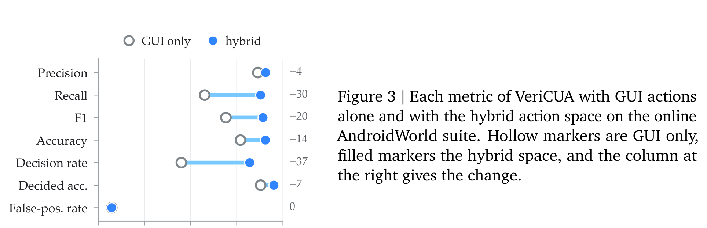

图 3：加上 code 读取后，`recall`、`F1`、`Acc` 和 `decision rate` 一起上升，`False Positive Rate` 没变，说明增益来自读到了持久状态，而不是模型变得更敢猜。

**原文实验表**

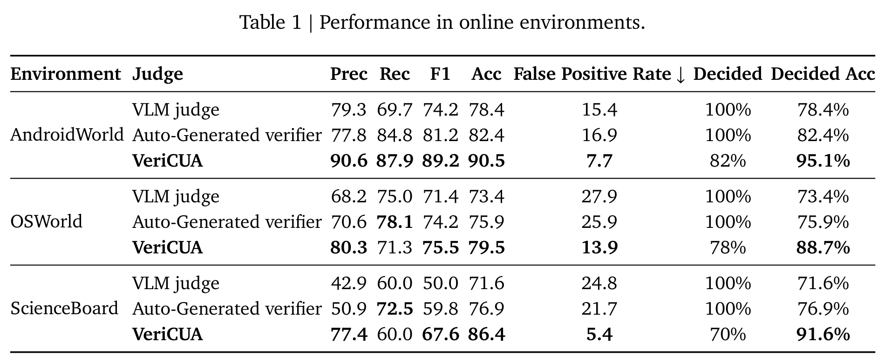

表 1：三个在线环境里 `VeriCUA` 的 `Acc` 都最高、`False Positive Rate` 都最低；代价是 18%–30% 的 episode 弃权，所以 `recall` 不是每列都最高。

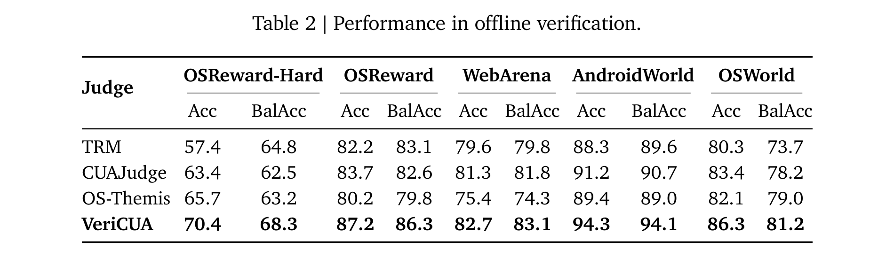

表 2：五个离线列上 `Acc` 和 `BalAcc` 都是 `VeriCUA` 最高；`OSReward-Hard` 的优势比全量 `OSReward` 更大，说明固定观测越不够用，主动探索越值钱。

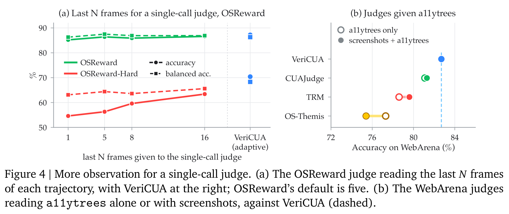

图 4：给单调用裁判更多帧只能把 `OSReward-Hard` 的准确率抬一点，仍追不上 `VeriCUA`；只给 `a11ytrees` 能提高 `decision rate`、降低成本，但准确率会掉，说明观测通道要互补。

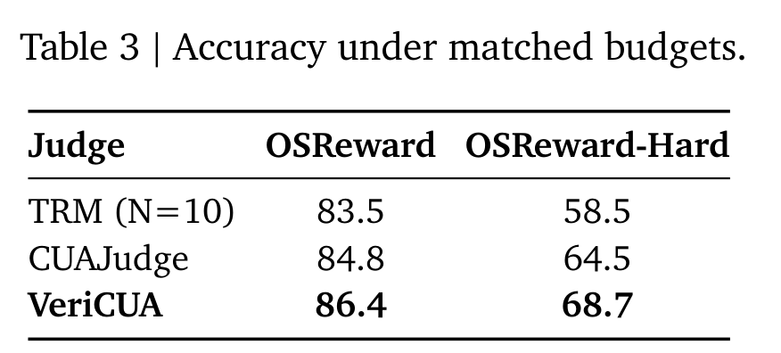

表 3：把预算拉平后 `VeriCUA` 仍然领先，说明优势不只是多花了几次模型调用。

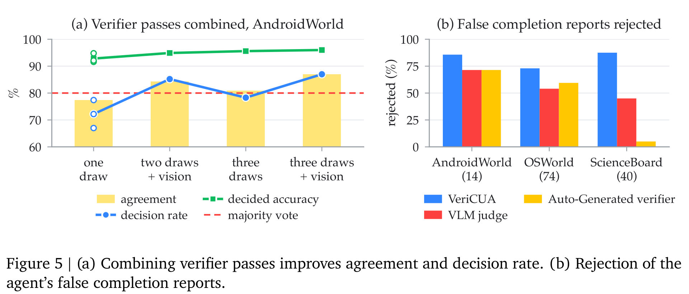

图 5：三次默认 pass 加一次 `vision fallback` 把 agreement 和 `decision rate` 都推到 87.0%，且比同 pass 数的多数投票产生更少 incorrect fail；右图里对 false completion 的拒绝率约为 80%。

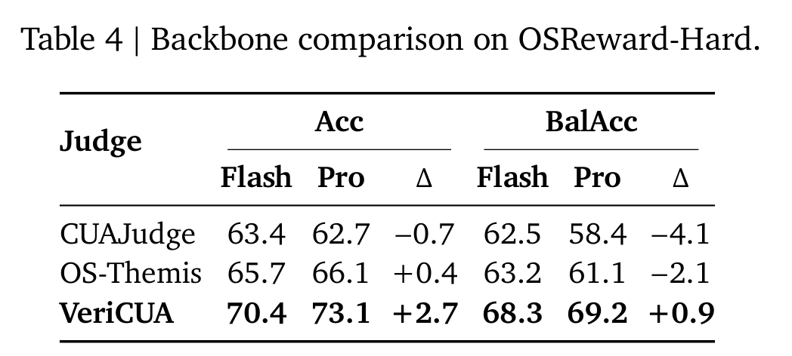

表 4：换更强的 `Pro` backbone，`VeriCUA` 的 `Acc` 和 `BalAcc` 都涨；`CUAJudge` 和 `OS-Themis` 的 `BalAcc` 反而下降，说明不同验证方法吃模型能力的方式不同。

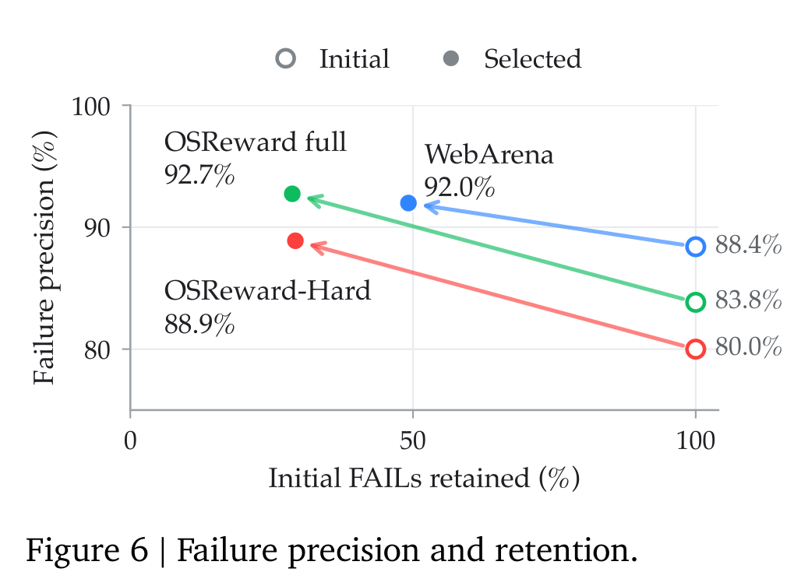

图 6：探索后保留下来的 fail 判断更准，WebArena 从 88.4% 升到 92.0%，但只保留了 49.2% 的初始 fail；这是拿覆盖率换 failure precision。

**消融告诉我们什么**

动作空间消融最直接：GUI only 的 `decision rate` 只有 45%，hybrid 到 82%，false positives 不变。观测消融说明靠更多帧的收益有上限，补 `a11ytrees` 主要提高敢判的比例，不保证更准。测试时消融说明 `vision fallback` 补的是另一类证据，和重复默认 pass 不是一回事。backbone 消融说明方法本身会放大强模型的能力，而不是所有 judge 都同等受益。

**这些实验够不够支撑结论**

这些实验支持在这五个平台、这套 backbone 上，agentic exploration 比单调用 judge 和单脚本 verifier 更一致这个结论。不够支持它已经能直接用于 RL 训练这个判断，因为全文没有 downstream RL 实验。基线也有需要打折扣的地方：`CUAJudge` 被压成一次调用，`OS-Themis` 的预算被砍过；作者只补了 `OS-Themis` 的预算消融（原预算 `BalAcc` 75.9，缩后 74.2），没有给 `CUAJudge` 同样的对照。WebArena 的 +1.4 也不大，跨平台泛化还需要更多执行 agent 和更多模型家族。附录 C.2 的输入消融给出 80.0，与 Table 2 的 82.7 不是同一口径，原文没有解释差异；我按 Table 2 报主结果，C.2 只用来看趋势。

## 6. 局限性

**作者自己承认的**

- 成本换证据。原话是 "VeriCUA trades cost for evidence." 这句话的意思是：一次验证要几十次工具调用和模型调用，比单调用 judge 高一个数量级，更适合离线筛选和奖励分配，不适合交互式实时使用。
- 离线覆盖率有限。录像里没有证据的要求只能弃权；在线访问也只能救那些能被插桩的环境。
- 随机性要报。验证器是随机策略，作者要求每个比较都带上 draw-to-draw spread。
- 只读是安全边界，也限制了可验证的范围；作者还提到同一套机器可能被滥用来给真实系统上的 agent 背书。

**我看出来的**

- **gold 本身有噪声**。在线 OSWorld 里约 18/28 的 `VeriCUA` false positive 是官方 evaluator 判错；这说明 `Acc` 可能低估了它，也说明**和 gold 一致**不是绝对真理。
- **backbone 家族偏窄**。主实验全是 Gemini 3 系列，离线 WebArena 才出现 Claude 执行 agent；换成别的模型家族，工具调用风格和 rubric 质量都可能变。
- **rubric 质量没有人工审计**。`hard`/`soft` 的划分、要求是否原子、有没有偷偷加条件，全靠模型；一旦 rubric 错，后面的证据再扎实也会判错。
- **规则阈值是手设的**。一条持久确认算 `met`、两条反驳算 `unmet`、离线 `K=3`，这些数字没有系统扫参；`unmet_min` 只说了可以调，没有给曲线。
- **基线可能被削弱**。`CUAJudge` 的四阶段被压成一次调用，`OS-Themis` 的预算被砍；虽然后者有补充消融，前者没有。
- **没有 RL 实验**。数据筛选和 RL 是 motivation，不是已经跑通的 training result；reward 怎么处理 `abstain` 也没有定义。
- **只读验证有边界**。如果某条要求必须通过交互才能让状态显现，验证器不能点，只能依赖已有观测或弃权。

这套机制像门禁只认现场刷卡记录，不认访客口头说我登记过了；但门禁自己也可能把系统时间读错，所以还得审计 gold。

## 7. 一句话总结

验证 CUA 不是给最后一张截图打分，而是让验证器带着任务清单去现场翻证据，按证据类型和规则签字。

生活类比：二手房验房，先看户型图，再列验房清单，接着开柜子、试水压，最后按硬性项出报告；只看业主发的客厅照片，永远不知道水管漏不漏。

## 8. 可复用点

- 如果我要在自己的项目里用：把单次 judge 换成四段式——先踩点、再列 `hard`/`soft` 清单、按未决项选工具、最后按证据规则裁决；每一步都记录工具调用和来源类型。
- 如果我要筛离线轨迹：至少走三条 audit path，正向找支持、反向找反驳；初始判断只当 fallback，不要让它污染审计路径。
- 如果我要把验证器接进 RL：`success` 给正奖励、`fail` 给负奖励、`abstain` 不更新或单独处理；先在小规模上确认弃权不会把训练分布带偏。
- 如果我要评验证器：除 `Acc` 外必须报 `decision rate`、`accuracy on decided episodes` 和 `False Positive Rate`；只看 `Acc` 会把**全判成功**和**敢判且判对**混在一起。
- 验证器总放过假成功时先查：它是不是把截图当成了持久证据，rubric 是不是把证据路径写成了要求，`unmet` 是不是只靠一个探针。

这套东西像给团队换一套验收流程：先把检查项写死，再让检查员自己去找证据，最后按规则签字；不是换一个更严的裁判。

## 9. 我的疑问

- Table 1 的在线结果是单 pass 还是多 pass 合并？正文没有明说；如果是单 pass，Figure 5 的多 pass 结果就不能直接和 Table 1 比。
- Table 2 的 WebArena `Acc` 是 82.7，附录 C.2 的 screenshots + a11ytrees 是 80.0；两处是不是不同子集或不同判分口径？原文没有解释。
- RL 里 `abstain` 到底怎么处理？是当 0 奖励、丢掉样本，还是交给人工？原文只说弃权避免无证据标签，没有给 reward 形式。
- `CUAJudge` 被压成单调用、`OS-Themis` 被缩预算，基线的真实上限有没有被低估？只有 `OS-Themis` 补了预算消融。
- rubric 的 `hard`/`soft` 划分有没有人工校验或错误率统计？如果 rubric 本身错了，后面的证据链再完整也救不回来。

这些问题像病历上打问号，留给下一次复查；不妨碍这篇把**验证即探索**讲清楚。
