> 一句话：把技能里能说清、能检查的步骤编成程序，只把模糊判断留给模型。

原文依据：联网下载的 12 页原始 PDF，完整阅读 SkillCompiler 方法、五项 benchmark、六个 model family、repeated-execution、cost、program reuse、ablation 与 Limitations。Figure 1–2、Table I–VIII 全部手工裁出并检查；表中百分数按作者定义分别解释，不把路径一致性当任务成功率。

## 0. 读之前你需要知道

**术语卡**

- **agent skill**：从过去 interaction 中提炼的可复用流程知识，通常是一段自然语言文档。像维修手册，告诉 agent 先查什么、再做什么。
- **self-evolving skill**：agent 根据成功/失败 trajectory 持续修订技能，不更新底层模型参数。
- **programmatic compilation**：把输入、步骤、输出和检查方式都明确的 operation 写成可执行程序，而非每次让 LLM 重新推理生成动作。
- **operation contract**：一项局部操作的接口说明，包括输入、输出、前置条件、预期效果、验证器与执行指导。
- **hybrid skill skeleton**：同一技能中既有程序节点，也有保留给 LLM 的 agent-guided 节点，并显式记录顺序、依赖和参数绑定。
- **program asset bank**：持久保存已验证程序，后续 skill 先检索兼容实现，找不到才重新合成。

**它站在谁肩上**：Trace2Skill、EmbodiSkill、SkillOpt 主要演化 textual skill；Workflow Memory、FlowEvo、Voyager 等复用 workflow 或 executable skill。SkillCompiler 的差异在于先做 operation-level executability analysis，再把已验证 program 作为跨 skill 资产持续积累。

## 1. 动机

公司已经写好一份报销流程，但员工每次仍要让一位临时助理读手册、重新理解“下载表格、核对金额、提交系统”。即使手册不变，助理的中间判断仍可能不同；同一个确定步骤被反复“现想”，既浪费 token，也引入执行波动。

**以前怎么做**：把成功经验压成自然语言 skill，下一次继续由 LLM 解读执行；或者为单一任务生成 workflow/tool。**为什么不够**：文本 skill 保留知识，却没有消除每次解释和动作生成的不确定性；不同 skill 还会重复合成相同程序。

**为什么现在能做**：许多局部 operation 已有明确输入、工具接口、前置条件和可检查效果。作者把整个 skill 拆成 operation contract，只编译可验证部分；上下文判断和开放语义仍交给 LLM，避免“把整项任务硬编码”丢失灵活性。

## 2. 贡献

- **提出 SkillCompiler**：把 executability-aware compilation、program asset reuse 和 trace-based skill optimization 放进同一 self-evolving loop。
- **定义 hybrid skill skeleton**：程序节点与 agent-guided 节点共享一张依赖图，明确 data/prerequisite edges 与 runtime bindings。
- **建立 persistent program asset bank**：复用前同时检查 binding、precondition、environment interface 和 validation certificate，不只按文本相似度调用代码。
- **用 repeated execution 测不确定性**：同一 skill、同一输入与环境运行 3 次，报告 EIR@3、APS@3、EPR@3，而非只报一次成功率。
- **覆盖五 benchmark、六模型家族**：四项 QA/数学 benchmark 的平均分在六个模型上均最高，ALFWorld success rate 达 98.26%。

像把手册改造成“自动脚本 + 人工判断”的混合 SOP，论文的中心不是所有步骤都程序化，而是选择性地移除重复、可验证的推理。

## 3. 创新点

**第一，以 operation contract 判断可编译性。** 不是“看起来像代码”就编译，而是要求输入输出可表示、procedure 可明确、precondition 可观察、effect 可独立检查、工具接口能有界实现。像生产线只有检测点齐全的工序才能自动化。

**第二，程序复用受契约约束。** lexical similarity 只用于找候选，真正调用还要通过 Bind、Pre、Env、Cert。它避免名称相似但参数、环境或验证范围不同的程序被误用。

**第三，失败只局部修订。** 若某 operation 输出和 check 都通过，即使最终任务失败也保留它；只修 precondition、binding/dependency、guidance 或对应 program。相比整份 skill 重写，这更像单元测试定位到具体模块。

**第四，确定性只下沉到有证据的局部边界。** SkillCompiler 并不把“程序执行”当作天然可靠，而是要求每个 programmatic operation 都能在 isolated environment 中验证 contract。程序是否可复用也不是永久属性，而是相对当前 task binding、precondition、environment interface 和 certificate 的判断。这个设计比“生成一次代码以后反复调用”更严格，像把工具从临时脚本升级成带版本和验收记录的内部服务。

**第五，把 skill evolution 与 program evolution 分开。** textual skeleton 可以因依赖、guidance 或 agent-guided decision 改变；program asset 则围绕局部 capability 合并和复用。两者分离使一项程序能服务多个 skill，也允许 skill 改写而不重新合成全部代码。代价是系统必须维护引用关系和兼容性，资产库越大，错误 certificate 或过期依赖的治理越重要。

## 4. 方法

### 4.1 整体流程

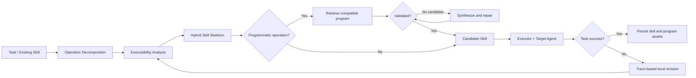

像把复杂工作拆成工序：能写成脚本且能验收的交给自动化，必须看现场的留给人，失败后只返修出问题的工序。

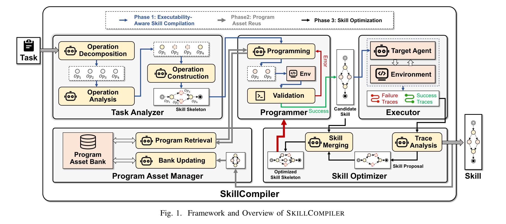

Figure 1：Task Analyzer、Programmer、Executor、Skill Optimizer 与 Program Asset Manager 形成闭环；程序资产与 skill skeleton 分开持久化，使同一 capability 能跨 skill 复用。

### 4.2 模块拆解

**Operation contract。** 每项 operation 表示为：

$$
\kappa_i=\langle I_i,O_i,pre_i,post_i,check_i,g_i\rangle.
$$

- $I_i,O_i$ 是所需输入和预期输出。
- $pre_i$ 是可观察前置条件，$post_i$ 是预期局部效果。
- $check_i$ 指定如何验证效果，$g_i$ 保存可复用执行指导。
- task-specific entity 在调用时绑定，因此 operation 可跨任务复用。

它像函数签名加单元测试：只写自然语言名称不够，必须知道何时可调、调完应发生什么、怎样判定成功。

**Hybrid skill skeleton。** 对任务 $x$，skill 表示为：

$$
S_x=\langle O_x,\sigma_x,E_x,\beta_x\rangle.
$$

- $O_x$ 是 operation occurrences，$\sigma_x$ 是执行顺序。
- $E_x$ 记录 data relations 与 prerequisite relations。
- $\beta_x$ 保存当前 argument bindings；构建时未知的值留到 runtime 由 observation 实例化。

**Program retrieval。** atomic skill 的候选 ranking 为：

$$
R(a,o)=\frac{2|T(o)\cap T(a)|}{|T(o)|+|T(a)|}+0.1u(a)+0.05\mathbf1[active(a)].
$$

词项 Dice similarity、historical utility 和 active status 只负责排序。真正 eligible set 为：

$$
P_{\mathrm{valid}}(a,x)=\{p\in P(a):Bind(p,x)\land Pre(p,x)\land Env(p,x)\land Cert(p,x)\}.
$$

如果没有唯一合格或 preferred implementation，选择仍留给 agent；没有兼容程序时才合成新 program。

**Program synthesis and validation。** 新程序在 isolated environment 中检查：能否运行、输入输出是否符合 contract、局部效果是否满足 $post_i$、$check_i$ 是否通过。失败证据回传 Programmer 进行 repair；始终无法验证的 operation 保留 agent-guided。

**Operation merging。** 两项 operation 只有 capability 相同且 contract fields 在参数对齐 $\pi$ 后兼容才合并：

$$
\operatorname{Mergeable}(\kappa_i,\kappa_j)=\operatorname{SameCap}(\kappa_i,\kappa_j)
\land\exists\pi:\bigwedge_{f\in\{I,O,pre,post,check\}}\operatorname{Compat}(\pi(f_i),f_j).
$$

这像把两个“下载文件”函数合并前，不只看名字，还要检查认证方式、参数、输出格式和成功判据。

### 4.3 关键细节

测试前选定 persistent skill state 并冻结；主性能与成本在 seeds 42、43、44 上平均。repeated-execution 与 ablation 使用 seed-42 skill state，每个 test task 在同输入、初始环境与 inference setting 下跑 3 次。底层模型参数不更新，演化对象是 skill/program assets。

## 5. 实验结果

像评估自动化流程，既要看任务完成率，也要看同一流程重复三次是否走同一路径，以及写脚本的前期成本能否被后续复用摊销。

**实验设置六项**

- **数据集与切分**：SearchQA 300/24/1400，OfficeQA 120/24/102，DocVQA 180/22/201，LiveMath 60/17/100，ALFWorld 120/24/134，分别为 train/val/test。
- **骨干模型**：MiniMax-M3、Gemini-3.8-Flash、Qwen3.8-Flash、DeepSeek-V4.1-Flash、Kimi-K2.6、GLM-5.3-Flash。
- **训练预算**：不更新模型权重；skill evolution 的轮数、每轮最大 repair 次数和具体 inference temperature 原文未在主文统一给出。成本按 learning tokens、test tokens/task、calls/task 报告。
- **基线**：No Skill、Human Skill、Trace2Skill、EvoSkill、EmbodiSkill、GEPA、SkillOpt。
- **指标**：QA/数学用 EM 或 benchmark-specific score，ALFWorld 用 SR；重复执行用 EIR@3、APS@3、APSsuccess@3、EPR@3；内部复用用 PPC、CPO、CSR、PIS、PAS。
- **推理设置**：同一 model-benchmark configuration 下工具、evaluator 与 inference setting 相同；测试 skill state 冻结。动态 web environment 未评测。

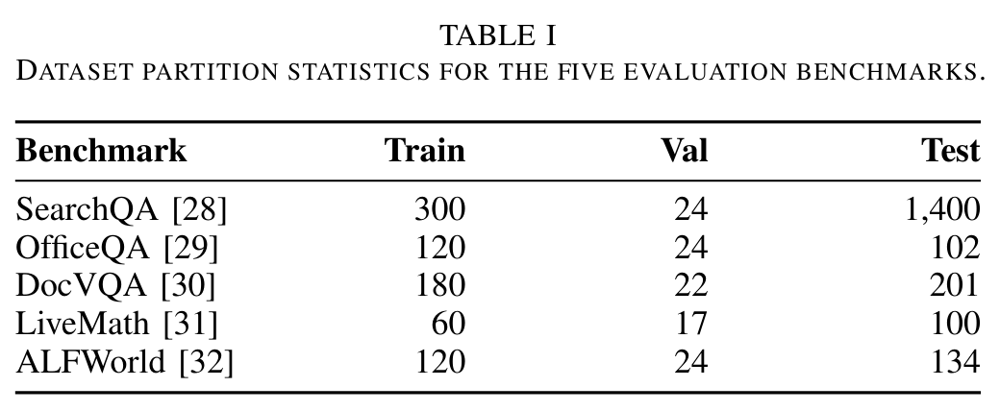

Table I：五项 benchmark 的训练数据都很小，尤其 LiveMath 仅 60 train、17 val；结果主要检验从有限任务中演化 skill 后的 test reuse，而非大规模 supervised training。

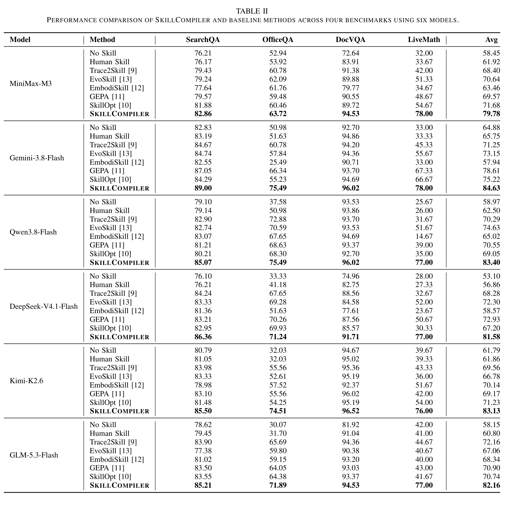

Table II：SkillCompiler 在六个模型的四项平均分均最高，范围 79.78–84.63；相对每个模型最强 baseline 的 average 提升为 6.02–11.90 points。提升集中在 OfficeQA 与 LiveMath，SearchQA/DocVQA 较小。

以 Kimi-K2.6 为例，SearchQA 85.50、OfficeQA 74.51、DocVQA 96.52、LiveMath 76.00；相对各列最强 baseline 分别 +1.52、+16.99、+0.50、+22.00 points。说明可编译 operation 的密度比 benchmark 名称本身更可能决定收益。

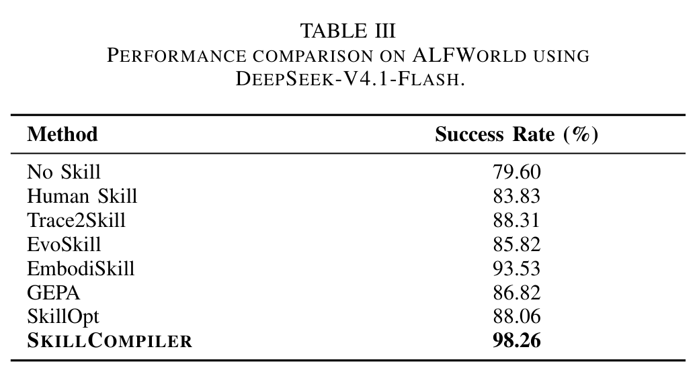

Table III：DeepSeek-V4.1-Flash 在 ALFWorld 上 SR 98.26%，高于最强 baseline EmbodiSkill 的 93.53%，差 4.73 pp；这里是长程环境成功率，不等同 OfficeQA/LiveMath 的 EM。

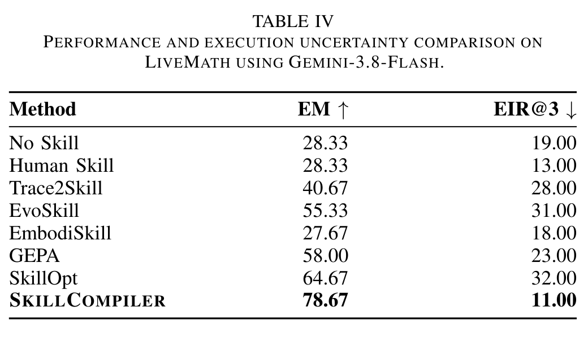

Table IV：Gemini-3.8-Flash 在 LiveMath 上 EM 78.67、EIR@3 11.00；SkillOpt 为 64.67、32.00。方法同时提高正确性并降低三次重复运行的 outcome reversal，而非只让路径固定但答案仍错。

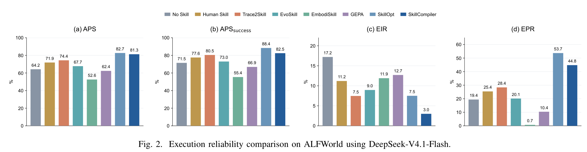

Figure 2：ALFWorld 上 SkillCompiler 的 APS 81.3、APSsuccess 82.5、EIR 3.0、EPR 44.8。EPR 并非最高，说明稳定不要求三次 action path 完全相同；只要路径高度相似且结果稳定即可。

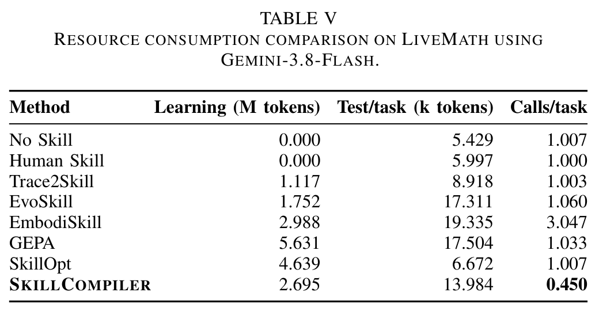

Table V：LiveMath learning cost 2.695M tokens，低于 SkillOpt 4.639M 和 GEPA 5.631M；但 test tokens/task 13.984k 高于 SkillOpt 6.672k。论文的“节省”不是所有成本维度都最低。

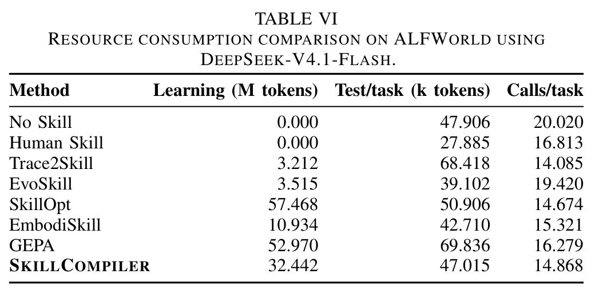

Table VI：ALFWorld learning 32.442M、test 47.015k、calls 14.868；比 SkillOpt/GEPA 的 token 成本低，但 No Skill 仍为 0 learning cost、20.020 calls。提高 SR 需要预先演化和验证资产。

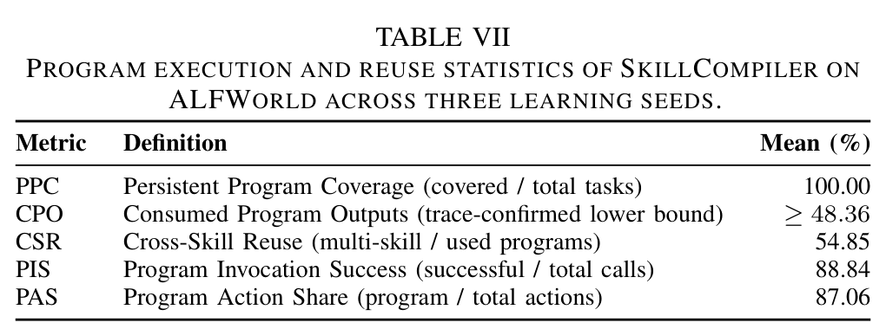

Table VII：PPC 100%、CPO 至少 48.36%、CSR 54.85%、PIS 88.84%、PAS 87.06%。program output 的消费只给 trace-confirmed lower bound，不能把未被日志确认的部分当成未使用。

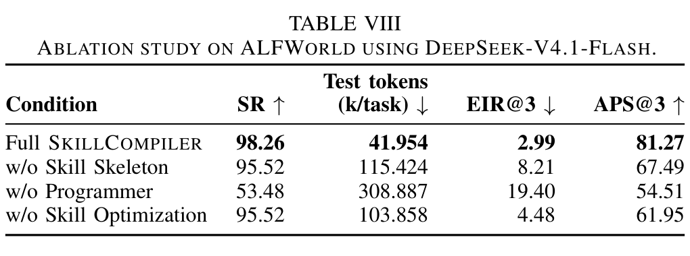

Table VIII：移除 Programmer 时 SR 降到 53.48%、test tokens 升到 308.887k、EIR 19.40，退化最大；移除 skeleton 或 optimizer 时 SR 都为 95.52，但 token 成本分别是 full method 的 2.75 倍和 2.48 倍，说明主性能与效率由不同组件贡献。

**消融告诉我们什么**：Programmer 决定是否真正把确定 operation 从 LLM reasoning 移走；Skill Skeleton 管理依赖与 invocation；Skill Optimization 通过失败 trace 让复用逐步变得准确。三者不是可互换模块。

这组结果还说明三个评价维度不能互相代替。SR/EM 回答“最后做成没有”；EIR/APS/EPR 回答“重复运行是否稳定、路径是否相似”；token/call cost 回答“得到这份能力花了多少资源”。例如 SkillCompiler 在 LiveMath 的 test tokens 高于 SkillOpt，却有更高 EM 和更低 EIR；在 ALFWorld 的 EPR 不是最高，但 SR 最高、EIR 最低。像自动驾驶系统，路线完全重复不是目标，安全到达且波动受控才是目标。

Table VII 的 program statistics 只能证明程序机制确实被大量使用，不能单独证明使用导致性能提升。PPC 100% 表示测试任务被 program asset 覆盖，PAS 87.06% 表示动作多数来自程序，PIS 88.84% 表示调用层多数成功；真正的因果证据仍来自 Table VIII 中移除 Programmer 后的性能和成本退化。内部使用率与外部任务结果必须联合阅读。

资源账也需要分摊视角。No Skill 没有 learning tokens，但每次任务继续大量调用模型；SkillCompiler 先花 token 合成、验证和优化资产，再期待在重复任务中摊销。论文只在固定 test set 上统计，没有给出达到 break-even 需要多少未来调用。若 operation 只出现一次，program asset reuse 的经济性可能不成立。

**这些实验够不够支撑结论**：能支持受控 benchmark 中选择性编译提高平均性能、重复执行稳定性和若干成本指标。不能支持开放 web 上的长期安全运行：local validation 只覆盖 tested inputs/states，contract drift、权限、外部 API 变化和副作用都未系统评测。

## 6. 局限性

**作者自己承认的**：依赖可识别 operation boundary、可观察 precondition、可独立检查 effect；ambiguous/context-dependent decision 仍由 LLM 处理；local validation 不保证 unseen condition；program reuse 只有在 contract compatible 且复用频次足够时才能摊销成本；主要评测是受控环境。

**我的判断**：operation contract 是系统的信任根。Task Analyzer 若把一个需要语义判断的步骤误标为 programmatic，后续 validation 可能只验证有限样例，程序却会在新状态中稳定地做错。确定性降低的是方差，不自动降低偏差。

Program Asset Bank 还会形成版本管理问题。环境 API、认证、网页结构或数据 schema 改变时，旧 Cert 可能失效；论文的 $Cert(p,x)$ 是逻辑条件，但没有给出 certificate 的过期、回滚与依赖追踪机制。

“跨 skill reuse”也可能把局部错误扩散到更多技能。共享资产越成功，blast radius 越大，因此真实部署需要 capability sandbox、权限最小化、版本 pinning 和持续回归测试。

**实验层面的不足**：benchmark 与模型均较新但受控；没有 dynamic web；主文未统一列 temperature/repair budget；部分内部指标是该框架自定义。这些留在正文，不写进 frontmatter 方法局限。

## 7. 一句话总结

**把能写成带单元测试函数的技能步骤编译掉，把真正需要现场判断的步骤留给模型。** 类比企业 SOP：自动化不是把整份流程变成脚本，而是让确定工序可复用、可验证、可回滚，人工只处理例外。

## 8. 可复用点

- 为 agent skill 的每个 operation 写六字段 contract：input、output、precondition、postcondition、checker、guidance；缺 checker 的步骤默认不自动编译。
- program retrieval 分两阶段：语义召回候选，契约与环境验证决定是否调用。不要把 embedding similarity 当安全兼容性。
- 失败 trace 先定位 operation，再决定改 precondition、binding、dependency、guidance 或 program；避免整份 skill 重写造成回归。
- 每个可执行资产保存版本、工具依赖、验证输入范围与 certificate timestamp；环境变化后主动失效，而非永久信任一次测试。

可跨任务复用的机制已抽为 [[../../../30 方法卡片/操作契约驱动的选择性编译]]。

## 9. 我的疑问

- Task Analyzer 的 executability 分类错误率是多少，误编译与漏编译各自成本如何？
- $Cert(p,x)$ 怎样随 API、schema 与权限变化自动过期？
- program asset 出现安全漏洞时，如何找到所有引用它的 skill 并原子回滚？
- dynamic web 中 postcondition 不完全可观测时，能否用 probabilistic checker 而不重新引入同样的不确定性？
- 跨模型复用 program asset 的收益来自程序本身，还是不同模型更容易遵循同一 hybrid skeleton？
