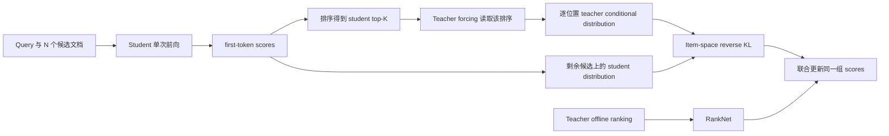
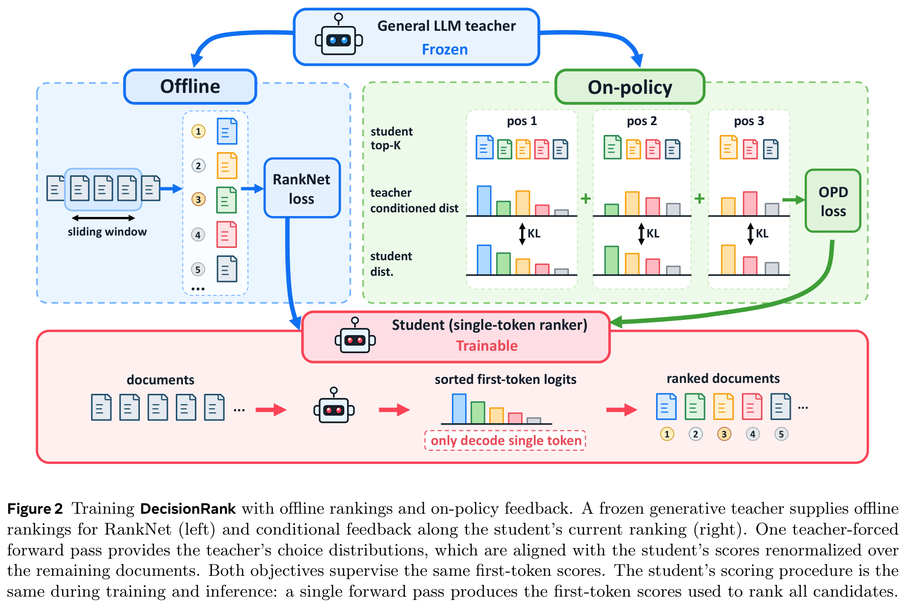
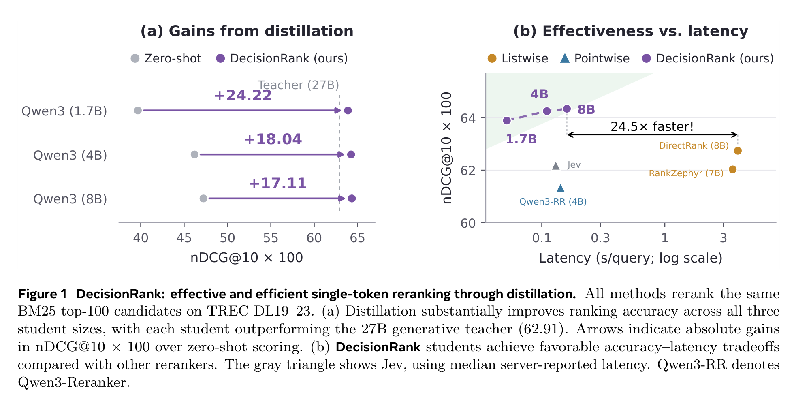
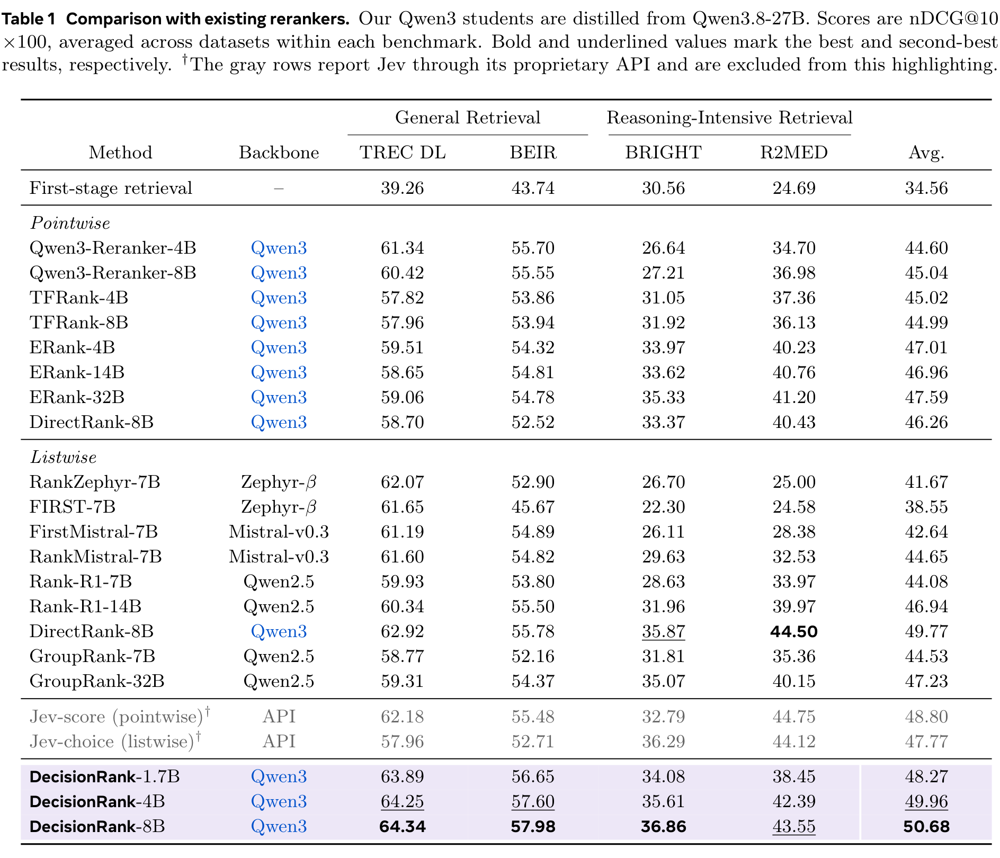
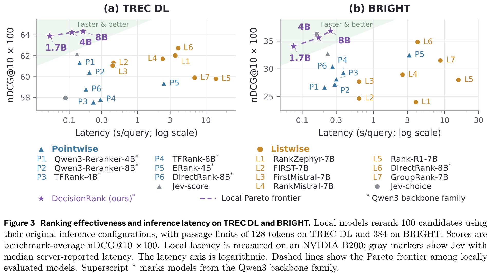
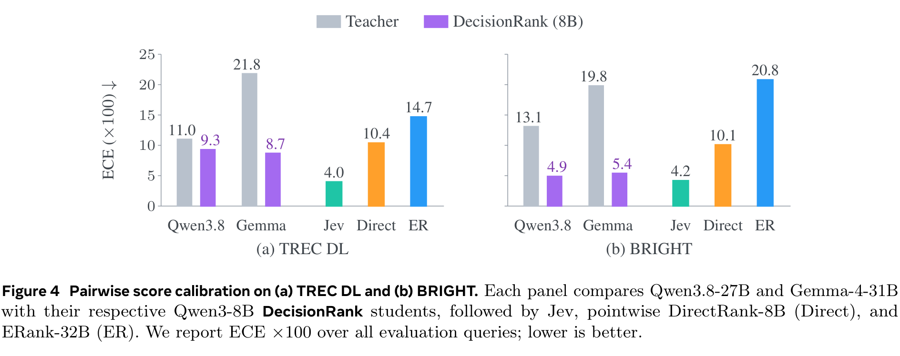
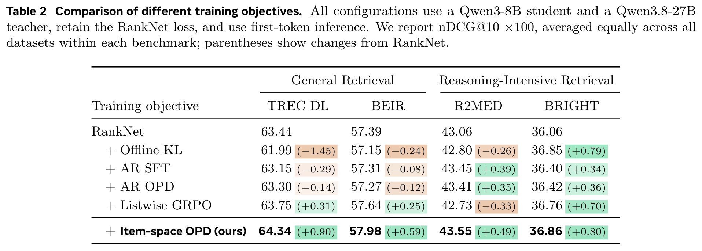
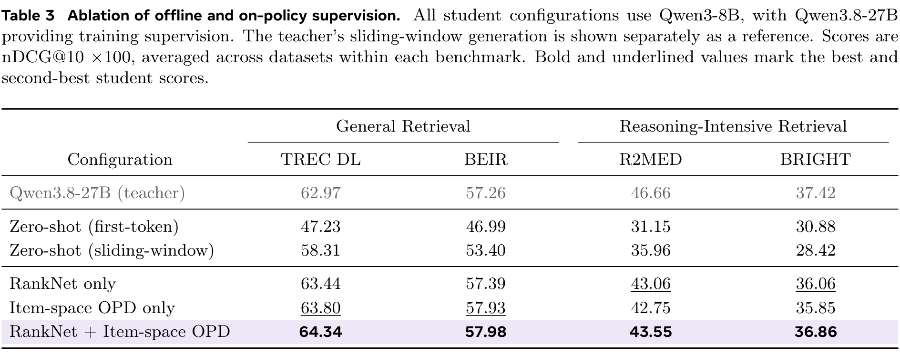
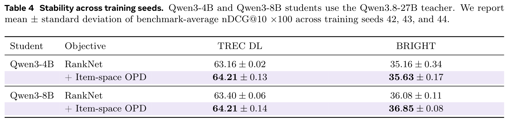
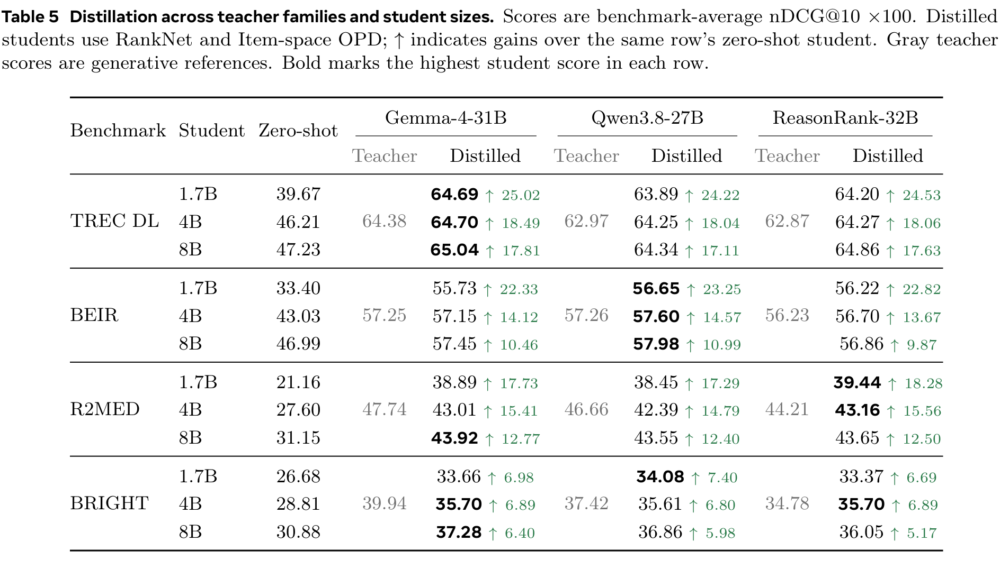

> 一句话：让学生先排一次，老师沿着这份排序逐步纠偏，部署时仍只算一次分数。

原文依据：联网下载的 25 页原始 PDF，完整阅读正文、训练与推理细节 Appendix A、完整结果 Appendix B、种子与校准 Appendix C。正文 4 张 Figure、5 张 Table 均从 PDF 裁出并逐张检查；附录图表用于核对，不把重复展开当作独立证据。

## 0. 读之前你需要知道

**术语卡**

- **document reranking**：检索器先找出一批候选文档，reranker 再把最相关的排到前面。像书店先把一百本可能相关的书搬上桌，再由店员重新排推荐顺序。
- **decision model**：不逐字生成答案，而是直接输出选项或分数。这里学生只读取第一个输出位置的 document-ID logits，排序后得到整张榜单。
- **listwise reranker**：一次考虑多篇文档的相对次序，常用自回归方式一个 ID 接一个 ID 地生成。它像主持人逐名宣布名次，信息丰富，但每宣布一名都要继续解码。
- **on-policy distillation（OPD）**：教师不是只批改预先保存的标准答案，而是针对学生当前会做出的选择给反馈。像教练看你今天实际走的路线，而不是反复播放去年的示范录像。
- **item-space alignment**：教师和学生的 token 编码可以不同，只要都能指向同一篇候选文档，就在文档身份这一层比较分布。
- **RankNet**：把教师排序拆成成对偏好，要求排在前面的文档分数高于后面的文档。像只问 A 应不应该排在 B 前面，再把大量二选一约束拼成整张榜单。

**它站在谁肩上**：RankGPT、RankZephyr 等方法证明生成式 LLM 能做 listwise ranking，但需要多步解码；FIRST、DirectRank 等方法尝试用 first-token score 降低延迟；GKD 一类 OPD 则让教师沿学生生成轨迹给条件分布。本文要解决的缺口是：学生部署时只使用一组静态 first-token scores，教师却擅长按序列逐步选择，二者怎样在不改变部署接口的情况下接起来。

## 1. 动机

想象给一百名选手排座次。老师会先选第一名，再在剩下的人里选第二名，前一次选择会改变下一次判断；学生却只有一张一次性打分表。若只让学生模仿老师第一次选谁，后面九十九步的条件偏好全丢了；若让学生也逐名生成，训练出来的能力又不再对应部署时使用的那张分数表。

**以前怎么做**：离线生成教师完整排序，再用 RankNet 或 SFT 训练；或者做 autoregressive OPD，让学生生成 ID 序列并逐位置对齐教师。**为什么不够**：固定排序不会随学生变化；序列训练监督的是生成过程，部署读取的却是 first-token logits，形成 training-inference mismatch。

**为什么现在能做**：学生的一次前向已经给出所有候选的分数。作者把这些分数排序成学生当前轨迹，再用 teacher forcing 让冻结教师一次前向给出每个位置的条件选择分布。因此无需让学生真的自回归 rollout，也能获得沿当前排序状态变化的反馈。

## 2. 贡献

- **提出 Item-space OPD**：把学生的 first-token scores 转成 top-$K$ 排序轨迹，在同一候选 item space 中逐步对齐教师条件分布。
- **保持训练与部署接口一致**：RankNet 和 OPD 都直接更新部署时使用的同一组 first-token scores；推理仍是一遍前向加排序。
- **给出目标函数级对照**：Offline KL、AR SFT、AR OPD、Listwise GRPO 都在相同 Qwen3-8B、相同 RankNet 基础上比较，只有 Item-space OPD 在四个 benchmark 上全部提高。
- **验证跨教师与跨尺寸泛化**：Gemma-4-31B、Qwen3.8-27B、ReasonRank-32B 分别蒸馏到 1.7B、4B、8B Qwen3，所有 36 个 benchmark-size-teacher 组合都高于对应 zero-shot student。
- **同时检查效率与校准**：8B student 在 TREC DL 比 listwise DirectRank-8B 快 24.5 倍，在 BRIGHT 快 16.7 倍；pairwise ECE 也低于对应教师。

像把老师的逐步口头排序压进学生的一张评分表，贡献不在于老师更强，而在于设计了一条不会改变学生最终使用方式的传递通道。

## 3. 创新点

**第一，在 item 而非 token 上对齐。** 教师用数字 ID，学生用各自词表里的单 token ID，只要二者都指向同一文档，就能比较概率。对比要求共享词表的 token KL，这更像用运动员身份证对齐两张名单，而不是要求两位裁判使用同一种笔迹。

**第二，用静态分数模拟条件选择过程。** 同一组 $s_i$ 在每一步都不变，只是已经选走的候选从归一化分母中删除，于是形成 Plackett-Luce choice distribution。它像同一张价格表，商品卖掉后只在剩余商品里重新计算购买比例。

**第三，把离线全局顺序与在线局部纠偏组合。** RankNet 保证一百个候选的整体次序，Item-space OPD 专门纠正学生当前 top-$K$ 的条件选择。单独使用任一项都不如联合目标，说明标准答案和针对当前错误的批改承担不同作用。

## 4. 方法

### 4.1 整体流程

像先让实习生交一张完整名单，再让主管沿名单逐名说明下一位更应该是谁；最终修改的仍是实习生那张一次性评分表。

Figure 2：离线 RankNet 与 on-policy conditional feedback 都落到同一个 student first-token score 接口上，因此训练增加教师反馈，推理却不增加自回归步骤。

### 4.2 模块拆解

**First-Token Ranking。** 这个公式把每个候选的第一个 document-ID logit 排序，得到学生当前榜单：

$$
\pi=(\pi_1,\pi_2,\ldots,\pi_N)=\operatorname{argsort}^{\downarrow}_{i\in\{1,\ldots,N\}} s_i.
$$

- $N\le 100$ 是候选数；$d_i$ 是第 $i$ 篇文档，$v_i$ 是它在学生词表中的单 token ID。
- $s_i$ 是学生在第一个输出位置对 $v_i$ 的 logit，为标量。
- $\pi_t$ 是第 $t$ 名对应的候选索引；推理只需排序，不生成 ID 序列。

**On-Policy Conditional Feedback。** 需要把同一组静态分数变成每一步的选择概率。在第 $t$ 步只对尚未被选走的 $R_t$ 重新归一化：

$$
p_{\theta,t}(i)=\frac{\exp(s_i)}{\sum_{j\in R_t}\exp(s_j)},\qquad i\in R_t.
$$

- $S=\{\pi_1,\ldots,\pi_K\}$ 是 student top-$K$ 候选，本文 $K=20$。
- $h_t=(\pi_1,\ldots,\pi_{t-1})$ 是已选 prefix；$R_t$ 是尚未选择的候选集合。
- $p_{\theta,t}$ 是长度 $|R_t|$ 的 student choice distribution；分数不变，集合逐步缩小。

教师在相同 prefix 上给每个剩余 item 一个条件分数 $a_{T,t}(i)$，再归一化：

$$
p_{T,t}(i)=\frac{a_{T,t}(i)}{\sum_{j\in R_t}a_{T,t}(j)},\qquad i\in R_t.
$$

教师和学生的 token 可以不同，但 $i$ 指向同一文档，像把两种语言的座位号翻译成同一排座位。作者用 reverse KL 对齐：

$$
\ell_t=D_{\mathrm{KL}}(p_{\theta,t}\Vert p_{T,t})
=\sum_{i\in R_t}p_{\theta,t}(i)\log\frac{p_{\theta,t}(i)}{p_{T,t}(i)},
$$

$$
L_{\mathrm{on}}=\frac{1}{|T_{\mathrm{step}}|}\sum_{t\in T_{\mathrm{step}}}\ell_t.
$$

- $T_{\mathrm{step}}=\{2,\ldots,19\}$；第 1 步留给离线全局监督，最后一步只剩一个候选，KL 为零。
- 教师一次 teacher-forced forward pass 产出全部位置的条件分布，不执行新的 autoregressive rollout。
- 排序与 top-$K$ 在一个训练步内固定，梯度只经 $s_i$ 更新；下一训练步重新计算学生排序。

**Offline RankNet 与联合目标。** 离线教师排序提供全局成对约束：

$$
L_{\mathrm{RN}}=
\frac{\sum_{(i,j)\in P}w_{ij}\log(1+\exp(s_j-s_i))}
{\sum_{(i,j)\in P}w_{ij}},
$$

其中 $P=\{(i,j)\mid d_i\succ d_j\}$，$w_{ij}=u(r_i^T)-u(r_j^T)$，$u(r)=1/\log_2(1+r)$。排名越靠前的 pair 权重差越大，像先确保冠军和末位别排反，再处理相邻名次。

最终目标为：

$$
L=L_{\mathrm{RN}}+\lambda L_{\mathrm{on}},\qquad \lambda=0.1.
$$

### 4.3 关键细节

学生为 Qwen3-1.7B、4B、8B；主教师 Qwen3.8-27B，另测 Gemma-4-31B 与 ReasonRank-32B。batch size 为 32；1.7B learning rate 为 $2\times10^{-5}$，4B/8B 为 $6\times10^{-6}$。离线排序用 window size 20、stride 10；Qwen3.8 与 Gemma on-policy feedback 关闭 thinking，ReasonRank 开启 thinking。

教师看到的是 student top-20 对应文档，但 prompt 中仍按 first-stage retrieval order 排列，student ranking 只作为 teacher-forced answer。这个区别像考卷题目顺序不变，只把学生提交的答案顺序交给老师逐步批改。

## 5. 实验结果

像比较两种导航软件，既要看是否找到正确路线，也要看计算多久、是否对自己的判断过度自信。

**实验设置六项**

- **数据集与切分**：训练用 Rank-DistiLLM 中 10,000 条 MS MARCO queries，加 ReasonEmbed 12 类各 500 条，共 16,000 条。评测为 TREC DL19–23、BEIR 7 个子集、BRIGHT 12 个任务、R2MED 8 个医学检索集；训练/验证的独立切分细节原文未给。
- **骨干模型**：Qwen3-1.7B/4B/8B students；Qwen3.8-27B 主教师，Gemma-4-31B 与 ReasonRank-32B 做跨教师实验。教师冻结。
- **训练预算**：batch 32，learning rate 如 4.3；top-$K=20$，$\lambda=0.1$。GPU 数、训练 epochs、总 steps、wall-clock 和总 FLOPs 原文未给。
- **基线**：pointwise Qwen3-Reranker、TFRank、ERank、DirectRank；listwise RankZephyr、FIRST、FirstMistral、RankMistral、Rank-R1、GroupRank、DirectRank；API 模型 Jev。目标函数对照为 Offline KL、AR SFT、AR OPD、Listwise GRPO。
- **指标**：主指标 nDCG@10，先在每个 dataset 内按 query 平均，再对 TREC DL 5 年、BEIR 7 集、BRIGHT 12 任务、R2MED 8 集做非加权平均，乘 100，越高越好；校准用 pairwise ECE，越低越好；效率用 median seconds/query。
- **推理设置**：每题 rerank top-100；TREC DL passage 截至 128 tokens，其余截至 384。延迟在 NVIDIA B200 上测，1 worker/GPU，共 8 workers，warm-up 后逐 query 运行，先取每 worker 中位数再跨 worker 取中位数；student latency 不含 score sorting。

**主结果提炼**

| Benchmark | 指标 | DecisionRank-8B | 最强公开基线 | 差值 |
| --- | --- | --- | --- | --- |
| TREC DL | nDCG@10 ×100 | 64.34 | DirectRank-8B listwise 62.92 | +1.42 |
| BEIR | nDCG@10 ×100 | 57.98 | DirectRank-8B listwise 55.78 | +2.20 |
| BRIGHT | nDCG@10 ×100 | 36.86 | DirectRank-8B listwise 35.87 | +0.99 |
| R2MED | nDCG@10 ×100 | 43.55 | DirectRank-8B listwise 44.50 | -0.95 |

Figure 1：1.7B、4B、8B students 在 TREC DL 相对各自 zero-shot 提升 24.22、18.04、17.11，并都超过 27B teacher；尺寸越大，绝对分更高，但蒸馏增量反而变小。

Table 1：DecisionRank-8B 的四集平均 50.68 为最高；R2MED 仍落后 listwise DirectRank 与 Jev-score，不能把三项领先改写成所有 benchmark 全面最优。

Figure 3：三种 DecisionRank 尺寸都处在本地模型 Pareto frontier；8B 对 listwise DirectRank 在 TREC DL 快 24.5 倍、BRIGHT 快 16.7 倍，代价优势来自取消自回归排序生成。

Figure 4：Qwen3.8 teacher 到 student 的 ECE 在 TREC DL 从 11.0 降到 9.3，在 BRIGHT 从 13.1 降到 4.9；Gemma teacher 到 student 分别从 21.8 降到 8.7、19.8 降到 5.4，说明 ranking supervision 没有专门校准目标也改善了 pairwise confidence。

Table 2：只有 Item-space OPD 相对 RankNet 在 TREC DL、BEIR、R2MED、BRIGHT 全为正增量；Offline KL 和 Listwise GRPO 至少在一个 benchmark 退步，支持“监督接口要对准部署 score”的解释。

Table 3：RankNet only 与 Item-space OPD only 各有强项，联合后四列都最高；这支持二者互补，但提升相对 RankNet 为 0.49–0.90 分，不能只用 zero-shot 到蒸馏后的大幅差值归因给 OPD。

Table 4：3 个 seeds 下 4B/8B 在 TREC DL 与 BRIGHT 的 matched runs 均提高；标准差较小，说明主消融不是单次幸运结果，但只覆盖两个 benchmark 和两个尺寸。

Table 5：三种 teacher family、三种 student size、四个 benchmark 的 distilled score 均高于对应 zero-shot；不同 teacher 的最优列随数据集变化，说明更强的生成式 teacher score 不保证蒸馏出的 student 在每列都最好。

**消融告诉我们什么**：真正稳定的增益来自“RankNet 全局排序 + 当前 student top-$K$ 上的条件反馈”，而不是任意增加教师 KL。训练目标若要求学生自回归生成，部署却只读 first-token score，收益会在 general retrieval 上倒退。

**这些实验够不够支撑结论**：足以支持本文四个 reranking benchmark、三种教师和三种 student size 下的效果与延迟结论。实验没有覆盖候选无法一次装入上下文、候选集合动态变化或非检索决策任务；训练总成本与教师调用成本也未给，不能从低推理延迟推出端到端训练更便宜。

## 6. 局限性

**作者自己承认的**：论文没有单列 Limitations；Conclusion 只总结 reranking 结果，没有声称已经推广到任意 structured decision task。因此能确认的适用域仍是 top-100 document reranking。

**我的判断**：这像把一百张候选卡同时摊在桌面上再评分，方法首先假设所有候选能进入同一上下文。若候选需分块、动态到达或无法建立稳定 item identity，当前 item-space alignment 不直接成立。

第二，teacher feedback 沿 deterministic student top-$K$ 排序展开，只纠正学生已经访问到的前部状态。top-$K$ 外的潜在好文档主要靠 offline RankNet 间接拉回；若学生早期 top-$K$ 很差，教师看不到被排除候选的条件位置。

第三，同一组 $s_i$ 被重复归一化为各步分布，隐含了上下文条件偏好能够由静态 utility 表示。教师的后续偏好若存在强烈的互补、去重或集合覆盖效应，单个 first-token score 未必能表达。

**实验层面的不足**：训练 epochs、总 steps、训练 GPU 与教师前向总成本原文未给；R2MED 没超过最强 listwise baseline；主结果没有报告每个 BEIR/BRIGHT 子任务的显著性。本段只保留在正文，不写入 frontmatter 的方法局限。

## 7. 一句话总结

**把学生的一次性打分表排序成轨迹，让老师沿轨迹逐步批改，再把批改压回同一张表。** 类比排比赛名次：学生不用学会逐名念榜，老师也不只批第一名；但整套办法仍要求所有选手可同时列在一张表里。

核心式子把全局排序监督与当前轨迹反馈相加：

$$
\boxed{L=L_{\mathrm{RN}}+\lambda L_{\mathrm{on}}}
$$

## 8. 可复用点

- 如果自己的系统部署时读取固定 action scores，而教师按序列决策，可先建立稳定 item ID，再在剩余 action set 上计算条件分布；不要直接对齐不同词表的原始 token。
- 做蒸馏对照时固定 backbone、offline loss 与 inference interface，分别比较 Offline KL、sequence SFT、autoregressive OPD、scalar reward 和 item-space feedback。像比较教学法时先固定考试形式。
- 训练不收敛时先查三件事：student/teacher 的 item mapping 是否一一对应，mask 后的 $R_t$ 是否一致，最后一步的零 KL 是否被错误计入平均。
- 要迁移到推荐、路由或工具选择，先检验“静态 score 能否表示条件偏好”。若动作之间有互补和覆盖约束，需让 score 依赖已选集合，而不是照搬本文公式。

可跨任务复用的机制已抽为 [[../../../30 方法卡片/Item-space On-Policy Distillation]]。

## 9. 我的疑问

- 若用 stochastic Plackett-Luce rollout 而非 deterministic argsort，能否覆盖更多 student states，还是只会增加教师调用方差？
- top-$K=20$ 的收益对 $K$ 是否单调，教师成本与效果的 Pareto 曲线怎样？原文没有 $K$ 消融。
- 把静态 $s_i$ 改成依赖已选集合的轻量 set-conditioned correction，能否保留单次主干前向同时表达多样性约束？
- student ECE 下降究竟来自 RankNet、Item-space OPD，还是模型尺寸和 score range 的共同变化？论文没有校准目标消融。
- 原文未给训练总成本与代码状态；在公开实现出现前，teacher-forced distribution extraction 的工程开销保持未知。
