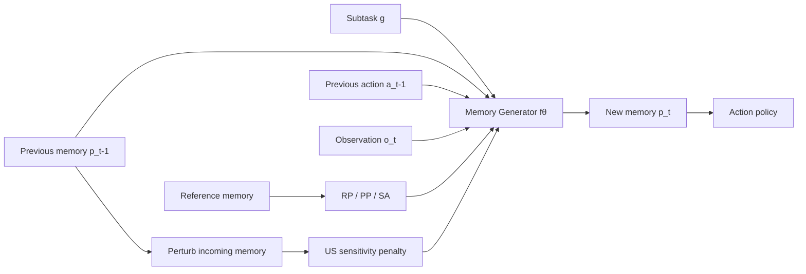
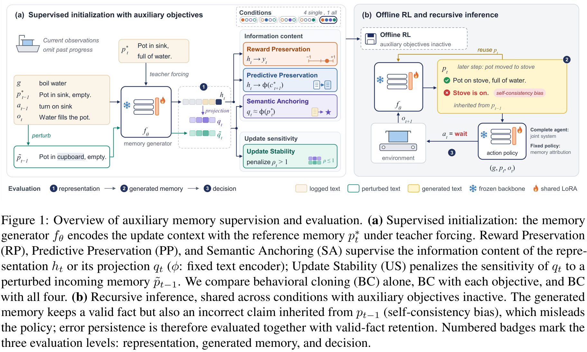
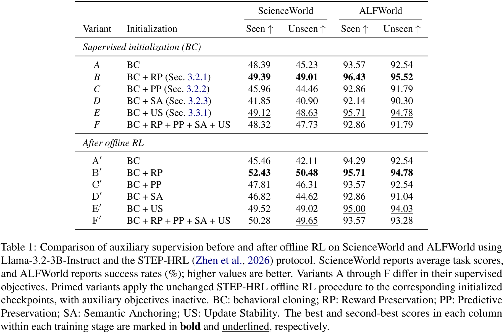
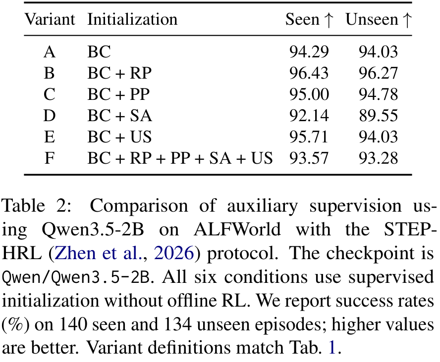
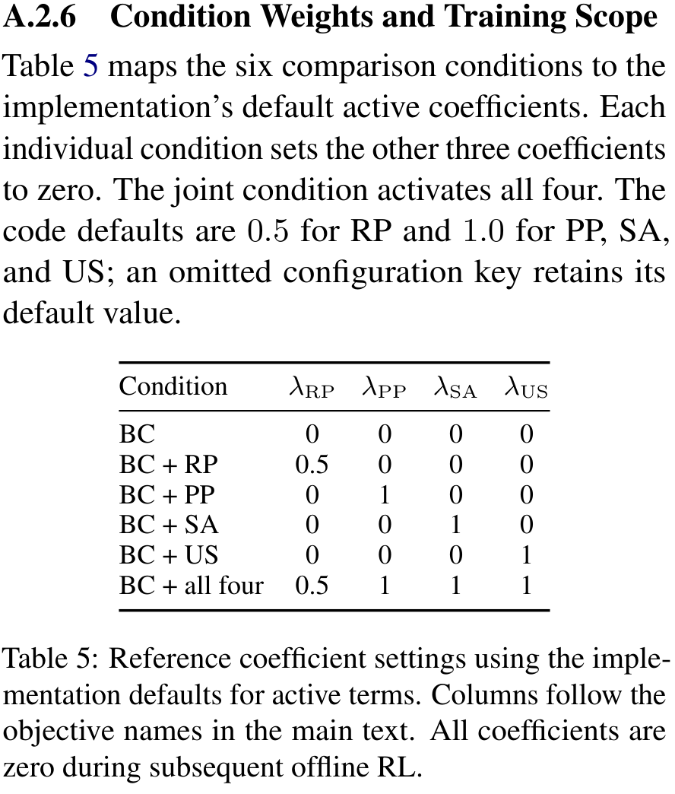
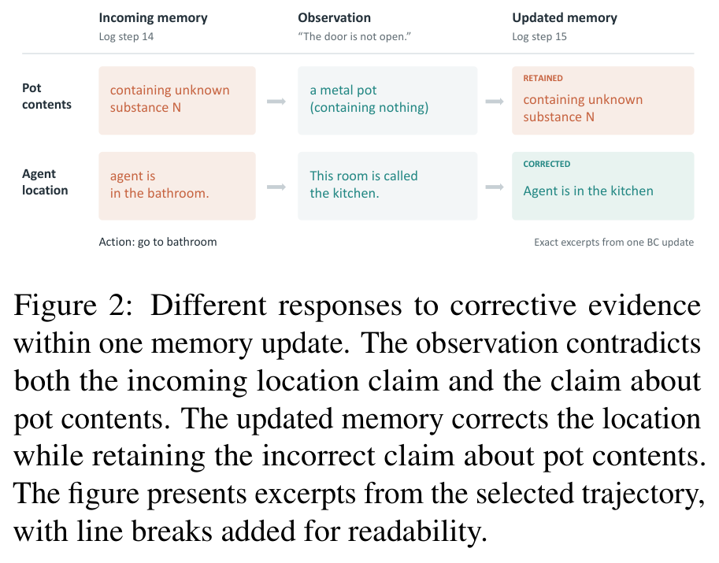
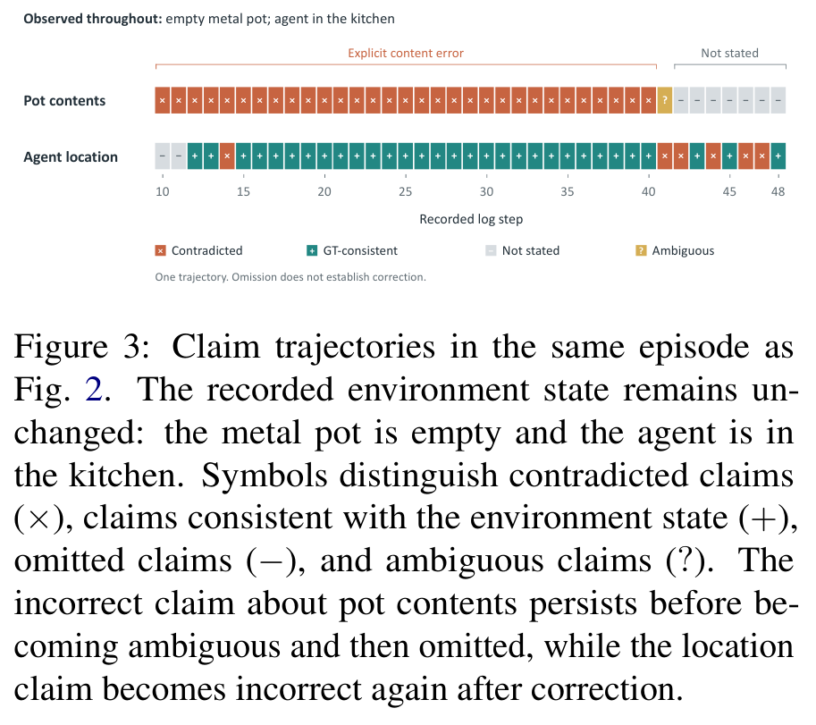

> 一句话：训练记忆时分别保留奖励、未来、语义和稳定性，再看哪种真的帮助长期行动。

原文依据：联网下载的 13 页原始 PDF，完整阅读方法、主实验、Limitations 与 Appendix A 的数据、训练和梯度路由细节。正文 3 张 Figure、主结果 Table 1–2 与系数 Table 5 已裁出；定量任务结果与单条质性轨迹严格分开解释。

## 0. 读之前你需要知道

**术语卡**

- **recursive textual memory**：每一步都用“旧记忆 + 新观察”重写一份新摘要，下一步再把新摘要当输入。像值班日志每天抄写一次，前一天写错的内容可能被继续抄下去。
- **self-consistency bias**：已经存在于 incoming memory 的错误，在连续更新中继续出现。它不是新产生一个错，而是旧错因递归复用活了下来。
- **control-sufficient memory**：记忆不必复述全部历史，但要保留足以支持后续决策的信息。像导航只需记住当前位置、目的地和封路信息，不必保存沿途每块广告牌。
- **behavioral cloning（BC）**：直接模仿示范数据中的动作和记忆文本。它像照着优秀员工的操作录像练习，但不额外检查笔记里是否保留了关键事实。
- **teacher forcing**：训练时把参考 memory token 喂给模型，再读取内部表示。这个表示看过标准答案，不能自动等价于模型自由生成时也会写对。
- **offline RL**：用预先收集的数据更新策略，不在训练时继续在线探索环境。

**它站在谁肩上**：STEP-HRL 提供层级 agent 与 recursive progress memory 接口；Memory-R1、MemPO、Self-Sum 等工作学习记忆操作、摘要或信用分配。KEEPER 不宣称重新发明记忆架构，而是在同一接口下比较四类辅助目标，并追问“表征学到某种性质”是否真的传递到生成记忆和决策。

## 1. 动机

一本交接日志连续写了“金属锅里有未知液体”。后来监控明确显示锅是空的，下一班却只纠正了房间位置，仍把锅的错误内容抄下去。日志前后很一致，但一致不代表正确。

**以前怎么做**：用最终任务分数训练或评价 memory；分数提高就推断记忆更好。**为什么不够**：完整 agent 的策略、记忆生成器和共享参数会一起变化；高分不能说明旧错误减少，也可能通过丢掉全部历史来避免错误，却连正确事实也忘掉。

**为什么现在能做**：作者把监督分成两个轴。information content 问内部表示保留了什么；update sensitivity 问 incoming memory 改变时下一表示会改变多少。再把证据分成 representation、generated memory、decision 三层，避免从一层改善直接跳到另一层结论。

## 2. 贡献

- **定义 self-consistency bias**：专指 incoming memory 中已有错误在后续重写中的持续，不把新错误、复发和省略混为一类。
- **统一比较四个目标**：Reward Preservation（RP）、Predictive Preservation（PP）、Semantic Anchoring（SA）、Update Stability（US）在相同 STEP-HRL 接口、数据与 BC 设置下单独或联合训练。
- **发现目标并非越多越好**：RP 在 Llama-3.2-3B 的 ScienceWorld、ALFWorld 以及 Qwen3.5-2B 的 ALFWorld 上整体最高；四目标联合反而低于 RP 和 US。
- **区分表征、文本和决策证据**：作者明确指出 teacher-forced representation alignment 不证明自由生成 memory 正确，稳定性 penalty 也不证明 decoded memory 全局收缩。
- **记录一种错误传播形态**：同一条 BC trajectory 中，锅内容错误长期持续，位置错误被纠正后又复发，最终省略也不能算已纠正。

像医院分别检查化验指标、病历文字和治疗决策，这篇最重要的贡献是拒绝把其中一层的改善当作另外两层已被治好。

## 3. 创新点

**第一，把监督目标放进同一递归接口比较。** 很多论文同时换 memory architecture、policy 和训练信号，难以知道收益来自哪里。KEEPER 固定 STEP-HRL，只改变辅助损失，像同一辆车换四种驾驶提示。

**第二，把“保留什么”和“对输入多敏感”分开。** RP、PP、SA 选择表示应含的信息，US 约束旧 memory 扰动的传播。二者分别对应记事本写了什么，以及涂改一行会不会让整页重写失控。

**第三，给 self-consistency bias 建立 claim-level 词汇。** persistence 是错误连续存在，recurrence 是纠正后又出现，omission 只是没再写。这个分类避免把“删掉一句错话”误读成“模型已经理解正确事实”。

## 4. 方法

### 4.1 整体流程

像更新项目交接单：先由旧进度、刚做的动作和现场观察写新摘要，再用不同训练目标检查这张摘要的内部表示是否保留决策所需信息。

Figure 1：四个辅助目标只在 supervised initialization 激活，offline RL 与实际 recursive inference 都移除辅助头；结果因此检验的是初始化留下的表示偏置，而非部署时额外调用检测器。

### 4.2 模块拆解

**递归记忆更新。** 这个公式说明新 memory 由任务、旧 memory、前一动作和新观察共同生成：

$$
p_t=f_\theta(g,p_{t-1},a_{t-1},o_t).
$$

- $g$ 是当前 subtask；$p_{t-1}$、$p_t$ 分别是前后两版文本记忆。
- $a_{t-1}$ 是上一步动作，$o_t$ 是执行后的观察。
- $f_\theta$ 是共享 LoRA 可训练的 memory generator；action policy 读取 $g,p_t,o_t$。

**Reward Preservation（RP）。** 它要求 teacher-forced hidden state $h_t$ 能预测 STEP-HRL 转换得到的 reward-related label：

$$
L_{\mathrm{RP}}=\mathbb E_D\left[\ell_{\mathrm{SL1}}(r_b(h_t),y_t)\right].
$$

- $r_b$ 是标量 reward predictor，$y_t\in\{-1,0,+1\}$ 来自 invalid action、普通动作与 subtask-final action 的转换标签。
- smooth-L1 预测得更准，表示 $h_t$ 必须区分与任务进度有关的历史。像值班日志至少要能让接班人判断这一步是错误、普通进展还是阶段完成。

**Predictive Preservation（PP）。** 它要求 $h_t$ 预测下一条 observation 与 reference memory 拼成的 successor context embedding：

$$
L_{\mathrm{PP}}=\mathbb E_{D_{\mathrm{link}}}\left[1-\cos(F(h_t),\phi(c^\star_{t+1}))\right].
$$

- $F$ 是可训练 successor predictor，$\phi$ 是冻结的 all-MiniLM-L6-v2 encoder，输出 384 维单位向量。
- $D_{\mathrm{link}}$ 只含能按 reference memory 精确链接到下一行的样本；没有 successor 的样本不计入平均。
- 这像要求交接单不仅解释当前得分，还能预测下一班会看到什么。

**Semantic Anchoring（SA）。** 它直接把投影 $q_t$ 对齐 reference memory embedding：

$$
L_{\mathrm{SA}}=\mathbb E_D\left[1-\cos(q_t,\phi(p_t^\star))\right].
$$

$q_t$ 是 $h_t$ 投影后的 384 维单位向量。因为 $h_t$ 在 teacher forcing 下已经看过 $p_t^\star$，对齐变好可能只是更会提取给定标准文本，不等于自由生成时事实更准确。

**Update Stability（US）。** 它把 incoming memory 改成扰动版 $\tilde p_{t-1}$，其余输入和 reference output 固定，再比较 clean/perturbed projection 的变化比例：

$$
\rho_t=\frac{\|q_t-\tilde q_t\|_2}
{\|\phi(p_{t-1}^\star)-\phi(\tilde p_{t-1})\|_2+\delta},
$$

$$
L_{\mathrm{US}}=\mathbb E_{\mathrm{valid}}\left[\max(0,\rho_t-1)^2\right],\qquad \delta=10^{-4}.
$$

- 扰动包括删除、同类型实体替换和模板注入；这些文本编辑没有外部 factuality judge。
- 默认 clean branch stop-gradient，只从 perturbed branch 回传。
- $\rho_t\le1$ 只表示抽样 pair 上投影变化没有放大，不是 decoded memory 的全局 Lipschitz 保证。常量投影也可能得到低 penalty。

联合目标为：

$$
L_{\mathrm{total}}=L_{\mathrm{BC}}+lambda_{\mathrm{RP}}L_{\mathrm{RP}}
+\lambda_{\mathrm{PP}}L_{\mathrm{PP}}+\lambda_{\mathrm{SA}}L_{\mathrm{SA}}
+\lambda_{\mathrm{US}}L_{\mathrm{US}}.
$$

### 4.3 关键细节

RP 系数为 0.5，PP、SA、US 各为 1；单目标条件只打开对应一项，joint 全部打开。RP predictor 先 warm-up 500 minibatches，使用 detached features；随后才让梯度进入共享 backbone。所有辅助系数在 offline RL 阶段归零，辅助头也不参与环境交互。

像给同一本日志加四种训练题，联合条件把四套题直接相加，并没有自动平衡梯度冲突；因此 joint 变差不能简单解释成四种信息都无用。

## 5. 实验结果

像评估仓库交接制度，既要看熟悉仓库的老任务，也要看新布局，还要区分日志质量与最终能否完成搬运。

**实验设置六项**

- **数据集与切分**：ScienceWorld 1,483 train、194 seen evaluation、211 unseen evaluation；ALFWorld 3,211 train、140 seen、134 unseen。沿用 STEP-HRL 全 split。
- **骨干模型**：主实验 Llama-3.2-3B-Instruct；跨 backbone 只在 ALFWorld 测 Qwen3.5-2B。层级 agent、memory interface 和 action policy 沿用 STEP-HRL。
- **训练预算**：BC 用 LoRA rank 16、scaling 32、dropout 0.05，AdamW，learning rate $10^{-4}$，5 epochs，effective batch 128，bfloat16。offline RL 3 epochs，actor lr $10^{-5}$，critic lr $10^{-4}$，critic warm-up 100 iterations。GPU 与 wall-clock 原文未给。
- **基线**：BC；BC+RP；BC+PP；BC+SA；BC+US；BC+all four。primed 条件表示相同初始化再跑不带辅助损失的 STEP-HRL offline RL。
- **指标**：ScienceWorld 报 average task score，包含部分完成；ALFWorld 报 episode success rate（%），均越高越好。原文未给独立置信区间或多 seed 方差。
- **推理设置**：每 episode 最多 50 environment steps；action token budget 32，memory token budget 150，greedy decoding；BC/evaluation seed 为 0。

**主结果提炼**

| 阶段 / Benchmark | 指标 | RP | BC | 差值 |
| --- | --- | --- | --- | --- |
| BC / ScienceWorld seen | average task score | 49.39 | 48.39 | +1.00 |
| BC / ScienceWorld unseen | average task score | 49.01 | 45.23 | +3.78 |
| BC / ALFWorld seen | success rate | 96.43 | 93.57 | +2.86 pp |
| BC / ALFWorld unseen | success rate | 95.52 | 92.54 | +2.98 pp |
| offline RL / ScienceWorld seen | average task score | 52.43 | 45.46 | +6.97 |
| offline RL / ScienceWorld unseen | average task score | 50.48 | 42.11 | +8.37 |

Table 1：RP 在 supervised initialization 与 offline RL 后都总体最高；US 通常第二。PP、SA 低于 BC，joint 也没有累加单项收益，说明“预测更多目标”不等于“形成更有用的递归记忆”。

Table 2：换成 Qwen3.5-2B 后，RP 在 ALFWorld seen/unseen 仍从 94.29/94.03 提高到 96.43/96.27；SA 仍最低，方向与 Llama 主实验一致，但只覆盖一个 benchmark 且没有 offline RL。

Table 5：joint 条件直接使用 0.5、1、1、1 的默认系数，没有做梯度尺度或 Pareto 权衡；联合失败不能单独归因于目标内容相互矛盾。

Figure 2：同一次更新中，location error 被 observation 纠正，pot contents error 却被保留，说明模型不是统一接受或拒绝纠错证据，而是 claim 级选择性处理。

Figure 3：pot contents 的错误从 log step 10 持续到约 41，之后变 ambiguous 再 omitted；location 在纠正后多次复发。省略只表示没写，不能证明记忆已改成正确内容。

**消融告诉我们什么**：在本文实现里，reward-related prediction 对 task score 最稳定；限制 update sensitivity 也有帮助；future embedding 与 reference semantic alignment 没转化成更高任务分。作者没有直接统计四种条件各自的 error persistence，因此不能说 RP 已被证明减少 self-consistency bias。

一种谨慎的机制解释是：STEP-HRL 的 progress memory 首先服务于动作选择，而 RP 的 $-1/0/+1$ 标签恰好把“无效动作、普通过程、阶段完成”压成策略最需要的粗粒度区别。PP 预测的 successor embedding 更丰富，却可能要求模型保留许多与当前动作无关的表面信息；SA 又在 teacher forcing 下对齐完整 reference memory，容易优化语义接近而不是决策边界。这个解释与结果相容，但论文没有做表示 probing 或信息删除实验，所以仍是我的推断。

joint 条件还存在优化尺度问题。RP 用 smooth-L1，PP/SA 用 cosine distance，US 用 squared hinge；四个损失的数值范围、梯度方向和有效样本数不同。直接使用默认系数相加，像让四位老师同时批一份作业，却没有约定谁的意见优先。Table 1 只能证明当前权重组合没有累加收益，不能证明四类约束在经过调权或分阶段训练后仍然冲突。

**这些实验够不够支撑结论**：能支持“不同辅助目标在完整 agent task score 上效果不同，RP 最好，联合不自动更好”。不能支持“RP 生成的 memory 更真实”或“US 消除了错误传播”；这些需要大规模 claim-level annotation 和独立 memory/controller 参数隔离。

## 6. 局限性

**作者自己承认的**：只覆盖一个 agent architecture 和两个 backbone，第二 backbone 只测 ALFWorld；memory generator 与 action selection 共用 trainable parameters；teacher-forced supervision 不证明 generated-memory correctness；US 只测抽样 perturbation 的 projected representation；质性证据是事后选择的一条 baseline trajectory。

**我的判断**：这像同时给司机和导航软件升级同一块控制板，最终路线更好时无法判断是地图记得更准，还是司机策略更会绕过错误。共享 LoRA 是本文比较的公平条件，也正是因果归因的边界。

RP 的 label 是 STEP-HRL converter 生成的 $-1/0/+1$ action-progress proxy，不是 memory factuality 标签。它可能帮助策略保留“是否完成阶段”的信息，却不保证人物、容器、位置等事实都正确。

US 的扰动有时只是删除或替换，并不保证与环境冲突；常量 projection 还能低成本压低 sensitivity ratio。因此稳定不等于既保留真事实又纠正假事实。

**实验层面的不足**：只有 seed 0，没有方差；没有自动 claim-level error rate；联合目标没有调权重；Qwen3.5 只测 ALFWorld。这些不写入 frontmatter 的四条方法局限。

## 7. 一句话总结

**长程记忆要保留对行动有用的区别，而不是追求文本前后一致或语义看起来相似。** 类比交接日志：最有帮助的是能判断任务是否真正推进的记录，但一条案例已经提醒我们，日志可能一边改对房间，一边继续抄错锅里的东西。

## 8. 可复用点

- 设计 memory auxiliary loss 时，把 representation、generated text、decision 三层指标分开；任何一层改善都只作为下一层的假设。
- 对 recursive memory 建立 claim tracker，至少区分 persistence、recurrence、omission 与 explicit correction。像审计版本历史，不能把删除错误句当作新增正确句。
- 若使用稳定性正则，记录扰动是否真的改变事实、clean/perturbed branch 的梯度路由、projection 方差，防止常量表示投机。
- 联合多个辅助目标前先测梯度范数和冲突，再调系数；直接相加失败只说明当前权重组合失败。

可跨任务复用的机制已抽为 [[../../../30 方法卡片/递归记忆更新敏感性约束]]。

## 9. 我的疑问

- RP 的优势来自保留 task progress，还是共享参数直接改善 action policy？分离 memory LoRA 与 policy LoRA 后结果会怎样？
- 在所有条件上自动标注 claim correctness 后，task score 与 self-consistency bias 的相关性有多强？
- PP 若使用真实 future observation 而不是 observation+reference memory embedding，是否会减少 teacher-forcing shortcut？
- US 加入“保留 clean representation 方差”的约束后，能否排除 near-constant projection？
- joint 条件做 gradient balancing 或分阶段训练后，四类信息是否仍不能累加？
