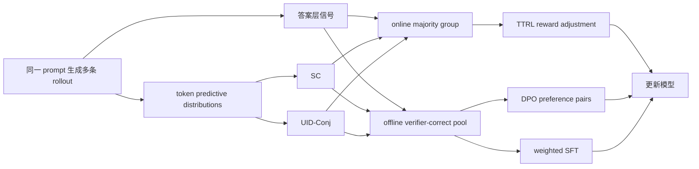
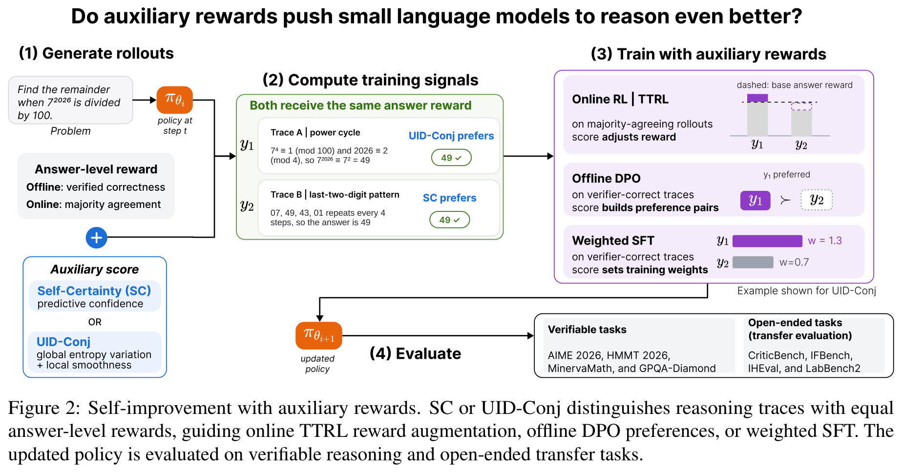
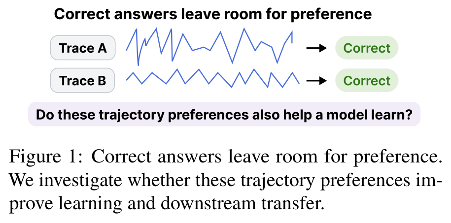
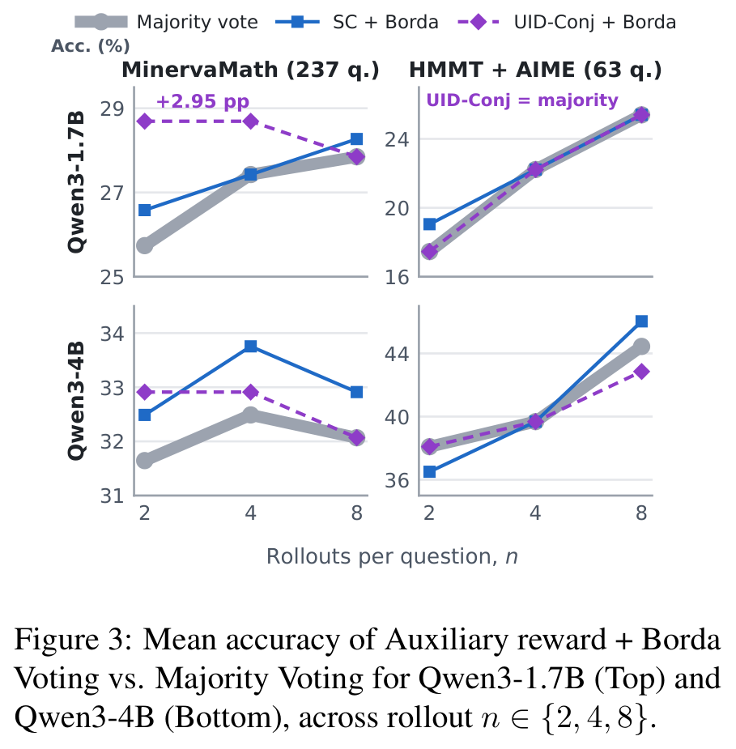
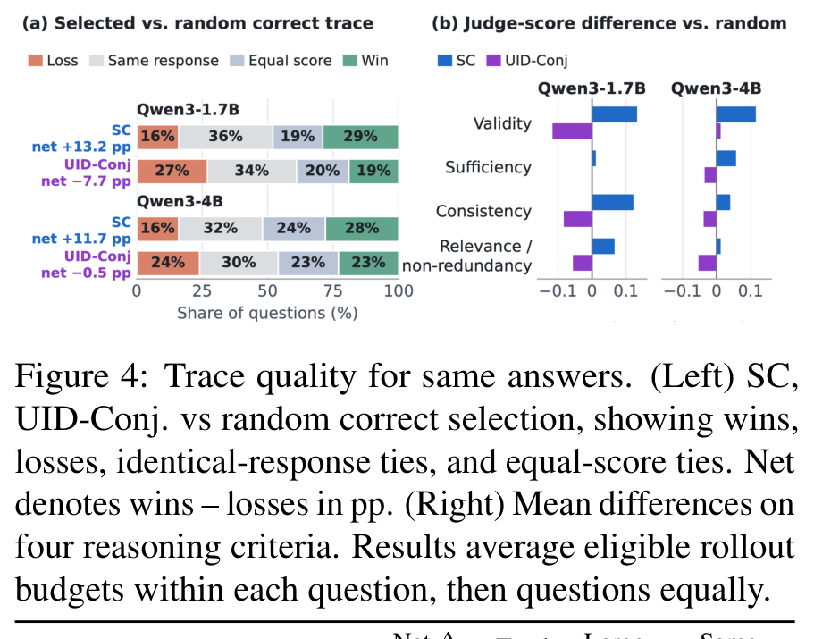
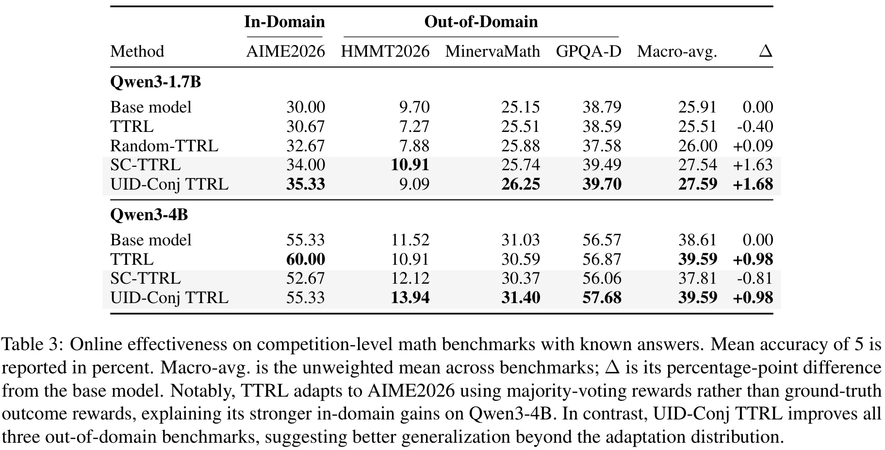
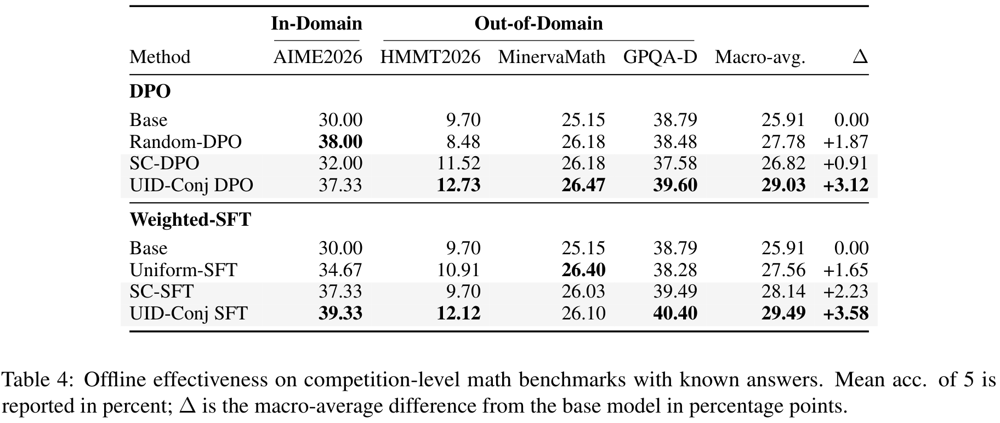
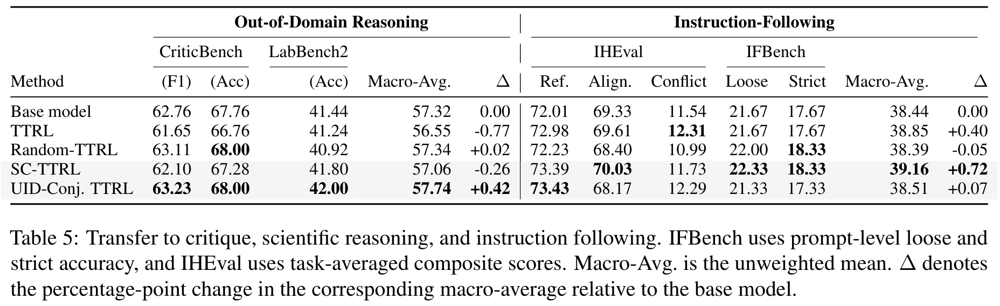
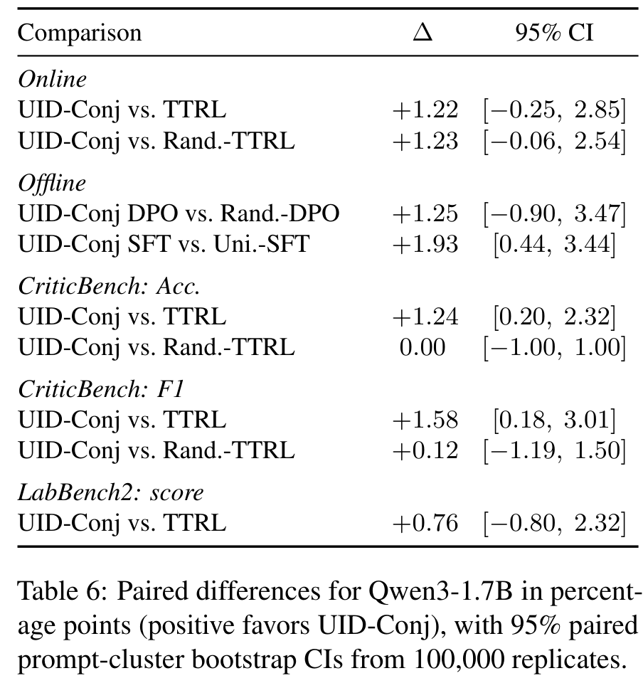

> 一句话：答案同样正确时，再按模型自己的不确定性轨迹挑出更值得学习的解法。

原文依据：联网下载的 28 页原始 PDF，完整阅读诊断实验、在线 TTRL、离线 DPO/weighted SFT、transfer、bootstrap CI、Limitations 与训练附录。正文 Figure 1–4、Table 3–6 已裁出并检查；附录控制实验用于限定结论，不把 judge 偏好直接当作训练价值。

## 0. 读之前你需要知道

**术语卡**

- **answer-level reward**：只看最终答案对不对。两条推理都答对时，它们拿到相同分数，无法区分一条严谨、一条碰巧蒙对。
- **trajectory preference**：对整条 reasoning trace 的相对偏好。像老师给两份都得满分的作业再看过程，判断哪份更适合作为范例。
- **Self-Certainty（SC）**：根据每个生成位置的预测分布，衡量模型对自己所写 token 的整体确信程度；本文实现基于 top-25 support，而非完整词表。
- **Uniform Information Density（UID）**：研究信息量是否沿序列均匀分布。本文的 UID-Conj. 不追求全程恒定，而是偏好全局 entropy 有变化、局部变化平滑的轨迹。
- **TTRL**：test-time reinforcement learning，在测试题自身上用模型 rollout 的多数答案构造 pseudo reward，再短程更新模型。
- **weighted SFT**：仍对正确 response 做 token-level SFT，但同一 prompt 内 auxiliary score 高的 response 权重更大。

**它站在谁肩上**：self-consistency 用最终答案投票，SC 用内部 confidence 做 best-of-$N$ 选择，TTRL 用多数一致作为 test-time RL 奖励，DPO/SFT 则把离线 response 转成偏好对或示范。本文把这些路线接在同一问题上：当 correctness 已固定，内部 entropy trajectory 是否还能指出不同的学习价值。

## 1. 动机

两名学生都写出正确答案。一人给出完整证明，另一人靠一个脆弱捷径碰巧算对。只按答案打分，两份作业都是 100；若把二者都等权放进训练集，模型无法知道哪种过程更值得复制。

**以前怎么做**：RLVR 用 verifier 只给 outcome reward；STaR 和 SFT 只筛正确轨迹；TTRL 没有参考答案时用 majority agreement。**为什么不够**：同一正确答案下仍有逻辑有效性、充分性、重复程度和未来训练价值差异。

**为什么现在能做**：模型生成时已经产生 token logits，不需要额外 reward model 就能计算 SC 与 entropy trajectory。作者用这些信号在 majority-consistent 或 verifier-correct response 内部做微调，保持正确/错误之间的基本 reward ordering 不变。

## 2. 贡献

- **把选择质量与训练价值分开**：SC 被 judge 评为更高质量的 correct trace，但 UID-Conj. 在多个 offline training 与 transfer 设置中收益更大，说明“看起来更好”与“教得更好”不是同一个指标。
- **覆盖在线与离线两种监督**：online TTRL 没有 reference answer，只在 majority-agreeing group 内调整 reward；offline DPO/weighted SFT 只使用 verifier-correct response。
- **给出 matched controls**：Random-TTRL 控制 reward variation，Random-DPO 控制随机 correct-correct preference，Uniform-SFT 固定相同 response pool 只去掉权重差。
- **评估跨任务迁移**：从数学训练迁移到 CriticBench、LabBench2、IHEval、IFBench，而不是只看 adaptation set。
- **报告 prompt-cluster bootstrap CI**：最清晰证据是 UID-Conj SFT 对 Uniform-SFT 的 +1.93 pp，95% CI 为 [0.44, 3.44]；在线与 DPO 主比较区间仍跨 0。

像挑教材，本文不只问哪份解答最漂亮，还让模型真正学习后再考试；两种排序标准出现分歧，正是最有信息的结果。

## 3. 创新点

**第一，UID-Conj. 同时要求 global variation 与 local smoothness。** 完全平坦的 entropy trajectory 不得高分；全局要有信息节奏，局部又不要剧烈跳动。像一段音乐需要段落起伏，但相邻音符不能乱跳。

**第二，online reward 只在 majority-consistent group 内中心化。** auxiliary term 不参与投票，也不让 disagreeing response 超过 agreeing response，尽量把“答案层级”和“轨迹层级”分开。

**第三，offline weighted SFT 保持每个 prompt 总权重不变。** 同题内重新分配 response 权重，避免某题因可用正确答案多就占据更大训练份额。像班级内调整学生发言次序，但不改变每个班的总课时。

**第四，把“当前读起来好”与“作为梯度有用”拆开。** judge 按 validity、sufficiency、consistency、relevance/non-redundancy 给一条完整 response 打分，评价的是成品文本；训练收益却取决于这些 token 在当前参数附近产生怎样的梯度。SC 可能偏好模型已经很熟悉、写得稳定的轨迹，所以 judge 看起来更可靠，但新增参数信息较少。UID-Conj. 偏好的全局起伏和局部平滑也许包含模型尚未充分掌握的结构，作为示范反而更能移动决策边界。这只是与结果相容的解释，论文没有直接测梯度新颖性或 influence，因此不能写成已证实机制。

**第五，控制组对应不同因果问题。** Random-TTRL 问“只要在 unanimous group 中制造 reward variation 是否就有用”；Random-DPO 问“任意 correct-correct preference 是否已足够”；Uniform-SFT 问“同一批 correct responses 等权训练能到什么水平”。三者不是一个统一 baseline，必须分别与同目标的 UID-Conj. 比。像测试三种教学方案时，随机点名、随机成对比较和全员等时长授课回答的是三个不同问题。

## 4. 方法

### 4.1 整体流程

像先用答案筛出“可能合格”的作业，再用过程信号决定在线奖励、偏好对或示范权重。

Figure 2：SC 与 UID-Conj. 不改变 answer-level verification 的来源，而是在相同答案层 reward 内提供第二层排序；在线和离线分支共享思想，但 scoring policy 与 calibration 不完全相同。

### 4.2 模块拆解

**Self-Certainty（SC）。** 每个 response token 位置只保留 top-$K$ logits，$K=25$，重新归一化：

$$
p_{t,j}=\frac{\exp(z_{t,j})}{\sum_{k\in K_t}\exp(z_{t,k})},\qquad j\in K_t.
$$

SC 计算 uniform distribution 到 $p_t$ 的 KL，再在 $T$ 个 response tokens 上平均：

$$
\mathrm{SC}(y)=\frac1T\sum_{t=1}^T D_{\mathrm{KL}}(U_K\Vert p_t).
$$

- $z_{t,j}$ 是 raw next-token logit；不使用 rollout temperature scaling。
- special tokens、chat control tokens 与 thinking delimiters 不计分。
- 分布越远离 uniform，SC 越高；这表示模型更确定，不表示推理必然正确。

**UID-Conj.。** 先计算每个位置的 entropy：

$$
H_t=-\sum_{j\in K_t}p_{t,j}\log p_{t,j}.
$$

把轨迹切成 $B=32$ 个相对位置 bin，得到平均 entropy $h_k$。用校准集拟合 robust scale $s$ 后，计算 global variation 与 local smoothness：

$$
G(y)=\frac1B\sum_{k=1}^B\left(\frac{h_k-\bar h}{s}\right)^2,
$$

$$
S(y)=-\frac1{B-1}\sum_{k=1}^{B-1}\rho\left(\frac{h_{k+1}-h_k}{s}\right),
$$

其中 $\rho$ 为 threshold 1 的 Huber loss。$G$ 大表示全局不平坦，$S$ 大表示相邻变化更平滑。二者分别经 calibration empirical-CDF midrank 映射，再相乘：

$$
q_{\mathrm{UID-Conj}}(y)=F_G(G(y))F_S(S(y)).
$$

像评价文章节奏：整篇不能一个声调，段落之间又不能突然断裂；两项有一项很差，乘积就被压低。

**Majority-Gated Online RL。** 设 $\hat a_x$ 为 rollout 最常见答案，$g_i$ 表示 response 是否与多数答案一致：

$$
g_i=\mathbf 1[a(y_i)\simeq\hat a_x],\qquad M_x=\{i:g_i=1\}.
$$

只在 $M_x$ 内中心化 auxiliary score，并截断：

$$
R_i=2g_i-1+\lambda b_i,
$$

$$
b_i=\begin{cases}
\operatorname{clip}(q_i-\bar q_x,-\delta,\delta), & i\in M_x, |M_x|\ge2,\\
0, & \text{otherwise},
\end{cases}
$$

其中 $\lambda=0.1,\delta=0.5$，所以 adjustment 最大为 0.05，不能翻转 majority-agreeing 与 disagreeing 的基础顺序。需要注意，GRPO 组内标准化会把 unanimous group 中很小的 reward difference 重新放大成非零 advantage。

**Offline DPO 与 weighted SFT。** DPO 在 verifier-correct responses 中选 score 最高和最低者组成 preference pair。weighted SFT 为同 prompt 的 $m$ 条 correct responses 分配：

$$
w_i=m\frac{\exp(\alpha q_i)}{\sum_{y_j\in C_x}\exp(\alpha q_j)}.
$$

权重均值为 1，本文离线实现使用 $\alpha=2$。训练 response pool 不变时，Uniform-SFT 令 $w_i=1$，从而隔离辅助权重的贡献。

### 4.3 关键细节

online 默认 Qwen3-1.7B，AIME2026 全 30 题既作 adaptation 又作 in-domain evaluation，每题 8 rollouts，2 dataset epochs。GRPO learning rate $5\times10^{-7}$，clip 0.2，reference KL $10^{-3}$。offline data 来自 Qwen3-1.7B 在历史 AIME 上生成的共享 response pool；DPO 每方法 413 train pairs、53 dev pairs，且共享同一 warm-start SFT。

Figure 1：论文研究对象不是把错答案变对，而是在最终答案同样正确时判断轨迹是否仍有可利用的学习差异。

## 5. 实验结果

像比较两套习题筛选器，既要看当场挑出的答案，也要看学生学完后在别的考试是否进步。

**实验设置六项**

- **数据集与切分**：online 用 AIME2026 全 30 题训练并同题评测；out-of-domain 为 HMMT2026 33 题、MinervaMath 272 题、GPQA-Diamond 198 题。transfer 用 CriticBench 500、LabBench2 500，以及 IHEval、IFBench；offline 用历史 AIME response pool。
- **骨干模型**：主训练与全部 offline 结果为 Qwen3-1.7B；online 另测 Qwen3-4B。trace-quality judge 为 gpt-6-luna，只用于诊断，不产生主训练 reward。
- **训练预算**：4×A100 训练、1×A40 inference，online LoRA rank 16/scaling 32；offline LoRA rank/scaling 64。weighted SFT 1 epoch、global batch 32、lr $5\times10^{-5}$；DPO 1 epoch、batch 16、lr $10^{-5}$、$\beta=0.1$。
- **基线**：Base、TTRL、Random-TTRL、SC-TTRL、UID-Conj TTRL；offline 为 Random/SC/UID-Conj DPO 与 Uniform/SC/UID-Conj SFT。
- **指标**：数学报 MeanAcc5，即每题 5 个 sample 的平均 correctness，不是 pass@5 或 maj@5；跨 benchmark 用非加权 macro-average。CriticBench 报 verdict accuracy 与 incorrect-class F1；差值用 prompt-cluster bootstrap 95% CI。
- **推理设置**：数学 post-training evaluation 使用 thinking、temperature 0.6、top-p 0.95、top-k 20、presence penalty 0.5、repetition penalty 1.05；CriticBench/IFBench/IHEval 关闭 thinking。原文按各 benchmark 官方 verifier/judge 执行。

**主结果提炼**

| 设置 | 对照 | Macro-average | 差值 |
| --- | --- | --- | --- |
| Online UID-Conj TTRL | TTRL | 27.59 vs 25.51 | +2.08 pp |
| Online SC-TTRL | TTRL | 27.54 vs 25.51 | +2.03 pp |
| Offline UID-Conj DPO | Random-DPO | 29.03 vs 27.78 | +1.25 pp |
| Offline UID-Conj SFT | Uniform-SFT | 29.49 vs 27.56 | +1.93 pp |
| Transfer UID-Conj | Base reasoning macro | 57.74 vs 57.32 | +0.42 pp |
| Transfer SC | Base instruction macro | 39.16 vs 38.44 | +0.72 pp |

Figure 3：best-of-$N$ selection 的收益随模型、任务与 rollout budget 改变；Qwen3-1.7B 在 MinervaMath 的小预算提升最明显，不能把 auxiliary selector 当作始终优于 majority vote。

Figure 4：在最终答案都正确的 cohort 中，SC 相对 random correct 的 judge net win 为 13.2/11.7 pp，UID-Conj 为 -7.7/-0.5 pp；SC 更偏向 validity/consistency，UID-Conj 在 relevance/non-redundancy 上较接近，但 judged quality 排名与后续训练收益不一致。

Table 3：Qwen3-1.7B 的 UID-Conj TTRL 在四项上 macro-average 27.59，略高于 SC 的 27.54；Qwen3-4B 的普通 TTRL 与 UID-Conj 都为 39.59，但普通 TTRL 靠 AIME2026 60.00，UID-Conj 则在三个 transfer benchmark 都高于 base，呈现不同的泛化取舍。

Table 4：UID-Conj DPO 与 SFT 的 macro-average 分别为 29.03、29.49；Random-DPO 在 AIME2026 仍以 38.00 高于 UID-Conj 的 37.33，Uniform-SFT 在 MinervaMath 26.40 高于 UID-Conj 的 26.10，收益不是逐列全胜。

Table 5：UID-Conj 在 CriticBench/LabBench2 reasoning macro 最好，SC 在 instruction-following macro 最好。内部不确定性信号的偏好具有任务依赖，不能用一个总分替代分域观察。

Table 6：只有 UID-Conj SFT vs Uniform-SFT、CriticBench accuracy/F1 vs TTRL 的 95% CI 明确高于 0；online、DPO 和 LabBench2 区间跨 0，因此摘要中的点估计提升不能全部写成已确认稳定收益。

**消融告诉我们什么**：answer-level correctness 固定后，轨迹仍有可学习差异；但 SC 更符合单 judge 的质量标准，UID-Conj 更常产生训练增益。作者的 permutation control 说明 online reward variation 本身可能贡献部分收益，trajectory-specific preference 尚未被完全隔离。

从证据强弱看，weighted SFT 最干净：UID-Conj 与 Uniform-SFT 使用同一 response pool、同一 prompt 总权重和同一 token loss，只改变 prompt 内 response weights。DPO 次之，因为 score 既决定 chosen/rejected，也会改变哪些 prompt 满足 preference gap；作者取所有 score method 的 common prompt set 缓解了这一点，但 pair 仍不同。online 最复杂：多数答案、auxiliary adjustment、GRPO 标准化和更新后的 rollout distribution 会相互作用，且 AIME2026 训练题同时用于 in-domain evaluation。三类结果方向一致时能增强可信度，点估计不一致时应优先保留各自设置，而不是硬合成一个“UID-Conj 提升 2 点”的结论。

Table 6 进一步说明统计确定性不等于点估计大小。online 的 +1.22、+1.23 pp 区间跨 0，DPO 的 +1.25 也跨 0；weighted SFT 的 +1.93 区间全为正。CriticBench 相对 TTRL 的 accuracy 和 F1 区间为正，但相对 Random-TTRL 的区间跨 0，表明“优于原始算法”和“优于随机扰动控制”是不同主张。像药物试验，优于不治疗不等于优于安慰剂。

**这些实验够不够支撑结论**：最强支持来自共享 response pool 上的 weighted SFT，因为训练样本相同，只改变权重且 CI 为正。online TTRL 使用 adaptation 题自身、majority pseudo-label 和组内标准化，因果更复杂；transfer 改进小且任务分化，不能推出一般开放式科学推理已经可靠提升。

此外，Figure 3 的 inference-time selection 不能代替训练实验。selector 当场多选对一道题，只证明它会挑答案；模型吸收这些轨迹后在新题上提高，才说明信号具有学习价值。两者像开卷时挑参考答案与闭卷后真正掌握方法，必须分别报告。

## 6. 局限性

**作者自己承认的**：主体集中于 Qwen3-1.7B，4B 只做额外 online evaluation；AIME2026 是训练题上的 adaptation；online 比较不能完全分离 trajectory-specific preference 与 unanimous group 中引入 reward variation；trace diagnostic 只用一个 model judge；transfer 仍是受控 benchmark，不是无限制 open-ended reasoning。

**我的判断**：多数答案像全班投票，大家可能共同相信同一个错误。auxiliary score 只在多数组内排序，无法修复 majority pseudo-label 本身的 shared misconception。

SC 与 UID-Conj 都来自模型自己的 predictive distribution。模型可能对熟悉的错误模式很自信，也可能用平滑 entropy 写出逻辑漏洞；它们是学习价值的 proxy，不是事实或证明 verifier。

top-25 renormalization 丢掉词表尾部概率质量，SC 的均匀参考与 UID entropy 都因此改变。若两个模型尾部结构不同，score 可比性依赖校准集，不能直接拿原始值跨模型比较。

**实验层面的不足**：online 主比较 CI 跨 0，judge 只有一个，4B 结果有限，历史 AIME pool 的完整题量原文未在正文概括。这些保留在正文，不进入 frontmatter 方法局限。

## 7. 一句话总结

**答对只是入场券，轨迹内部的不确定性节奏还能决定这条解法值不值得教给模型。** 类比选教材：老师最喜欢的范文未必最能提高下次考试，真正可靠的标准是学生学完后的迁移成绩。

## 8. 可复用点

- 在 verified-correct response pool 内比较 trajectory score，避免把“挑对答案”与“挑好过程”混成同一收益。
- online reward augmentation 要显式限制幅度并保留 outcome ordering，同时加入 permutation/random variation control，检查收益是否只是打破零 advantage。
- weighted SFT 用 prompt 内归一化权重，使每题总权重相同；训练不起色时先查 eligible response 数、CDF calibration 和权重温度。
- 评价 auxiliary score 时并列报告 selector accuracy、独立 trace quality 与 downstream learning gain。像招聘测评，面试评价、试岗表现和长期绩效不能互相替代。

可跨任务复用的机制已抽为 [[../../../30 方法卡片/多数一致组内的轨迹辅助奖励]]。

## 9. 我的疑问

- 若 majority answer 错误，UID-Conj 是否会更高效地强化共享错误？需要按 pseudo-label correctness 分层。
- 用 full-vocabulary entropy 或累计 tail mass 修正后，SC 与 UID-Conj 排名会改变多少？
- 单条 response 的训练影响能否用 influence function 或 leave-one-out update 直接估计，而不是借 judge score？
- online 中把 auxiliary term 从 group-normalized advantage 改为 pairwise loss，能否避免微小 reward 被放大？
- 在非数学、没有 verifier 的真实 agent trajectory 上，怎样建立不依赖多数错误的 eligibility gate？
