> 一句话：别让优化器悄悄前进、采样模型原地不动；无偏导出后就在实际服务权重上训练。

原文依据：联网下载的 15 页原始 PDF，完整阅读数值分析、Fair Cast、主实验、ablation、checkpoint/export 讨论、Limitations 与 Appendix A 设置。正文 Figure 1–9、Table 1–3 全部裁出并检查；所有数字按 served copy 与 fp32 master 的不同对象分别记录。

## 0. 读之前你需要知道

**术语卡**

- **fp32 master weights**：optimizer 保存的高精度参数 $\theta$，Adam moment 等状态围绕它更新。
- **served copy**：同步给 vLLM/SGLang sampler 的低精度副本 $q$，真正生成 rollout。像总部账本是 fp32，门店实际执行的价目表是 bf16。
- **bf16 grid**：bf16 只有 7-bit significand，数值只能落在较稀的离散格点上；小于半个格距的更新经 round-to-nearest 后会消失。
- **stochastic rounding（SR）**：在相邻格点间按小数位置随机选择，使导出值的期望等于 master。
- **error feedback（EF）**：把本次舍入误差存进 residual，下次导出前加回来，使累计误差有界。
- **training-inference mismatch**：生成训练数据的 policy 与计算 gradient 的 policy 不同。本文强调的是 master-versus-served 的隐藏错位，不是两个 bf16 kernel 之间的可见差异。

**它站在谁肩上**：PPO/TIS/IcePop 检查 trainer 与 sampler log-prob ratio，已有工作也观察到 bf16 只有约 1% 权重变化。但这些方法比较的两个 policy 都在同一次 round-to-nearest 之后，看不到 fp32 master 已经移动而 served copy 没动。本文把诊断点移到 export 上游。

## 1. 动机

想象会计每天把价格改一分钱，总部账本持续变化；门店系统只允许五毛一档，四舍五入后几十天都显示同一价格。销售数据来自门店旧价，财务却按总部新价判断这次调整是否有效。两边各自看起来一致，闭环实际上已经断开。

在常见 LLM RL stack 中，optimizer 更新 fp32 $\theta_t$，sampler 使用 $q_t=R(\theta_t)$。当 learning rate 约 $10^{-6}$ 时，大多数单步更新小于 bf16 半格距，Qwen3-1.7B 每步只有 0.4–0.5% served weights 改变，sampler 落后 master 50–150 steps。

**以前怎么做**：用 trainer/sampler visible ratio、PPO clipping、TIS 或 IcePop 修正推理 kernel mismatch。**为什么不够**：trainer 的 bf16 forward 与 sampler 都依赖同一 $q_t$，所以 visible ratio 仍接近 1；真正相关的 $\pi_{\theta_t}/\pi_{q_t}$ 从未计算。

## 2. 贡献

- **给出 bf16 dead-zone 分析**：格距 $u\approx |w|/128$，round-to-nearest 丢弃 $|\Delta|<u/2\approx |w|/256$ 的更新。
- **定义 visible 与 hidden ratio**：前者是框架现有诊断，后者才衡量 master 与 served policy 的滞后。
- **提出 Fair Cast**：export 使用 SR 或 EF，并让 trainer forward 使用 exact served copy；两部分缺一不可。
- **覆盖模型、optimizer 与任务族**：25 个 matched seed-pairs 中 18 胜、6 平、1 负，平均 endpoint +6.1 points。
- **揭示 checkpoint 风险**：round-to-nearest 训练后，fp32 checkpoint 可比自己的 bf16 served export 低 12–50 points；更细的 fp16 export 反而继承未被 sampler 看过的 residual。
- **把意外滞后改成显式正则**：需要平滑时用 EMA master 再无偏导出，用 $\alpha$ 控制 lag，而非依赖权重大小和 learning rate 共同决定的隐式过滤器。

## 3. 创新点

**第一，区分两个 ratio。** visible ratio 像比较门店收银机和门店价签，当然一致；hidden ratio 才比较总部账本与门店价签。论文把“诊断没报警”解释为测错对象，而不是问题不存在。

**第二，无偏 export 与 served-copy training 绑定。** 只换 SR/EF 会让 sampler 随机跳动，trainer 仍在另一个点算梯度，实验会 collapse；只在 served copy 上训练但仍 round-to-nearest，又保留 dead zone。Table 1 的 2×2 设计把必要性讲清楚。

**第三，部署格式结论反直觉。** round-to-nearest 训练后直接保存 fp32 master，不代表保存了训练曲线中的模型；bf16 export 反而复现 sampler 看到的 policy。更高精度不是自动更忠实，因为它带回了未被 rollout 验证的 residual。

这里需要区分“单次舍入误差小”和“闭环训练误差小”。bf16 每个权重的误差最多约 $|w|/256$，对一次普通 forward 常可忽略；但 round-to-nearest 会让同一批权重连续几十步朝同一方向被扣住。rollout 每一步 token probability 的小偏差再沿两千 token 相乘，最终行为分布可以与 master 明显分离。像钟表每天慢一秒并不可怕，若导航系统始终用慢了两分钟的钟来协调多个路口，整个调度会错位。

另一个关键是 optimizer state 不在 served copy 上。AdamW 的 moments 按 fp32 master 的历史更新，sampler 却只在 master 跨格点时看到跳变。于是 optimizer 会继续沿“自己认为已经产生效果”的方向累计动量，而 reward 数据来自尚未接受这些小更新的旧 policy。这个 feedback delay 不是简单把 learning rate 变小：变小 learning rate 反而让更多更新落进 dead zone，使 visible ratio 更接近 1、hidden lag 更严重。

## 4. 方法

### 4.1 整体流程

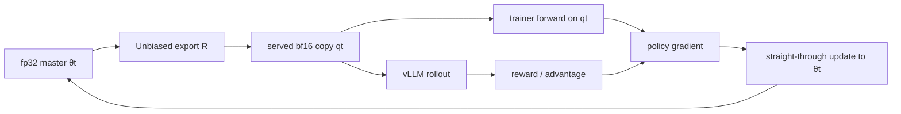

像门店用哪张价目表卖货，就必须在同一张价目表上评估调价效果；总部仍保存高精度账本，但 gradient 在实际执行点计算。

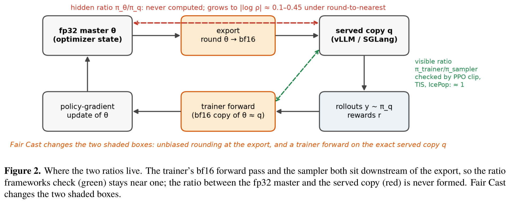

Figure 2：green visible ratio 位于 export 下游，无法看到 red hidden ratio；Fair Cast 同时修改 export 规则与 trainer forward 两个 shaded boxes。

### 4.2 模块拆解

**bf16 dead zone。** bf16 在权重 $w$ 附近的格距为：

$$
u(w)=2^{\lfloor\log_2|w|\rfloor-7}\approx\frac{|w|}{128}.
$$

round-to-nearest 在：

$$
|\Delta|<\frac{u}{2}\approx\frac{|w|}{256}
$$

时把更新映射成 0。若平均单步速度为 $|\bar\Delta|$，跨过一次边界约需 $\tau\approx u/(2|\bar\Delta|)$ steps；learning rate decay 会让 $\tau$ 趋于更大。

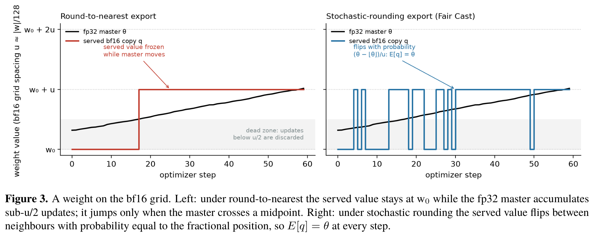

Figure 3：nearest 让 served value 长时间冻结后突然跳格；SR 让 $q$ 在相邻格点间抖动，但每步满足 $\mathbb E[q]=\theta$。

**隐藏 policy ratio。** 标准 importance ratio 是：

$$
\rho(y)=\frac{\pi_\theta(y)}{\mu(y)}
=\prod_k\frac{\pi_\theta(y_k\mid y_{<k})}{\mu(y_k\mid y_{<k})}.
$$

框架实际形成：

$$
\rho_{\mathrm{loss}}(y)=\frac{\pi_{\mathrm{trainer}}(y)}{\pi_{\mathrm{sampler}}(y)},
$$

而本文关心：

$$
\rho_{\mathrm{hidden}}(y)=\frac{\pi_{\theta_t}(y)}{\pi_{q_t}(y)}.
$$

当 trainer forward 也在 $q_t$ 的 bf16 image 上，$\rho_{\mathrm{loss}}\approx1$，无论 $\theta_t$ 离 $q_t$ 多远。实验中 visible mean per-token $|\log\rho|\approx0.01$，hidden ratio 增至 0.10–0.45。

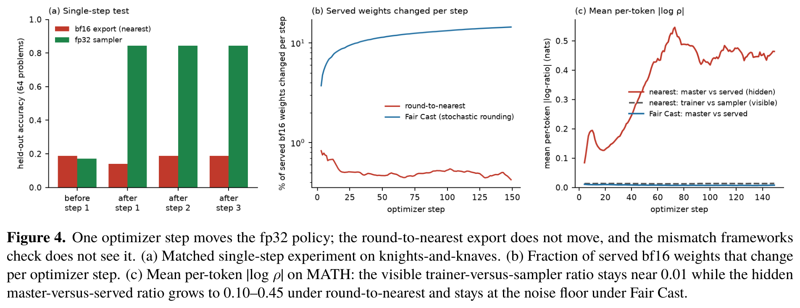

Figure 4：单步 fp32 sampler 从 0.17 跳到 0.84，nearest bf16 仍约 0.19；Fair Cast 每步改变 2–15% served weights，nearest 只有约 0.4–0.5%，hidden ratio 只有前者被压到噪声底。

**Stochastic rounding。** 若 $\theta$ 位于相邻 bf16 值 $\lfloor\theta\rfloor$ 与 $\lfloor\theta\rfloor+u$ 之间，以：

$$
p=\frac{\theta-\lfloor\theta\rfloor}{u}
$$

选择上格点，否则选下格点，于是 $\mathbb E[q(\theta)]=\theta$。实现给 fp32 bit pattern 加 16 个均匀随机 bits 后截断。

**Error feedback。** 保存每个参数的 residual：

$$
q_t=\operatorname{round}(\theta_t+r_{t-1}),\qquad
r_t=\theta_t+r_{t-1}-q_t.
$$

累积 export error telescopes：

$$
\sum_{s\le t}(q_s-\theta_s)=r_{-1}-r_t,
$$

其绝对值被一个格距约束。代价是一份额外 fp32 residual，1.7B 参数约 6.9 GB。

**Train on served copy。** trainer forward 用 $q_t$，通过 straight-through estimator 把 gradient 传给 $\theta_t$。activation checkpointing 时最精确的实现是 forward/backward 暂时把 parameter storage 换成 $q_t$，optimizer step 前恢复 master。

为什么不能只把 sampler 改成 stochastic rounding？因为 SR 每次会让一批权重随机翻到相邻格点，sampler 生成数据时使用的 $q_t$ 与 trainer 在 master 附近重新 bf16 forward 得到的值不完全相同。PPO clip 看到的 ratio 开始抖动，极端时所有 GRPO group 都变成统一错误，gradient norm 归零。让 trainer 明确复用同一份 $q_t$ 后，随机性变成 policy 本身的一部分，sampling 与 differentiation 重新闭合。

EF 与 SR 的无偏方式也不同。SR 在每次 sync 的统计期望上无偏，但单次运行会有随机噪声；EF 是确定性的，把舍入残差像欠账一样带到下一步，时间累计误差有界。前者节省 persistent memory，后者更可复现但为每个参数增加一份 fp32 state。论文发现两者总体接近，说明主要收益来自消除系统性 withholding，而不是某一种随机数技巧。

### 4.3 关键细节

SR full export 在 H100 上约 21.7–22 ms，EF 约 37.2–38 ms，nearest 4.3 ms；每个 optimizer step 为 31–130 s，因此 export overhead <0.1%。EF 额外占显存，SR 不加 persistent tensor。无偏性只对 weights 成立，神经网络非线性意味着 $\mathbb E[\pi_q]\ne\pi_\theta$。

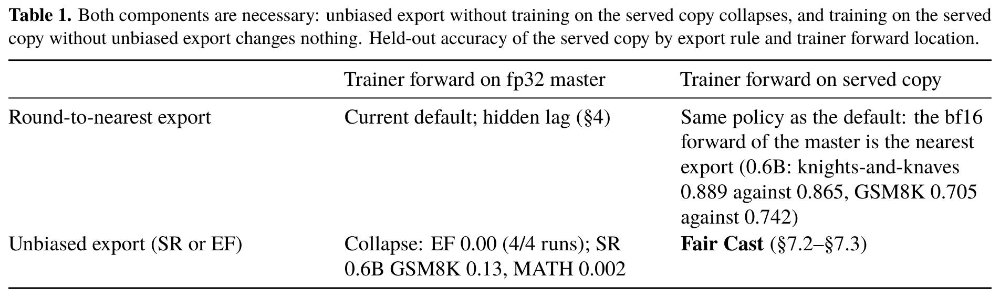

Table 1：unbiased export + fp32-master forward 会 collapse，nearest + served-copy forward 基本不变；只有 unbiased export + served-copy forward 构成 Fair Cast。

## 5. 实验结果

像检查软件发布，必须区分源代码仓库、构建产物、线上二进制和用户实际请求；只测其中一个会错判。

**实验设置六项**

- **数据集与切分**：Reasoning Gym 的 knights-and-knaves、zebra、list functions、string manipulation、Countdown；Nim/subtraction/Kuhn games；MBPP+、HumanEval+、MATH、GSM8K。held-out 通常 512，HumanEval+ 164，1.7B MATH/Countdown 128；MBPP+ 排除与训练 MBPP 重叠后 224。
- **骨干模型**：Qwen3-0.6B、1.7B、4B，另有 OLMoE-1B-7B、Qwen2.5-1.5B-Instruct 控制。
- **训练预算**：GRPO-style clipped policy gradient，group size 8，24 prompts/step，150 steps；每步 192 rollouts。默认 AdamW lr $10^{-6}$、weight decay 0.01；另测 Muon。每 arm 1×H100。
- **基线**：nearest、Fair Cast-SR、Fair Cast-EF、fp32-sampler oracle、TIS、IcePop、FP16 sampler、tuned LR、lag 2/8、truncation penalty 和 EMA lag。
- **指标**：served-copy held-out accuracy；training reward；response length；changed served weights fraction；master-served mean per-token $|\log\rho|$ 与 normalized per-token ESS。
- **推理设置**：rollout temperature 1.0，通常 2,048 tokens，Nim 6,144；held-out 每 10 steps greedy decoding。所有主曲线默认评估 served copy。

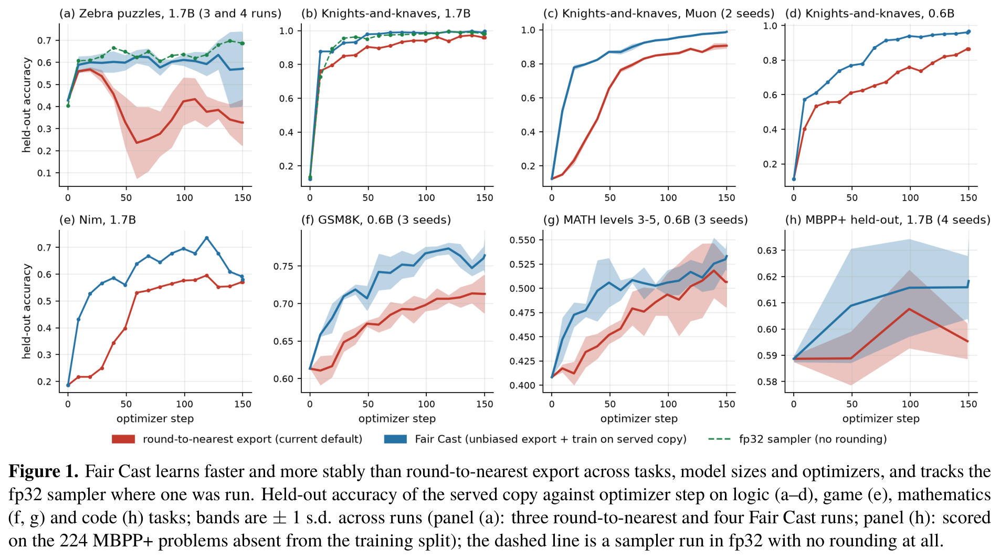

Figure 1：Fair Cast 的优势横跨逻辑、游戏、数学与代码，但最大集中在长 rollout 和较深 dead zone；接近 ceiling 的 4B knights-and-knaves 几乎无差异。

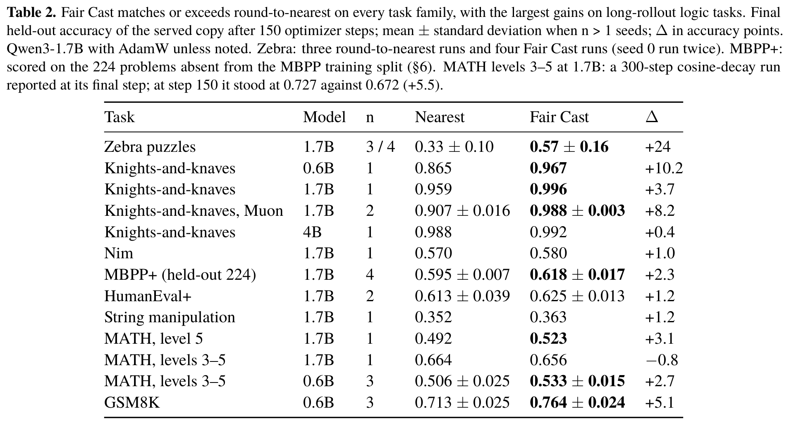

Table 2：Zebra +24 points、0.6B knights-and-knaves +10.2、Muon +8.2、GSM8K +5.1；1.7B MATH levels 3–5 最终为 -0.8，是表内唯一负 endpoint，不能写成逐项全胜。

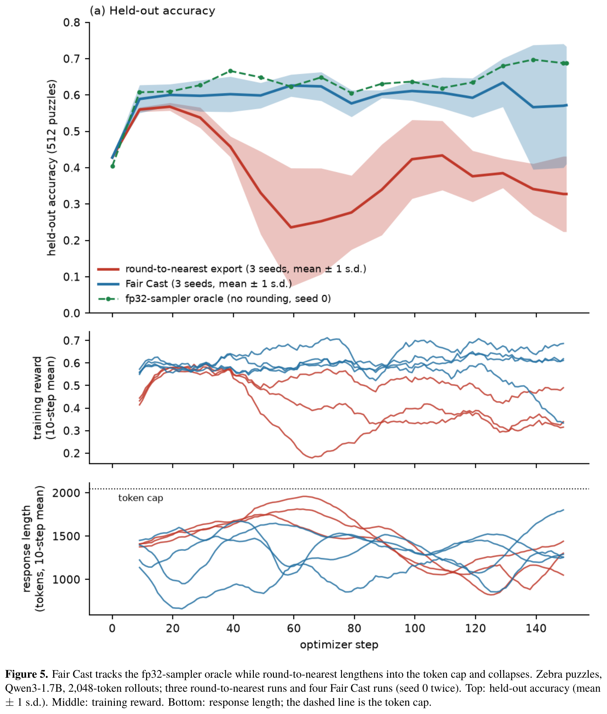

Figure 5：nearest 在 zebra 约 step 30 后 reward 与 held-out accuracy 同时下滑，response length 冲向 2,048 token cap；Fair Cast 大多跟随 fp32 oracle，但第四个 Fair Cast run 末段也 collapse，说明修复降低而非消灭优化不稳定性。

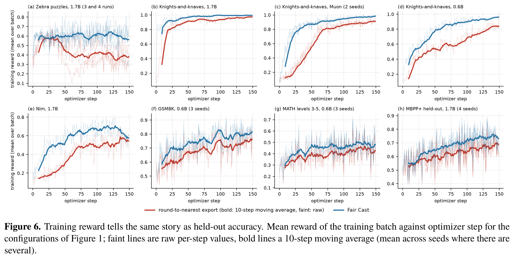

Figure 6：training reward 与 held-out 曲线大体同向，尤其 Muon 和 0.6B 设置的早期速度差明显；这反驳“只改变评估导出、训练本身没变”的解释。

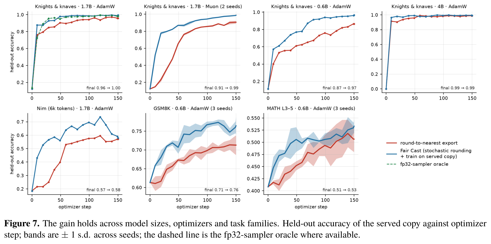

Figure 7：模型越小或 optimizer 更新越难跨 bf16 格点，Fair Cast 越早拉开；4B ceiling case 几乎重合，符合 dead-zone 分析而不是固定常数收益。

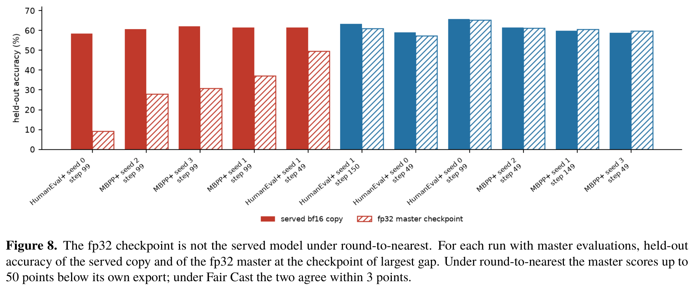

Figure 8：nearest 的 fp32 master 在最大 gap checkpoint 可比自己的 served bf16 低 50 points；Fair Cast 的两者始终在 3 points 内，说明训练曲线中的“模型”应指 served copy。

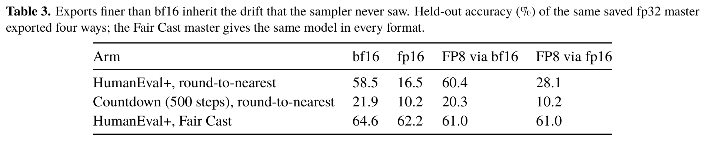

Table 3：nearest HumanEval+ 同一 master 导出为 bf16 得 58.5，fp16 仅 16.5；Fair Cast 为 64.6 与 62.2。更细格式暴露未被 sampler 验证的 master residual，不能默认精度越高越可靠。

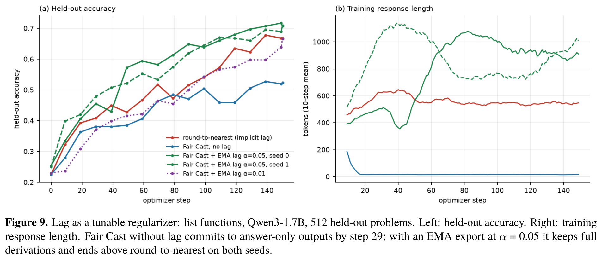

Figure 9：list functions 上 Fair Cast 无 lag 很快退化成只输出答案，最终 0.523；nearest 的隐式平滑达 0.668；显式 EMA $\alpha=0.05$ 达 0.707/0.709，说明需要的是可控 lag，不是 biased rounding 本身。

**消融告诉我们什么**：SR 与 EF 都可用，核心是“unbiased export + exact served forward”。FP16 只把 dead zone 缩小约 8 倍，tuned LR 会引入 collapse，TIS 修版本 lag 而非 rounding lag，可与 Fair Cast 叠加。

25 个 matched pair 的平均 +6.1 points 很有概括力，但分布并不均匀。长 rollout logic 与小模型贡献了大部分增益，4B ceiling case、短答案任务和某个 1.7B MATH endpoint 接近持平。它更像修复一种在特定数值尺度下加重的系统误差，而不是给所有 RL 任务附加固定涨点。迁移实验也只说明 Fair Cast checkpoint 在 AIME24、AMC23、MATH-500 至少不更差，不能单独证明泛化机制改变。

checkpoint 风险则独立于平均训练收益。即使某项任务最终 nearest 与 Fair Cast 分数接近，只要 fp32 master 与 bf16 served policy 不同，后续 fp16 部署、继续训练、量化校准都可能突然换成另一套行为。工程上应把“保存参数”与“保存已评估模型”分开：保存 master 用于 optimizer continuity，另保存或可重建 served artifact 用于复现实验曲线。

显式 EMA 的意义是把两种作用拆开。round-to-nearest 同时带来有偏滞后和低通平滑，无法知道哪一部分帮助了 list functions。Fair Cast 先移除数值偏差，再对 master 做 $m_t=(1-\alpha)m_{t-1}+\alpha\theta_t$，把平滑长度约 $1/\alpha$ 变成可解释参数。像先修准钟表，再按业务需要设置缓冲时间，而不是靠坏钟碰巧提供延迟。

**这些实验够不够支撑结论**：多任务、多个尺寸和 25 matched pairs 支持 export mismatch 是实际训练问题；但模型最大 4B、多个 arm 单 seed，128/512 题的 endpoint 小差值有 3–6 points 标准误，表中 1–3 points 不能逐项宣称显著。

## 6. 局限性

**作者自己承认的**：模型最多 4B；共享一个 training implementation；若干配置单 seed；尚不能预先判断哪些任务需要显式 lag。

**我的判断**：无偏 weight export 不保证 policy output 无偏，因为 transformer 是非线性函数。Fair Cast 的关键不是构造严格 unbiased policy-gradient estimator，而是消除跨步系统性 withholding，并让 sampling 与 differentiation 指向同一离散 copy。

SR 会让每步 2–15% served weights 变化，稀疏 delta sync 的压缩率下降 5–30 倍。通信受限的多机集群需要重新核算 wall-clock，而本文单 H100 共置 sampler/trainer 的 overhead 不能直接外推。

EF 需要每参数 fp32 residual；超大模型的 4 bytes/parameter 额外状态可能不可接受。SR 则引入随机数与可复现性管理，二者工程取舍不同。

**实验层面的不足**：没有 >4B、跨 framework 独立复现；多个小差值在单 seed 误差内；EMA lag 只在一个明显受益任务上调过。这些不放进 frontmatter 的方法局限。

还要注意论文把 sampler 与 trainer 共置在单张 H100、lag 设为 1。真实生产栈可能隔若干 optimizer steps 才同步一次权重，此时 version lag 与 rounding lag 会叠加。Fair Cast 只消除每次 export 内的系统性舍入滞后，不能代替版本控制、异步队列校正或 TIS；部署时应分别记录同步间隔、export rule 和 inference kernel 差异。

因此最小监控面板至少应同时画出：每步 served weight 变化率、master-served hidden ratio、trainer-sampler visible ratio、rollout 长度和 held-out accuracy。只看其中一条曲线，就像只看发动机转速判断整车是否沿正确方向行驶。

这也是本文最可复用的工程教训：训练状态、采样状态与部署状态必须分别命名、分别保存、分别评测。

## 7. 一句话总结

**训练哪个副本，就让哪个副本生成数据并计算梯度；高精度 master 只是账本，不是线上模型。** 类比门店定价：总部可以保留更多小数，但每次调价必须无偏地传到门店，并用门店实际价格评估销售反馈。

核心条件是：

$$
\boxed{\mathbb E[q_t]=\theta_t\quad\text{and}\quad y\sim\pi_{q_t},\ \nabla\log\pi_{q_t}(y)}
$$

## 8. 可复用点

- 在任何 optimizer-to-inference export 链路记录 master、served copy 和二者 policy log-ratio；不要只看 downstream trainer/sampler ratio。
- 低 learning rate 全参 RL 先测每步 changed served weights fraction。若长期低于 1%，检查是否进入量化 dead zone。
- 部署、恢复训练或更换精度前分别评估 fp32 master、训练时 bf16 export 和目标格式；不要把 checkpoint 文件名当作 model identity。
- 需要平滑时用显式 EMA export，把 lag 变成一个可调参数；不要依赖 round-to-nearest 的偶然低通滤波。

可跨任务复用的机制已抽为 [[../../../30 方法卡片/无偏权重导出与 served-copy 训练]]。

## 9. 我的疑问

- 在 70B 级 tensor-parallel 环境，SR RNG、通信与参数分片能否保持确定的无偏语义？
- LoRA adapter 单独服务时 dead zone 是否显著减弱，论文只给出预测，没有直接实验。
- 对不同 layer、weight magnitude 自适应选择 export precision，能否兼顾 unbiased movement 与 delta-sync 压缩？
- hidden ratio 能否在线触发 EMA lag，而不是人工为任务选 $\alpha$？
- 多步 nonlinear policy 下，weight unbiasedness 与 return bias 之间能否给出更紧的理论界？
